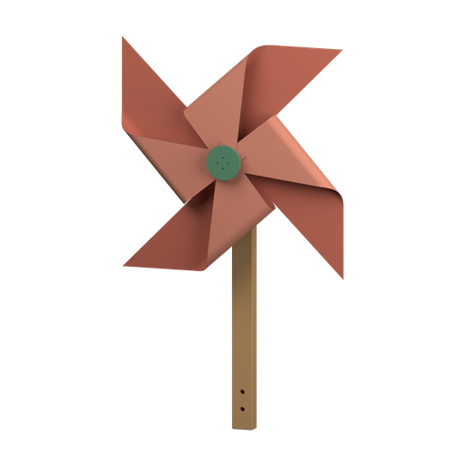

#  Crumb sweeper
background: 

Build a little sweeper with a turning brush and a removable crumb hopper.

> NOTE: These are proposed visuals, not audited artwork. Braced passages describe proposed diagrams; the completion paragraph describes a proposed working scene. This text prototype has no item artwork.
>
> NOTE: Keep the brush behind the hopper. The right ground wheel has an integral large gear, directly meshing with the smaller gear on the brush axle. Their opposite rotation sweeps crumbs forward from beneath the brush, up the hopper's low rear lip. Both wheels, both bearing blocks and the hopper are individually connected parts. Use a high view into the open body so both side fittings and the gear mesh remain visible. Nominal geometry, clearances and sweeping performance still need a physical model.

## `brush-page` The brush
background: 

**Goals**
- Slide the axle through the brush -- `brush`
- next: Fit the gear to the axle -- `brush`[`brush-gear`]
- next: Clip on a bearing
  - either: `brush`[`bearing-a`]
  - or: `brush`[`bearing-b`]
- next: Clip on the other bearing -- `brush`[`brush-gear`,`bearing-a`,`bearing-b`]

**Items**
- `roller` Brush

  {A short cream cylinder covered with stiff bristles. A flat-sided hole runs through its centre.}
- `shaft` Axle

  {A charcoal shaft with a flat-sided middle, a narrow round journal near each end, and a short flat-sided tip at the right. A shoulder and spring tongue flank the middle.}
- `brush-gear` Gear

  {A small red gear with a flat-sided centre hole and a retaining tongue.}
- `bearing-a` Bearing

  {A green mounting block with a round, narrow-mouthed clip on top and a retaining foot underneath.}
- `bearing-b` Bearing

  {A green mounting block with a round, narrow-mouthed clip on top and a retaining foot underneath.}
- `brush` Brush (compound)
  - unnamed slot: accepts `brush-gear`
  - unnamed slot: accepts `bearing-a`
  - unnamed slot: accepts `bearing-b`

  {The charcoal axle passes through the bristled roller. Its shoulder and spring tongue sit against opposite ends of the roller; short axle ends project beyond them.}

  [`brush-gear`] {A small red gear surrounds the axle's right tip.}

  [`bearing-a`] {A green bearing block clasps the round journal at the left end of the axle.}

  [`bearing-b`] {A green bearing block clasps the round journal at the right end of the axle, beside the red gear.}

**Combinations**
- `shaft` [consume] + `roller` [transform] -> `brush` (tutorial)

## `body-page` The sweeper
background: 

**Goals**
- Clip the brush into the body -- `sweeper`
- next: Fit the drive wheel -- `sweeper`[`drive-wheel`]
- next: Fit the other wheel -- `sweeper`[`plain-wheel`]
- next: Slide in the hopper -- `sweeper`[`hopper`]
- next: Clip on the handle -- `sweeper`[`drive-wheel`,`plain-wheel`,`hopper`,`handle`]

**Items**
- `body` Body

  {A compact open green shell. Two square mounting pockets flank a wide rear opening. Round wheel sockets sit on the outer sides. Short rails run along the front compartment; two handle clips stand at the back. A rounded skid runs beneath the front edge.}
- `drive-wheel` Drive wheel

  {A black rubber rim surrounds a cream wheel. A large red gear is fixed to its inner face; a short blunt spindle projects from the centre.}
- `plain-wheel` Wheel

  {A black rubber rim surrounds a cream wheel with a short blunt spindle at its centre.}
- `hopper` Hopper

  {A shallow cream tray with high sides, a low sloping rear lip and a small front pull tab. A flexible latch projects from its front edge.}
- `handle` Handle

  {A broad wooden arch with two short mounting feet.}
- `sweeper` Sweeper (compound)
  - unnamed slot: accepts `drive-wheel`
  - unnamed slot: accepts `plain-wheel`
  - unnamed slot: accepts `hopper`
  - unnamed slot: accepts `handle`

  {The brush spans the rear opening of the green shell. Its two bearing blocks sit in the square pockets, their retaining feet below the pocket rims. The small red gear projects into the open right side bay. Bristles extend slightly beneath the body.}

  [`drive-wheel`] {A rubber-rimmed wheel sits outside the body's right side. Its large red gear meets the smaller brush gear tooth to tooth in the open side bay.}

  [`plain-wheel`] {A second rubber-rimmed wheel sits outside the body's left side.}

  [`hopper`] {The cream tray fills the front compartment. Its low rear lip lies just ahead of the brush; its pull tab and latch remain exposed at the front.}

  [`handle`] {The wooden arch rises behind the brush, with one foot held in each rear clip.}

  [`drive-wheel`,`plain-wheel`,`hopper`,`handle`] The wheels roll forward. The large red gear turns the little gear the other way; the bristles flick crumbs up the lip into the hopper. A clear strip remains behind the brush.

**Combinations**
- `brush`[`brush-gear`,`bearing-a`,`bearing-b`] [consume] + `body` [transform] -> `sweeper`

## `ending` The End
background: 
