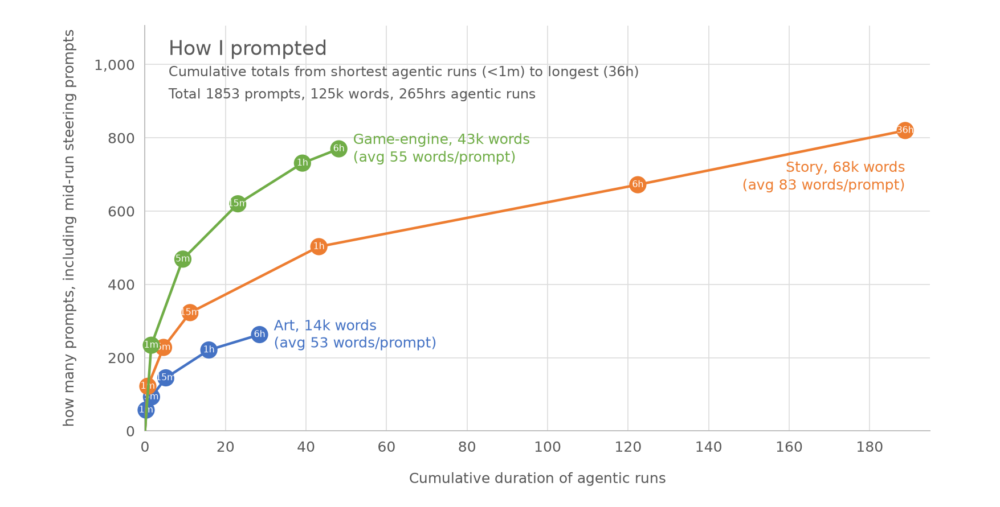

# How I prompted



The chart includes **1,853 human messages, 124,992 human-written words and 265.42 hours of agentic runs**. Those messages comprise **1,072 initial prompts and 781 mid-run steering prompts**. The 23 November 2026 refresh added later local Codex activity and project conversations from a ChatGPT export. A word audit then removed copied material from the two non-local sources.

Read each colored line from left to right. Runs are grouped by their duration, from shortest to longest; this is not a timeline. At each dot, the horizontal coordinate is the sum of the included runs' durations, in hours. The vertical coordinate is the number of human messages sent during those runs, including their initial prompts and all steering prompts.

The dots labeled **1m, 5m, 15m, 1h and 6h** include all runs strictly shorter than that threshold. Each successive dot includes everything in the previous one. The final **36h** dot includes all remaining runs; its label rounds the longest run, which actually lasted **36 hours, 20 minutes**. Art and Game-engine finish at the 6h dot because every timed run in those categories lasted less than six hours. The straight segments connect grouped totals; they do not describe individual runs between the dots. Both axes are linear.

A **run** is an interval of agent activity beginning with an initial human prompt and ending when the agent finishes responding, stops at a blocker or handoff, or is interrupted. A **steering prompt** is another human message sent while that run is still underway. It can clarify, correct, or add work. Every message counts once, and each run's duration counts once. A two-hour run containing an initial prompt and nine steers therefore contributes **10 messages and two hours**, not 20 hours.

Story's 1h dot is at **43.19 hours and 503 messages**, and its 6h dot is at **122.40 hours and 672 messages**. The difference is **38 runs, containing 38 initial prompts and 131 steers, taking 79.22 hours**. The average run in that band lasted about two hours and five minutes.

The three areas describe the work requested by each run's initial prompt. GPT-6 Luna classified the prompts using a shared rubric, with review of ambiguous and mixed cases. **Art** means illustrations and other visual assets. **Story** means narrative, educational content, authored combinations and story-specific design or evaluation. **Game-engine** means shared software, interface behavior, tooling and deployment; it also includes the small “other” category, such as retrospective analysis. Steers inherit their run's area even when they introduce another topic, so the colors do not divide time according to every activity actually performed.

| Area | Runs / initial prompts | Steering prompts | All human messages | Human-written words | Agentic hours |
|---|---:|---:|---:|---:|---:|
| Art | 141 | 122 | 263 | 14,035 | 28.46 |
| Story | 360 | 460 | 820 | 68,238 | 188.82 |
| Game-engine, including Other | 571 | 199 | 770 | 42,719 | 48.14 |
| **Total** | **1,072** | **781** | **1,853** | **124,992** | **265.42** |

The labels beside the final dots show each area's total words, rounded to the nearest thousand, and its **average words per human message**, including steers. Art's average is 14,035 ÷ 263 ≈ 53. The displayed word totals are rounded independently.

For local Codex, direct input is accepted as human writing. The attachment audit counts the author's own passages and excludes generated logs and unchanged source excerpts. For Dot and ChatGPT, the audit also checks the main message body for copied material. It excludes identifiable playtest reports, assistant replies and source excerpts while keeping the author's framing, feedback, drafts and previously authored text. Images and excluded text contribute zero words, and a message can still count if it has no words. App-generated wrappers, quoted assistant selections and clarification-question text are excluded. Words are sequences of letters or numbers, with internal apostrophes and hyphens kept within a word.

**Agentic duration is elapsed time, including tools, waiting and work added by steers.** It does not measure model compute time, human working time, or successful output. Finished, failed, blocked and interrupted runs can all contribute when their duration is known. Separate Codex conversations can run simultaneously, so summed hours can exceed the elapsed wall-clock period spent supervising them. Subagent time is not added separately. A steeper line means more human messages per agentic hour; it does not by itself establish better productivity or quality.

Codex supplies recorded turn timings from project conversations, including archived conversations and excluding subagent threads. Dot supplies a chronological message export. The ChatGPT export is a third source, recorded separately as `chatgpt`. For Dot and ChatGPT, Luna matched requests to closing replies, and elapsed time is estimated from the timestamps. Overlapping requests in a conversation were merged into continuous runs. The longest run was in Dot and combined overlapping requests and 97 steers.

| Source | Timed runs | Plotted human messages | Plotted human-written words | Agentic hours |
|---|---:|---:|---:|---:|
| Codex | 822 | 1,408 | 95,063 | 183.60 |
| Dot | 63 | 235 | 19,825 | 78.24 |
| ChatGPT | 187 | 210 | 10,104 | 3.58 |
| **Total** | **1,072** | **1,853** | **124,992** | **265.42** |

Runs without a usable ending or duration are excluded rather than assigned zero duration. This is a frozen summary of available project history, not a claim to recover deleted or unavailable conversations.

The retained data records each run's chronological `sequence`, source (`codex`, `dot` or `chatgpt`), area, initial prompt's word count and whole-run duration. Each steer has its own word count and delay in seconds from the initial prompt. Sequence numbers 1–1,072 give the initial-prompt order across the three sources. The file retains neither message wording nor absolute timestamps or original identifiers. [Dataset](sources/message-counts.json) · [Schema and chart commands](sources/README.md)

## Generating message-counts.json

Generating the JSON requires the original private conversations and a review pass. The retained `plot_message_counts.py` only reads the finished JSON and draws the chart; it does not extract conversations. The extraction and review scripts were removed during cleanup. The procedure below records how to rebuild their processing, rather than a command that is still available in this checkout. Recreating this exact frozen snapshot also requires its original input boundaries and reviewed attachment/category/response-boundary decisions; a fresh export or fresh model judgments can produce different results.

### Private inputs

- **Codex:** the local thread index, originally `~/.codex/state_5.sqlite`, its referenced rollout JSONL files, and referenced pasted-text attachments. Select top-level threads whose recorded working directory is this repository, including archived threads and excluding subagents. The original capture covered 95 conversations. Database and event schemas may need adapting for a newer export.
- **Dot:** the complete `dot-all-messages.csv` export, containing 793 messages: 241 human messages and 552 assistant messages. Read its sender, timestamp, main message text and reply metadata. The older `dots-conversation-data.csv` contains only 236 human messages and incomplete reply information; it cannot replace the full export for this procedure.
- **ChatGPT:** the `conversations-NNN.json` files in the account export, supplied as `more-dots.zip` for this refresh. Follow `current_node` through the conversation mapping's parent links to recover the selected branch. Read user text from the string parts of each message and ignore attachment contents. Keep assistant replies and adjacent reasoning recap timestamps as timing evidence. The export contained 961 ChatGPT conversations and 11 cloud Codex records.

Read these sources without modifying them. Freeze the input cutoff and file lengths before processing so an ongoing conversation cannot change halfway through extraction. Work in memory or disposable ignored scratch space under `runs/`; keep conversation text, absolute times, source IDs and review packets out of the retained output.

### Extract and review

1. **Build Codex runs from recorded turn boundaries.** Read `task_started`, `task_complete` and `turn_aborted` lifecycle events, and actual human messages from `item_completed` / `UserMessage` or legacy `user_message` events. Deduplicate by client message ID. The first human message in a turn is the initial prompt; subsequent human messages in that turn are steers. Exclude turns with no human message, system/context injections and subagent messages. Inspect missing or ambiguous boundaries rather than guessing how to group them. Use terminal `duration_ms / 1000` when available. Use terminal time minus turn-start time if the reported timer is missing or shorter than a recorded steer delay. An unfinished turn has no usable duration. Separate conversations remain separate runs even when their times overlap. On a refresh, include turns that closed after the previous cutoff if they were still untimed in the previous snapshot.

2. **Have Luna identify Dot response boundaries.** Give the classifier the full chronological conversation, with temporary message IDs, and ask which reply actually finishes each request. A substantive final delivery, a blocker or handoff that stops work, or an explicit interruption can end an interval. Acknowledgments and progress reports do not. Later human prompts do not automatically end earlier work, and unrelated background announcements must not extend it. Ask for the endpoint ID, outcome, confidence and a short reason; review uncertain matches and unusually long intervals. If no endpoint can be established, leave the duration unknown instead of using the last observed reply or the time of the next prompt.

3. **Merge Dot intervals into runs.** Sort resolved request intervals by their initial human-message time and merge overlapping intervals, including chains of overlaps. Each merged run starts at its earliest initial prompt and ends at its latest matched endpoint. Its duration is that difference, counted once. Assign each human message in the half-open interval `[start, end)` exactly once: the first is the initial prompt and every later one is a steer, including a new task arriving while Dot is working. An unresolved request arriving inside a known run still counts as a steer; one outside all known intervals remains untimed. Intervals that merely meet at an interruption boundary remain separate. Do not sum the individual overlapping request durations.

4. **Count each human message separately.** For Codex, trust direct input and review the exact contents of pasted-text attachments. Bind temporary attachment decisions to content hashes and character spans so changed or new text gets reviewed. For Dot and ChatGPT, exclude attachment contents and review every retained message body for copied passages. Luna suggested passages to check, and the review verified attribution and boundaries against earlier replies or source material where available. Keep uncertain passages and the author's own reused wording. Apply the review to prompts and steers of every length. Remove app-generated wrappers and previews, count only answer strings in clarification replies, and count only the user's comments and request in response annotations. Images contribute zero words. Use this tokenizer.

   ```python
   import re

   def count_words(text):
       return len(re.findall(r"[^\W_]+(?:['’\-][^\W_]+)*", text))
   ```

   Count accepted text passages separately and sum them for each message. Keep zero-word messages when they belong to a timed run. The non-local audit removed **2,043 words from 22 of 445 counted messages**, including 1,359 words from one playtest report. After the audit, 53 Dot messages and 27 ChatGPT messages still contain more than 100 human-written words.

5. **Classify each run's initial prompt with Luna.** Use the Art / Story / Game-engine / Other definitions above. Supply enough preceding conversation and relevant attachment context to interpret brief continuations or approvals. Choose one primary area for mixed requests and review ambiguous cases. Fold Other into `game-engine` for export. All steers inherit the initial prompt's area; neither messages nor hours are split between areas. Both category classification and Dot boundary review originally used GPT-6 Luna.

For the refresh, Luna screened local conversations and account export candidates using titles and prompt excerpts. The account screen covered conversations active during the project period beginning 25 October, with explicit project matches eligible regardless of date. Checkout location supplied context for local threads. Keep prompts about Make Something Worthwhile, including its earlier prototypes and project support work, and review uncertain associations. The cloud Codex records did not establish a link to this project. The update retained additions from 26 local conversations and 22 ChatGPT conversations.

For ChatGPT, apply the same semantic matching and overlapping-interval rules as for Dot, within each conversation. Use the matched visible reply's exported time, or the associated reasoning recap's time when it is later. This accounts for cases where the export stamped the reply before reasoning ended. The resulting durations are estimates because the export has no end-of-turn stopwatch. Exclude unmatched messages outside a known run, including image deliveries whose response timestamp is absent. Before merging, check the selected branch's user IDs and compare normalized texts and send times with previously counted messages. The refresh found no overlapping messages among the selected ChatGPT additions.

### Export and check

Keep source IDs and absolute times only in the private intermediate representation. Drop runs without a usable duration, then sort across sources by **initial human-message arrival time**. For the refresh, the original start order was recovered from the private source records so earlier ChatGPT runs could be inserted chronologically. Assign consecutive `sequence` values beginning at 1 before discarding the timestamps. Use the following [JSON fields](sources/README.md).

- `sequence`, `source`, `area`, the initial message's `word_count`, and whole-run `duration_seconds`;
- an arrival-ordered `steers` array, with each steer containing its own `word_count` and `delay_seconds = steer_arrival - initial_prompt_arrival`, expressed in seconds.

Write a single JSON array to `sources/message-counts.json`. Build these records from an explicit field allowlist, so no private fields leak through. Preserve measured durations and delays rather than rounding them to the chart's labels. Do not distribute a run's total words across its steers: use each message's independently counted words.

Check that every retained human message belongs to exactly one run, sequence numbers are consecutive, counts are nonnegative integers, and durations and delays are finite and nonnegative. Each run's steer delays must be ordered and no greater than its duration; investigate discrepancies in the source rather than clipping them. Reconcile messages as `sum(1 + len(run["steers"]))`, words as initial words plus all steer words, and hours as summed run durations divided by 3,600.

The 11 November baseline contained **597 runs, 1,260 messages, 94,729 words and 213.94 hours**. The 23 November refresh added 288 local Codex runs with 95 steers and 187 ChatGPT runs with 23 steers. One open local run and 12 ChatGPT messages without usable timings stay outside the refreshed totals. The new source and area breakdowns are shown above. Run the chart commands to validate the retained schema and bucket totals, then remove disposable private processing material. [Redraw the chart](sources/README.md#redraw-the-chart)

For implementation reference, the earlier Codex extractor and word-count code can still be inspected in Git without restoring conversation data:

```sh
git show 50d69cd9:projects/retrospective/build_dataset.py
git show 50d69cd9:projects/retrospective/word_counts.py
```

Those historical scripts produced intermediate CSVs and depended on the original attachment audit. Use them as a reference for Codex extraction. The Dot and ChatGPT steps and the anonymous JSON export are documented above.
