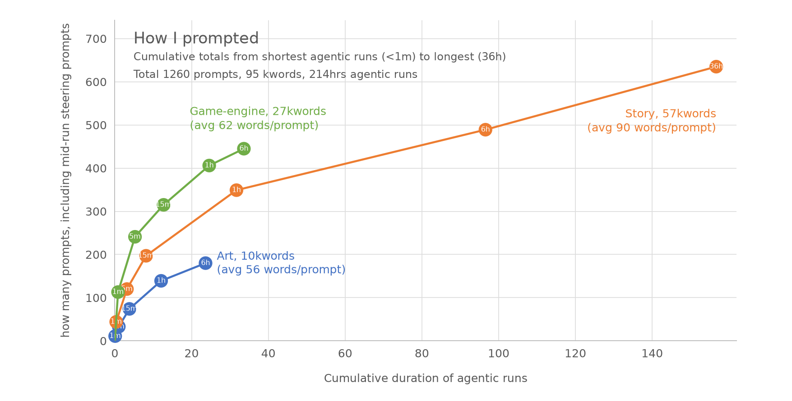

# How I prompted

The chart includes **1,260 human messages, 94,729 human-written words and 213.94 hours of agentic runs**. Those messages comprise **597 initial prompts and 663 mid-run steering prompts**. The totals subtitle rounds words to thousands and duration to hours: **Total 1260 prompts, 95 kwords, 214hrs agentic runs**.

Read each colored line from left to right. Runs are grouped by their duration, from shortest to longest; this is not a timeline. At each dot, the horizontal coordinate is the sum of the included runs' durations, in hours. The vertical coordinate is the number of human messages sent during those runs, including their initial prompts and all steering prompts.

The dots labeled **1m, 5m, 15m, 1h and 6h** include all runs strictly shorter than that threshold. Each successive dot includes everything in the previous one. The final **36h** dot includes all remaining runs; its label rounds the longest run, which actually lasted **36 hours, 20 minutes**. Art and Game-engine finish at the 6h dot because every timed run in those categories lasted less than six hours. The straight segments connect grouped totals; they do not describe individual runs between the dots. Both axes are linear.

A **run** is an interval of agent activity beginning with an initial human prompt and ending when the agent finishes responding, stops at a blocker or handoff, or is interrupted. A **steering prompt** is another human message sent while that run is still underway. It can clarify, correct, or add work. Every message counts once, and each run's duration counts once. A two-hour run containing an initial prompt and nine steers therefore contributes **10 messages and two hours**, not 20 hours.

For example, Story's 1h dot is at **31.69 hours and 349 messages**; its 6h dot is at **96.56 hours and 489 messages**. The difference is **30 runs, containing 30 initial prompts and 110 steers, taking 64.88 hours**. Those 140 messages did not each start an independent one-to-six-hour run. The average run in that band lasted about two hours and ten minutes.

The three areas describe the work requested by each run's initial prompt. GPT-6 Luna classified the prompts using a shared rubric, with review of ambiguous and mixed cases. **Art** means illustrations and other visual assets. **Story** means narrative, educational content, authored combinations and story-specific design or evaluation. **Game-engine** means shared software, interface behavior, tooling and deployment; it also includes the small “other” category, such as retrospective analysis. Steers inherit their run's area even when they introduce another topic, so the colors do not divide time according to every activity actually performed.

| Area | Runs / initial prompts | Steering prompts | All human messages | Human-written words | Agentic hours |
|---|---:|---:|---:|---:|---:|
| Art | 72 | 108 | 180 | 10,069 | 23.63 |
| Story | 221 | 414 | 635 | 57,292 | 156.69 |
| Game-engine, including Other | 304 | 141 | 445 | 27,368 | 33.62 |
| **Total** | **597** | **663** | **1,260** | **94,729** | **213.94** |

The labels beside the final dots show each area's total words, rounded to the nearest thousand, and its **average words per human message**, including steers. For example, Art's average is 10,069 ÷ 180 ≈ 56. The displayed word totals are rounded independently.

Words entered directly in messages are trusted as human writing. Codex pasted-text attachments were audited: human-authored text is included, generated diagnostic logs and unchanged manuscript excerpts are excluded, and mixed attachments contribute only the reviewed human-written passages. Dot counts only the exported main message text, excluding all attachment contents. Images contribute no words; an image-only message can still count as a message. App-generated wrappers, quoted assistant selections and clarification-question text are excluded. Words are sequences of letters or numbers, with internal apostrophes and hyphens kept within a word. Repeated submissions count again; these are communicated words, not unique keystrokes.

**Agentic duration is elapsed time, including tools, waiting and work added by steers.** It does not measure model compute time, human working time, or successful output. Finished, failed, blocked and interrupted runs can all contribute when their duration is known. Separate Codex conversations can run simultaneously, so summed hours can exceed the elapsed wall-clock period spent supervising them. Subagent time is not added separately. A steeper line means more human messages per agentic hour; it does not by itself establish better productivity or quality.

Codex supplies recorded turn durations from project conversations, including archived conversations and excluding subagent threads. Dot supplies a full chronological message export. Luna matched its requests to the replies that finished them; overlapping request intervals were merged into continuous runs because a new request arriving while Dot was working counts as steering. Dot's merged runs do not overlap. The longest run combines overlapping requests and 97 steers; it is not 36 hours spent responding to a single isolated message.

| Source | Timed runs | Plotted human messages | Plotted human-written words | Agentic hours |
|---|---:|---:|---:|---:|
| Codex | 534 | 1,025 | 74,733 | 135.70 |
| Dot | 63 | 235 | 19,996 | 78.24 |
| **Total** | **597** | **1,260** | **94,729** | **213.94** |

Runs without a usable ending or duration are excluded rather than assigned zero duration. This is a frozen summary of available project history, not a claim to recover deleted or unavailable conversations.

The retained data is [sources/message-counts.json](sources/message-counts.json). Each run records its chronological `sequence`, source (`codex` or `dot`), area, initial prompt's word count and whole-run duration, plus an ordered list of steers. Every steer has its own word count and its delay in seconds from the initial prompt. These relative delays let the steering pattern be examined without retaining dates or clock times. The data contains no message wording, timestamps, original message IDs or conversation IDs. Runs are listed in initial-prompt order, with sequence numbers 1–597 spanning both sources; the chart continues to group them by duration. The [source guide](sources/README.md) explains the nested format and how to reproduce the chart.
