# 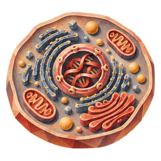 Anatomy — Four-chapter art sample

Explore four illustrated chapters: a cell boundary, bones and muscles, hearing, and digestion. They play consecutively in this sample.

> NOTE: Generated by checks/build-samples.ts from this theme’s full anatomy.md. Original chapter numbers: 1, 4, 8, 18. See the shared Anatomy design brief.

## `cell-boundary` An inside of its own
background: 

A cell has an inside that differs from its surroundings. Begin with the outer membrane and a smaller enclosure for its DNA. Bring those two constructions together.

**Goals**
- Build the cell's outer enclosure -- `opening-cell`
- Enclose DNA in a nucleus -- `opening-nucleus`
- next: Put the nucleus inside the outer boundary -- `opening-cell`[`opening-nucleus`]

**Items**
- `prelude-phospholipids` Membrane fats (lipids)
  - icon: 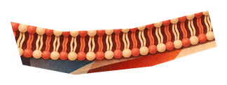 (center 280px, 700px)
  {Small molecules have water-facing heads and water-avoiding tails.}
- `prelude-water` Water
  - icon: 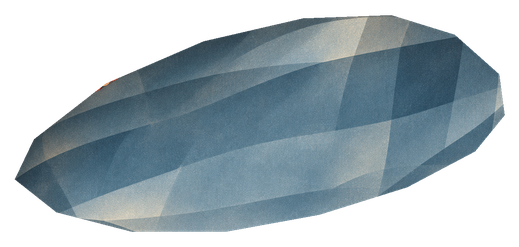 (center 780px, 700px)
  {A clear volume of water, with enlarged water molecules beside it.}
- `opening-dna` DNA
  - icon: 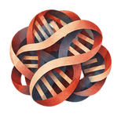 (center 1280px, 700px)
  {Coiled strands carry coloured units, with a short label: “instructions for making proteins.”}
- `opening-nuclear-envelope` Nuclear envelope
  - icon: 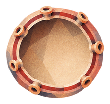 (center 280px, 1090px)
  {A rounded double membrane surrounds an open central space. Small pores cross its wall.}
- `opening-nucleus` Nucleus
  - icon: 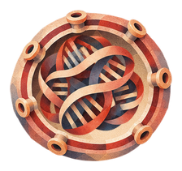
  {DNA sits inside its envelope. A small RNA strand leaves a pore, labelled “a copy of one DNA instruction.”}
- `opening-cell` Membrane bag (compound)
  - icon: 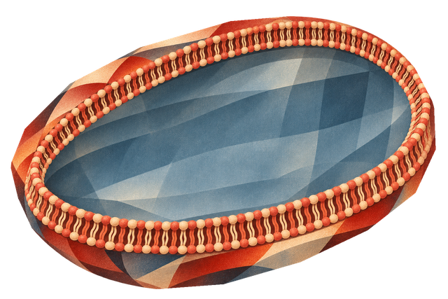
  - unnamed slot: accepts `opening-nucleus`, icon: 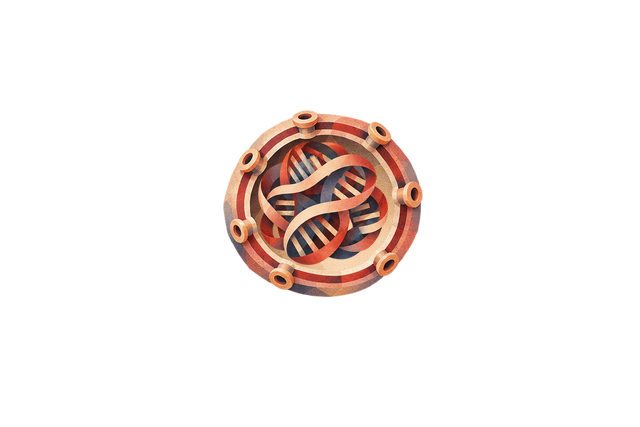
  {A closed lipid membrane encloses water. A cutaway keeps the rear surface visible; its enlarged edge shows water-facing heads on both sides and tails meeting within the wall.}

  A boundary makes an inside and an outside. A living cell needs much more than a bag.
- `opening-cell`
  [`opening-nucleus`] {The nucleus sits in the enclosed fluid. DNA remains inside its own smaller envelope.}

**Combinations**
- `prelude-phospholipids` [consume] + `prelude-water` [consume] -> `opening-cell` (tutorial)
- `opening-dna` [consume] + `opening-nuclear-envelope` [consume] -> `opening-nucleus`

> NOTE: Three operations, two independent starting constructions. This is a textbook reconstruction, not a recipe for manufacturing life. The cell's later function includes ordinary cytosol, enzymes and supporting machinery. The nuclear envelope includes pores and associated proteins. The early model shows DNA's location and the physical source of the RNA used next. No nutrient, ATP, water-flow event or activated status is a compound slot. Only persistent physical structures are fitted. Closed lipid vesicles: https://pmc.ncbi.nlm.nih.gov/articles/PMC1434845/ ; OpenStax A&P 3.1. Ordinary school scope: curriculum.md.

## `full-strong-and-movable` Hard bones and pulling muscles
background: 

Explore the arm's anatomical model. Build its front or back using the same kind of muscle cells, and add mineral to the bone at each attachment—in either order. The biceps bends the elbow; the triceps straightens it.

**Goals**
- Build the biceps and strengthen its bone attachment -- `arm-front-tendons`[`school-bone-mineral`,`prelude-myoblasts`]
- Build the triceps and strengthen its bone attachment -- `arm-back-tendons`[`school-bone-mineral`,`prelude-myoblasts`]

**Hotspots**
- `arm-front-tendons` (center 780px, 1688px)
  - hitbox: (center 590px, 1050px) (size 330px, 1200px)
- `arm-back-tendons` (center 780px, 1688px)
  - hitbox: (center 825px, 1080px) (size 210px, 1160px)

**Items**
- `prelude-myoblasts` Muscle cells
  - icon: 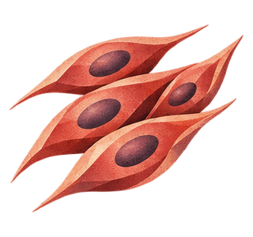
  {Separate elongated muscle cells contain parallel protein fibres. This supply includes enough cells for both arm regions.}

- `school-bone-mineral` Bone mineral
  - icon: 
  {Calcium-phosphate crystals beside a hard mineral chip. A pressing arrow shows resistance to compression.}
- `arm-front-tendons` Front of arm (compound)
  - icon: 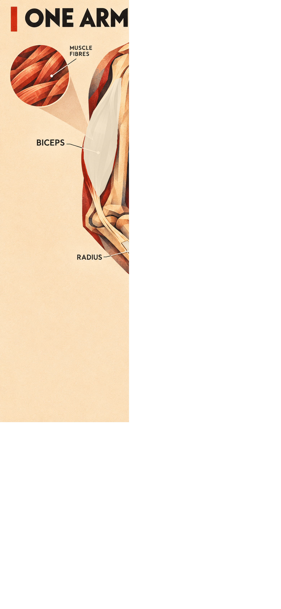
  - slot: Bone mineral, accepts `school-bone-mineral`, icon: 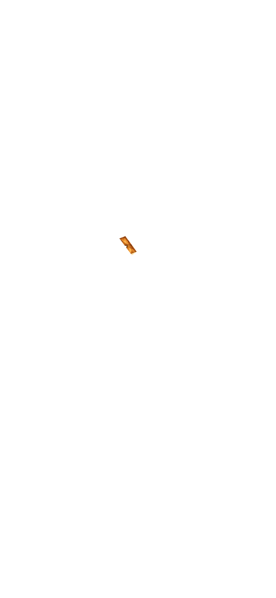
  - slot: Biceps, accepts `prelude-myoblasts`, icon: 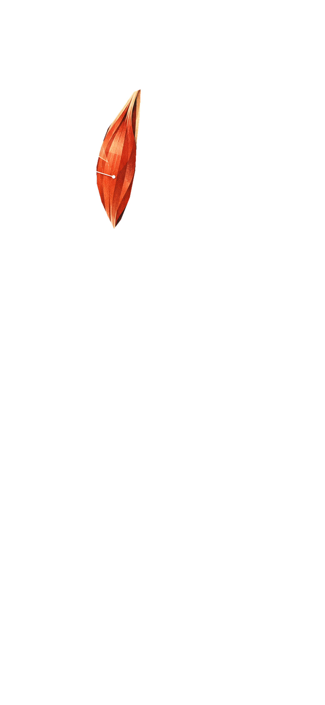
  {The front receiving region belongs to one arm cutaway. Tendons run from the shoulder blade to the radius, one of the forearm bones, across a space for the biceps. A window into the radius shows living cells and vessels in tough protein fibres awaiting mineral. The elbow's cartilage, capsule and ligaments are already present.}
- `arm-front-tendons`
  [`school-bone-mineral`] {Mineral now fills spaces among the radius's bone fibres. The mineral stays inside this bone window; the tendons and joint cartilage stay soft. Any biceps already built remains attached.}
- `arm-front-tendons`
  [`prelude-myoblasts`] {A biceps muscle fills the front region between its tendons. Its cutaway shows muscle fibres grouped in connective tissue continuous with the tendons. A small time strip shows separate muscle cells joining and growing into long fibres. A pull arrow crosses in front of the elbow; a curved arrow shows bending. The radius's mineral state is unchanged.}

  The biceps pulls across the front of the elbow, bending it. Mineral hardens the bone that its tendon pulls on.
- `arm-back-tendons` Back of arm (compound)
  - icon: 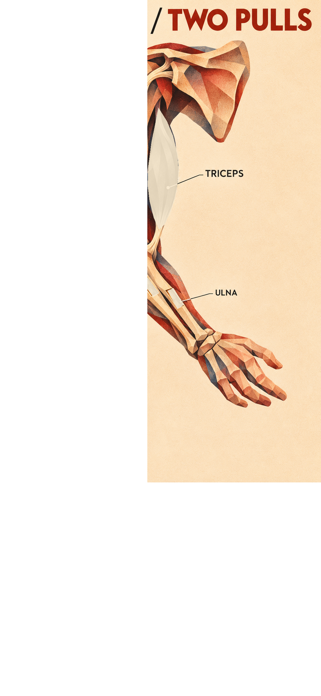
  - slot: Bone mineral, accepts `school-bone-mineral`, icon: 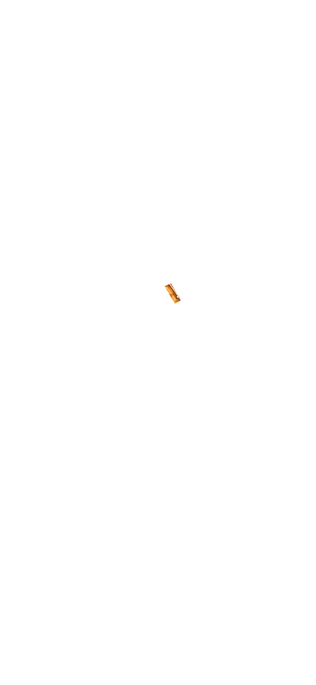
  - slot: Triceps, accepts `prelude-myoblasts`, icon: 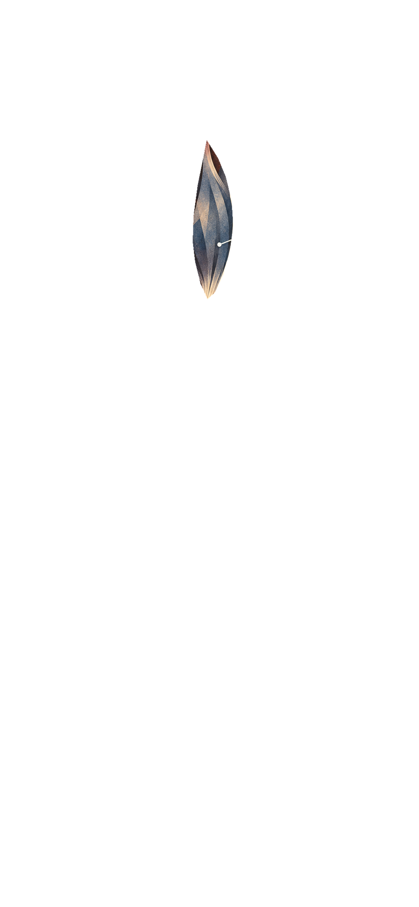
  {The back receiving region belongs to the same arm. Tendons run from the shoulder blade and upper-arm bone to the back of the ulna, the other forearm bone, across a space for the triceps. A separate window into the ulna shows living bone tissue awaiting mineral. The shared shoulder and upper-arm bones are supplied; they are not a second skeleton.}
- `arm-back-tendons`
  [`school-bone-mineral`] {Mineral fills spaces among the ulna's bone fibres. The tendons and joint surfaces stay soft. Any triceps already built remains attached; the front region is unchanged.}
- `arm-back-tendons`
  [`prelude-myoblasts`] {A triceps muscle fills the back region between its tendons. The same kind of muscle cells has formed long fibres within connective tissue. The pull arrow passes behind the elbow; a curved arrow shows straightening. The ulna's mineral state is unchanged.}

  The triceps pulls behind the elbow, straightening it. The attachments give the same kind of pulling cells a different effect.

> NOTE: Four implicit fittings into two fixed anatomical regions. Both regions accept the same Bone mineral and Muscle cells identities; each material remains available until both required sites have received it. Each region permits mineral before or after muscle, and the projects can be interleaved. These are two connected regions of one arm, not free-standing collections or two complete arms. The front mineral window is in the radius and the back window is in the ulna, so the same shared bone is not mineralized twice. Supplied shoulder/upper-arm anatomy is already mineralized. Ordinary joint tissues, nerves and blood vessels remain included. Neither mineral nor muscle is added to the joint space.

> NOTE: The precursor population supplies enough cells for both muscle regions. Cell fusion, growth and organization occur over the illustrated interval; a drag is not literal transplantation or a claim that adult tendons precede muscle development. This is the return from embryonic examples to textbook reconstruction. Each fixed region remains the same object as its parts are fitted; no replacement state or completion token is needed. The final assembly re-presents this completed arm at model scale. [OpenStax A&P 6.3](https://openstax.org/books/anatomy-and-physiology-2e/pages/6-3-bone-structure) grounds mineral in bone matrix; [10.2](https://openstax.org/books/anatomy-and-physiology-2e/pages/10-2-skeletal-muscle) grounds muscle fibres and tendon continuity; [11.5](https://openstax.org/books/anatomy-and-physiology-2e/pages/11-5-muscles-of-the-pectoral-girdle-and-upper-limbs) grounds the selected attachments. Biceps and triceps are a representative opposing pair, not the arm's only muscles.

## `full-hearing` Vibration into signals
background: 
A voice begins as moving air. Build the route that passes those vibrations inward and the delicate cells that detect them. The brain receives nerve signals from the ear.

**Goals**
- Carry vibrations from the ear canal inward -- Sound-conducting ears
- Build the inner ear's sensing tissue -- Vibration-sensitive inner ears
- next: Join the ears to their hearing nerves -- Ears

**Items**
- Outer ears and canals
  - icon: 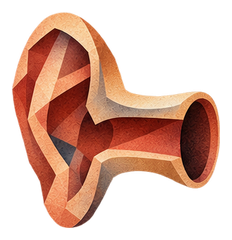 (center 280px, 700px)
  {The outer ears lead into narrow canals, shown in cutaway.}
- Eardrums
  - icon: 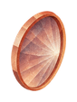 (center 780px, 700px)
  {Thin membranes stretch across the ends of the canals; a vibrating edge is shown in two positions.}
- Outer ears with eardrums
  - icon: 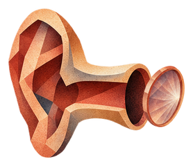
  {An ear canal ends at its vibrating membrane.}
- Middle-ear bones
  - icon: 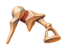 (center 1280px, 700px)
  {Three tiny linked bones form a chain from the eardrum toward the inner ear.}
- Sound-conducting ears
  - icon: 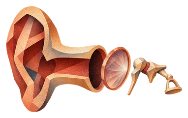
  {Movement arrows pass from air to eardrum to the chain of tiny bones.}
  The eardrum moves the tiny bones. Their movement pushes on the fluid-filled inner ear.
- Coiled inner-ear chambers and fluid
  - icon: 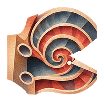 (center 280px, 1090px)
  {Two coiled chambers contain fluid. A small membrane at each entrance moves inward while another bows outward.}
- Hearing cells with tiny hairs
  - icon: 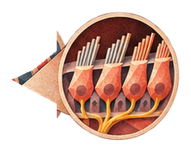 (center 780px, 1090px)
  {A located cochlear enlargement shows sensory cells attached to the moving tissue partition, with short hair bundles and nerve connections. Relative movement between this tissue and its overlying structures bends the bundles; the cells do not float freely in fluid.}
- Vibration-sensitive inner ears
  - icon: 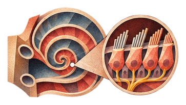
  {Movement arrows pass through fluid inside the coil and move its tissue partition. A magnified inset shows the attached sensory cells, relative movement bending their hair bundles, and changed signals at their nerve connections.}
  Tiny movements bend the hearing cells' hairs. That changes the signals passed to nerves.
- Sound-receiving ears
  - icon: 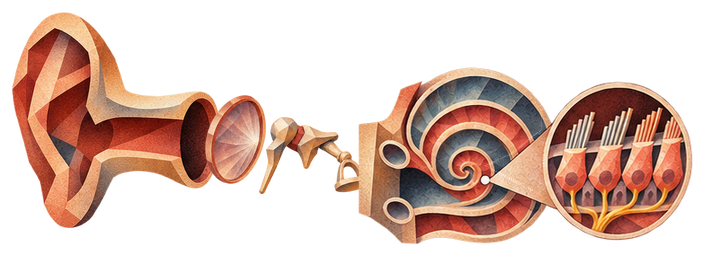
  {The outer ear, eardrum, bone chain and fluid-filled coil share one continuous cutaway.}
- Hearing pathways
  - icon: 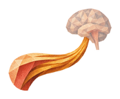 (center 1280px, 1090px)
  {Nerve fibres lead from the hearing cells toward the brain.}
- Inner ears with hearing pathways
  - icon: 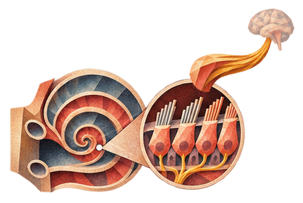
  {The hair-bearing sensory tissue inside the fluid-filled coils joins nerve fibres leading toward the existing brain. The sound-conducting outer parts remain outlined.}
- Ears
  - icon: 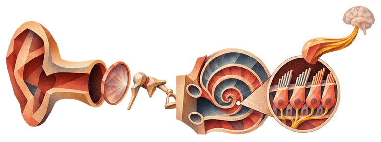
  {The local ear cutaways retain outer ears, eardrums, tiny bones and sensing coils. Vibration arrows lead inward; signal arrows then follow hearing nerves toward the faint outline of the existing brain.}
  A voice arrives as moving air. The ear passes those vibrations inward, and its sensory cells send information along nerves.

**Combinations**
- Outer ears and canals [transform] + Eardrums [consume] -> Outer ears with eardrums
- Outer ears with eardrums [transform] + Middle-ear bones [consume] -> Sound-conducting ears
- Coiled inner-ear chambers and fluid [transform] + Hearing cells with tiny hairs [consume] -> Vibration-sensitive inner ears
- Sound-conducting ears [transform] + Vibration-sensitive inner ears [consume] -> Sound-receiving ears

- Vibration-sensitive inner ears [transform] + Hearing pathways [consume] -> Inner ears with hearing pathways
- Sound-conducting ears [transform] + Inner ears with hearing pathways [consume] -> Ears
- Sound-receiving ears [transform] + Hearing pathways [consume] -> Ears

> NOTE: Five required actions retain independent sound-conducting and sensory anatomy. Hearing nerves may join the inner-ear tissue before or after the outer/middle structures join it. The finished local cutaway shows the connection to existing brain pathways; it never installs ears or a hearing-status object into a whole-body tile. Ordinary surrounding tissues and the central ends of the existing hearing nerves are included, rather than constructed a second time. The coiled chamber is the cochlea; its name, named ossicles, basilar/tectorial membranes, ionic channels and auditory nuclei are not required vocabulary. The sensory-tissue input includes its supporting cells, membranes and attachments. There is no separate strip or opposing-membrane operation: the player follows sound transmission, fluid movement, hair bending and nerve signals, not the mechanics of the cochlear partition. The two small membranes at the chamber entrance represent oval- and round-window movement. Relative motion within the cochlear partition bends stereocilia, altering hair-cell transmitter release to auditory nerve fibres; the hair cells do not themselves send action potentials along the nerve. This source-grounded explanation remains author background, while the short pictured sequence shows the selected movement-to-signal relationship. Worth: one signal crosses air, membrane, bone and fluid before becoming nerve activity. Source: OpenStax [14.1 Sensory Perception](https://openstax.org/books/anatomy-and-physiology-2e/pages/14-1-sensory-perception).

## `full-nutrition-meal` Breaking down a meal
background: 
A bite of food contains molecules too large to pass through the gut lining. The digestive tube’s glands supply different juices. Explore what their juices do to starch, protein and fat; water and normal digestive conditions are included in each sample.

**Goals**
- Break starch and protein into small molecules
  - both: Meal glucose
  - and: Meal amino acids
- Spread fat into smaller droplets -- Small fat droplets
- next: Break fat molecules into smaller ones -- Fat digestion products

**Items**
- Starchy food
  - icon: 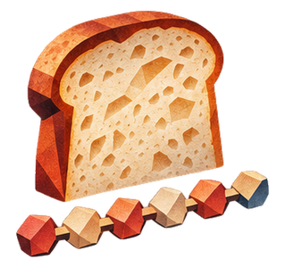 (center 280px, 700px)
  {Bread beside an enlarged starch molecule: many linked glucose units.}
- Saliva
  - icon:  (center 780px, 700px)
  {Saliva around chewed bread. A small enzyme shape fits against a starch chain.}
- Shorter starch chains
  - icon: 
  {Several short sugar chains beside the longer starch chain they came from.}
- Digestive enzymes
  - icon: 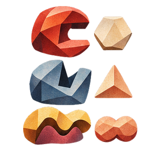 (center 1280px, 700px)
  {Different enzyme shapes fit starch chains, protein chains and fat molecules. A label reads “different enzymes break different bonds.”}
- Meal glucose
  - icon: 
  {Separate glucose units beside the starch chain they came from.}
  Digestion releases small molecules from larger food molecules. Glucose can cross the intestinal lining.
- Protein food
  - icon: 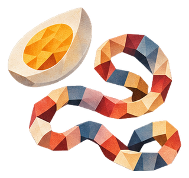 (center 280px, 1090px)
  {A piece of egg beside a folded chain of differently coloured amino acids.}
- Meal amino acids
  - icon: 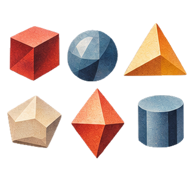
  {Separate amino acids beside the protein chain they came from.}
- Fat food
  - icon:  (center 780px, 1090px)
  {Large fat droplets mixed with watery food inside the intestine.}
- Bile
  - icon: 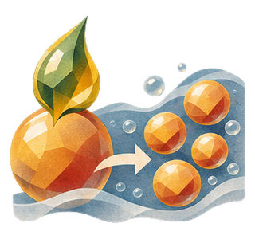 (center 1280px, 1090px)
  {Bile spreading one large fat droplet into many smaller droplets. An enlarged fat molecule stays unchanged.}
- Small fat droplets
  - icon: 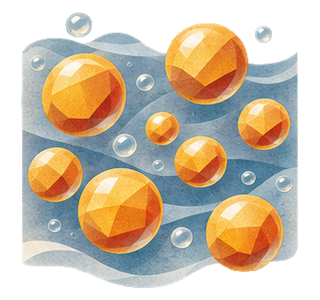
  {Many small droplets have more exposed surface than the single large droplet beside them.}
- Fat digestion products
  - icon: 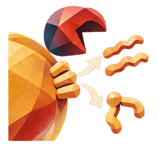
  {An enzyme at a droplet's surface; enlarged fat molecules split into smaller pieces.}
  Bile spreads fat out. Enzymes then break its molecules apart: two different jobs.

**Combinations**
- Starchy food [transform] + Digestive enzymes [preserve] -> Meal glucose
- Fat food [transform] + Digestive enzymes [preserve] -> Fat digestion products
- Starchy food [transform] + Saliva [preserve] -> Shorter starch chains
- Shorter starch chains [transform] + Digestive enzymes [preserve] -> Meal glucose
- Protein food [transform] + Digestive enzymes [preserve] -> Meal amino acids
- Fat food [transform] + Bile [preserve] -> Small fat droplets
- Small fat droplets [transform] + Digestive enzymes [preserve] -> Fat digestion products

> NOTE: Direct starch digestion by the supplied enzyme collection and fat hydrolysis before bile are also allowed. Bile is not chemically required for every individual fat bond to be hydrolysed; it increases the accessible surface, so the visible droplet-making goal remains distinct. The simplified endpoints compress different rates and complete digestion under the included normal conditions.

> NOTE: Five food transformations remain; three gland fittings have been removed. The gland-and-duct anatomy is bundled into the supplied digestive tube, leaving its real vein fitting for the later connection. The enzyme collection contains the different gastric, pancreatic and intestinal enzymes appropriate to each sample, not one universal enzyme. Water, normal temperature and acidity, and elapsed digestion are included; the visible juices supply the selected catalysts or dispersing material. Bile disperses fat without breaking its molecules. The colon's outer muscle is present but its inner wall is explicitly unfinished until the colon chapter. Grounding: [OpenStax 23.2](https://openstax.org/books/anatomy-and-physiology-2e/pages/23-2-digestive-system-processes-and-regulation), [23.7](https://openstax.org/books/anatomy-and-physiology-2e/pages/23-7-chemical-digestion-and-absorption-a-closer-look). Worth: physical dispersal and chemical breakdown do different jobs.

> NOTE: Illustration scope: locate saliva in the mouth, acid/protein digestion in the stomach and bile/pancreatic enzymes in the small intestine. The mixed enzyme supply represents distinct catalysts at their appropriate sites, not a single juice acting everywhere under one condition. Use separate labelled magnifications connected to one tract locator.

## `art-sample-finish` Four chapters complete
background: 

You have built a cell boundary, fitted bone and muscle, connected an ear, and broken down a meal. This is the end of the four-chapter artwork sample.
