# 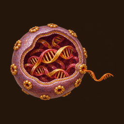 Anatomy

Build an anatomy and physiology textbook, one combination at a time: cells, tissues, organs and systems. Discover how their structures make movement, exchange, regulation and renewal possible.

> NOTE: Grades 9–10 ordinary biology, non-AP/non-Honors. The active brief and curriculum.md define the audience, taught terms and limited advanced exceptions. These are explanatory reconstructions of selected processes and mature anatomical cutaways, not manufacture of life, surgery or a complete developmental timeline. Braces describe planned illustrations. No graphics or screenshot tests.

## `cell-boundary` An inside of its own
background: 

A cell has an inside that differs from its surroundings. Begin with the outer membrane and a smaller enclosure for its DNA. Bring those two constructions together.

**Goals**
- Build the cell's outer enclosure -- `opening-cell`
- Enclose DNA in a nucleus -- `opening-nucleus`
- next: Put the nucleus inside the outer boundary -- `opening-cell`[`opening-nucleus`]

**Items**
- `prelude-phospholipids` Membrane fats (lipids)
  - icon: 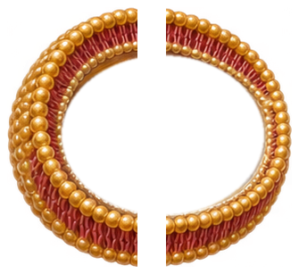 (center 400px, 1630px)
  {Small molecules have water-facing heads and water-avoiding tails.}
- `prelude-water` Water
  - icon: 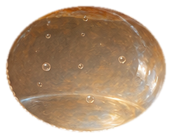 (center 1160px, 1630px)
  {A clear volume of water, with enlarged water molecules beside it.}
- `opening-dna` DNA
  - icon: 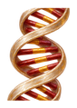 (center 400px, 2310px)
  {Coiled strands carry coloured units, with a short label: “instructions for making proteins.”}
- `opening-nuclear-envelope` Nuclear envelope
  - icon: 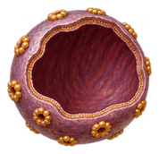 (center 1160px, 2310px)
  {A rounded double membrane surrounds an open central space. Small pores cross its wall.}
- `opening-nucleus` Nucleus
  - icon: 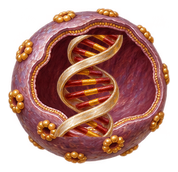
  {DNA sits inside its envelope. A small RNA strand leaves a pore, labelled “a copy of one DNA instruction.”}
- `opening-cell` Membrane bag (compound)
  - icon: 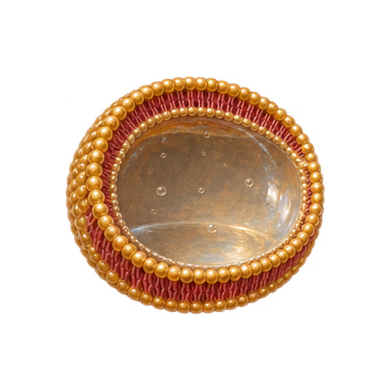
  - from chapter `cell-energy`: Cell
  - unnamed slot: accepts `opening-nucleus`, icon: 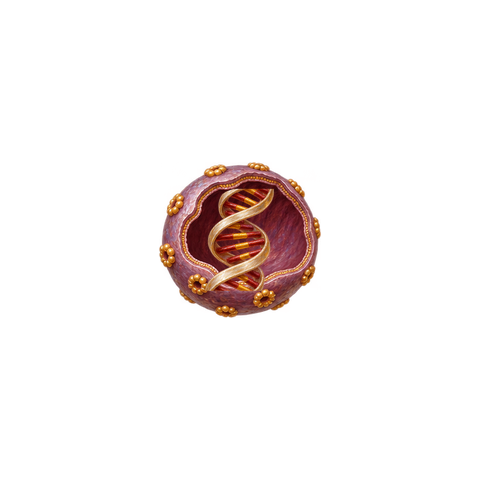
  - unnamed slot: accepts `opening-mitochondria`, icon: 
  - unnamed slot: accepts `school-sugar-carrier`, icon: 
  - unnamed slot: accepts `school-ribosome`, icon: 
  {A closed lipid membrane encloses water. A cutaway keeps the rear surface visible; its enlarged edge shows water-facing heads on both sides and tails meeting within the wall.}

  A boundary makes an inside and an outside. A living cell needs much more than a bag.
- `opening-cell`
  [`opening-nucleus`] {The nucleus sits in the enclosed fluid. DNA remains inside its own smaller envelope.}
- `opening-cell`
  [`opening-mitochondria`] {Mitochondria sit in the cell fluid. One is cut open to show its folded inner membrane. All earlier fitted parts remain.}
- `opening-cell`
  [`school-sugar-carrier`] {The carrier crosses the outer membrane. A two-panel inset shows its sugar-shaped pocket opening outward, then inward.}
- `opening-cell`
  [`school-ribosome`] {Ribosomes sit inside the cell membrane, in the fluid outside the nucleus. A connected magnifying window shows a strand labelled “RNA: copied from DNA” leaving a nuclear pore and passing through a ribosome. Free amino acids surround it. The whole cell remains visible around the enlargement.}

**Combinations**
- `prelude-phospholipids` [consume] + `prelude-water` [consume] -> `opening-cell` (tutorial)
- `opening-dna` [consume] + `opening-nuclear-envelope` [consume] -> `opening-nucleus`

> NOTE: Three operations, two independent starting constructions. This is a textbook reconstruction, not a recipe for manufacturing life. The cell's later function includes ordinary cytosol, enzymes and supporting machinery. The nuclear envelope includes pores and associated proteins. The early model shows DNA's location and the physical source of the RNA used next. No nutrient, ATP, water-flow event or activated status is a compound slot. Only persistent physical structures are fitted. Closed lipid vesicles: https://pmc.ncbi.nlm.nih.gov/articles/PMC1434845/ ; OpenStax A&P 3.1. Ordinary school scope: curriculum.md.

## `cell-energy` The powerhouse of the cell
background: 

Cells use food both as fuel and as building material. Add mitochondria to make ATP from glucose, and ribosomes to make proteins following RNA copies from the nucleus. Oxygen is dissolved around the cell and can cross its membrane. The watery interior—cytosol—already contains RNA, amino acids and the usual supporting machinery.

**Goals**
- Add mitochondria and a route for glucose
  - both: `opening-cell`[`opening-mitochondria`]
  - and: `opening-cell`[`school-sugar-carrier`]
- next: Feed glucose to the cell to make ATP -- `school-atp`
- Add the cell's protein builders -- `opening-cell`[`school-ribosome`]
- next: Use ATP in the cell to build a protein from amino acids -- `school-protein`

**Items**
- `opening-cell`
- `opening-mitochondria` Mitochondria
  - icon: 
  {Bean-shaped organelles have folded inner membranes. A small locator places them inside the cell.}
- `school-sugar-carrier` Sugar-carrier protein
  - icon: 
  {A membrane-spanning protein has a pocket shaped to hold glucose, alternately open on opposite sides.}
- `school-glucose` Glucose
  - icon: 
  {Free sugar molecules in the fluid outside the cell match the carrier's pocket.}
- `school-ribosome` Ribosomes
  - icon: 
  {Small two-part structures have a groove for an RNA strand. A pale outline inside the cell marks their place; the loose structures are not yet in that outline.}
- `school-atp` ATP
  - icon: 
  {An enlarged ATP molecule is linked by a locator to the same cell. An inset shows glucose being broken down in the cell fluid and mitochondria, oxygen entering, and carbon dioxide and water leaving. Glucose is not attached to the membrane.}

  Glucose is used up. Respiration replenishes ATP, which powers work such as building proteins.
- `school-protein` Protein
  - icon: 
  {An enlarged protein chain folds into a three-dimensional shape. A locator points to the installed ribosome inside the same intact cell: RNA from its nucleus passes through the ribosome, amino acids join in the RNA's order, and the chain emerges. ATP is used beside the machinery without becoming part of the chain. The ribosome stays inside the cell.}

  Food provides both fuel and building material. ATP helps pay for the work; amino acids become the protein.

**Combinations**
- `school-glucose` [consume] + `opening-cell`[`opening-mitochondria`,`school-sugar-carrier`] [preserve] -> `school-atp`
- `school-atp` [consume] + `opening-cell`[`opening-nucleus`,`school-ribosome`] [preserve] -> `school-protein`

> NOTE: Five operations. Ribosomes are structural components: they must be fitted inside the cell before they can make protein in this model. The separate Ribosomes supply has no production recipe. RNA is already present within the cell, made from its existing nuclear DNA; it is shown reaching installed ribosomes, not dragged in from outside or made into a detachable second ribosome. The stable cell is the receiving producer for both glucose-to-ATP and ATP-supported protein production. Glucose and ATP are consumed supplies; only persistent structures occupy slots. Protein is a real molecular product, shown enlarged with its location made explicit. Amino acids are disclosed in the opening and consumed in protein formation; ATP contributes energy, not the protein material. The next chapter gives amino acids their own icon while comparing different RNA instructions. The operation includes ordinary translation machinery, amino-acid activation and GTP. Oxygen, ADP/phosphate, water and supporting enzymes are supplied; glycolysis in the cytosol makes some ATP and mitochondria support much aerobic ATP production. No fixed yield, glucose entering mitochondria unchanged, or activation of an otherwise inactive cell is claimed. Nucleus, carrier, mitochondria and ribosomes each have a visible use. Sources: OpenStax Biology [glycolysis](https://openstax.org/books/biology-2e/pages/7-2-glycolysis), [oxidative phosphorylation](https://openstax.org/books/biology-2e/pages/7-4-oxidative-phosphorylation), and A&P 3.4.

## `cell-specialization` Same DNA, different jobs
background: 

Step back to an embryo's growing limb. Earlier, a rear-edge patch called the zone of polarizing activity releases Sonic hedgehog; later, developing cartilage and muscle release TGF-beta2. These proteins help already prepared cells use different genes. Follow two groups: one makes muscle; the other builds tendons, the tough links between muscle and bone.

> NOTE: Planned background: two clearly separated textbook enlargements labelled “earlier” and “later,” joined to a small embryo locator. In the early limb bud, mark the posterior edge's source patch “zone of polarizing activity (ZPA)” and show Sonic hedgehog spreading toward a selected ventral muscle-precursor group. The later enlargement shows tendon precursors between developing muscle and cartilage, with TGF-beta2 arising locally from these tissues and the tendon cells. Do not put both sources in the ZPA or imply that the two scenes are simultaneous. No art is generated in this revision.

**Goals**
- Follow Sonic hedgehog into muscle development -- `school-young-muscle`
- next: Build pulling proteins inside the cells -- `prelude-myoblasts`
- Follow TGF-beta2 into tendon development -- `school-young-support`
- next: Build tendon fibres around the cells -- `prelude-matrix`

**Items**
- `prelude-daughters` Embryonic cells
  - icon: 
  {Separate groups retain the familiar membrane, nucleus, mitochondria and ribosomes. Each group has a different outline colour, matched to a recipient group in the messenger pictures. The key reads “precursors: cells already partway along different developmental paths.”}
- `school-muscle-signals` Sonic hedgehog protein
  - icon: 
  {Enlarged Sonic hedgehog protein molecules meet receivers on a cell membrane. The same molecule is shown at both scales; it is an external message, not a new organelle. Its releasing tissue and the prepared recipient cells are located in the current developmental scene.}
- `school-support-signals` TGF-beta2 protein
  - icon: 
  {Enlarged protein molecules pass from developing cartilage, muscle and tendon cells to receivers on the intervening tendon precursors. A locator matches the later limb close-up. The caption reads “helps tendon cells keep developing.”}
- `school-amino-acids` Amino acids — protein building blocks
  - icon: 
- `school-young-muscle` Cells with muscle-protein RNA
  - icon: 
  {The selected muscle precursors retain their DNA. A short time strip follows the surface message to developmental gene activity, then later RNA instructions for pulling proteins. Those proteins appear as dotted outlines beside the RNA, labelled “to be made.”}
- `school-young-support` Tendon cells with collagen RNA
  - icon: 
  {The selected tendon cells retain the same DNA set. A short time strip shows continued development and later RNA copies of collagen instructions; a key shows collagen as a tough, rope-like protein. Dotted outlines mark the fibres still to be built around the cells.}
- `prelude-myoblasts` Muscle cells
  - icon: 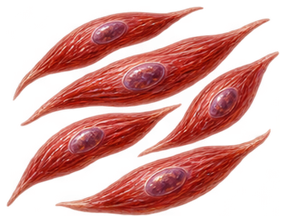
  {Elongated, still separate cells now contain parallel protein fibres, enlarged as two overlapping sets that can slide to shorten the cell. Compare the newly built protein fibres with the RNA instructions in the preceding cell. Each cell retains its own nucleus and membrane; the later muscle chapter assembles these cells into larger fibres.}
- `prelude-matrix` Tendon tissue
  - icon: 
  {Living tendon cells lie between aligned collagen fibres. A short time strip follows protein production, release outside the cells and fibre assembly. A locator shows this tissue linking developing muscle to cartilage in the limb.}

  Muscle cells keep their pulling proteins inside. Tendon cells build tough fibres outside. Different uses of the same DNA help make a limb.

**Combinations**
- `prelude-daughters` [preserve] + `school-muscle-signals` [consume] -> `school-young-muscle`
- `prelude-daughters` [preserve] + `school-support-signals` [consume] -> `school-young-support`
- `school-young-muscle` [transform] + `school-amino-acids` [consume] -> `prelude-myoblasts`
- `school-young-support` [transform] + `school-amino-acids` [consume] -> `prelude-matrix`

> NOTE: This chapter is an explicit developmental flashback, not the main game's assembly timeline. The reusable population represents distinct, appropriately prepared descendants in different places and at different times, not any one interchangeable cell. Selected limb muscle precursors are somite-derived; tendon precursors here have a different, limb-mesenchymal history. The later neuron chapter still selects appropriate neural-tube/neural-crest descendants from the broad model population, not from these limb precursors. Each signal operation compresses cellular responses over time; neither protein alone converts an arbitrary cell or directly makes contractile/collagen RNA without intervening regulation. Existing organelles, ATP, other cues, growth and tissue organization are supplied. Muscle cells remain precursors before the fusion into long skeletal fibres pictured in the next chapter. This is one route into muscle development, not the origin of every skeletal muscle or a claim that the same limb cells later become both biceps and triceps.

> NOTE: [Anderson et al., 2012](https://pmc.ncbi.nlm.nih.gov/articles/PMC3444735/) experimentally connect ZPA-derived Shh to Myf5 activation specifically in ventral limb muscle precursors in mouse embryos. That result supports the selected source, recipients and developmental setting; the game omits the regulatory cascade and later gene-expression steps. [Pryce et al., 2009](https://journals.biologists.com/dev/article-pdf/136/8/1351/1213661/1351.pdf) establish TGF-beta2/3's importance for maintaining tendon progenitors, with expression in developing cartilage, muscle and tendon cells. Initial progenitor induction persists in the mutants; recruitment of additional progenitors is the authors' proposed model. Accordingly, this scene supplies already prepared tendon precursors and teaches continued development, not a proven first-induction switch. The mature collagen-rich result additionally includes protein production, secretion and organization over time (OpenStax A&P 3.4 and 4.3). These vertebrate experiments ground an explanatory human-anatomy model; mouse embryonic days are not human dates. The two protein names and ZPA are locally taught, user-requested extensions beyond ordinary school vocabulary, not prerequisites or a pathway memorization exercise.

## `full-strong-and-movable` Hard bones and pulling muscles
background: 

Return to the arm's anatomical model. Build its front or back using the same kind of muscle cells, and add mineral to the bone at each attachment—in either order. The biceps bends the elbow; the triceps straightens it.

**Goals**
- Build the biceps and strengthen its bone attachment -- `arm-front-tendons`[`school-bone-mineral`,`prelude-myoblasts`]
- Build the triceps and strengthen its bone attachment -- `arm-back-tendons`[`school-bone-mineral`,`prelude-myoblasts`]

**Hotspots**
- `arm-front-tendons` (center 780px, 1688px)
  - icon: 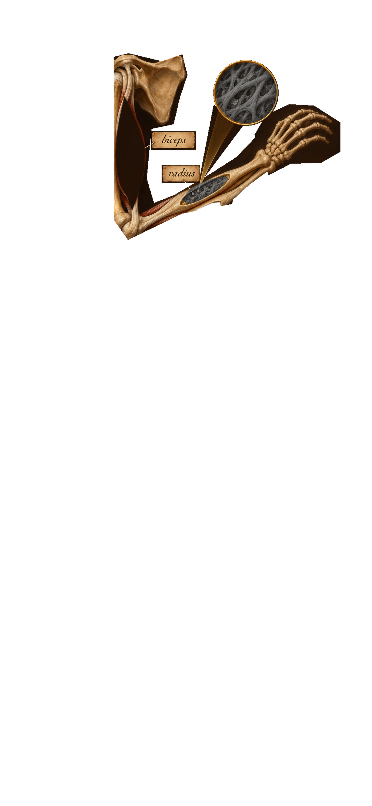
  - hitbox: (center 550px, 655px) (size 170px, 490px)
- `arm-back-tendons` (center 780px, 1688px)
  - icon: 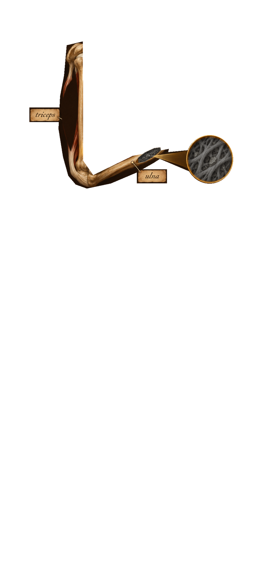
  - hitbox: (center 397px, 655px) (size 140px, 490px)

**Items**
- `prelude-myoblasts`
- `school-bone-mineral` Bone mineral
  - icon: 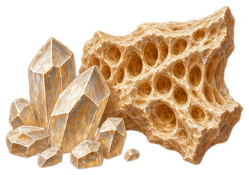 (center 1080px, 1750px)
  {Calcium-phosphate crystals beside a hard mineral chip. A pressing arrow shows resistance to compression.}
- `arm-front-tendons` Front of arm (compound)
  - icon: 
  - slot: Bone mineral, accepts `school-bone-mineral`, icon: 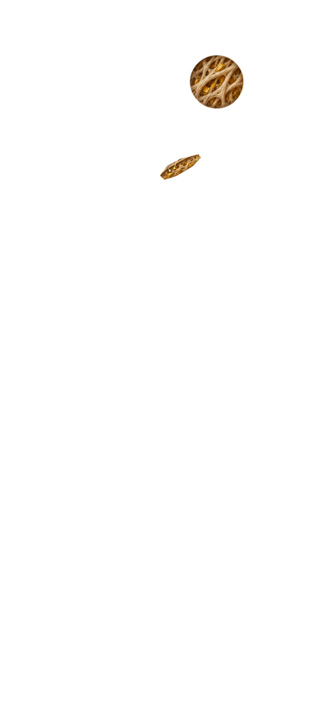
  - slot: Biceps, accepts `prelude-myoblasts`, icon: 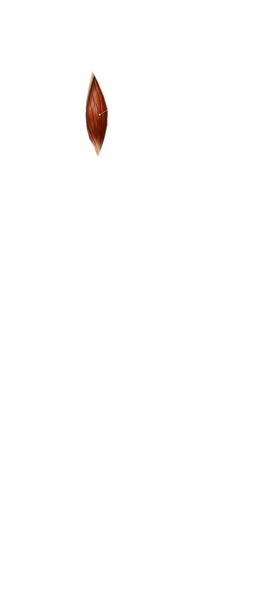
  {The front receiving region belongs to one arm cutaway. Tendons run from the shoulder blade to the radius, one of the forearm bones, across a space for the biceps. A window into the radius shows living cells and vessels in tough protein fibres awaiting mineral. The elbow's cartilage, capsule and ligaments are already present.}
- `arm-front-tendons`
  [`school-bone-mineral`] {Mineral now fills spaces among the radius's bone fibres. The mineral stays inside this bone window; the tendons and joint cartilage stay soft. Any biceps already built remains attached.}
- `arm-front-tendons`
  [`prelude-myoblasts`] {A biceps muscle fills the front region between its tendons. Its cutaway shows muscle fibres grouped in connective tissue continuous with the tendons. A small time strip shows separate muscle cells joining and growing into long fibres. A pull arrow crosses in front of the elbow; a curved arrow shows bending. The radius's mineral state is unchanged.}

  The biceps pulls across the front of the elbow, bending it. Mineral hardens the bone that its tendon pulls on.
- `arm-back-tendons` Back of arm (compound)
  - icon: 
  - slot: Bone mineral, accepts `school-bone-mineral`, icon: 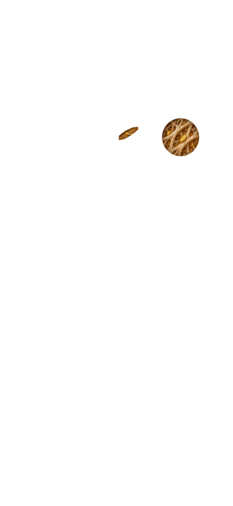
  - slot: Triceps, accepts `prelude-myoblasts`, icon: 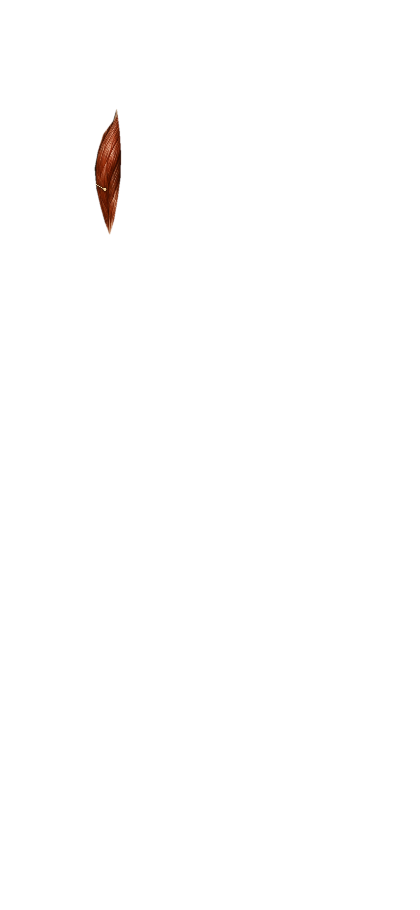
  {The back receiving region belongs to the same arm. Tendons run from the shoulder blade and upper-arm bone to the back of the ulna, the other forearm bone, across a space for the triceps. A separate window into the ulna shows living bone tissue awaiting mineral. The shared shoulder and upper-arm bones are supplied; they are not a second skeleton.}
- `arm-back-tendons`
  [`school-bone-mineral`] {Mineral fills spaces among the ulna's bone fibres. The tendons and joint surfaces stay soft. Any triceps already built remains attached; the front region is unchanged.}
- `arm-back-tendons`
  [`prelude-myoblasts`] {A triceps muscle fills the back region between its tendons. The same kind of muscle cells has formed long fibres within connective tissue. The pull arrow passes behind the elbow; a curved arrow shows straightening. The ulna's mineral state is unchanged.}

  The triceps pulls behind the elbow, straightening it. The attachments give the same kind of pulling cells a different effect.

> NOTE: Four implicit fittings into two fixed anatomical regions. Both regions accept the same Bone mineral and Muscle cells identities; each material remains available until both required sites have received it. Each region permits mineral before or after muscle, and the projects can be interleaved. These are two connected regions of one arm, not free-standing collections or two complete arms. The front mineral window is in the radius and the back window is in the ulna, so the same shared bone is not mineralized twice. Supplied shoulder/upper-arm anatomy is already mineralized. Ordinary joint tissues, nerves and blood vessels remain included. Neither mineral nor muscle is added to the joint space.

> NOTE: The precursor population supplies enough cells for both muscle regions. Cell fusion, growth and organization occur over the illustrated interval; a drag is not literal transplantation or a claim that adult tendons precede muscle development. This is the return from embryonic examples to textbook reconstruction. Each fixed region remains the same object as its parts are fitted; no replacement state or completion token is needed. The final assembly re-presents this completed arm at model scale. [OpenStax A&P 6.3](https://openstax.org/books/anatomy-and-physiology-2e/pages/6-3-bone-structure) grounds mineral in bone matrix; [10.2](https://openstax.org/books/anatomy-and-physiology-2e/pages/10-2-skeletal-muscle) grounds muscle fibres and tendon continuity; [11.5](https://openstax.org/books/anatomy-and-physiology-2e/pages/11-5-muscles-of-the-pectoral-girdle-and-upper-limbs) grounds the selected attachments. Biceps and triceps are a representative opposing pair, not the arm's only muscles.

## `neural-circuits` Cells that send messages
background: 

Return to the embryo and examine two other precursor groups, retaining the familiar cell structures. Sonic hedgehog from beneath the early spinal cord helps prepared cells become motor nerve cells. Later, neuregulin-1 on growing nerve fibres helps neighbouring cells develop into insulating Schwann cells. Then examine the mature cells: channels carry electrical changes along the nerve cell, while other cells wrap its long extension.

**Goals**
- Develop spinal motor nerve cells -- `school-neurons`
- next: Fit channels through the nerve cells' membranes -- `school-neurons`[`school-ion-channels`]
- Develop insulating Schwann cells beside nerve fibres -- `neural-wrapping-cells`
- next: Wrap the long extensions with those cells -- `school-neurons`[`neural-wrapping-cells`]

**Hotspots**
- `neural-wrapping-messengers`

**Items**
- `school-muscle-signals`
- `neural-spinal-precursors` Spinal-cord precursor cells
  - icon: 
  {A magnified group in the lower wall of the early spinal cord retains the familiar membranes, nuclei, mitochondria and ribosomes. A locator shows the tube above a rod labelled “notochord.” Sonic hedgehog comes from the rod and then cells along the tube's underside. The caption reads “already prepared spinal precursors.”}
- `neural-schwann-precursors` Schwann-cell precursors
  - icon: 
  {A different group of familiar cells sits beside existing growing nerve fibres outside the spinal cord. An earlier-stage inset traces these cells from the edge of the forming spinal tube. Their nuclei remain separate from those of the adjacent nerve cells. The caption reads “precursors of cells that wrap peripheral nerves.”}
- `neural-wrapping-messengers` Neuregulin-1 protein
  - icon: 
  {A magnified protein remains anchored on the surface of an existing, continuous nerve fibre in the later developmental scene. It meets a receiver on a neighbouring precursor cell. A locator connects this fixed molecular view to the source fibre; the protein is not a loose bottle or detached nerve fragment. The caption reads “a message passed by contact.”}
- `school-ion-channels` Gated ion channels
  - icon: 
  {Proteins span an enlarged cell membrane. A gate opens and closes across each protein; small charged particles labelled “ions” fit through its opening. A locator points to the nerve cell's own membrane.}
- `neural-wrapping-cells` Schwann cells
  - icon: 
  {Separate living cells have broad flexible membranes and their own nuclei. A time strip connects the precursors beside a nerve to these cells. A cross-section shows how each can wrap its membrane repeatedly around a stretch of a peripheral nerve fibre.}
- `school-neurons` Motor nerve cells (compound)
  - icon: 
  - unnamed slot: accepts `school-ion-channels`, icon: 
  - unnamed slot: accepts `neural-wrapping-cells`, icon: 
  {A time strip follows a prepared spinal cell as it develops and grows receiving branches and one long extension. The anatomical view shows the entire cell inside one continuous membrane, with its nucleus and familiar organelles. Its cell body stays inside the spinal cord; the long extension leaves toward muscle. Its enlarged membrane has outlines for the selected channels.}
- `school-neurons`
  [`school-ion-channels`] {Channels cross the nerve cell's own membrane. An unwrapped stretch shows ions crossing locally. Arrows link the electrical change to the next channels opening. An existing pump uses ATP to maintain different ion concentrations on the two sides. The full cell remains visible beside this enlargement.}

  A message travels along the membrane through local electrical changes. No single ion has to travel the whole length.
- `school-neurons`
  [`neural-wrapping-cells`] {Schwann cells wrap separate lengths of the same continuous extension outside the spinal cord. The nerve-cell membrane stays inside; another cell's membrane makes the outer layers, with that cell's nucleus to one side. Short gaps remain between wraps. The cell body and receiving branches stay unwrapped. Any fitted channels remain in the nerve-cell membrane, with exposed groups at the gaps.}

  The long fibre belongs to one cell. Other cells make insulating wraps that help its messages travel quickly.

**Combinations**
- `neural-spinal-precursors` [transform] + `school-muscle-signals` [consume] -> `school-neurons`
- `neural-schwann-precursors` [transform] @ `neural-wrapping-messengers` -> `neural-wrapping-cells`

> NOTE: Four operations: two independent cell-development examples followed by two anatomical fittings. The named precursor groups are explicit local views of distinct descendants of the earlier embryonic population, not new organelles, detached fibres or arbitrary mature cells made pluripotent. This source/recipient distinction also makes the reused Sonic hedgehog recipe unambiguous: limb muscle precursors and spinal precursors are not the same cells. No extra conversion action is charged merely for the change of scale. Neural regionalization, other prior signals, nutrients, ATP and gene/protein machinery are supplied. Time strips distinguish early development, later outgrowth and the mature anatomical reconstruction.

> NOTE: [Ericson et al., 1996](https://pubmed.ncbi.nlm.nih.gov/8929535/) establish Shh's roles in ventral preparation and motor-neuron differentiation. Here its source is the notochord and floor plate, not the limb ZPA. This is one spinal motor-neuron example, not a recipe for all neurons. [Leimeroth et al., 2002](https://pubmed.ncbi.nlm.nih.gov/12051814/) support membrane-associated neuregulin-1 type III promoting Schwann-cell features in appropriate neural-crest-derived progenitors. The fixed protein view selects contact signalling on a supplied existing peripheral axon; this source is not one of the neurons the player must first construct. Thus either project can be pursued first. Other forms and released fragments are outside the example, not denied. [Taveggia et al., 2005](https://pmc.ncbi.nlm.nih.gov/articles/PMC2387056/) ground its later role in ensheathment/myelination and show that neuregulin alone is insufficient. Additional axonal and extracellular conditions remain supplied. These animal experiments ground a mammalian anatomy model, not a precise human embryonic calendar.

> NOTE: The selected whole neuron keeps its continuous axon; wrapping cells keep separate nuclei and membranes. Several Schwann cells wrap its peripheral portion, never the central cell body or receiving branches. Not every neuron has this shape or these wraps. The signal names, named recipients and source anatomy are locally taught specialist vocabulary; “type III,” regulatory genes and receptor cascades remain author-only. Channel fitting is an anatomical reconstruction, not a laboratory insertion procedure. Existing pumps maintain gradients; they do not directly carry each message. The ion-channel detour omits channel subtypes, voltage arithmetic, named ions and a saltatory-conduction lesson. [OpenStax A&P 12.2](https://openstax.org/books/anatomy-and-physiology-2e/pages/12-2-nervous-tissue) and [12.4](https://openstax.org/books/anatomy-and-physiology-2e/pages/12-4-the-action-potential) ground cellular continuity and the membrane close-up.

## `nervous-system-anatomy` Brain, spinal cord and nerves
background: 
The kinds of nerve cells we have examined are organized into the brain, spinal cord and nerves. These soft structures need protection as well as routes into the rest of the body. Fit their protective bones while building one spinal nerve as an example of the many routes branching from the cord.

**Goals**
- Protect the brain and spinal cord
  - both: `school-protected-brain`
  - and: `school-protected-cord`
- next: Connect the protected brain and spinal cord -- `central-nervous-system-model`
- Join sensory and motor roots into a spinal nerve -- `school-peripheral-nerves`
- next: Connect the spinal nerve to the brain-and-cord model -- `nervous-system-model`

**Items**
- `brain-model` Brain
  - icon: 
  {A whole-brain cutaway shows its folded surface, deeper regions and connections. An inset uses the same cell and membrane symbols as the nerve-cell chapter. These are the brain’s own nerve cells; the earlier example showed the same basic cell plan.}
- `spinal-cord-model` Spinal cord
  - icon: 
  {A long cord contains nerve-cell groups and connecting fibres, with side branches at repeated levels. Arrows run up, down and across short local connections.}
- `school-skull` Skull
  - icon: 
  {A cutaway skull encloses a pale brain outline. Openings remain at its base.}
- `school-backbone` Backbone
  - icon: 
  {A row of vertebrae surrounds a pale spinal-cord outline. Small side openings appear between neighbouring bones.}
- `school-protected-brain` Brain inside the skull
  - icon: 
  ---
  {The skull surrounds the brain. A small cutaway shows soft membranes and fluid between brain and bone.}
- `school-protected-cord` Spinal cord inside the backbone
  - icon: 
  ---
  {The spinal cord lies within the vertebral canal and ends above its lower end; the lower nerve roots continue downward through the canal before leaving through side openings. A small whole-back locator keeps the enlarged roots at their actual level.}
- `central-nervous-system-model` Brain and spinal cord
  - icon: 
  {A head-and-back cutaway shows the brain continuing into the spinal cord inside skull and backbone.}

  The spinal cord carries signals between body and brain. Its local circuits can also produce rapid responses without waiting for a conscious decision.
- `sensory-routes` Sensory nerve root
  - icon: 
  {A short root meets the back of a spinal-cord outline. Its fibres carry arrows toward the cord, labelled “sensory: messages from the body.” A small swelling contains the rounded sensory-cell regions; its outer end meets a pale nerve-trunk outline.}
- `motor-routes` Motor nerve root
  - icon: 
  {A short root emerges from the front of the same spinal-cord outline. Its fibres carry arrows away from the cord, labelled “motor: messages to muscles.” Its outer end meets the same pale nerve-trunk outline.}
- `school-peripheral-nerves` Spinal nerve
  - icon: 
  {The two roots meet outside the spinal cord in one short, solid nerve trunk. A peeled-back outer covering reveals separate sensory and motor fibres held within connective tissue. Inward and outward arrows stay on different fibres; the roots retain their separate entries at the cord.}
- `nervous-system-model` Nervous system model
  - icon: 
  {Brain and spinal cord remain inside their protective bones. The built example spinal nerve is highlighted at one level; the other nerve routes are supplied in paler colour. Separate arrows trace incoming information and outgoing muscle signals.}

**Combinations**
- `brain-model` [transform] + `school-skull` [consume] -> `school-protected-brain`
- `spinal-cord-model` [transform] + `school-backbone` [consume] -> `school-protected-cord`
- `school-protected-brain` [transform] + `school-protected-cord` [consume] -> `central-nervous-system-model`
- `sensory-routes` [transform] + `motor-routes` [consume] -> `school-peripheral-nerves`
- `central-nervous-system-model` [transform] + `school-peripheral-nerves` [consume] -> `nervous-system-model`

> NOTE: Five required actions independently protect brain and cord and prepare peripheral routes before their meeting. The whole-organ views contain the already organized nervous tissue examined previously; they are supplied changes of scale, not newly fabricated organs or a second addition of fibres to tissue that already contained them. This sacrifices a literal recipe from generic tissue to brain in favour of honest anatomy and simpler knowledge demands. The brain includes its regions without a naming catalogue. The cord ends above the bottom of the adult vertebral canal. Protective membranes, fluid and openings for nerves are included. Sensory cell bodies remain peripheral where appropriate; motor cell bodies remain central. A spinal nerve is a real tissue-bound anatomical trunk formed where sensory and motor roots meet, not an arbitrary collection of fibres. The root names are introduced by their visible positions and message directions; dorsal/ventral vocabulary, nerve-layer names and plexus routes are not tested. This selected nerve represents the same pattern repeated along the cord, with the rest of the peripheral anatomy supplied in the system view. Roots and nerve carry their normal connective tissue. Mixed spinal nerves contain separate incoming and outgoing fibres. Source: [OpenStax, peripheral nerves and roots](https://openstax.org/books/anatomy-and-physiology-2e/pages/13-4-the-peripheral-nervous-system). Further sources: [OpenStax, central nervous system](https://openstax.org/books/anatomy-and-physiology-2e/pages/13-2-the-central-nervous-system) and [peripheral nervous system](https://openstax.org/books/anatomy-and-physiology-2e/pages/13-4-the-peripheral-nervous-system).

## `full-vision` From light to sight
background: 

Light from a leaf must be focused before the eye can detect its shape. Build the focusing front and the light-sensitive lining independently, then bring them together in one eye cutaway. The optic nerve carries the resulting signals toward the existing brain.

**Goals**

- Build an eye front that focuses and controls light -- Light-controlling eye front
- Build a light-sensitive lining with an outgoing nerve -- Retina with optic nerve
- next: Bring the focusing front and sensing lining together -- Eye with optic nerve

**Items**

- Clear dome (cornea)
  - icon: 

  {A transparent curved dome, seen from the side. Thin light rays bend as they pass through it.}

  ---

  The cornea is the clear front surface of the eye. Its curve bends incoming light.

- Clear lens
  - icon: 

  {A transparent oval lens, thicker in the middle than at its edges. Light rays bend inward through it.}

  ---

  The lens sits inside the eye and helps focus light onto its back lining.

- Coloured muscle ring (iris)
  - icon: 

  {A coloured ring with a round opening at its centre. A small inset shows the opening narrowed.}

  ---

  The iris is the coloured ring at the front of the eye. Its muscles change the size of the opening, called the pupil, to control how much light enters.

- Light-sensitive cells
  - icon: 

  {A close view of a row of elongated cells, each with a broad light-catching end.}

  ---

  Light-sensitive cells in the eye respond to light by starting electrical signals.

- Retinal nerve cells
  - icon: 

  {A connected group of branching nerve cells. Long thin fibres extend from some of them.}

  ---

  Nerve cells can pass signals to other cells. Their long fibres carry signals over a distance.

- Focusing eye front
  - icon: 

  {A side cutaway of the eye's front: the clear dome outside and the oval lens behind it. Light rays bend through both towards the same small area at the back.}

- Light-controlling eye front
  - icon: 

  {The same cutaway, now with the coloured ring between the dome and lens. Light passes through the ring's opening before reaching the lens.}

  The iris changes how much light gets in. The cornea and lens focus it.

  ---

  The cornea and lens bend light towards the retina at the back of the eye. The iris adjusts the pupil's size to admit more or less light. [National Eye Institute: parts of the eye](https://www.nei.nih.gov/eye-health-information/healthy-vision/nei-for-kids/about-eye).

- Retina with optic nerve
  - icon: 

  {A retinal enlargement shows light-sensitive cells linked through local nerve cells to outgoing fibres. Those fibres gather into the optic nerve. A locator puts this curved lining at the back of the same eyeball; it is not drawn at the scale of the lens.}

  This light-sensitive lining is the retina. Its cells pass signals onwards, through a bundle of nerve fibres called the optic nerve.

  ---

  The retina is a layer of tissue lining the back of the eye. Light-sensitive cells begin electrical signals, and other nerve cells process and pass them on. Long fibres from nerve cells in the retina gather into the optic nerve, carrying signals towards the brain. [National Eye Institute: how eyes work](https://www.nei.nih.gov/eye-health-information/healthy-vision/how-eyes-work).

- Eye with optic nerve
  - icon: 

  {The completed cutaway eye retains the dome, coloured ring and lens at its front and retina at its back. Rays from a small leaf focus on the retina; signal arrows follow the attached optic nerve toward the existing brain, faintly outlined beyond the eye.}

  The eye focuses light onto living cells. The optic nerve carries their information toward the brain.

- Cornea and iris
  - icon: 
  {The coloured muscle ring sits behind the clear dome; its opening leaves room for the lens behind it.}

**Combinations**
- Clear dome (cornea) [transform] + Coloured muscle ring (iris) [consume] -> Cornea and iris
- Cornea and iris [transform] + Clear lens [consume] -> Light-controlling eye front

- Clear dome (cornea) [transform] + Clear lens [consume] -> Focusing eye front
- Focusing eye front [transform] + Coloured muscle ring (iris) [consume] -> Light-controlling eye front
- Light-sensitive cells [transform] + Retinal nerve cells [consume] -> Retina with optic nerve
- Light-controlling eye front [transform] + Retina with optic nerve [consume] -> Eye with optic nerve

> NOTE: Four operations assemble optical and sensory anatomy independently, then join them within the same local eye. The eye is an anatomical view in the existing head, not a detached organ to install; the intact optic nerve already connects its retinal cells with existing visual pathways. No whole-body identity or repair result is an operand. The iris may join the cornea before or after the lens. Finished-eye illustrations show light from a leaf focused on the retina and signals reaching the brain; this use produces no separate “seeing body” item. Existing supporting eye tissues, muscles, supply and visual brain pathways are included. OpenStax A&P 14.1 grounds optical focusing and sensory reception; the daily-light/sleep exercise is omitted rather than represented by time or observation ingredients.

## `full-hearing` Vibration into signals
background: 
A voice begins as moving air. Build the route that passes those vibrations inward and the delicate cells that detect them. The brain receives nerve signals from the ear.

**Goals**
- Carry vibrations from the ear canal inward -- Sound-conducting ears
- Build the inner ear's sensing tissue -- Vibration-sensitive inner ears
- next: Join the ears to their hearing nerves -- Ears

**Items**
- Outer ears and canals
  - icon: 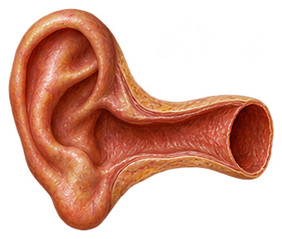 (center 300px, 1600px)
  {The outer ears lead into narrow canals, shown in cutaway.}
- Eardrums
  - icon: 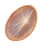 (center 780px, 1600px)
  {Thin membranes stretch across the ends of the canals; a vibrating edge is shown in two positions.}
- Outer ears with eardrums
  - icon: 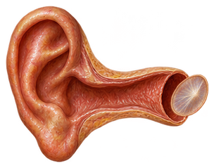
  {An ear canal ends at its vibrating membrane.}
- Middle-ear bones
  - icon: 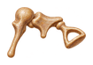 (center 1260px, 1600px)
  {Three tiny linked bones form a chain from the eardrum toward the inner ear.}
- Sound-conducting ears
  - icon: 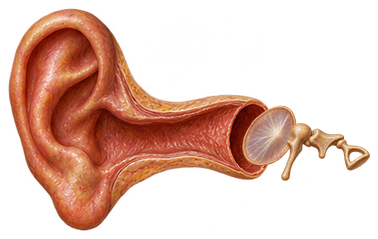
  {Movement arrows pass from air to eardrum to the chain of tiny bones.}
  The eardrum moves the tiny bones. Their movement pushes on the fluid-filled inner ear.
- Coiled inner-ear chambers and fluid
  - icon: 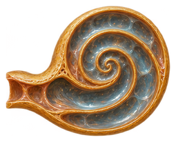 (center 300px, 2280px)
  {Two coiled chambers contain fluid. A small membrane at each entrance moves inward while another bows outward.}
- Hearing cells with tiny hairs
  - icon: 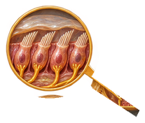 (center 780px, 2280px)
  {A located cochlear enlargement shows sensory cells attached to the moving tissue partition, with short hair bundles and nerve connections. Relative movement between this tissue and its overlying structures bends the bundles; the cells do not float freely in fluid.}
- Vibration-sensitive inner ears
  - icon: 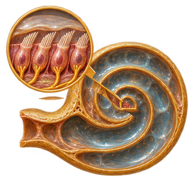
  {Movement arrows pass through fluid inside the coil and move its tissue partition. A magnified inset shows the attached sensory cells, relative movement bending their hair bundles, and changed signals at their nerve connections.}
  Tiny movements bend the hearing cells' hairs. That changes the signals passed to nerves.
- Sound-receiving ears
  - icon: 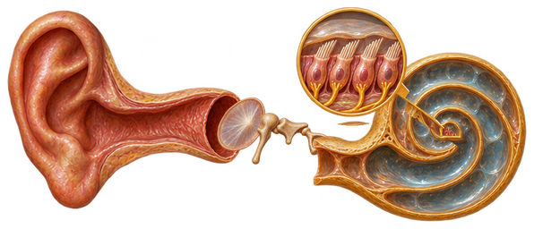
  {The outer ear, eardrum, bone chain and fluid-filled coil share one continuous cutaway.}
- Hearing pathways
  - icon: 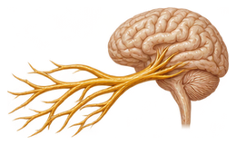 (center 1260px, 2280px)
  {Nerve fibres lead from the hearing cells toward the brain.}
- Inner ears with hearing pathways
  - icon: 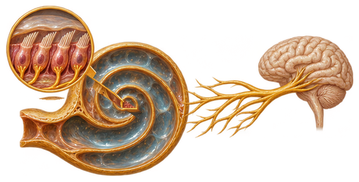
  {The hair-bearing sensory tissue inside the fluid-filled coils joins nerve fibres leading toward the existing brain. The sound-conducting outer parts remain outlined.}
- Ears
  - icon: 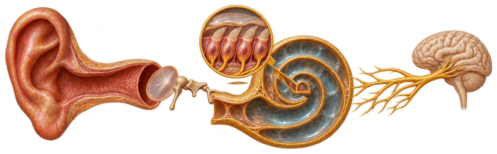
  {The local ear cutaways retain outer ears, eardrums, tiny bones and sensing coils. Vibration arrows lead inward; signal arrows then follow hearing nerves toward the faint outline of the existing brain.}
  A voice arrives as moving air. The ear passes those vibrations inward, and its sensory cells send information along nerves.

**Combinations**
- Outer ears and canals [transform] + Eardrums [consume] -> Outer ears with eardrums
- Outer ears with eardrums [transform] + Middle-ear bones [consume] -> Sound-conducting ears
- Coiled inner-ear chambers and fluid [transform] + Hearing cells with tiny hairs [consume] -> Vibration-sensitive inner ears
- Sound-conducting ears [transform] + Vibration-sensitive inner ears [consume] -> Sound-receiving ears

- Vibration-sensitive inner ears [transform] + Hearing pathways [consume] -> Inner ears with hearing pathways
- Sound-conducting ears [transform] + Inner ears with hearing pathways [consume] -> Ears
- Sound-receiving ears [transform] + Hearing pathways [consume] -> Ears

> NOTE: Five required actions retain independent sound-conducting and sensory anatomy. Hearing nerves may join the inner-ear tissue before or after the outer/middle structures join it. The finished local cutaway shows the connection to existing brain pathways; it never installs ears or a hearing-status object into a whole-body tile. Ordinary surrounding tissues and the central ends of the existing hearing nerves are included, rather than constructed a second time. The coiled chamber is the cochlea; its name, named ossicles, basilar/tectorial membranes, ionic channels and auditory nuclei are not required vocabulary. The sensory-tissue input includes its supporting cells, membranes and attachments. There is no separate strip or opposing-membrane operation: the player follows sound transmission, fluid movement, hair bending and nerve signals, not the mechanics of the cochlear partition. The two small membranes at the chamber entrance represent oval- and round-window movement. Relative motion within the cochlear partition bends stereocilia, altering hair-cell transmitter release to auditory nerve fibres; the hair cells do not themselves send action potentials along the nerve. This source-grounded explanation remains author background, while the short pictured sequence shows the selected movement-to-signal relationship. Worth: one signal crosses air, membrane, bone and fluid before becoming nerve activity. Source: OpenStax [14.1 Sensory Perception](https://openstax.org/books/anatomy-and-physiology-2e/pages/14-1-sensory-perception).

## `full-balance` Head turns, eyes stay
background: 
Beside the hearing coil already built, the inner ear has sensors for turning, tilt and changes in straight-line movement. When your head turns, your eyes can turn the other way to keep looking at the same point. Build the sensors and their nerve routes to the existing eye and posture muscles.

**Goals**
- Build the turning sensors -- Turn-sensing canals
- Build the weighted tilt sensors -- Weighted balance sensors
- Join the incoming and outgoing nerve routes
  - either: Balance response routes
  - or: Inner ear
  - or: Turning sensors with response routes
  - or: Weighted sensors with response routes
- next: Link the sensors to eye and posture muscles -- Inner ear
- (three goals are a lot but okay here because turning sensors, weighted sensors and the connecting nerve routes do different jobs)

**Items**
- Fluid-filled loops
  - icon: 
  {Three loops lie at different angles. As a head begins turning, arrows show the fluid briefly lagging behind.}
- Turning sensor cells
  - icon: 
  {Hair-bearing cells sit beneath a jelly flap at the base of a loop. Flow pushes the flap and bends the hairs.}
- Turn-sensing canals
  - icon: 
  {Fluid lag bends the jelly flap when the head begins to turn. An enlarged sensory cell shows a change at its short nerve ending; an outline marks the continuing nerve bundle.}
  As a turn starts or changes, moving fluid bends these sensors.
- Tiny mineral weights
  - icon: 
  {Small crystals rest on a jelly layer above the outline of a patch of sensory cells.}
- Tilt sensor cells
  - icon: 
  {Hair-bearing cells project into a jelly layer. A tilted view shows the layer sliding slightly over them.}
- Weighted balance sensors
  - icon: 
  {Crystals weight the layer over the sensory cells. Tilt and starting-forward panels show the weighted layer shifting and bending hairs.}
  The weighted layer shifts when the head tilts or its straight-line movement changes.
- Balance organs
  - icon: 
  {Fluid loops and two weighted sensory patches occupy their places beside the same hearing coil from the preceding chapter. The hearing coil and its nerve remain intact in pale background colours; spaces for the balance nerves are outlined.}
- Balance nerves
  - icon: 
  {Nerve bundles lie between pale outlines of the two sensor regions and the existing brain. Their branching ends face the sensory cells; their central ends face the brain's receiving cells.}
- Eye and posture nerve routes
  - icon: 
  {A circuit inset outlines the brain and spinal cord separately from the inner ear. Central connections lie within those outlines; peripheral nerves extend to eye, trunk and leg muscles.}
- Balance response routes
  - icon: 
  {A separately located circuit inset follows incoming inner-ear nerves into outlined brain regions, then through central connections and outgoing nerves toward eye and posture muscles. The inset is not anatomy placed inside the ear.}
- Turning sensors with incoming nerves
  - icon: 
  {Nerve fibres leave the turning-sensitive cells in the fluid loops. Their ends face the existing brain's outline.}
- Weighted sensors with incoming nerves
  - icon: 
  {Nerve fibres leave the weighted tilt-sensitive patches and face the existing brain's outline.}
- Balance organs with incoming nerves
  - icon: 
  {Turning loops and weighted patches both connect to sensory nerve fibres leading toward the brain.}
- Inner ear
  - icon: 
  {A whole-ear locator retains the outer ear, eardrum, small bones and hearing coil built earlier. The magnified inner region shows both kinds of balance sensor beside that same coil. Incoming nerves lead through the existing brain to outgoing nerves that reach existing eye and posture muscles. A small head inset shows a turn while the eyes move oppositely toward a fixed point; another shows small trunk and leg adjustments.}
  Balance signals help the eyes turn against a head movement and help adjust posture. Vision and signals from muscles and joints help too.
- Turning sensors with response routes
  - icon: 
  {The fluid-loop sensors link to incoming and outgoing nerve routes. Weighted-sensor positions remain pale.}
- Weighted sensors with response routes
  - icon: 
  {The weighted patches link to incoming and outgoing nerve routes. Fluid-loop sensor positions remain pale.}

**Combinations**
- Fluid-filled loops [transform] + Turning sensor cells [consume] -> Turn-sensing canals
- Tiny mineral weights [transform] + Tilt sensor cells [consume] -> Weighted balance sensors
- Turn-sensing canals [transform] + Weighted balance sensors [consume] -> Balance organs
- Balance nerves [transform] + Eye and posture nerve routes [consume] -> Balance response routes

- Turn-sensing canals [transform] + Balance nerves [consume] -> Turning sensors with incoming nerves
- Weighted balance sensors [transform] + Balance nerves [consume] -> Weighted sensors with incoming nerves
- Turning sensors with incoming nerves [transform] + Weighted balance sensors [consume] -> Balance organs with incoming nerves
- Weighted sensors with incoming nerves [transform] + Turn-sensing canals [consume] -> Balance organs with incoming nerves
- Balance organs [transform] + Balance nerves [consume] -> Balance organs with incoming nerves
- Balance organs with incoming nerves [transform] + Eye and posture nerve routes [consume] -> Inner ear
- Balance organs [transform] + Balance response routes [consume] -> Inner ear
- Turn-sensing canals [transform] + Balance response routes [consume] -> Turning sensors with response routes
- Weighted balance sensors [transform] + Balance response routes [consume] -> Weighted sensors with response routes
- Turning sensors with response routes [transform] + Weighted balance sensors [consume] -> Inner ear
- Weighted sensors with response routes [transform] + Turn-sensing canals [consume] -> Inner ear

> NOTE: Five required actions. Either sensor type may join incoming nerves first, and the two nerve-route inputs may join independently before meeting the sensors. These are variations in order, not extra required combinations or additional physiology. Incoming and outgoing nerve anatomy remains a third independent construction alongside the two sensor mechanisms. The final Inner ear names the focused anatomical region with its newly joined sensory nerves. The hearing coil already exists in the scene and is neither fabricated from these balance inputs nor installed again. Its central nerve connections supply the pictured eye/posture consequence, rather than a separate whole-body accomplishment. Its nerve routes run through the existing brain and reach existing eye and posture muscles; no brain, eye or muscle is installed again. This is the selected advanced-mechanism exception for the sensory chapters: two different inner-ear mechanisms explain the surprising ability to keep a view steady while moving. The independent constructions have concrete mechanical contrasts—fluid lag versus a weighted layer—rather than a catalogue of sensory subtypes. It must earn its place in new-audience Fun/hook tests; do not retain it just for anatomical completeness. Semicircular ducts respond chiefly to angular acceleration; otolith organs respond to gravity and linear acceleration. Otolith, vestibular, angular acceleration, brainstem nuclei and motor-tract names remain outside player prerequisites. The two weighted patches have different orientations, included in the drawing. Balance is multisensory; no claim is made that these organs alone guarantee stable sight or posture. Source: OpenStax [14.1 Sensory Perception](https://openstax.org/books/anatomy-and-physiology-2e/pages/14-1-sensory-perception), [14.2 Central Processing](https://openstax.org/books/anatomy-and-physiology-2e/pages/14-2-central-processing).

## `full-blood-on-the-move` Blood carries more than oxygen
background: 
Blood contains living cells suspended in a liquid called plasma. Prepare its oxygen-carrying cells and its liquid separately, then bring the components together. The liquid can carry dissolved materials that do not ride on red cells.

**Goals**
- Prepare red cells carrying oxygen -- Red cells carrying oxygen
- Make the liquid that carries the cells -- Plasma
- next: Bring the blood components together -- Blood

**Items**
- Developing red blood cells
  - icon: 
  {A bone-marrow inset shows young red cells with nuclei and protein-making machinery. A time arrow follows maturation into flattened, nucleus-free red cells that enter the nearby blood.}
- Iron and amino acids
  - icon: 
  {Iron symbols and separate amino-acid units sit beside a developing red-cell outline. A small inset labels an iron-containing protein “haemoglobin: binds oxygen.”}
- Red blood cells
  - icon: 
  {Flexible red discs have thin centres and no nuclei. A magnified view shows many haemoglobin molecules inside each one.}
- Oxygen molecules
  - icon: 
  {Pairs of oxygen atoms lie beside a pale red-cell outline.}
- Red cells carrying oxygen
  - icon: 
  {Oxygen molecules bind to haemoglobin inside the red cells. Paired arrows show attachment and release.}

  Red cells carry much of the blood's oxygen. It can attach in the lungs and leave again near tissues that use it.
- Plasma water
  - icon: 
  {Water fills the pale liquid spaces between blood-cell outlines.}
- Plasma proteins, nutrients and salts
  - icon: 
  {Glucose, salts and labelled plasma-protein molecules are scattered in a liquid sample. The proteins are supplied blood proteins, not unchanged food proteins absorbed from a meal.}
- Plasma
  - icon: 
  {A pale yellow liquid contains dissolved nutrients, salts and proteins. Blood-cell outlines remain unfilled.}
- White cells and platelets
  - icon: 
  {Large white cells with nuclei sit beside much smaller cell fragments labelled “platelets.”}
- Plasma with white cells and platelets
  - icon: 
  ---
  {White cells and tiny platelets are suspended in pale plasma; red-cell outlines remain unfilled.}
- Plasma with oxygen-carrying red cells
  - icon: 
  ---
  {Red cells carrying some oxygen are suspended in pale plasma; white-cell and platelet outlines remain unfilled.}
- Blood
  - icon: 
  {Red cells, white cells and platelets travel within plasma. A cutaway distinguishes oxygen attached inside red cells from nutrients dissolved in the liquid.}

  Blood has several jobs at once: transporting materials, carrying defenders and bringing the parts needed to seal a leak.

**Combinations**
- Developing red blood cells [transform] + Iron and amino acids [consume] -> Red blood cells
- Red blood cells [transform] + Oxygen molecules [consume] -> Red cells carrying oxygen
- Plasma water [transform] + Plasma proteins, nutrients and salts [consume] -> Plasma
- Plasma [transform] + White cells and platelets [consume] -> Plasma with white cells and platelets
- Plasma with white cells and platelets [transform] + Red cells carrying oxygen [consume] -> Blood
- Plasma [transform] + Red cells carrying oxygen [consume] -> Plasma with oxygen-carrying red cells
- Plasma with oxygen-carrying red cells [transform] + White cells and platelets [consume] -> Blood

> NOTE: Five required actions. The two initial projects are real oxygen carriers and their liquid carrier, not two additions to one object. The red-cell operation compresses maturation, haemoglobin synthesis and loss of the nucleus in a living developing population; iron and amino acids are selected material inputs, not a complete nutritional recipe. Mature red cells cannot make new haemoglobin. The liquid input includes ordinary plasma proteins and other solutes. Oxygen binding is reversible and does not imply that all blood is fully oxygenated. White cells and platelets have different roles, developed in later defense and wound chapters. Sources: [OpenStax, blood overview](https://openstax.org/books/anatomy-and-physiology-2e/pages/18-1-an-overview-of-blood), [red cells](https://openstax.org/books/anatomy-and-physiology-2e/pages/18-3-erythrocytes) and [gas transport](https://openstax.org/books/anatomy-and-physiology-2e/pages/22-5-transport-of-gases). Haemoglobin is introduced with its function, not tested as unexplained biochemical knowledge.

## `full-routes-through-the-body` Outward, across and back
background: 
Blood needs a route out from the heart, a place to exchange materials and a route back. Build those three parts side by side. Their different walls suit different jobs.

**Goals**
- Make arteries with strong, elastic walls -- Arterial vessels
- Bring tiny exchange vessels close to body cells -- Capillary bed
- Make a return route with one-way valves -- Venous return
- next: Join the three routes -- Body blood-vessel network
- (three goals are a lot but okay here because arteries, exchange vessels and returning veins are independent constructions with visibly different jobs)

**Items**
- Blood-facing lining cells
  - icon: 
  {A sheet of flat cells curls around a pale tube interior. The smooth surface faces the space where blood will flow.}
- Arterial wall
  - icon: 
  {A thick, elastic tube wall has an unlined inner surface. Two poses show it stretching under a pulse and springing back.}
- Tiny capillary tubes
  - icon: 
  {Many branching tubes have walls only one cell thick, with fine supporting material outside. A single red cell nearly fills a tube's width.}
- Nearby body cells
  - icon: 
  {Several living cells lie beside pale capillary outlines. Oxygen and food symbols sit at one side; carbon-dioxide symbols sit near the cells.}
- Venous wall
  - icon: 
  {A thinner tube wall surrounds a wider space than the artery's. Its inner surface is unlined.}
- One-way valve flaps
  - icon: 
  {Two flexible flaps meet in the middle of a pale vein. Forward-flow and backward-flow panels show them opening and closing.}
- Arterial vessels
  - icon: 
  {The thick elastic walls now have a smooth inner lining. Arrows point away from a faint heart.}
- Capillary bed
  - icon: 
  {Tiny capillaries thread closely among body cells. Oxygen and nutrients cross outward; carbon dioxide crosses toward blood.}

  Red blood cells normally stay inside while water and dissolved materials can cross the thin walls. Each body cell needs to be close enough to a supply.
- Thin-walled veins
  - icon: 
  {Smooth lining cells cover the inside of the thinner vessel walls. Arrows point toward a faint heart.}
- Venous return
  - icon: 
  {This limb-vein example contains one-way valves. A nearby contracting muscle compresses a section; the forward valve opens and the backward valve closes.}
- Distribution and exchange bed
  - icon: 
  ---
  {An artery branches through smaller vessels into capillaries beside body cells. Open collecting ends mark the return side.}
- Body blood-vessel network
  - icon: 
  {Arteries lead through many capillary beds into collecting vessels and veins. One continuous arrow route leads away from and back toward a heart outline.}

  Arteries carry blood away from the heart; veins carry it back. Capillaries provide the close contact for exchange.

- Capillaries and venous return
  - icon: 
  {Capillary outlets join the thin-walled veins and their one-way valves. Arterial inlets remain outlined.}

**Combinations**
- Capillary bed [transform] + Venous return [consume] -> Capillaries and venous return
- Arterial vessels [transform] + Capillaries and venous return [consume] -> Body blood-vessel network
- Blood-facing lining cells [preserve] + Arterial wall [consume] -> Arterial vessels
- Tiny capillary tubes [transform] + Nearby body cells [consume] -> Capillary bed
- Blood-facing lining cells [preserve] + Venous wall [consume] -> Thin-walled veins
- Thin-walled veins [transform] + One-way valve flaps [consume] -> Venous return
- Arterial vessels [transform] + Capillary bed [consume] -> Distribution and exchange bed
- Distribution and exchange bed [transform] + Venous return [consume] -> Body blood-vessel network

> NOTE: Six required actions preserve three independent useful projects. The capillary operation places complete tiny vessels beside the tissue they supply, removing the earlier basement-membrane/pericyte assembly. Supplied capillaries include their real thin walls; adding nearby body cells establishes a tissue exchange bed, not the formation of capillary endothelium. The other cutaways highlight lining and outer wall as constituents of mature arteries and veins, not a surgical procedure. The network includes smaller arteries and veins between the illustrated scales. Not all veins have valves; this selects a limb return route. Vessel identity is defined by direction relative to the heart, not oxygen content. Source: [OpenStax, vessel structure](https://openstax.org/books/anatomy-and-physiology-2e/pages/20-1-structure-and-function-of-blood-vessels).

## `full-a-pump-with-two-routes` A pump with two routes
background: 

The heart sends blood to the lungs and around the body. Its own working muscle needs a blood supply too.

> NOTE: Fresh chapter fragment. The carried vessel input is the existing Body blood-vessel network. The blood examined earlier is pictured within these anatomical cutaways; filling them is not another assembly operation. This is a diagram-building abstraction, not an account of embryonic development or surgery. The braced captions propose concrete illustrations for this text prototype; no illustrations have been made or visually verified. Both heart halves arrive with their chambers, muscle, valves and normal electrical activity included. The blood-vessel route through the lungs is present, but the next chapter builds the air side and exchange surface.

**Goals**

- Make the route through the lungs -- Right heart and lung route
- Make the route around the body -- Left heart and body route
- Give the heart muscle its own vessel network -- Heart-muscle vessel network
- next: Connect the heart and its vessel networks -- Heart with connected vessels
- (three goals are a lot but okay here because the lung route, body route and heart-muscle supply are three separate useful constructions that can be made in any order before joining)

**Items**

- Right side of heart
  - icon: 

  {A cutaway of the heart's right half, labelled RIGHT, with a small upper chamber above a larger lower chamber. Arrows pass down through valve flaps and out through a tube labelled TO LUNGS. A second tube enters the upper chamber and is labelled FROM BODY.}

  ---

  The right side of the heart receives blood returning from the body and pumps it toward the lungs. Muscle around the chambers squeezes to push blood onward; valves prevent backward flow. [NHLBI: heart structure](https://www.nhlbi.nih.gov/health/heart/anatomy)

- Left side of heart
  - icon: 

  {A cutaway of the heart's left half, labelled LEFT, with a small upper chamber above a larger lower chamber. The lower chamber has a visibly thicker muscle wall than the right side. Arrows pass down through valve flaps and out through a tube labelled TO BODY. A second tube enters the upper chamber and is labelled FROM LUNGS.}

  ---

  The left side of the heart receives blood returning from the lungs and pumps it around the body. Its lower chamber produces higher pressure than the right side, which sends blood through the lungs. [American Heart Association: healthy circulation](https://www.heart.org/en/health-topics/congenital-heart-defects/about-congenital-heart-defects/how-the-healthy-heart-works)

- Lung blood-vessel network
  - icon: 

  {Branching blood vessels occupy two pale lung outlines. A fine mesh joins the outgoing branches to returning branches. The two open ends are labelled FROM RIGHT HEART and TO LEFT HEART. No airways or air sacs are drawn.}

- Body blood-vessel network

- Arteries for the heart muscle
  - icon: 

  {Two branching arteries curve around a faint heart outline. Their common starting region is marked FROM BODY'S MAIN ARTERY; their fine branch tips are open.}

- Heart-muscle capillaries and veins
  - icon: 

  {A magnified patch shows fine capillaries threading between heart-muscle fibres, then joining larger veins. The returning end is labelled TO RIGHT HEART. Several capillary entrances are open.}

- Right heart and lung route
  - icon: 

  {The right heart half connects to vessels passing through both lung outlines. Arrows lead from the right heart to the lung meshes and along returning veins. Their open return end is labelled TO LEFT HEART. The right heart's inlet is still open and labelled FROM BODY.}

- Left heart and body route
  - icon: 

  {The left heart half connects to the body's branching arteries, capillary meshes and returning veins. Arrows lead out of the left heart, through the body and toward an open end labelled TO RIGHT HEART. The left heart's inlet is still open and labelled FROM LUNGS.}

- Heart-muscle vessel network
  - icon: 

  {A branching artery feeds the capillary mesh between heart-muscle fibres, and veins collect from the mesh. The two open ends are labelled FROM BODY'S MAIN ARTERY and TO RIGHT HEART.}

  ---

  Heart muscle needs oxygen and nutrients like other muscles. Coronary arteries carry its blood supply, and small vessels reach through the muscle. Veins return the blood to the right side of the heart. [NHLBI: blood supply to heart muscle](https://www.nhlbi.nih.gov/health/heart/blood-flow)

- Heart and two routes
  - icon: 

  {Both heart halves now sit together, separated by an intact central wall. One continuous chain of arrows reads RIGHT HEART → LUNGS → LEFT HEART → BODY → RIGHT HEART. The two sides have separate chambers; no arrow crosses the central wall.}

  One full lap passes through the heart twice: once on the way to the lungs and once on the way to the body.

  ---

  The heart's right and left sides serve two linked routes. Blood passes from the right side to the lungs, returns to the left side, travels through the body and returns to the right side. The routes meet through the heart's separate sides, rather than through a hole in its dividing wall. [American Heart Association: healthy circulation](https://www.heart.org/en/health-topics/congenital-heart-defects/about-congenital-heart-defects/how-the-healthy-heart-works)

- Heart with connected vessels
  - icon: 

  {The same physical heart and attached blood vessels now include a small branch from the main artery leaving the left heart. It runs over the heart and into a magnified patch of heart muscle, then returns by veins to the right heart. The branch never opens directly from a chamber into its surrounding muscle.}

  The pump needs a delivery route too. These coronary vessels carry blood into the heart muscle itself.

  ---

  Coronary arteries branch from the aorta, the main artery leaving the left side of the heart. They supply the heart muscle, while coronary veins return blood toward the right side. This supply is a branch of the body route. [NHLBI: coronary circulation](https://www.nhlbi.nih.gov/health/heart/blood-flow)

**Combinations**

- Right side of heart [transform] + Lung blood-vessel network [consume] -> Right heart and lung route
- Left side of heart [transform] + Body blood-vessel network [consume] -> Left heart and body route
- Arteries for the heart muscle [transform] + Heart-muscle capillaries and veins [consume] -> Heart-muscle vessel network
- Right heart and lung route [transform] + Left heart and body route [consume] -> Heart and two routes
- Heart and two routes [transform] + Heart-muscle vessel network [consume] -> Heart with connected vessels

> NOTE: Five structural operations. Adding blood no longer produces a new circulation-status identity. The final item is the heart with real attached body, lung and heart-muscle vessels; the next chest chapter uses those physical connections. Blood remains the earlier material and is used again in the kidney chapter. Larger-scale integration remains a planned-art readability question; this cut does not establish that every route diagram reads as a convincing object.

## `full-close-enough-to-exchange` Air beside blood
background: 
Air and blood stay in separate spaces inside the lungs. Build a branching route for air and a thin surface where gases can cross. Millions of small air sacs provide far more contact than one large hollow bag.

**Goals**
- Bring air sacs and tiny blood vessels close together -- Elastic air sacs with blood vessels
- Build the branching air route -- Branching airways
- next: Join the airways and exchange surfaces into lungs -- Lungs

**Items**
- Tiny air sacs
  - icon: 
  {Clusters of small, thin-walled sacs have open necks for air. A magnified wall shows a very short distance from the air inside to its outer surface.}
- Lung capillaries
  - icon: 
  {An enlarged view of the same fine vessels in the earlier lung vessel network. A fine mesh of blood vessels curves around pale air-sac outlines. Red cells nearly fill each vessel's width.}
- Elastic supporting tissue
  - icon: 
  {Springy fibres surround pale air-sac outlines. Two small views show stretched and recoiled fibres.}
- Windpipe
  - icon: 
  {A wide air tube has firm supporting rings. Its lower end divides into two main branches.}
- Branching air tubes
  - icon: 
  {The main branches divide repeatedly into finer tubes; their open tips face pale air-sac clusters.}
- Air sacs with blood vessels
  - icon: 
  {Air sacs lie beside thin blood-capillary walls. Oxygen arrows cross from air to arriving blood; carbon-dioxide arrows cross in the opposite direction. The air and blood spaces remain separate.}

- Elastic air sacs with blood vessels
  - icon: 
  {Elastic fibres support the air sacs and their close capillary mesh. Matched views show expansion and recoil; an inset shows oxygen crossing toward blood and carbon dioxide crossing toward air through separate thin walls.}

  Gases cross the thin walls. Air does not need to bubble into the blood.
- Branching airways
  - icon: 
  {The windpipe joins repeatedly branching tubes that end beside pale air-sac clusters. A continuous air arrow reaches every terminal branch.}
- Lungs
  - icon: 
  {Two lungs contain branching airways ending in many small air sacs surrounded by capillaries.}

- Elastic air sacs
  - icon: 
  {Springy fibres surround the thin air sacs. A small sequence shows stretching and recoil; pale vessel outlines remain beside the sacs.}

**Combinations**
- Tiny air sacs [transform] + Lung capillaries [consume] -> Air sacs with blood vessels
- Air sacs with blood vessels [transform] + Elastic supporting tissue [consume] -> Elastic air sacs with blood vessels
- Windpipe [transform] + Branching air tubes [consume] -> Branching airways
- Branching airways [transform] + Elastic air sacs with blood vessels [consume] -> Lungs

- Tiny air sacs [transform] + Elastic supporting tissue [consume] -> Elastic air sacs
- Elastic air sacs [transform] + Lung capillaries [consume] -> Elastic air sacs with blood vessels

> NOTE: Four required actions, allowing either capillary or elastic support preparation first, reconstruct independent conducting and exchange regions, then join them. Connecting the lungs to blood flow is reserved for the next chapter alongside the chest construction; global recipes still permit useful earlier completion. The small supplied air sacs include surfactant and ordinary supporting cells; surfactant is no longer a required named ingredient. Capillaries are the pulmonary loop's specialized exchange view, not an additional circulation. The diagram depicts ordinary gradients under ventilation and blood flow; the two gases move according to their own partial-pressure differences. That advanced quantitative vocabulary is omitted from play without replacing it with a false claim about total gas concentration in haemoglobin-bearing blood. The air tubes include bronchi and bronchioles without requiring those names. Elastic recoil is a property of lung tissue, not an independent motor for inhalation. Sources: [OpenStax, respiratory structures](https://openstax.org/books/anatomy-and-physiology-2e/pages/22-1-organs-and-structures-of-the-respiratory-system) and [gas exchange](https://openstax.org/books/anatomy-and-physiology-2e/pages/22-4-gas-exchange).

## `full-moving-the-lungs` Making room for a breath
background: 
The lungs need both fresh air and flowing blood. Connect them to the circulation while building the chest that moves air. Chest muscles enlarge the space around the lungs, so the lungs expand and air flows in.

**Goals**
- Connect the lungs to their blood supply -- Heart and lungs
- Build the muscular chest -- Breathing apparatus[Diaphragm]
- next: Bring breathing and blood flow together -- Breathing apparatus[Diaphragm, Heart and lungs]

**Items**
- Heart and lungs
  - icon: 
  {A cropped thoracic view contains the actual heart, lungs and their connecting vessels. The systemic vessels continue beyond its labelled boundaries toward the rest of the body. A separate air-sac inset shows oxygen entering blood and carbon dioxide leaving across the thin barrier.}

  Blood brings carbon dioxide to the lungs and carries oxygen away. Fresh air must keep reaching the sacs for exchange to continue.
- Rib cage
  - icon: 
  {Curved ribs surround pale lung outlines. Gaps between the ribs and a wide opening below mark muscle positions.}
- Muscles between the ribs
  - icon: 
  {Bands of muscle bridge neighbouring ribs. Paired views show the ribs rising and moving outward when the bands shorten.}
- Diaphragm
  - icon: 
  {A broad domed muscle lies below pale lung outlines. A second view shows its dome lower and flatter during contraction.}
- Breathing apparatus (compound)
  - icon: 
  - slot: Lower chest muscle, accepts Diaphragm, icon: 
  - slot: Heart and lungs, accepts Heart and lungs, icon: 
  {The rib cage has muscles between its ribs. Pale lung outlines and the lower muscle opening remain; fine slippery coverings line the chest and lung outlines.}
- Breathing apparatus
  [Diaphragm]
  {The domed diaphragm closes the lower chest. Arrows show ribs rising and diaphragm lowering, enlarging the pale lung spaces.}
- Breathing apparatus
  [Heart and lungs]
  {The heart and lungs sit inside the rib cage, while systemic vessels continue through the cropped chest boundaries. Fine lung coverings meet the chest lining across a narrow fluid film; the rest of the systemic network is not tucked into this space.}
- Breathing apparatus
  [Diaphragm, Heart and lungs]
  {Two matched cutaways show the diaphragm lowered, ribs raised and air entering expanded lungs; then the relaxed dome, lowered ribs and air leaving recoiling lungs. Heart and blood routes remain attached.}

  Making more room lowers the air pressure inside the lungs, so air flows in. When the muscles relax, the lungs recoil and air flows out.

**Combinations**
- Rib cage [transform] + Muscles between the ribs [consume] -> Breathing apparatus
- Lungs [transform] + Heart with connected vessels [consume] -> Heart and lungs

> NOTE: Four required actions include two independent projects: connect the built lungs to circulation, and make a muscular chest with diaphragm. Their convergence links ventilation and blood flow without adding an artificial ingredient or action. Diaphragm/lung fitting order alone is not credited as Fun; this short chapter is retained as a physiology payoff after constructing blood, vessels, the heart and lung exchange surfaces. It has two initial projects but low measured decision density; the matched merge experiment did not improve its combined passage. The payoff is the contrast between moving air and exchanging gases, not mere anatomical completion. The lung coverings and fluid film supply the real pleural coupling; no operand tests pleural anatomy. The sequence demonstrates ordinary quiet inspiration and passive expiration, not every possible breathing pattern. The later final assembly joins the constructed neural routes to the same chest anatomy. Existing ribs, diaphragm and circulation are anatomical views of one body, not implanted detached organs. Source: [OpenStax, breathing](https://openstax.org/books/anatomy-and-physiology-2e/pages/22-3-the-process-of-breathing).

## `full-the-air-we-breathe` The air we breathe
background: 
Air brings dust and microbes as well as oxygen. Build two defenses: a moving, sticky lining in the air passages, and white blood cells that catch some microbes farther inside.

**Goals**
- Catch and sweep particles toward the throat -- Mucus with trapped particles
- Catch bacteria in a lung air sac -- Lung white cells containing bacteria

**Items**
- Airway mucus
  - icon: 
  {A thin layer of sticky mucus, with dust grains caught on its surface.}
- Airway lining with sweeping hairs
  - icon: 
  {Airway cells carry tiny hairs. Three adjacent panels show the hairs bending together toward the throat.}
- Inhaled particles and bacteria
  - icon: 
  {Dust and bacteria travel with an arrow of inhaled air.}
- Mucus-covered airway lining
  - icon: 
  {Tiny hairs reach into a mucus layer above the airway cells; an arrow points toward the throat.}
- Mucus with trapped particles
  - icon: 
  {Dust and bacteria stick in mucus, which the hairs carry toward the throat. The living lining remains in place.}
  The airway's tiny hairs move mucus and its trapped particles away from the lungs.
- Lung white blood cells
  - icon: 
  {A white blood cell in a lung air sac reaches around a small particle.}
- Bacteria in a lung air sac
  - icon: 
  {A few bacteria sit inside an air sac, beyond the mucus-lined air passages.}
- Lung white cells containing bacteria
  - icon: 
  {A white blood cell surrounds a bacterium; a second panel shows the bacterium enclosed and breaking apart.}
**Combinations**
- Airway lining with sweeping hairs [transform] + Airway mucus [consume] -> Mucus-covered airway lining
- Mucus-covered airway lining [preserve] + Inhaled particles and bacteria [consume] -> Mucus with trapped particles
- Lung white blood cells [transform] + Bacteria in a lung air sac [consume] -> Lung white cells containing bacteria

> NOTE: Three operations in two distinct physical locations. The living airway lining persists as mucus with its trapped material moves toward the throat; white cells physically contain the deeper bacteria. Both are closeups of tissues in the existing body, not new organs to reinstall. Cilia move mucus; the air sacs use resident macrophages rather than mucus/cilia. The bacterial supplies denote different members of the inhaled population. No result claims complete protection. Sources: OpenStax 21.2. The later injury example returns to the previously built skin segment.

## `full-supply-and-return` A return route for tissue fluid
background: 
Some fluid continually leaves the smallest blood vessels and enters the spaces around cells. Without enough return, fluid builds up around the cells. A separate network of lymph vessels brings excess fluid back to the blood.

**Goals**
- Bring tiny lymph vessels beside the tissue -- Tissue with lymph capillaries
- Connect larger lymph vessels to a vein -- Lymph return route
- next: Join the small and large return vessels -- Lymph drainage network

**Items**
- Tissue beside blood capillaries
  - icon: 
  {Muscle cells lie beside a tiny blood vessel whose red cells stay inside. Water and dissolved-material arrows cross outward. Two time-strip insets compare “too little return,” with growing spaces of fluid, and “adequate return,” with roughly steady fluid around the cells and an arrow toward an unfilled return-vessel outline.}
- Tiny lymph vessels
  - icon: 
  {Blind-ended, thin-walled vessels lie beside pale body-cell outlines. Overlapping wall flaps open inward from the surrounding spaces.}
- Larger lymph vessels
  - icon: 
  {Small collecting vessels join a larger return vessel. One-way valves line the route, whose open end lies beside a neck-vein outline.}
- Neck vein segment
  - icon: 
  {A neck locator identifies a short segment of the existing large vein. Its receiving junction is outlined for the lymph vessel still to be attached. Blood continues through the vein toward the heart.}
- Tissue with lymph capillaries
  - icon: 
  {Fluid between muscle cells enters the tiny lymph vessels through their wall flaps. The separate blood vessel remains intact.}
- Lymph return route
  - icon: 
  {Larger lymph vessels connect to the neck vein. Paired panels show a compressed vessel moving fluid forward while one-way valves oppose backward flow.}
- Lymph drainage network
  - icon: 
  {A microscopic tissue inset shows fluid entering lymph capillaries. A small body locator follows the larger route upward, and a separate neck enlargement shows the already-built venous junction. Matching route marks connect the three scales without pretending the neck vein lies beside the pictured tissue cells.}

  The fluid becomes lymph when it enters these vessels. Returning it helps stop fluid building up around the cells.
**Combinations**
- Tissue beside blood capillaries [transform] + Tiny lymph vessels [consume] -> Tissue with lymph capillaries
- Larger lymph vessels [transform] + Neck vein segment [consume] -> Lymph return route
- Tissue with lymph capillaries [transform] + Lymph return route [consume] -> Lymph drainage network

> NOTE: Three required actions retain two independent vessel constructions and their physical junction. Whole-body assembly is deferred to the final chapters; the nervous system, arm and chest are kept as completed parts. This chapter's selected beyond-core relationship is continuous tissue-fluid return by the lymphatic system. It earns a candidate place because the player builds a previously missing return route and learns that supplying cells also creates a recovery job; fresh Fun/hook evidence must justify retaining it. The idea is taught in the opening and pictured entry and return routes, not assumed through specialist vocabulary. Entry flaps, one-way collecting valves and venous return are distinct structures. The model omits lymph nodes and many branches; it does not claim every fluid molecule becomes lymph, that all swelling has one cause, or that most filtered fluid returns through venous capillary ends. Sources: [OpenStax, lymphatic anatomy](https://openstax.org/books/anatomy-and-physiology-2e/pages/21-1-anatomy-of-the-lymphatic-and-immune-systems) and [Levick and Michel, fluid exchange](https://pubmed.ncbi.nlm.nih.gov/20200043/). The tissue-entry inset, reduced route locator and neck-junction inset have explicitly different scales; no whole-body status item is produced.

## `full-adaptive-memory` A response that remembers
background: 

Some bacteria escape the first defenses. In a lymph node—a small immune organ along the lymph vessels—white blood cells called lymphocytes encounter recognizable bacterial molecules called antigens. Help from neighbouring immune cells can activate a matching lymphocyte, and the node supports its descendants as they multiply. Some descendants make antibodies; others remain as memory cells.

**Goals**

- Help white blood cells clear these bacteria -- White blood cells containing bacterial remains
- Make antibody-producing cells and keep memory cells -- Antibody-making and memory cells

**Hotspots**

- Living lymph node

**Items**

- Bacterial fragments with antigens
  - icon: 

  {Broken pieces of a bacterial surface carry rounded knobs.}

  ---

  An antigen is a molecule that can be recognized by the specific immune system. Bacterial surface molecules can remain recognizable on fragments of the bacterium.

- Resting lymphocytes
  - icon: 

  {Several small round cells already have differently shaped recognition proteins; one has cup-shaped tips matching the bacterial knobs. A nearby helper immune cell contacts the matching cell and releases small chemical messengers, labelled “help already supplied.”}

  ---

  Lymphocytes are white blood cells involved in specific immune responses. Among them are cells whose descendants make antibodies. Different cells recognize different antigens; the matching surface proteins already exist before the encounter.

- Living lymph node
  - icon: 

  {A bean-shaped tissue section contains immune cells and fine blood vessels. A time strip shows an activated cell dividing into a growing group, labelled “living tissue supports cell growth.”}

  ---

  A lymph node is a small organ where lymphocytes can encounter antigens, receive help from other immune cells and multiply. Its living tissue and blood supply support the response.

- Amino acids
  - icon: 

  {Small molecular pieces in several shapes and colours.}

  ---

  Cells join amino acids into proteins. Antibodies are one kind of protein.

- Bacteria
  - icon: 

  {Three bacteria carry the same rounded surface knobs as the fragments.}

  ---

  These bacteria carry antigens that the responding lymphocytes recognize.

- Activated matching lymphocyte
  - icon: 

  {An enlarged round cell holds a bacterial fragment at a matching surface protein. The nearby helper remains in contact; inside the selected cell, more RNA copies and protein-making machinery are visible.}

  A matching antigen has selected this lymphocyte. With help from neighboring immune cells, it becomes active.

  ---

  Recognition selects a lymphocyte with a matching surface protein. Cooperation with other immune cells helps activate it; activation allows it to begin the response. [NIAID: immune cells and their products](https://static.nsta.org/extras/debatable/theimmunesystem.pdf).

- Antibody-making and memory cells
  - icon: 

  {A first-encounter panel shows antibody-producing descendants beside smaller memory cells. A later-encounter panel keeps the same antigen shape: surviving memory cells produce a response sooner. The two panels share a labelled time axis rather than showing two different organs.}

  Several days of division produce many descendants. Some make antibodies—proteins that bind matching antigens—while others persist as memory cells, helping a faster response to a later encounter with that antigen.

  ---

  Activated lymphocytes multiply by cell division. Their descendants specialize: some produce antibodies, while memory lymphocytes can persist after the response. [Pearson Edexcel GCSE Biology, section 5.13](https://qualifications.pearson.com/content/dam/pdf/GCSE/Science/2016/Specification/gcse-biology-spec.pdf).

- Matching antibodies
  - icon: 

  {Y-shaped proteins have cup-shaped tips matching the bacteria's rounded knobs.}

  ---

  Antibodies bind particular antigens. Antibody-producing cells use their protein-making machinery to join amino acids into these proteins and release them.

- Antibody-coated bacteria
  - icon: 

  {Y-shaped proteins cover the bacteria, with their tips attached to the rounded knobs.}

  ---

  Bound antibodies can help engulfing white blood cells take up bacteria. The antibodies bind; the white blood cells perform the engulfment. [NIAID: B cells and antibodies](https://static.nsta.org/extras/debatable/theimmunesystem.pdf).

- Engulfing white blood cells
  - icon: 

  {A large immune cell reaches around an antibody-coated bacterium. Binding shapes on its surface meet the outward-facing stems of the antibodies.}

- White blood cells containing bacterial remains
  - icon: 

  {The coated bacteria are enclosed inside white blood cells. A later panel shows them breaking apart.}

  Antibodies mark a matching target. Engulfing cells can then take it in and break it down.

**Combinations**

- Bacterial fragments with antigens [consume] + Resting lymphocytes [transform] -> Activated matching lymphocyte
- Activated matching lymphocyte [transform] @ Living lymph node -> Antibody-making and memory cells
- Antibody-making and memory cells [preserve] + Amino acids [consume] -> Matching antibodies
- Matching antibodies [consume] + Bacteria [transform] -> Antibody-coated bacteria
- Antibody-coated bacteria [transform] + Engulfing white blood cells [preserve] -> White blood cells containing bacterial remains

> NOTE: Five operations show recognition, growth of a real immune-cell population, protein secretion, antibody coating and engulfment. Matching lymphocytes and their appropriate helper signals are supplied. Cells are not manufactured from an antigen: it is a recognized stimulus. The lymph node supplies existing nutrients and supporting cells. The memory cells are actual surviving cells in the same node, not a new capability tile; a small first/later-encounter comparison belongs in their picture. This compact converging passage is a payoff for the earlier protein-production and specialization choices and the immediately preceding independent airway defenses; its actual Fun must still be reported. No body or node is reinstalled. Antibodies bind; white cells engulf. Sources: Pearson Edexcel GCSE 5.13–5.14 and the NIAID immune-system reference above.

## `full-nutrition-meal` Breaking down a meal
background: 
A bite of food contains molecules too large to pass through the gut lining. The digestive tube’s glands supply different juices. Explore what their juices do to starch, protein and fat; water and normal digestive conditions are included in each sample.

**Goals**
- Break starch and protein into small molecules
  - both: Meal glucose
  - and: Meal amino acids
- Spread fat into smaller droplets -- Small fat droplets
- next: Break fat molecules into smaller ones -- Fat digestion products

**Items**
- Starchy food
  - icon: 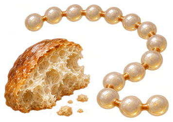 (center 300px, 1600px)
  {Bread beside an enlarged starch molecule: many linked glucose units.}
- Saliva
  - icon: 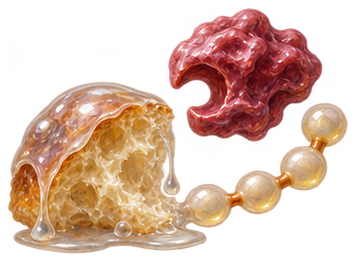 (center 780px, 1600px)
  {Saliva around chewed bread. A small enzyme shape fits against a starch chain.}
- Shorter starch chains
  - icon: 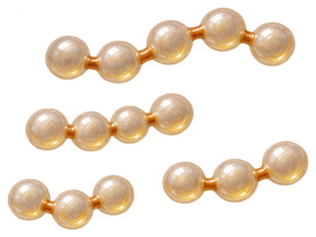
  {Several short sugar chains beside the longer starch chain they came from.}
- Digestive enzymes
  - icon: 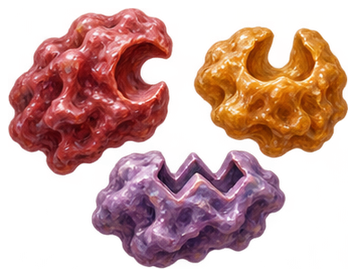 (center 1260px, 1600px)
  {Different enzyme shapes fit starch chains, protein chains and fat molecules. A label reads “different enzymes break different bonds.”}
- Meal glucose
  - icon: 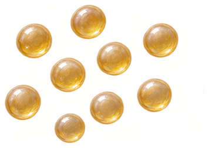
  {Separate glucose units beside the starch chain they came from.}
  Digestion releases small molecules from larger food molecules. Glucose can cross the intestinal lining.
- Protein food
  - icon: 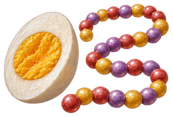 (center 300px, 2280px)
  {A piece of egg beside a folded chain of differently coloured amino acids.}
- Meal amino acids
  - icon: 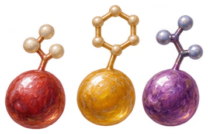
  {Separate amino acids beside the protein chain they came from.}
- Fat food
  - icon: 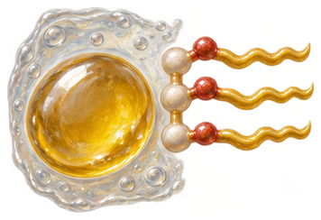 (center 780px, 2280px)
  {Large fat droplets mixed with watery food inside the intestine.}
- Bile
  - icon: 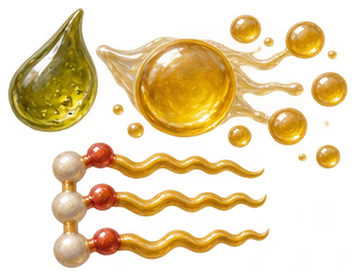 (center 1260px, 2280px)
  {Bile spreading one large fat droplet into many smaller droplets. An enlarged fat molecule stays unchanged.}
- Small fat droplets
  - icon: 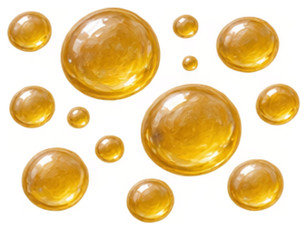
  {Many small droplets have more exposed surface than the single large droplet beside them.}
- Fat digestion products
  - icon: 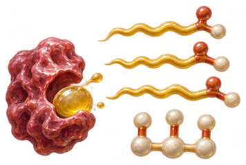
  {An enzyme at a droplet's surface; enlarged fat molecules split into smaller pieces.}
  Bile spreads fat out. Enzymes then break its molecules apart: two different jobs.

**Combinations**
- Starchy food [transform] + Digestive enzymes [preserve] -> Meal glucose
- Fat food [transform] + Digestive enzymes [preserve] -> Fat digestion products
- Starchy food [transform] + Saliva [preserve] -> Shorter starch chains
- Shorter starch chains [transform] + Digestive enzymes [preserve] -> Meal glucose
- Protein food [transform] + Digestive enzymes [preserve] -> Meal amino acids
- Fat food [transform] + Bile [preserve] -> Small fat droplets
- Small fat droplets [transform] + Digestive enzymes [preserve] -> Fat digestion products

> NOTE: Direct starch digestion by the supplied enzyme collection and fat hydrolysis before bile are also allowed. Bile is not chemically required for every individual fat bond to be hydrolysed; it increases the accessible surface, so the visible droplet-making goal remains distinct. The simplified endpoints compress different rates and complete digestion under the included normal conditions.

> NOTE: Five food transformations remain; three gland fittings have been removed. The gland-and-duct anatomy is bundled into the supplied digestive tube, leaving its real vein fitting for the later connection. The enzyme collection contains the different gastric, pancreatic and intestinal enzymes appropriate to each sample, not one universal enzyme. Water, normal temperature and acidity, and elapsed digestion are included; the visible juices supply the selected catalysts or dispersing material. Bile disperses fat without breaking its molecules. The colon's outer muscle is present but its inner wall is explicitly unfinished until the colon chapter. Grounding: [OpenStax 23.2](https://openstax.org/books/anatomy-and-physiology-2e/pages/23-2-digestive-system-processes-and-regulation), [23.7](https://openstax.org/books/anatomy-and-physiology-2e/pages/23-7-chemical-digestion-and-absorption-a-closer-look). Worth: physical dispersal and chemical breakdown do different jobs.

> NOTE: Illustration scope: locate saliva in the mouth, acid/protein digestion in the stomach and bile/pancreatic enzymes in the small intestine. The mixed enzyme supply represents distinct catalysts at their appropriate sites, not a single juice acting everywhere under one condition. Use separate labelled magnifications connected to one tract locator.

## `full-nutrition-boundary` Across the gut wall
background: 
Food inside the gut is still separated from the blood. Build either side first: a folded lining or a route joining capillaries to a vein. Bring the two constructions close together so dissolved food molecules have only a short crossing into the blood.

**Goals**
- Build the absorbing side: cover the villi with a thin lining -- Folded absorbing lining
- next: Bring the lining and blood close together -- Intestinal absorbing surface
- Build the blood side: join intestinal capillaries to the vein leading to the liver
  - either: Blood route from the intestine
  - or: Intestinal absorbing surface

**Items**
- Thin intestinal lining
  - icon: 
  {A sheet of closely joined living cells, one cell thick. Food faces one side and tissue fluid the other.}
- Fingerlike intestinal folds
  - icon: 
  {Many small fingerlike projections on larger folds inside the intestine. An inset labels the projections “villi” and shows their supporting tissue.}
- Folded absorbing lining
  - icon: 
  {The thin cell layer covers many villi. A flattened comparison strip shows how much surface fits into the folds.}
- Intestinal capillaries
  - icon: 
  {Fine blood vessels bend into loops inside a villus. Red cells stay inside the vessels.}
- Vein from intestine to liver
  - icon: 
  {A vein leads from the intestine to the liver. A one-way arrow follows the blood.}
- Blood route from the intestine
  - icon: 
  {Capillary loops join small veins, then the larger vein leading to the liver.}
- Intestinal absorbing surface
  - icon: 
  {A villus cutaway shows the one-cell-thick covering and nearby blood capillaries, with tissue fluid in between. The same glucose and amino-acid symbols from digestion cross the lining, then enter the capillaries. They keep exactly the same shapes on both sides. An arrow follows the outgoing vein to the liver; red blood cells remain inside the vessels.}
  Folds provide more surface. Thin walls keep the crossing short, and flowing blood carries absorbed molecules away.
- Lining with intestinal capillaries
  - icon: 
  {The folded cell layer has capillary loops beneath it. Larger outgoing vessels are still outlined on the way toward the liver.}

**Combinations**
- Thin intestinal lining [consume] + Fingerlike intestinal folds [consume] -> Folded absorbing lining
- Intestinal capillaries [consume] + Vein from intestine to liver [preserve] -> Blood route from the intestine
- Folded absorbing lining [consume] + Blood route from the intestine [consume] -> Intestinal absorbing surface
- Folded absorbing lining [consume] + Intestinal capillaries [consume] -> Lining with intestinal capillaries
- Lining with intestinal capillaries [consume] + Vein from intestine to liver [preserve] -> Intestinal absorbing surface

> NOTE: Three actions on the direct route, with an additional natural order for connecting capillaries and the outgoing vein. Lining and circulation are independent constructions. Their completed cutaway shows glucose and amino acids crossing unchanged; transport is not a recipe that creates a destination-labelled substance. The following chapter reuses Meal glucose itself as material for liver storage. Amino acids remain the digestion product; this chapter does not invent a second kind of amino acid. Villi are projections of the mucosa, containing connective tissue, vessels and ordinary support; the cell layer is their covering, not an empty bag. Transport proteins, energy supply and microvilli are included rather than constructed or named. This chapter examines glucose and amino acids only. Absorption of most long-chain fat through intestinal packaging and lymph is deliberately omitted; do not draw fat following the illustrated blood route. The fat result from the previous chapter is a completed digestion example. The reusable vein stands for the same blood route in the later whole-organ cutaway, not a duplicate vessel. Grounding: [OpenStax 23.5](https://openstax.org/books/anatomy-and-physiology-2e/pages/23-5-the-small-and-large-intestines), [23.7](https://openstax.org/books/anatomy-and-physiology-2e/pages/23-7-chemical-digestion-and-absorption-a-closer-look). Worth: arrangement and scale explain absorption without requiring transporter or fat-particle names.

## `full-between-one-meal-and-the-next` Fuel between meals
background: 
Meals arrive in bursts, but cells keep using fuel between them. Store some of the meal’s glucose in liver cells while exploring how insulin helps muscle store its own supply. Then compare the later, between-meal scene: a different pancreatic message, glucagon, prompts the liver to release glucose.

**Goals**
- Release insulin, then store glucose in muscle -- Muscle carbohydrate store
- Store glucose in the liver -- Liver carbohydrate store
- next: Use the between-meal message to release glucose -- `meal-released-glucose`

**Hotspots**
- `meal-insulin-cells`
- `meal-glucagon-cells`

**Items**
- Liver cells
  - icon: 
  {Intact liver cells beside a blood vessel contain the familiar nuclei and mitochondria. A time label reads “after a meal.” Separate glucose molecules from the earlier meal surround the cells; insulin is shown at the cell surface, labelled “after-meal storage signal.” Enzymes and ATP inside the cells are included.}
- Liver carbohydrate store
  - icon: 
  {Branched granules inside intact liver cells consist of many linked glucose units. A locator keeps the enlarged granule inside those cells, beside the same blood vessel.}

  The liver joins glucose into stored carbohydrate. Between meals, it can separate those units again.
- `meal-insulin-cells` Insulin-producing pancreatic cells
  - icon: 
  {A labelled “after a meal” cutaway shows a group of cells in the pancreas. The adjacent vessel contains many glucose molecules in the familiar blood. The cells contain stored insulin molecules; small membrane sacs can release them into that vessel.}
- `meal-glucagon-cells` Glucagon-producing pancreatic cells
  - icon: 
  {A second cutaway, labelled “between meals,” shows a different group of pancreatic cells. The same blood at this later time contains fewer glucose molecules. These cells contain stored molecules labelled “glucagon: message to release liver glucose.”}
- Insulin in blood
  - icon: 
  {Small protein molecules labelled “insulin” leave pancreatic cells and enter a blood vessel. The producing cells remain intact. Routes lead toward muscle and liver.}
  Insulin is a chemical message carried in blood. It helps muscle cells take in glucose.
- Glucagon in blood
  - icon: 
  {Small molecules labelled “glucagon” leave their pancreatic cells and travel toward the liver in a blood vessel. The cells remain intact; the label reads “message to release glucose.”}
  When blood glucose falls, this pancreatic message helps the liver break down stored carbohydrate.
- Muscle fibres beside a blood vessel
  - icon: 
  {An enlarged view of the same body's existing muscle fibres and capillary. Glucose molecules are visibly supplied in the nearby blood. The intact fibres contain enzymes and small carbohydrate granules; outlined receptors face the blood-carried insulin.}
- Muscle carbohydrate store
  - icon: 
  {A before/after inset shows fewer free glucose molecules in the nearby blood as linked glucose chains enlarge branched granules inside muscle fibres. The granules are labelled “glycogen: stored glucose.” The muscle and blood remain present; insulin stays outside and supplies no carbohydrate material.}
  Muscle stores some incoming glucose for its own later work. The hormone is a message, not the building material.
- `meal-released-glucose` Glucose
  - icon: 
  {The earlier branched liver store becomes smaller as separate glucose molecules pass from intact liver cells into a blood vessel. The pancreatic message meets the cell surface, outside the store.}
  Liver carbohydrate can supply glucose to the blood between meals. As blood glucose rises, the release signal eases.

**Combinations**
- Blood [preserve] @ `meal-insulin-cells` -> Insulin in blood
- Blood [preserve] @ `meal-glucagon-cells` -> Glucagon in blood
- Insulin in blood [preserve] + Muscle fibres beside a blood vessel [preserve] -> Muscle carbohydrate store
- Meal glucose [consume] + Liver cells [preserve] -> Liver carbohydrate store
- Liver carbohydrate store [transform] + Glucagon in blood [preserve] -> `meal-released-glucose`

> NOTE: Five operations in two independent projects: muscle storage and liver storage/release. The liver-storage operation is merged here from the former one-action chapter. Meal glucose is the same chemical material produced by digestion; its crossing of the intestinal wall did not create a new substance. The Glucose output is a later sample made by breaking down branched carbohydrate, not a transport-completed badge. Its separate engine identifier distinguishes this produced sample from the earlier supplies; all pictures use the same glucose symbol. Two fixed views of actual pancreatic cell populations supply the after-meal and between-meal contexts. The same existing Blood is used in both; no condition is turned into a new blood identity. These are two times, not one sample simultaneously at two glucose levels. The fixed contexts prevent these selected responses being performed before the scene that explains them. Muscle has a visibly supplied glucose pool in adjacent blood; it is consumed as storage material rather than represented by a separate preparatory placement. The newly made liver store remains pictured inside its intact producing cells; the release hormone binds those cells, not naked carbohydrate granules. Blood supplies the changing glucose stimulus in the shown context; it does not become a hormone. Alpha/beta cell names and release mechanisms are not required. Hormones are actual secreted proteins from stored cellular supplies, replenished using the cells' included amino acids, ATP and protein-making machinery. The existing muscle and liver remain producers/receivers, never materials to install again. Muscle storage consumes that supplied glucose; liver release transforms the actual store made earlier. Neither hormone provides the glucose atoms. Water, cellular enzymes, energy supply, transport and elapsed processing are included. Normal after-meal insulin conditions are supplied during liver storage; the later glucagon context changes the predominant response. The two pancreatic cutaways are temporal comparisons, not simultaneous contradictory conditions. Insulin and the liver-release hormone remain signals rather than structural fittings or glucose sources. Glucagon is introduced by name and immediately by its liver-release role; this stays within the already recorded blood-sugar-control detour, not a new advanced topic. Both hormones can coexist; this is a contrast of predominant responses, not an on/off switch, and the liver has other sources of glucose. These local tissue views share the same existing anatomy as the skin and later airway-defense chapters; no whole-body state changes here. Grounding: [OpenStax Biology 37.3](https://openstax.org/books/biology-2e/pages/37-3-regulation-of-body-processes), [OpenStax 24.5](https://openstax.org/books/anatomy-and-physiology-2e/pages/24-5-metabolic-states-of-the-body).

## `full-living-colon` A body is a habitat
background: 
The large intestine receives a wet remainder after much of a meal has been absorbed. Complete its inner wall while exploring what resident bacteria make from some of the fibre. The bacteria live in the contents; the lining keeps those contents apart from the blood.

**Goals**
- Build the colon's protected inner wall -- Colon inner wall
- next: Join the inner wall to the colon's muscle wall -- Colon
- next: Complete the continuous digestive tract -- Digestive tract
- Let microbes turn some fibre into smaller molecules -- Small fatty acids and gas

**Items**
- Upper digestive tract
  - icon: 
  {A continuous mouth-to-small-intestine cutaway includes the already-built absorbing lining and its blood route to the liver. The liver and pancreas retain their previously examined cells within their normal surrounding organ tissue. The mouth, food pipe, stomach, other glands, ducts and unexamined supporting tissues are supplied around that existing work. The small intestine ends beside a pale colon outline.}
- Digestive tract
  - icon: 
  {The small intestine now enters its supplied cecal junction, which continues into the existing colon. The colon continues to its supplied last section and outlet. A food arrow follows the tube; absorbed-molecule arrows cross its thin lining into nearby vessels. Blood-flow arrows remain inside those vessels. Liver, pancreas, glands and ducts retain their positions outside the tube.}

  Food stays inside a continuous tube. Absorbed material crosses its lining to reach the body's internal supplies.
- Colon lining
  - icon: 
  {Living cells form a continuous lining above a thin supporting layer. Water arrows cross the cells; the contents side is labelled “inside colon.”}
- Colon mucus
  - icon: 
  {A slippery layer above the cells that produced it.}
- Mucus-covered colon lining
  - icon: 
  {Mucus covers the lining. The contents lie above it and tissue fluid below.}
- Colon supporting tissue and vessels
  - icon: 
  {Connective tissue contains capillary loops beneath a space for the lining. The vessels connect to larger blood routes outside the colon.}
- Colon inner wall
  - icon: 
  {A continuous mucus-covered lining rests on supporting tissue containing capillaries. Water arrows cross the lining toward blood. A separate inset shows a few small fatty-acid molecules entering lining cells.}
  The lining recovers water. Some small molecules made by bacteria also cross it or become fuel for its cells.
- Wet food remainder
  - icon: 
  {Water, plant fibre and other undigested material inside the colon.}
- Resident gut microbes
  - icon: 
  {Bacteria remain intact among plant fibres in the wet colon contents. An inset shows small fragments entering bacteria and smaller molecules leaving them.}
- Small fatty acids and gas
  - icon: 
  {Small molecules labelled “short fatty acids” dissolve in the colon fluid beside gas bubbles. Broken fibre remains nearby; intact bacteria remain in the adjacent producer view.}
  Some gut bacteria break down fibre that our enzymes leave behind. They release small fatty-acid molecules and gas; some fibre remains unbroken.
- Colon lining with supporting tissue
  - icon: 
  {Living lining cells rest on connective tissue containing small blood vessels. The mucus layer at the inner surface is still outlined.}
- Colon muscle wall
  - icon: 
  {Two layers of muscle form the outside of a wide intestinal tube. Its inner surface is outlined for the lining; small paired views show successive contractions moving the contents along.}
- Colon
  - icon: 
  {The mucus-covered lining and supporting tissue sit inside the muscular wall of one continuous tube. Microbes and food remnants remain inside its tube, separate from blood vessels in the wall. The contractions move those contents toward the outlet.}

**Combinations**
- Colon lining [transform] + Colon supporting tissue and vessels [consume] -> Colon lining with supporting tissue
- Colon lining with supporting tissue [transform] + Colon mucus [consume] -> Colon inner wall
- Colon lining [transform] + Colon mucus [consume] -> Mucus-covered colon lining
- Mucus-covered colon lining [consume] + Colon supporting tissue and vessels [consume] -> Colon inner wall
- Wet food remainder [transform] + Resident gut microbes [preserve] -> Small fatty acids and gas
- Colon muscle wall [transform] + Colon inner wall [consume] -> Colon
- Upper digestive tract [transform] + Colon [consume] -> Digestive tract

> NOTE: Five required actions in two independent projects. This local reconstruction joins the built inner wall to the colon's supplied muscular wall; it finishes one real organ and never installs a second colon into a running body. The completed colon then joins the upper digestive tract through the supplied cecal junction, finishing the organ system before the finale. Whole-body placement is reserved for the finale. Fermentation preserves its living microbial producers and yields a mixed physical product: short-chain fatty acids and gases in the remaining wet contents. Existing microbial enzymes, water and elapsed time are included. Not all fibre is fermented and not every microbe or product is beneficial. Most water absorption has already occurred in the small intestine. The lining and vessel construction teaches their spatial relationship; this is not a claim that tissue survives without blood while being assembled. Sources: [OpenStax 23.5](https://openstax.org/books/anatomy-and-physiology-2e/pages/23-5-the-small-and-large-intestines), [OpenStax Microbiology 24.1](https://openstax.org/books/microbiology/pages/24-1-anatomy-and-normal-microbiota-of-the-digestive-system).

## `full-nutrition-kidney` Filter, then take back
background: 

Blood carries useful substances and wastes together. A kidney filter lets many small substances through, including some the body needs. Follow what the kidney takes back while building the route that carries the remaining urine to the bladder.

**Goals**
- Filter blood, then recover useful substances -- Urine
- Connect the kidneys to the bladder -- Urinary system[Ureters, Bladder]

**Hotspots**
- Kidney filter
- Kidney recovery tube

**Items**
- Urinary system (compound)
  - icon: 
  - slot: Ureters, accepts Ureters, icon: 
  - slot: Bladder, accepts Bladder, icon: 
  {Two kidneys lie beside the spine, with their existing blood vessels and two drainage outlets. A locator connects one kidney to the enlarged filtering unit beside this organ view. Spaces await the two ureters and the bladder below.}
- Urinary system
  [Ureters] {Two muscular ureters extend from the kidney outlets toward the bladder position. Arrows follow small muscular squeezes along each tube. Other fitted organs remain.}
- Urinary system
  [Bladder] {The bladder occupies its place below the kidneys. Its folded inner surface, muscular wall and supplied outlet are visible. A comparison shows this same sac small and stretched; any fitted ureters remain.}
- Urinary system
  [Ureters, Bladder] {Both ureters form continuous routes from the kidneys into the bladder. One fluid trail follows that route without changing the water and waste symbols. The enlarged kidney unit and the whole-organ view have separate scale labels.}

  Urine travels down two tubes called ureters and collects in the bladder. It stays the same fluid along that route.
- Ureters
  - icon: 
  {Two muscular tubes, each leading from a kidney toward the bladder.}
- Bladder
  - icon: 
  {A stretchy muscular sac with a supplied outlet tube.}
- Blood
- Kidney filter
  - icon: 
  {An enlargement within the existing kidney shows a ball of blood capillaries inside a cup-shaped space. Large blood cells and proteins stay in the vessels; small water, salt, glucose and waste symbols can cross the filter into the space. Blood has a continuing vessel exit of its own.}
- Filtered kidney fluid
  - icon: 
  {Water, glucose, salts and small wastes enter the start of the kidney tube. The neighbouring capillary still contains blood cells and large proteins. A locator places this fluid inside the same filtering unit.}

  The filter does not simply pick out wastes. Useful small substances pass through too.
- Kidney recovery tube
  - icon: 
  {The filtering unit continues into a living tube beside blood vessels. Arrows carry glucose, some salts and much water from inside the tube back into blood. The tube has a separate onward route for what remains.}
- Urine
  - icon: 
  {A smaller volume of fluid containing water, wastes and salts continues into a collecting route inside the kidney. The adjacent blood has recovered useful substances and much water. The urine has not turned into a different substance when it later enters a ureter or bladder.}

  Taking useful substances back is as important as filtering them out. The remaining fluid becomes urine.

**Combinations**
- Blood [preserve] @ Kidney filter -> Filtered kidney fluid
- Filtered kidney fluid [transform] @ Kidney recovery tube -> Urine

> NOTE: Four operations: two independent drainage fittings and filtration followed by recovery. Filter and recovery tube are fixed enlargement regions of one existing kidney, not detached organs. Blood is the familiar shared material; it is preserved because filtration removes only part of its fluid and small solutes. The result picture shows retained blood and filtrate together. Urine is the compositionally changed output after recovery, not a new identity defined by its destination. The completed system's picture traces that same fluid through its tubes into the bladder; no extra combination manufactures “urine in the bladder.” The supplied outlet does not require a separate anatomy ingredient. Nephron, glomerulus and individual transport-protein names are not prerequisites. Active transport, water movement, blood flow and other ordinary machinery are included; secretion into the tubule is omitted, so this is a selected account rather than complete urine chemistry. [NIDDK](https://www.niddk.nih.gov/health-information/kidney-disease/kidneys-how-they-work), [OpenStax A&P 25.5](https://openstax.org/books/anatomy-and-physiology-2e/pages/25-5-physiology-of-urine-formation) and [25.6](https://openstax.org/books/anatomy-and-physiology-2e/pages/25-6-tubular-reabsorption) ground the filter/recovery distinction.

## `full-nutrition-water` Save water, replace water
background: 

The blood now contains less water relative to its dissolved substances, and water-saving signals have reached the kidneys. The kidneys can conserve more water while still releasing urine. A drink supplies replacement water: move it across the already-built gut wall into its blood vessels.

**Goals**
- Make urine while conserving more water -- Concentrated urine
- Move water from the gut into blood -- Drinking water @ `water-gut-capillary`

**Hotspots**
- Urinary system
- `water-gut-capillary`

**Items**
- Drinking water
  - icon: 
  {Water molecules from a drink are now inside the intestinal lumen, on the opposite side of the lining from the pictured blood vessel. Their shape and label stay the same when they cross.}
- `water-gut-capillary` Gut-wall blood vessel
  - icon: 
  {The receiving area is the blood-filled interior of a capillary in the previously built intestinal absorbing surface. A larger surrounding cutaway keeps the gut lumen, intact lining and blood vessel visible together. A faint water route crosses the lining into this vessel; there is no open hole from gut contents to blood.}
- Concentrated urine
  - icon: 
  {The kidney panel shows more filtered water returning to blood and a smaller volume of urine carrying wastes onward. Its organ locator stays beside the kidney view; the independent gut panel keeps the drinking water wherever the player has placed it.}

  Kidneys conserve water already inside us. A drink replaces water from outside; both routes matter.

**Combinations**
- Blood [preserve] @ Urinary system[Ureters, Bladder] -> Concentrated urine

> NOTE: Two independent actions compare conservation and replacement. The kidney operation produces a genuinely different concentration of urine in a supplied low-water context. The water action is ordinary placement into an existing capillary view: its identity remains Drinking water, with no reaction recipe or destination-labelled product. The fixed capillary is a magnified receiving region of the gut-wall circulation built earlier, not a second organ to install. Its receptor bounds and eventual artwork placement must put the unchanged water on the blood side; a labelled route across intact epithelium represents the already-established absorption process. No claim is made that water passes through an open breach. This short physiology comparison is a payoff for the independent gut-wall/vascular and kidney-processing/drainage constructions, not a new molecular-control lesson.

> NOTE: Urinary system becomes fixed only in this comparison; its completed drainage slots remain required. Blood stays in circulation while some water and small dissolved materials enter urine. The water-short context and already-arrived hormonal response belong to the scene, not a renamed blood item. Sensing, hormones, kidney energy and processing time are supplied; hormone release and water-channel regulation are not reconstructed. [NIDDK](https://www.niddk.nih.gov/health-information/kidney-disease/kidneys-how-they-work) and [OpenStax A&P 26.2](https://openstax.org/books/anatomy-and-physiology-2e/pages/26-2-water-balance) ground the conservation/intake comparison.

## `full-a-living-surface` A living surface
background: 
Skin holds water in and helps keep unwelcome things out. This cross-section stays in the body: beneath its outer surface are living cells, blood vessels, glands and nerves. Build its protective layers and give sweat a way out.

**Goals**
- Build skin's protective and living layers -- Skin segment
- Make an outlet for sweat -- Sweat gland and duct
- next: Give the skin sweat outlets and sensory endings -- Skin segment[Sweat gland and duct, Skin nerve endings]

**Items**
- Outer skin cells
  - icon: 
  {Living cells below layers of flattened outer cells. Small arrows trace new cells moving towards the surface.}
- Lipids between skin cells
  - icon: 
  {Thin layers fill gaps between flattened outer skin cells. A magnified label reads “lipids: fat-like molecules.”}
- Supporting skin tissue
  - icon: 
  {A flexible mesh of fibres and living cells, with faint blood-vessel outlines.}
- Skin blood vessels
  - icon: 
  {Small red and blue vessels branch through the deeper skin.}
- Sweat gland coil
  - icon: 
  {A coiled tube of living cells with sweat forming inside it.}
- Sweat gland duct
  - icon: 
  {A narrow tube leads to a pore at the skin surface.}
- Skin nerve endings
  - icon: 
  {Fine nerve branches end at different depths in a skin cutaway.}
- Water-resistant skin surface
  - icon: 
  {Flattened cells and the fatty layers between them form the outer surface. Small outward water arrows are much reduced, not absent.}
  Outer cells and the fats between them slow water loss. New cells replace those shed at the surface.
- Sweat gland and duct
  - icon: 
  {The gland coil sits below the surface and its duct opens at a pore.}
- Living deeper skin
  - icon: 
  {Blood vessels run through the deeper supporting tissue. Arrows leave them toward the living cells at the base of an outlined outer layer; no blood vessels enter that outer layer.}
  The outer layer contains no blood vessels. Its living cells receive supplies from the tissue beneath it.
- Skin segment (compound)
  - icon: 
  - slot: Sweat outlet, accepts Sweat gland and duct, icon: 
  - slot: Sensory endings, accepts Skin nerve endings, icon: 
  {A small whole-arm locator marks this rectangular sample on the outer forearm. A rectangular cross-section of skin remains continuous with faint surrounding tissue at its edges. The water-resistant outer layer covers living deeper skin; a gland and nerve endings are outlined within it.}
- Skin segment
  [Sweat gland and duct, Skin nerve endings]
  {The same skin cross-section now contains a gland whose duct opens at the surface, with a droplet at its pore. Nerve branches and blood vessels occupy the deeper layer and continue into the surrounding tissue. Neighbouring layered cells resist water loss.}
  The same skin holds water in, senses contact and has openings that release sweat.

  ---

  {Two small views show this same skin in warm and cool surroundings. In warmth, sweat droplets lose water molecules to the air. In cold, a nearby muscle inset shows shivering. Nerve arrows from the brain reach glands and muscles.}

  Sweat removes heat as its water evaporates. In cold, shivering muscles make more heat. These responses use structures already present. [OpenStax, energy and heat balance](https://openstax.org/books/anatomy-and-physiology-2e/pages/24-6-energy-and-heat-balance).

- Skin layers awaiting blood vessels
  - icon: 
  {The water-resistant outer layer rests on deeper supporting tissue. Empty vessel outlines lie only in the deeper layer.}

**Combinations**
- Water-resistant skin surface [transform] + Supporting skin tissue [consume] -> Skin layers awaiting blood vessels
- Skin layers awaiting blood vessels [transform] + Skin blood vessels [consume] -> Skin segment
- Outer skin cells [transform] + Lipids between skin cells [consume] -> Water-resistant skin surface
- Sweat gland coil [transform] + Sweat gland duct [consume] -> Sweat gland and duct
- Supporting skin tissue [transform] + Skin blood vessels [consume] -> Living deeper skin
- Living deeper skin [transform] + Water-resistant skin surface [consume] -> Skin segment

> NOTE: Six required actions including two fittings. The surface, supporting layer and sweat outlet are separate useful constructions. The final object remains the same local skin segment, an anatomical view continuous with the body rather than a detached patch. It is not installed on a whole-body tile; `full-renewal-breach` and `full-renewal-rebuild` return to this same cross-section. Ordinary anatomy names epidermis, dermis and keratinocyte remain in background rather than as required labels. The epidermis is avascular; blood vessels remain in the deeper dermis. Barrier lipids reduce water loss rather than sealing the skin completely; the result explicitly says water-resistant. Lipids is introduced locally as fat-like molecules, without a list of their chemical types. The eccrine gland includes its ordinary secretory apparatus; its duct crosses the outer layers. Source: [OpenStax 5.1](https://openstax.org/books/anatomy-and-physiology-2e/pages/5-1-layers-of-the-skin), [5.2](https://openstax.org/books/anatomy-and-physiology-2e/pages/5-2-accessory-structures-of-the-skin), [5.3](https://openstax.org/books/anatomy-and-physiology-2e/pages/5-3-functions-of-the-integumentary-system). Worth: a seemingly simple covering contains different structures that solve different problems. The former standalone temperature chapter is cut. This short comparison retains ordinary sweat evaporation and shivering, while the advanced vessel-width control relationship is removed from both picture and prose. It adds no organ or process token. Airflow, humidity and air temperature affect cooling, and shivering uses food-derived energy through ATP. No guaranteed temperature recovery is depicted.

## `full-renewal-breach` A small breach
background: 
Return to the skin cross-section. A rough edge breaks its surface and a tiny blood vessel. Platelets gather into a plug while dissolved blood proteins become reinforcing threads; stopping the leak is the first repair.

**Goals**
- Gather a platelet plug at the break -- Skin with a platelet plug
- Make threads to reinforce the plug -- Clotting protein threads
- next: Stop the bleeding -- Skin with a reinforced clot

**Hotspots**
- Rough edge

**Items**
- Rough edge
  - icon: 
  {A rough edge touches the surface of the skin cross-section.}
- Platelets at the cut
  - icon: 
  {Tiny cell fragments gather on a torn vessel wall; further fragments stick to them.}
- Dissolved clotting protein
  - icon: 
  {Separate protein molecules float in the liquid part of blood.}
- Clotting enzymes
  - icon: 
  {Enzyme shapes appear in the blood near the damaged vessel. A label reads “helps clotting proteins form threads.”}
- Skin with a cut
  - icon: 
  {The same rectangular skin cross-section has a narrow cut through its surface and into a small blood vessel. The vessel is narrowed but still leaking. The sweat gland, nearby nerve branches and unbroken skin retain their positions.}
- Skin with a platelet plug
  - icon: 
  {In the same skin cross-section, platelets pile up at the vessel break, slowing the escaping blood. The surface cut remains open above it; neighbouring anatomy stays in place.}
  Platelets gather at the damage and recruit more platelets. Their plug slows the leak.
- Clotting protein threads
  - icon: 
  {Linked proteins form a branching mesh in the blood near the break.}
- Skin with a reinforced clot
  - icon: 
  {In the same cross-section, a protein mesh reinforces the platelet plug in the broken vessel. Escaping blood has stopped; the skin above it is still open.}
  The threads reinforce the plug. Bleeding has stopped; the skin still needs to heal.

**Combinations**
- Skin segment[Sweat gland and duct, Skin nerve endings] [transform] + Rough edge [preserve] -> Skin with a cut
- Skin with a cut [transform] + Platelets at the cut [consume] -> Skin with a platelet plug
- Dissolved clotting protein [transform] + Clotting enzymes [preserve] -> Clotting protein threads
- Skin with a platelet plug [transform] + Clotting protein threads [consume] -> Skin with a reinforced clot

> NOTE: Four actions, with platelet-plug and reinforcing-thread branches. Every changing wound item is the same local skin cross-section first built in the skin chapter. The injury consumes no whole-body object and produces no whole-body status. The skin compound's contents remain physically present in later drawings even though its former slots no longer encode them. The injury context is a selected event, not a treatment instruction. The dissolved protein is fibrinogen; thrombin cleaves it, allowing fibrin to assemble, and further reactions stabilize the mesh. The clotting enzymes represent the already activated local cascade, not an externally applied treatment. Enzymes are preserved rather than used as construction material. Platelet adhesion, coagulation and vessel contraction overlap. Scientific names for the cascade stay in these notes. Worth: stopping blood loss and rebuilding skin are different jobs. Source: OpenStax, [18.5 Hemostasis](https://openstax.org/books/anatomy-and-physiology-2e/pages/18-5-hemostasis).

## `full-renewal-rebuild` Close and strengthen
background: 
The plug holds blood in, but a gap remains in the skin. Clear broken fragments from that gap while preparing replacement cells, supporting fibres and new blood vessels. Then join the new tissue across the cleared gap.

**Goals**
- Clear broken fragments from the wound -- Skin with a cleared wound
- next: Close the skin surface -- Skin with a cleared wound[New skin cells]
- Rebuild support and blood supply -- Skin with a cleared wound[New supporting protein fibres, Capillary sprout]
- next: Clear the temporary clot -- Repaired skin segment

**Items**
- Debris-clearing white blood cells
  - icon: 
  {The outer-forearm locator marks the same small region. White blood cells surround broken cell fragments beside the clot.}
- Nearby capillary
  - icon: 
  {A tiny existing blood vessel runs beside the cut.}
- Protein messengers from the wound
  - icon: 
  {Small protein molecules released by cells near the wound travel through tissue fluid and meet the nearby vessel. An arrow points from these messengers toward the growing end of a new vessel branch.}
- Support-building skin cells
  - icon: 
  {Cells beneath the skin surface release bundles of supporting protein fibres.}
- `school-repair-protein-blocks` Protein building blocks
  - icon: 
  {Small labelled amino-acid shapes arrive in blood beside the support-building cells.}
- Skin cells at the cut's edge
  - icon: 
  {Surface cells divide and move toward the wound gap; the older outer cells remain above them.}
- `school-repair-fuel` Oxygen, glucose and amino acids
  - icon: 
  {Oxygen molecules, glucose molecules and amino acids leave nearby blood vessels and surround the dividing skin cells. The vessels remain in the background.}
- Clot-clearing enzymes
  - icon: 
  {An enzyme cuts protein threads into smaller fragments.}
- Capillary sprout
  - icon: 
  {A new branch extends from the nearby capillary toward another vessel at the wound.}
- Skin with a cleared wound (compound)
  - icon: 
  - slot: Supply, accepts Capillary sprout, icon: 
  - slot: Surface, accepts New skin cells, icon: 
  - slot: Support, accepts New supporting protein fibres, icon: 
  {In the same rectangular skin cross-section, broken cell fragments have been removed from around the clot; white cells contain the engulfed remains. The surface gap, deeper skin, sweat gland, nerve branches and surrounding vessels retain their positions.}
- Skin with a cleared wound
  [Capillary sprout]
  {The growing branch meets another vessel. Arrows show blood flowing through this joined route and supplying nearby cells. A separate small inset keeps the original vessel breach identifiable while its wall repairs beneath the temporary clot.}
- Skin with a cleared wound
  [New skin cells]
  {New skin cells span the wound gap. The deeper tissue remains visible below them.}
  The surface has closed. The tissue underneath is still gaining strength.
- Skin with a cleared wound
  [New supporting protein fibres]
  {New supporting fibres fill part of the deeper wound beneath the surface. Living cells remain among them.}
- New skin cells
  - icon: 
  {Newly produced skin cells cluster beside the existing wound edge. The gap remains open; a pale outline marks the area they can spread over.}
- New supporting protein fibres
  - icon: 
  {Fresh short bundles of protein fibres lie beside intact support-building cells at the wound margin. The deeper gap remains open; pale outlines show where more fibre material must join the surviving tissue.}
- Repaired skin segment
  - icon: 
  {The same skin cross-section has a closed surface and a small scar beneath it. Most temporary clot threads have gone; the original damaged vessel wall is continuous or its damaged remnant securely sealed. New supporting fibres and connected capillaries remain. The neighbouring sweat gland, nerve branches and unbroken skin retain their positions.}
  The clot was temporary. Living tissue takes its place and keeps changing as the scar matures.

**Combinations**
- Skin with a reinforced clot [transform] + Debris-clearing white blood cells [preserve] -> Skin with a cleared wound
- Nearby capillary [preserve] + Protein messengers from the wound [preserve] -> Capillary sprout
- Support-building skin cells [preserve] + `school-repair-protein-blocks` [consume] -> New supporting protein fibres
- Skin cells at the cut's edge [preserve] + `school-repair-fuel` [consume] -> New skin cells
- Skin with a cleared wound[Capillary sprout, New skin cells, New supporting protein fibres] [transform] + Clot-clearing enzymes [preserve] -> Repaired skin segment

> NOTE: Eight required actions including three implicit fittings. All changing wound objects remain views of the same local skin segment from `full-a-living-surface` and `full-renewal-breach`; the repaired segment is the endpoint, with no whole-body installation. Surface growth, matrix production and vessel sprouting are independently available and can proceed while debris clearance prepares the whole-wound view. The opening and first goal explicitly name that preparation before incorporation; the model orders the depicted gap clearance and closure, not all biological repair into non-overlapping phases. The support-building cells are fibroblasts making extracellular matrix, including collagen. They retain their normal gene-expression, secretion and processing machinery; the operation supplies amino acids and represents elapsed growth, rather than treating nutrients as a differentiation instruction. No separate transcription/translation lesson is required here. The surface cells migrate and divide using existing local nutrition; their consumed material input explicitly provides oxygen, glucose and amino acids rather than implying that fuel alone builds tissue. A capillary sprout requires connection to another vessel before the model depicts through-flow. The fittings show the produced skin cells spreading into the open gap, new fibres joining the surviving supporting tissue, and the new vessel branch meeting another vessel. Before these fittings, the cell/fibre product views leave the corresponding gaps open; no creation and installation step both claim to close the same gap. These are local growth and incorporation, not detached grafts. Producer populations remain: support-building cells secrete fibres and edge cells produce descendants. The sprout remains attached to its parent vessel; local oxygen, glucose, amino acids and water supporting vessel growth are included rather than supplied by the chemical repair signal. Fibrin removal overlaps repair; the final operation selects its later visible consequence. Scars may persist and may not regain original tissue strength. Worth: closing a wound and restoring its strength require different living tissues. Sources: OpenStax [4.6 Tissue Injury and Aging](https://openstax.org/books/anatomy-and-physiology-2e/pages/4-6-tissue-injury-and-aging), [18.5 Hemostasis](https://openstax.org/books/anatomy-and-physiology-2e/pages/18-5-hemostasis).

## `full-renewal-turnover` Still becoming
background: 
The body stays itself while replacing many of its cells. Bone marrow can reuse iron from worn red blood cells, while new skin cells grow beneath a shedding surface. Follow these local tissues as they make replacement cells.

**Goals**
- Recover iron and use it in new red blood cells -- `rf-new-red-cells`
- Grow replacement skin cells -- `rf-new-skin-cells`

**Items**
- `rf-worn-red-cells` Worn red blood cells
  - icon: 
  {Red discs with uneven edges contain haemoglobin. A labelled whole-molecule enlargement shows four iron-containing heme sites; the single-site close-up is labelled as one part of that molecule.}
- `rf-spleen-recyclers` Blood-cell recycling cells
  - icon: 
  {Large living cells in the existing spleen surround worn red cells. Inside one recycler, an enclosed red cell breaks into smaller materials.}
- `rf-recovered-iron` Iron recovered from old blood cells
  - icon: 
  {Iron atoms carried by protein molecules in blood. The recyclers remain intact; there are no metallic fragments.}
  Old red cells are broken down, but their iron can be used again.
- `rf-blood-forming-marrow` Red bone marrow
  - icon: 
  {Existing soft red marrow between bone struts contains stem cells, developing blood cells and small blood vessels. A short label explains “stem cells: some stay; descendants become blood cells.” A key identifies the included supply: water, amino acids, glucose and other nutrients.}
  ---
  Marrow maintains a population of stem cells while descendants divide and become specialized blood cells. Iron is one of several materials needed to make new red cells.
- `rf-new-red-cells` New red blood cells
  - icon: 
  {New red discs without nuclei enter a small vessel beside the intact marrow. Their haemoglobin contains iron with the same colour as the recovered supply; stem cells remain in the marrow.}
  Recovered iron becomes part of the oxygen-carrying protein in new red cells. The marrow remains to make more.
- `rf-skin-base` Dividing cells at the skin's base
  - icon: 
  {A row of living cells lies beneath several skin layers. Some cells divide; both the maintained base population and its outward-moving descendants are visible. Supporting tissue and a blood vessel lie below.}
- `rf-skin-materials` Water, glucose and cell building materials
  - icon: 
  {Water, glucose, amino acids and small fat-like molecules move from a blood vessel toward the skin's living base. An inset labels these as materials for growth, not as a tissue layer.}
- `rf-new-skin-cells` New skin cells beneath the surface
  - icon: 
  {New descendants occupy a layer just above the intact base population. Higher cells are progressively flatter; a few old flakes lift from the outer surface. The skin remains a continuous covering.}
  New cells grow below as old cells leave above. Their descendants change as they move toward the surface.

**Combinations**
- `rf-worn-red-cells` [consume] + `rf-spleen-recyclers` [preserve] -> `rf-recovered-iron`
- `rf-recovered-iron` [consume] + `rf-blood-forming-marrow` [preserve] -> `rf-new-red-cells`
- `rf-skin-materials` [consume] + `rf-skin-base` [preserve] -> `rf-new-skin-cells`

> NOTE: Three actions in two independent product chains. Recycling cells, marrow and the dividing skin base all persist. The iron input is reused material, not enough by itself to make a whole red cell: marrow includes its water, amino acids, glucose, other nutrients, oxygen, signals and supporting tissue. Skin growth explicitly consumes water and building materials; existing oxygen supply, ATP production, DNA replication and cell machinery accompany division and growth. Both examples compress normal elapsed time. These are local anatomical cutaways, not detached organs or implants; the whole-body model is assembled only in the final chapters. No whole-body token is needed: these existing local tissues make replacement cells without a final combination installing marrow or skin back into the body. Sources: [Red blood cell life cycle](https://pubmed.ncbi.nlm.nih.gov/34342697/), [Blood cell formation](https://www.ncbi.nlm.nih.gov/books/NBK26919/), [Building and maintaining the skin](https://cshperspectives.cshlp.org/content/14/7/a040840.full.pdf).

## `full-assembly-regions` All together
background: 

The parts you built now return at one scale. Prepare the head, chest, lower body and skin in whatever order helps you see their connections. The model supplies unstudied tissues, including the other arm and the studied arm’s hand and shoulder attachments. Finish each regional assembly before joining the regions, then fit the skin last.

**Goals**
- Place the eye and ears in the head -- `nervous-system-model`[Eye with optic nerve, `final-ears`]
- Prepare both regions: gut and urinary organs below; arm and lymph vessels at the chest
  - both: Lower body[Digestive tract, `final-urinary-organs`]
  - and: Breathing apparatus[Diaphragm, Heart and lungs, Arm assembly, Lymph drainage network]
- Fit the repaired segment into the skin covering -- Skin covering[Repaired skin segment]
- (three goals are a lot but okay here because head, regional anatomy and skin can be prepared independently)
- next: Join the chest to the lower body -- Trunk and limbs
- next: Join the head, spine and nerves to the trunk -- Body beneath the skin
- next: Fit the skin covering -- Body

**Items**
- `nervous-system-model` (compound)
  - from chapter `full-assembly-regions`: Head and spine
  - unnamed slot: accepts Eye with optic nerve, icon: 
  - unnamed slot: accepts `final-ears`, icon: 
- `nervous-system-model`
  [Eye with optic nerve] {The eye occupies one eye socket in the existing skull-and-brain model. Its optic nerve follows its route into the same brain; the supplied second eye occupies the other eye socket. The spine and peripheral nerves remain.}
- `nervous-system-model`
  [`final-ears`] {The ears occupy the sides of the head. The hearing coils and balance sensors retain their nerves to the brain; no second inner ear is added. Other fitted parts remain.}
- Eye with optic nerve
- `final-ears` Ears
  - icon: 
  {The same pair of ears now appears at the head's scale. Cutaways retain the outer ears, canals, eardrums, small bones and hearing coils from the hearing chapter. Beside the coils are the fluid loops and weighted balance sensors from the balance chapter. Their established nerves lead toward the matching brain connections. None of these parts is added twice.}
- Digestive tract

- Skin covering (compound)
  - icon: 
  - slot: Studied skin segment, accepts Repaired skin segment, icon: 
  {A flexible, body-shaped anatomical-model covering has normal openings for the eyes, mouth and other body openings. One small rectangular inspection opening matches the original skin segment. The rest of the skin and its ordinary underlying attachments are supplied. A locator places the opening at exactly the site shown in the skin and wound chapters.}
- Skin covering
  [Repaired skin segment]
  {The repaired segment fills only that small opening. Its modest scar remains visible at the same location; its blood vessels and nerves meet the neighbouring skin routes. An enlarged inset retains its layered cells, gland and repaired tissue. The surrounding skin has not come from the segment.}
- Repaired skin segment

- Lower body (compound)
  - icon: 
  - slot: Digestive tract, accepts Digestive tract, icon: 
  - slot: Urinary organs, accepts `final-urinary-organs`, icon: 
  {Real pelvic bones, two complete legs and abdominal and pelvic walls form the supplied lower region of the model. Its upper boundary lies just below the diaphragm. Clear spaces await the gut and urinary organs; a channel at the back awaits the same spine already present with the head. Ordinary unstudied organs, joints, muscles and surrounding support are included. The model has no duplicate backbone, kidneys or digestive tube.}
- Lower body
  [Digestive tract]
  {The gut occupies the abdomen, with the liver high beneath the future diaphragm and the colon surrounding loops of small intestine. The upper food pipe continues toward its matching route through the chest and throat. Its blood vessels retain the established route through the liver. Other fitted parts remain.}
- Lower body
  [`final-urinary-organs`]
  {The same kidneys lie toward the back of the upper abdomen. Their two ureters descend to the bladder low in the pelvis. The urinary outlet remains separate from the digestive outlet. Other fitted parts remain.}
- `final-urinary-organs` Urinary organs
  - icon: 
  {The completed kidney pair, both ureters and bladder from the filtering and water chapters now appear at the model's assembly scale. These are the same organs. The kidneys' blood vessels remain distinct from the two tubes carrying urine.}
- Breathing apparatus (compound)
  - unnamed slot: accepts Arm assembly, icon: 
  - unnamed slot: accepts Lymph drainage network, icon: 
- Breathing apparatus
  [Arm assembly] {The unstudied opposite arm is already attached at one shoulder. The built arm meets its shoulder attachments on the other side of the existing chest. Its supplied hand, collarbone and remaining tissues surround the bones and muscles already built. Biceps and triceps remain on opposite sides of its elbow. Blood vessels and nerve endings meet the routes at that shoulder.}
- Breathing apparatus
  [Lymph drainage network] {The existing lymph vessels occupy their anatomical routes beside the blood vessels. Their already built neck-vein junction is aligned with that same vein in the chest model; no second junction is created.}
- Arm assembly
  - icon: 
  {The completed arm cutaway returns as one movable anatomical-model part at the final assembly scale. Its mineralized living bones, biceps in front of the elbow and triceps behind it retain their original attachments. This is the same arm examined earlier, with the studied structures already in place; the model supplies its hand and other unexamined tissues.}
- Lymph drainage network
- Trunk and limbs
  - icon: 
  {Chest and lower region meet at their matching edges. The diaphragm separates the chest's lungs and heart from the abdominal organs below. Both arms connect at the shoulders and both legs at the pelvis. Digestive and urinary paths stay separate. An open channel at the back awaits the spine; established blood and lymph routes continue through the regions without a second neck-vein junction.}

  The diaphragm divides the chest from the abdomen. Nerves, blood vessels and the food pipe cross between regions through their own routes.
- Body beneath the skin
  - icon: 
  {The completed head and spine join the trunk: the skull sits above the neck, vertebrae run behind the chest and abdomen, and the same nerves reach muscles, glands and sensory endings. Existing blood routes supply the nervous tissue and all other regions. The eye and ears retain their established routes to the brain. The still-open surface exposes the anatomy for one last view.}

  Signals travel along nerves. Blood carries materials. The same muscle needs both.
- Body
  - icon: 
  {The prepared covering follows the body's shape. Its small repaired scar remains at the original site. A broad cutaway reveals the same heart, lungs, digestive tube, kidneys, nerves and opposing arm muscles inside. Insets show blood carrying materials, nerves carrying signals, and the skin and marrow continuing to make replacement cells. No constructed part is replaced by a new copy.}

  Every part keeps doing its own work. Together, those continuing exchanges make one living body possible.

**Combinations**

> NOTE: The sensory and skin fittings can be pursued alongside the chest and lower-body constructions; the digestive tract was completed in the colon chapter. The two sensory fittings may happen in either order; gut and skin are independent projects. This is a single-scale anatomical model of the same structures, not removal and transplantation of living organs. The head's ordinary facial tissues and second eye are supplied around the already-built skull/brain view. Eye and ear nerves meet their existing brain pathways, not the spinal nerve roots. The ear handoff represents completed hearing and balance anatomy once. A front/back model cutaway makes the separate head, spine and peripheral nerves legible as the same connected neural anatomy. The skin opening is a model inspection opening, not a new wound; fitting it causes no new healing event. The gut's muscular walls, attachments, glands and duct connections are included. The model retains two distinct exits: digestive contents eventually leave the gut, while the separately built urinary organs drain through their own outlet. Sources: OpenStax [body regions and cavities](https://openstax.org/books/anatomy-and-physiology-2e/pages/1-6-anatomical-terminology), [cranial and spinal nerves](https://openstax.org/books/anatomy-and-physiology-2e/pages/13-4-the-peripheral-nervous-system), and the candidate's existing digestion/skin sources. The goal names test physical placement and continuity, not new advanced mechanisms.

- Lower body[Digestive tract, `final-urinary-organs`] [transform] + Breathing apparatus[Diaphragm, Heart and lungs, Arm assembly, Lymph drainage network] [consume] -> Trunk and limbs
- Trunk and limbs [transform] + `nervous-system-model`[Eye with optic nerve, `final-ears`] [consume] -> Body beneath the skin
- Body beneath the skin [transform] + Skin covering[Repaired skin segment] [consume] -> Body

> NOTE: The regional preparation goal explicitly names all four required fittings before the model regions join. This is the model's assembly convention, not a claim that living anatomy requires this placement order. Ten required actions in this combined final chapter: two sensory fittings, one skin fitting, two lower-body fittings, two chest fittings and three physical joins. The lower-body and chest projects remain independently useful until convergence. Both chest fittings can occur in either order, and either lower-body organ system can be fitted first. The earlier diaphragm/lung/circulation fittings persist in Breathing apparatus. Those completed qualifications are required by its final ordinary recipe; slot acceptance does not try to require a qualified component. The same principle requires the completed sensory and skin compounds in their final recipes. The final `Body` is a single genuine anatomical unity, produced by adding a substantial covering rather than a completion or zoom-out token.

> NOTE: At this scale the first arm includes its supplied hand, remaining muscles, collarbone and ordinary joint/supporting tissues; its constructed shoulder blade, upper/forearm bones, biceps and triceps are unchanged. The opposite arm is explicitly supplied already attached to the chest; repeating its placement did not earn an operation in the first test. The lower-body base supplies the pelvis and legs while leaving the constructed spine absent until the real join. The chest's existing systemic vessels and lymph return are aligned with the other regions, not recreated. The urinary handoff preserves the exact completed anatomy represented by the fixed kidney compound in the water-balance chapter. The upper digestive input includes the throat/food-pipe continuation: assembly places that same tube through its normal route, not entirely below the diaphragm. The lower-body picture places the abdominal part of the gut; its supplied upper section continues through the chest and into the head when the regions join. Eye and ear pathways enter the brain through their established cranial routes; they do not pass through spinal nerve roots. No new physiology is claimed. Sources: OpenStax [body cavities](https://openstax.org/books/anatomy-and-physiology-2e/pages/1-6-anatomical-terminology), [shoulder girdle](https://openstax.org/books/anatomy-and-physiology-2e/pages/8-1-the-pectoral-girdle) and [peripheral nerves](https://openstax.org/books/anatomy-and-physiology-2e/pages/13-4-the-peripheral-nervous-system).

## `full-finish` Epilogue: the same body, still changing

The body's shape can look steady while its cells keep working, making materials, sending messages and replacing worn parts. Those continuing relationships make the whole possible. The model is assembled; the living body is never finished.
