# 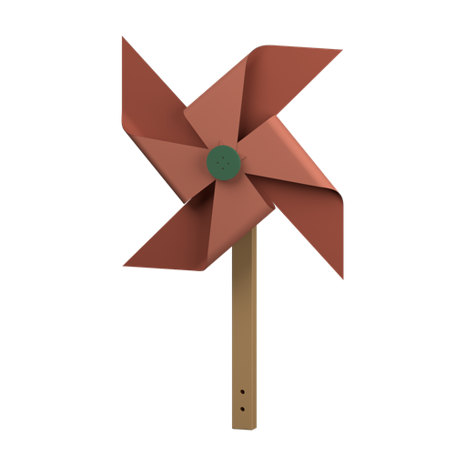 The Next Box
background: 

Paper, wheels, string and light. Open a box and make something.

## `c01` Something that moves
background: 
reference: 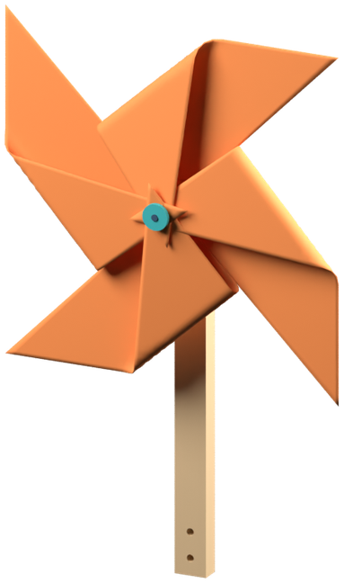

**Goals**
- Fold the first corner inward -- `pw-one-blade`
- next: Fold the second corner inward -- `pw-two-blades`
- next: Fold the third corner inward -- `pw-three-blades`
- next: Fold the last corner inward -- `pw-loose-rotor`
- next: Fit the hub to the blades -- `pw-folded-rotor`
- next: Flip the blades over -- `pw-rear-rotor`
- next: Fit the axle into the back of the hub -- `pw-bearing-rotor`
- next: Clip the handle onto the axle -- `pw-mounted`
- next: Flip the pinwheel to the front -- `pinwheel`

**Hotspots**
- `pw-fold` (center 390px, 216px)
  - icon: 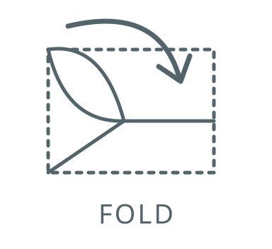
  - hitbox: (center 390px, 216px) (size 236px, 248px)
- `pw-flip` (center 130px, 216px)
  - icon: 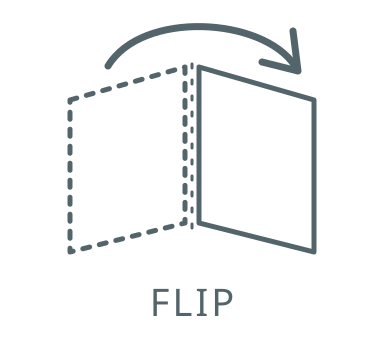
  - hitbox: (center 130px, 216px) (size 236px, 248px)

**Items**
- `pw-fold` Fold
- `pw-flip` Flip
- `pw-paper` Paper
  - icon: 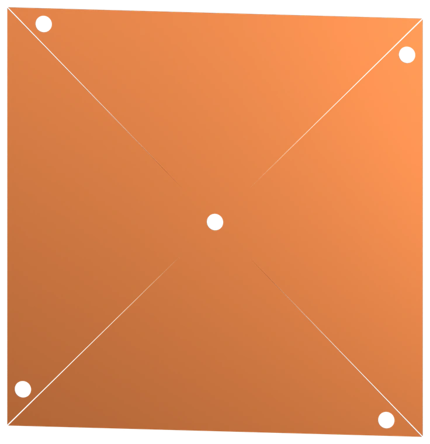 (center 358px, 830px)

  {A flat brick-red square. Fine diagonal lines run inward from its corners; round holes sit near the corners and centre.}

  ---

  The paper sheet is already cut along four diagonals, stopping short of the centre. Curl the four pierced corners inward; keep the uncut centre whole.
- `pw-hub` Hub
  - icon: 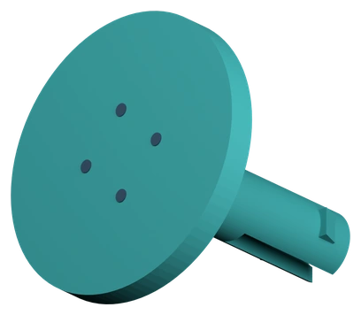 (center 140px, 460px)

  {A green round cap with four small dark holes on its face.}

  ---

  A hollow snap-in hub holds the folded corners together. Its centre is a bearing for the axle.
- `pw-axle` Axle
  - icon: 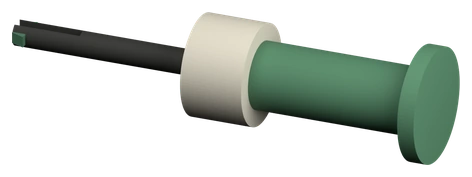 (center 470px, 460px)

  {A thin black pin extends from a cream ring and green stepped stem ending in a round cap.}

  ---

  A blunt axle with a built-in spacer and retaining tip. The hub turns around the axle; the spacer keeps the paper clear of the handle.
- `pw-handle` Handle
  - icon: 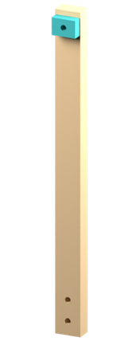 (center 690px, 820px)

  {A long narrow wooden handle with a green open hook at one end and small dark holes near each end.}

  ---

  The prepared clip snaps over the axle's rear post. Two small mounting holes remain near the foot of the handle.
- `pw-one-blade` Paper
  - icon: 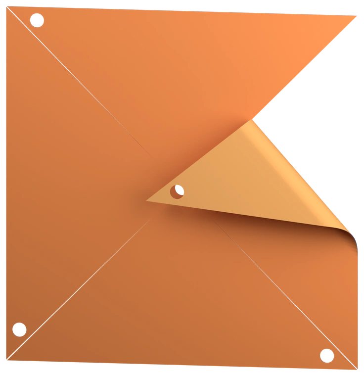

  {One red corner curls inward, leaving an open notch at the upper right and a holed tip near the centre.}
- `pw-two-blades` Paper
  - icon: 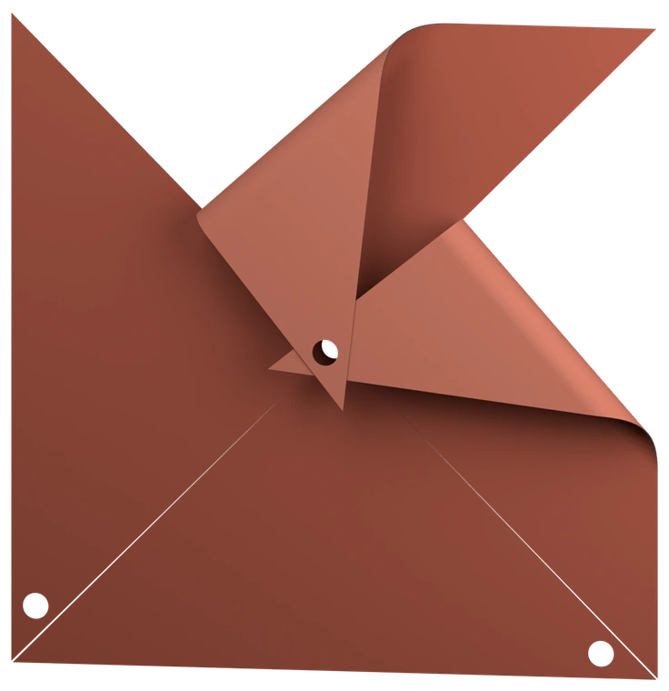

  {Two curled red folds meet near the centre. The lower half still has two flat corners.}
- `pw-three-blades` Paper
  - icon: 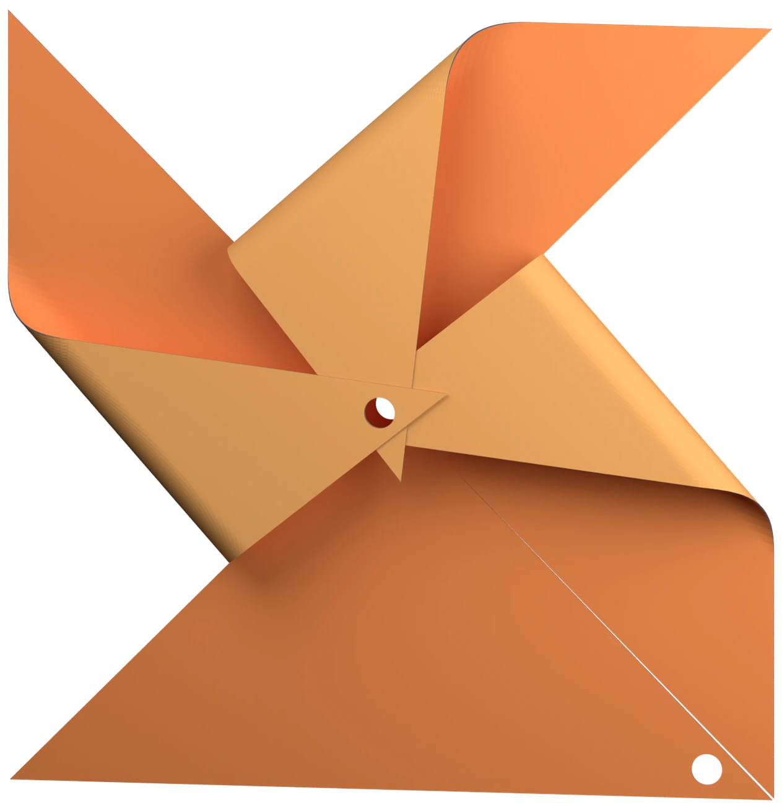

  {Three curled folds meet near the centre; one flat lower-right corner with a round hole remains.}
- `pw-loose-rotor` Blades
  - icon: 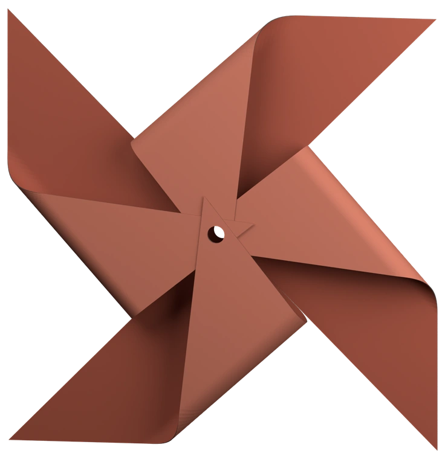

  {Four curled red blades surround a small dark hole at the centre.}
- `pw-folded-rotor` Blades
  - icon: 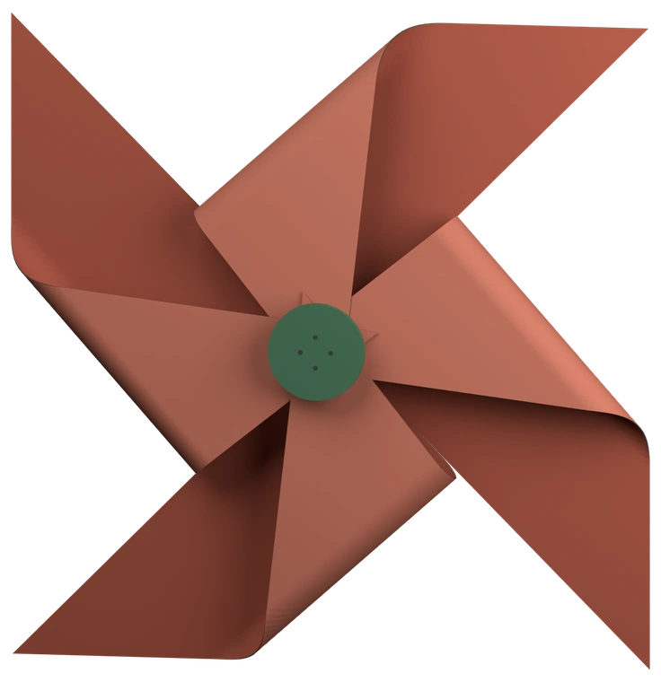

  {Four curled red blades meet beneath a small green round cap.}
- `pw-rear-rotor` Blades
  - icon: 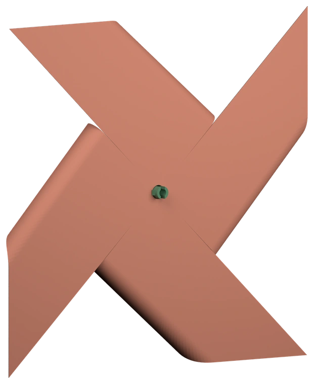

  {The pale-red back of the four blades, with a short green tip at the centre.}
- `pw-bearing-rotor` Blades
  - icon: 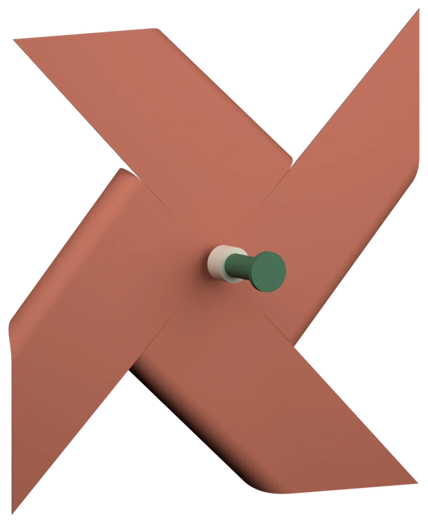

  {On the back of the red blades, a cream ring and short green stem project from the centre.}
- `pw-mounted` Pinwheel
  - icon: 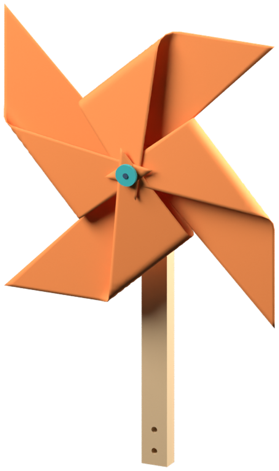

  {The wooden handle extends down from the back of the red blades, beneath the green centre fitting.}
- `pinwheel` Pinwheel
  - icon: 
  - animation: 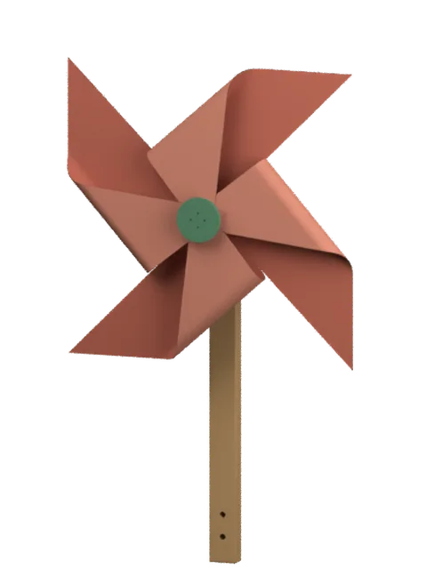

  {Four curled red blades surround a green centre cap. A long wooden handle extends below.}

  ---

  Four curved paper blades catch the breeze. The paper and hub turn together around the axle while the handle stays still.

**Combinations**
- `pw-paper` [transform] @ `pw-fold` -> `pw-one-blade` (tutorial)
- `pw-one-blade` [transform] @ `pw-fold` -> `pw-two-blades`
- `pw-two-blades` [transform] @ `pw-fold` -> `pw-three-blades`
- `pw-three-blades` [transform] @ `pw-fold` -> `pw-loose-rotor`
- `pw-hub` [consume] + `pw-loose-rotor` [transform] -> `pw-folded-rotor`
- `pw-folded-rotor` [transform] @ `pw-flip` -> `pw-rear-rotor`
- `pw-axle` [consume] + `pw-rear-rotor` [transform] -> `pw-bearing-rotor`
- `pw-handle` [consume] + `pw-bearing-rotor` [transform] -> `pw-mounted`
- `pw-mounted` [transform] @ `pw-flip` -> `pinwheel`

## `c02` A sail
background: 
reference: 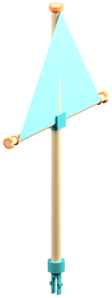

**Goals**
- Fit the connector to the mast
  - either: `wr-mast-joint`
  - or: `wr-mast-joint-foot`
  - or: `wr-frame`
  - or: `wr-ready`
  - or: `wr-frame-sail`
  - or: `wr-sail`
- next: Fit the crossbar into the connector
  - either: `wr-frame`
  - or: `wr-ready`
  - or: `wr-frame-sail`
  - or: `wr-sail`
- next: Push the foot onto the mast
  - either: `wr-mast-foot`
  - or: `wr-mast-joint-foot`
  - or: `wr-ready`
  - or: `wr-sail`
- next: Clip the sail onto the mast -- `wr-sail`

**Items**
- `wr-mast-wood` Mast
  - icon: 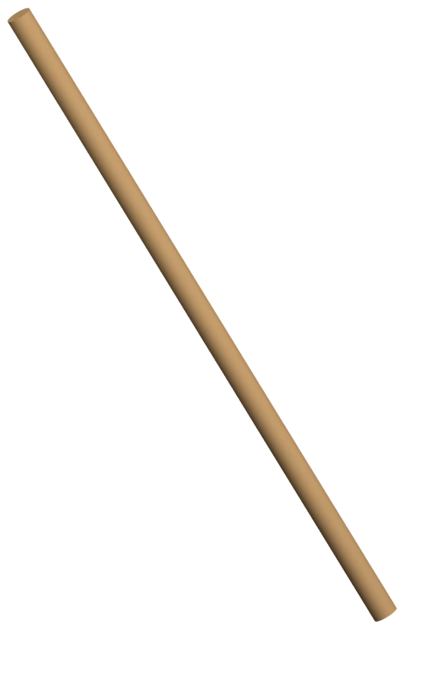

  {A long, slim tan rod lying diagonally.}
- `wr-mast-foot` Mast
  - icon: 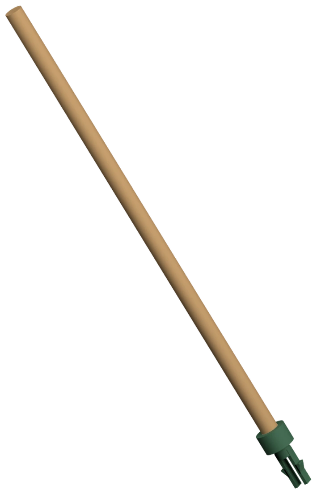

  {A long tan rod ends in a green socket with split legs.}
- `wr-mast-joint` Mast
  - icon: 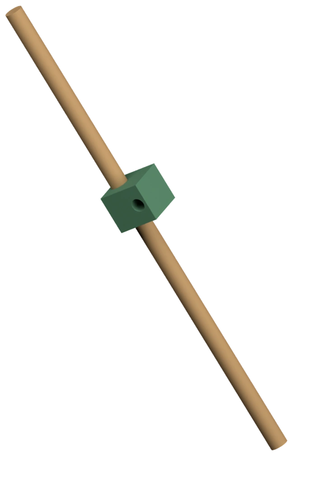

  {A long tan rod passes through a green block. A round side opening remains visible in the block.}
- `wr-mast-joint-foot` Mast
  - icon: 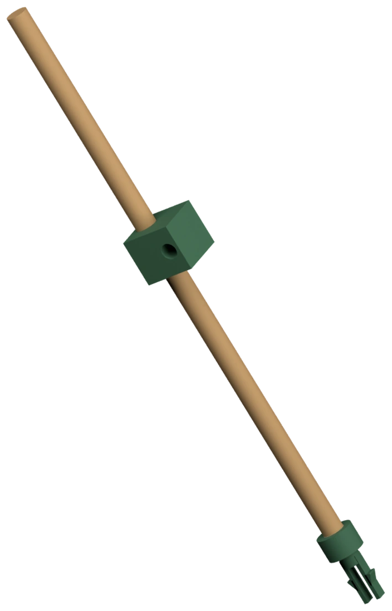

  {The long tan rod has a green block partway along it and a green split fitting at its lower end.}
- `wr-frame` Mast
  - icon: 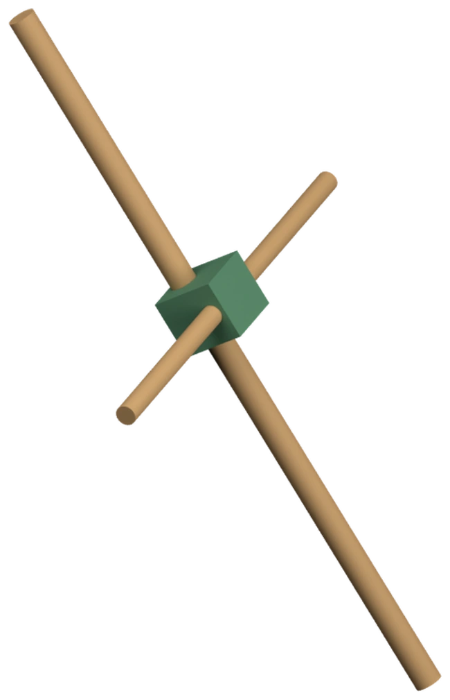

  {A long tan rod and shorter crosspiece meet at a green block.}
- `wr-ready` Mast
  - icon: 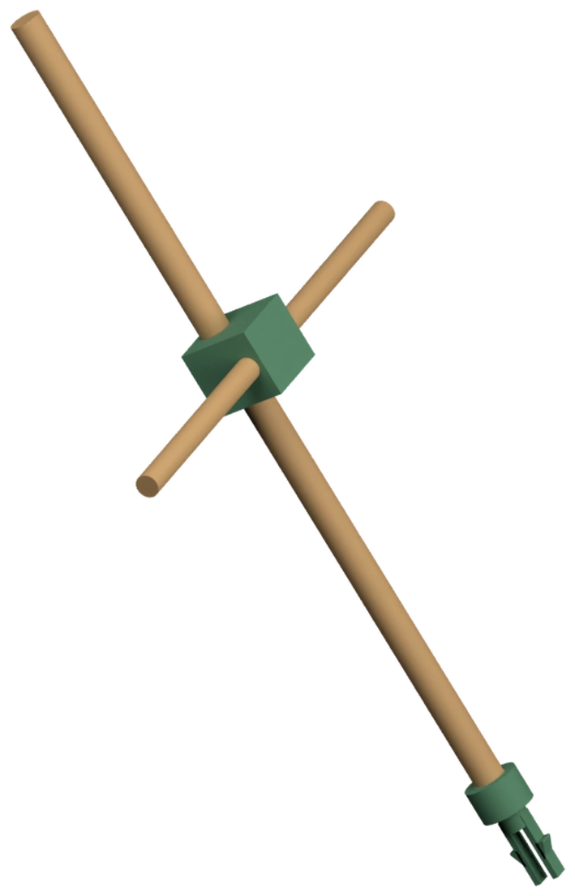

  {The crossed tan rods meet at a green block. A green split fitting sits at the end of the longer rod.}
- `wr-frame-sail` Sail
  - icon: 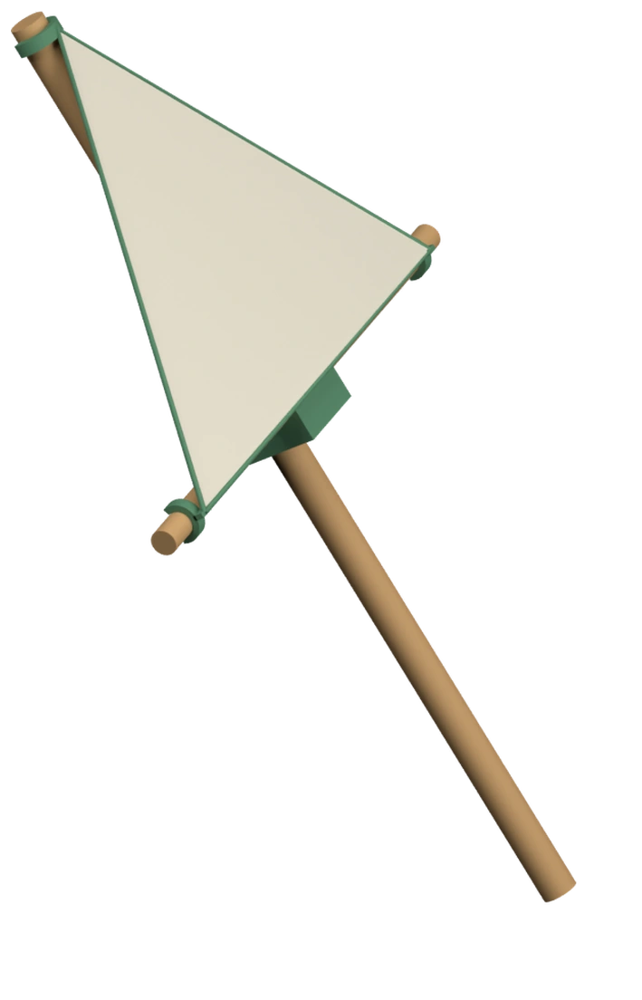

  {A cream triangular sail spans the tan frame, with a long bare rod extending below it.}
- `wr-sail` Sail
  - icon: 
  - from chapter `c-racer-body` icon: 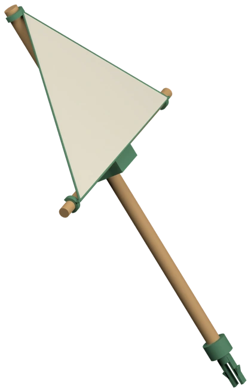

  {A cream triangular sail sits on a tan frame, above a long tan rod ending in a green split fitting.}
- `wr-connector` Connector
  - icon: 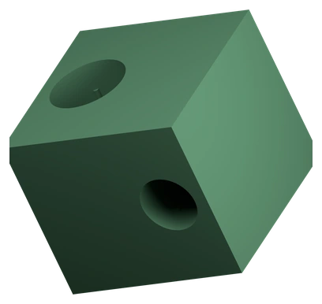

  {A green block with round openings on two different faces.}

  ---

  Two offset sockets keep the wooden rods from crossing through each other. Flexible ribs grip both rods.
- `wr-crossbar` Crossbar
  - icon: 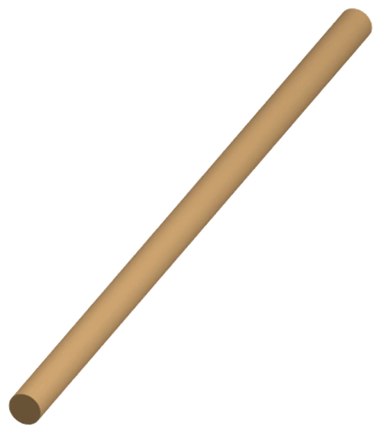

  {A short tan rod with a round end, lying diagonally.}

  ---

  A short wooden rod that supports the bottom of the sail.
- `wr-foot` Foot
  - icon: 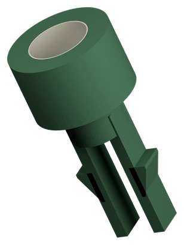

  {A green round socket with a pale inner rim and two long split legs below.}

  ---

  The mast pushes into the top socket. The split legs underneath will snap into the chassis.
- `wr-sailcloth` Sail
  - icon: 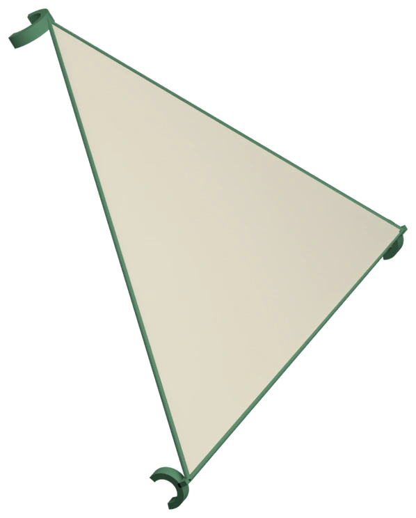

  {A cream triangular sail edged in green, with small open green clips at its corners.}

  ---

  Three small open clips are attached to the cloth. They press onto the mast and crossbar.
- `wr-crossbar-joint` Crossbar
  - icon: 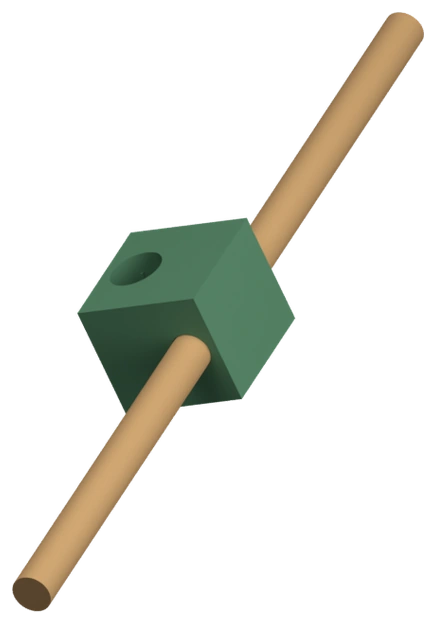

  {A short tan rod passes through a green block; a round opening faces upward.}

**Combinations**
- `wr-foot` [consume] + `wr-mast-wood` [transform] -> `wr-mast-foot`
- `wr-foot` [consume] + `wr-mast-joint` [transform] -> `wr-mast-joint-foot`
- `wr-foot` [consume] + `wr-frame` [transform] -> `wr-ready`
- `wr-foot` [consume] + `wr-frame-sail` [transform] -> `wr-sail`
- `wr-connector` [consume] + `wr-mast-wood` [transform] -> `wr-mast-joint`
- `wr-connector` [consume] + `wr-mast-foot` [transform] -> `wr-mast-joint-foot`
- `wr-crossbar` [consume] + `wr-mast-joint` [transform] -> `wr-frame`
- `wr-crossbar` [consume] + `wr-mast-joint-foot` [transform] -> `wr-ready`
- `wr-sailcloth` [consume] + `wr-frame` [transform] -> `wr-frame-sail`
- `wr-sailcloth` [consume] + `wr-ready` [transform] -> `wr-sail`
- `wr-connector` [consume] + `wr-crossbar` [transform] -> `wr-crossbar-joint`
- `wr-crossbar-joint` [consume] + `wr-mast-wood` [transform] -> `wr-frame`
- `wr-crossbar-joint` [consume] + `wr-mast-foot` [transform] -> `wr-ready`

## `c-racer-body` Wheels for the sail
background: 
reference: 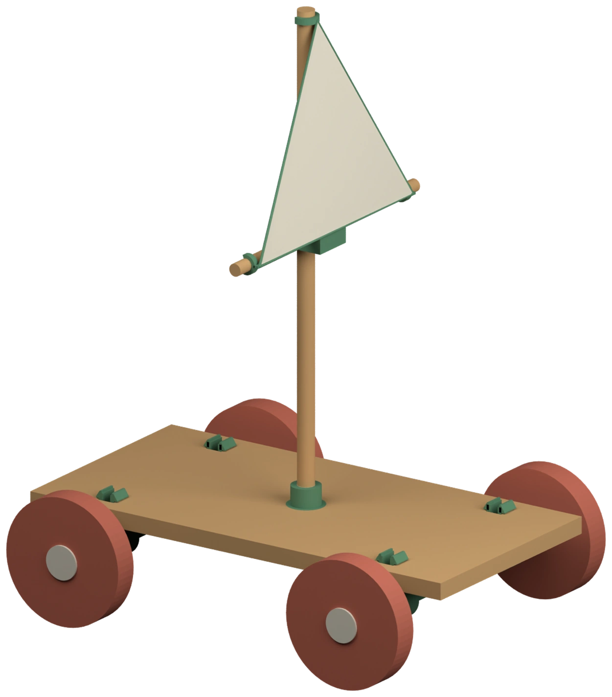

**Goals**
- Flip the chassis over -- `wr-chassis`
- next: Push a wheel onto the front straw -- `wr-front-one-wheel`
- next: Push another wheel onto the front axle -- `wr-front-wheels`
- next: Push a wheel onto the rear straw -- `wr-rear-one-wheel`
- next: Push another wheel onto the rear axle -- `wr-rear-wheels`
- next: Fit a bearing to the chassis
  - either: `wr-front-bearing-chassis`
  - or: `wr-rear-bearing-chassis`
  - or: `wr-bearing-chassis`
  - or: `wr-front-rolling-chassis`
  - or: `wr-rear-rolling-chassis`
  - or: `wr-front-wheel-chassis`
  - or: `wr-rear-wheel-chassis`
  - or: `wr-rolling-chassis`
- next: Fit the other bearing
  - either: `wr-bearing-chassis`
  - or: `wr-front-wheel-chassis`
  - or: `wr-rear-wheel-chassis`
  - or: `wr-rolling-chassis`
- next: Snap wheels into a bearing
  - either: `wr-front-rolling-chassis`
  - or: `wr-rear-rolling-chassis`
  - or: `wr-front-wheel-chassis`
  - or: `wr-rear-wheel-chassis`
  - or: `wr-rolling-chassis`
- next: Snap on the other wheels -- `wr-rolling-chassis`
- next: Flip the chassis upright -- `wr-upright`
- next: Fit the sail to the chassis -- `wind-racer`

**Hotspots**
- `wr-flip` (center 390px, 216px)
  - icon: 
  - hitbox: (center 390px, 216px) (size 236px, 248px)

**Items**
- `wr-chassis-top` Chassis
  - icon: 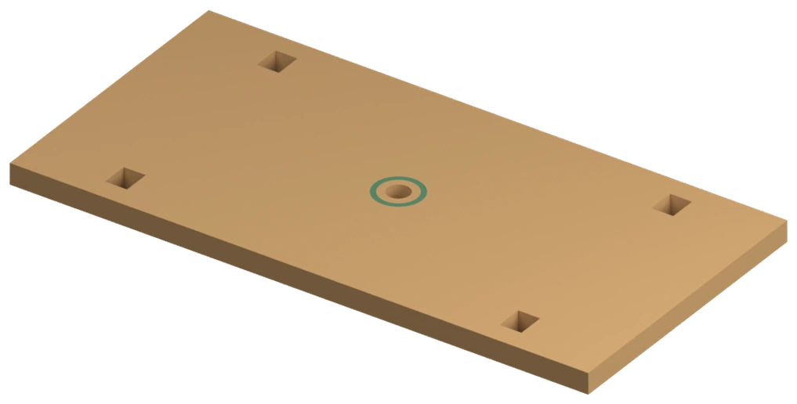

  {A flat tan rectangular board with four small rectangular holes and a green ring around its central round hole.}
- `wr-chassis` Chassis
  - icon: 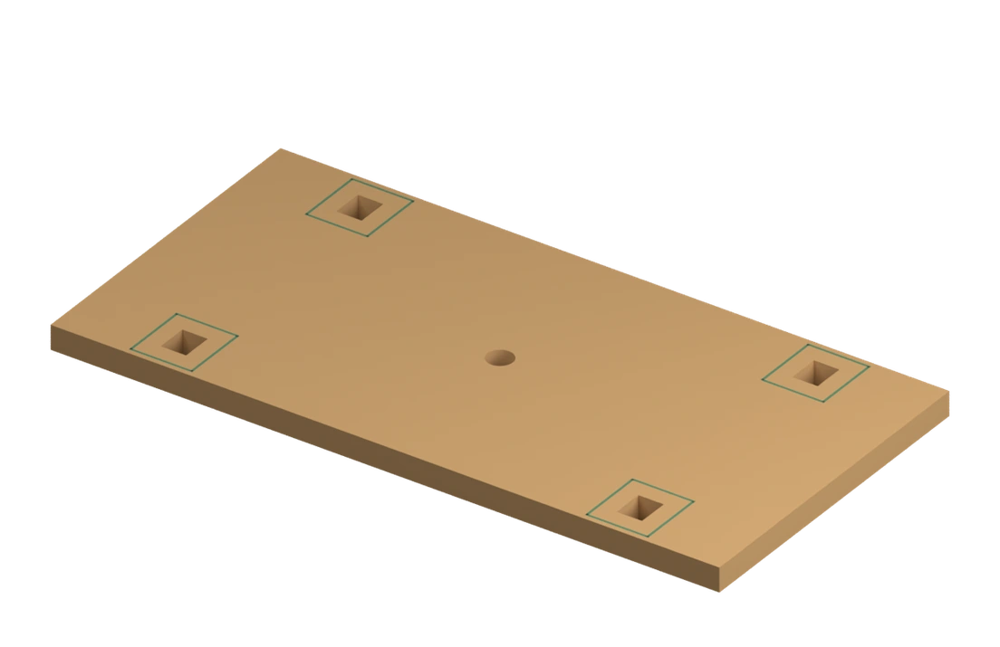

  {The other face of the tan board has green square outlines around its four rectangular holes and a plain central round hole.}
- `wr-front-bearing-chassis` Chassis
  - icon: 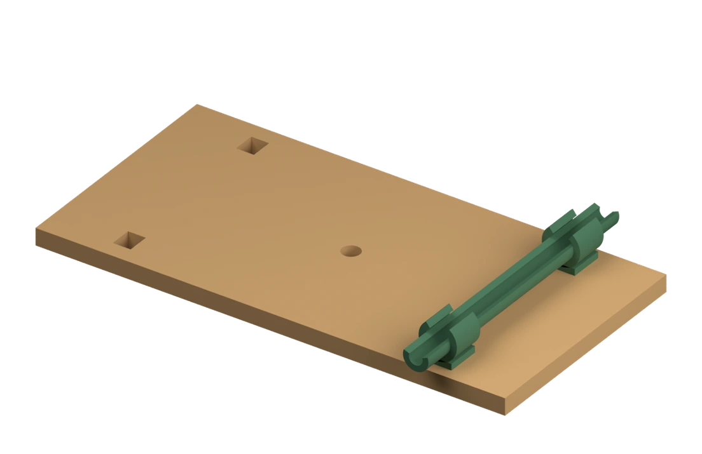

  {A green channel lies across the right-hand end of the tan board. The other end still shows two square outlines.}
- `wr-rear-bearing-chassis` Chassis
  - icon: 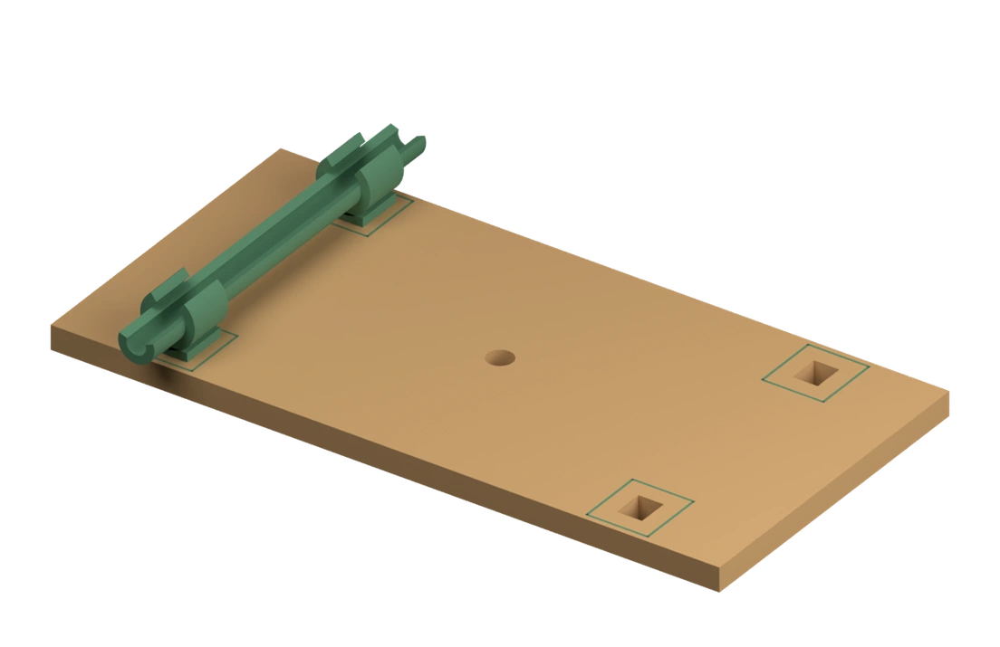

  {A green channel lies across the left-hand end of the tan board. The other end still shows two square outlines.}
- `wr-bearing-chassis` Chassis
  - icon: 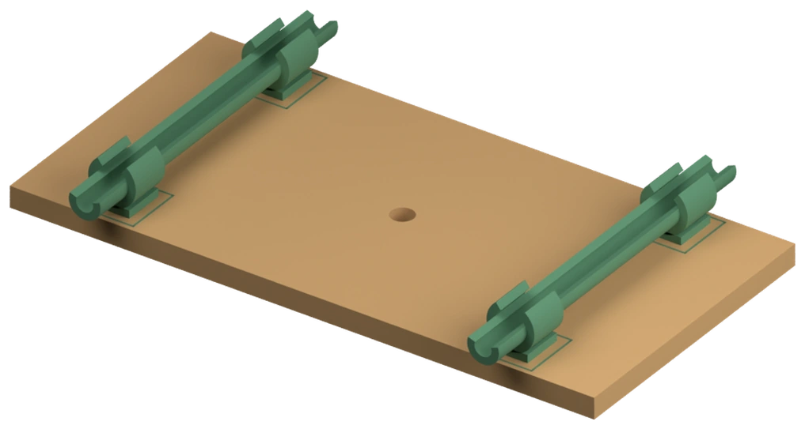

  {Two green channels lie across opposite ends of the tan board.}
- `wr-front-rolling-chassis` Chassis
  - icon: 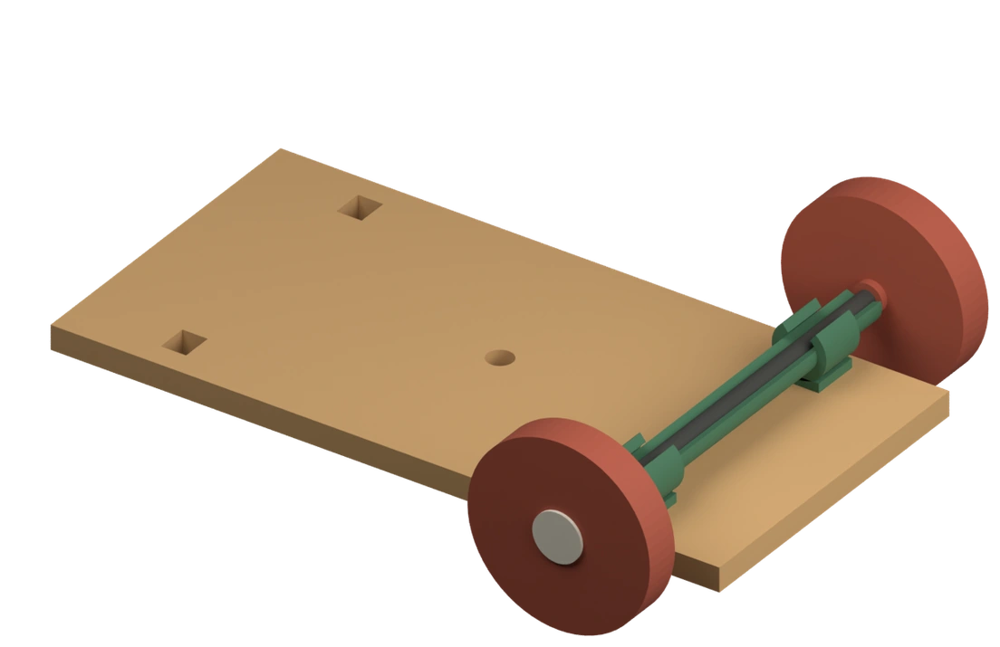

  {A pair of red wheels and a green channel cross the right-hand end of the tan board; the opposite end is bare.}
- `wr-rear-rolling-chassis` Chassis
  - icon: 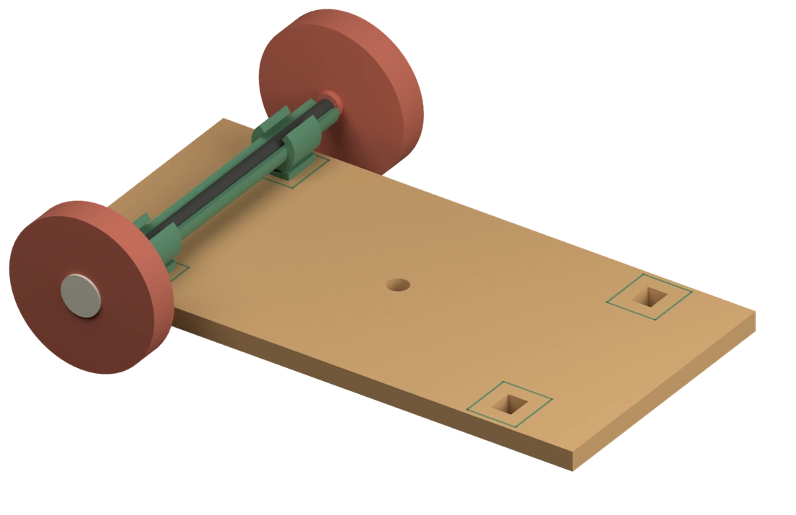

  {A pair of red wheels and a green channel cross the left-hand end of the tan board; the opposite end is bare.}
- `wr-front-wheel-chassis` Chassis
  - icon: 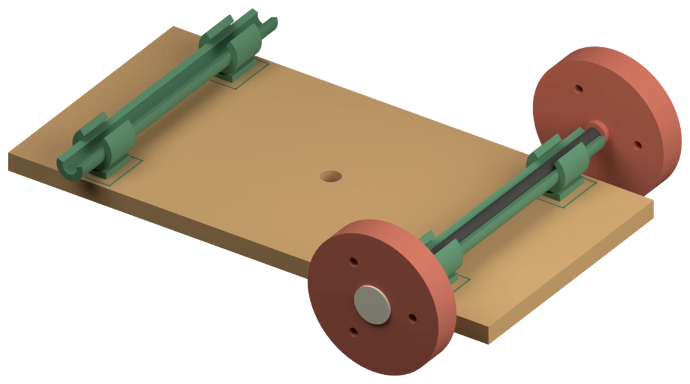

  {The tan board has two green channels; a red wheel sits at each end of the right-hand channel.}
- `wr-rear-wheel-chassis` Chassis
  - icon: 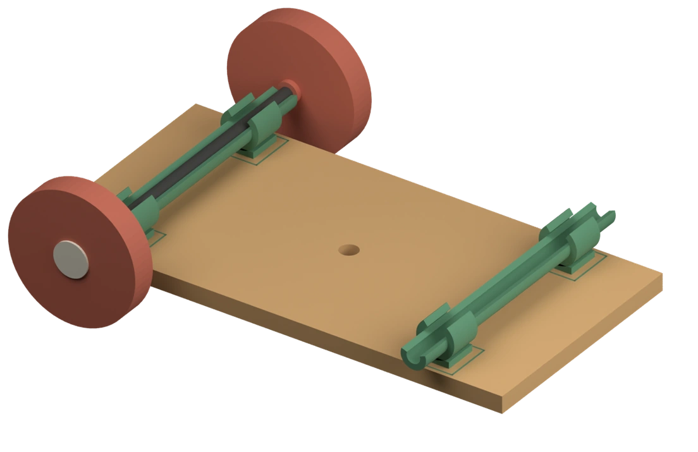

  {The tan board has two green channels; a red wheel sits at each end of the left-hand channel.}
- `wr-rolling-chassis` Chassis
  - icon: 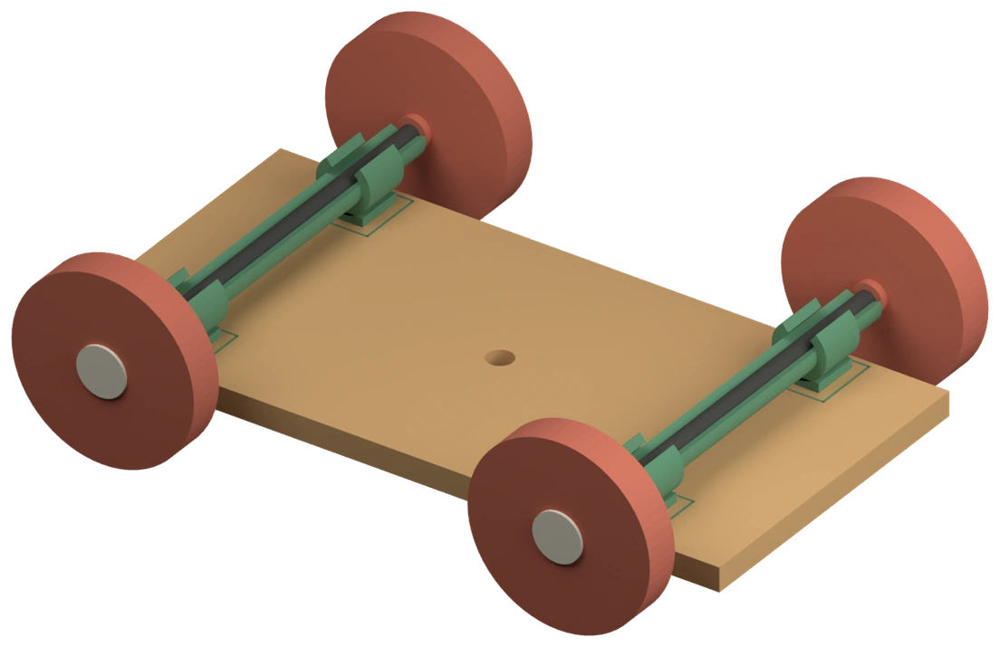

  {Four red wheels sit beside two green channels across the exposed underside of the tan board.}
- `wr-upright` Chassis
  - icon: 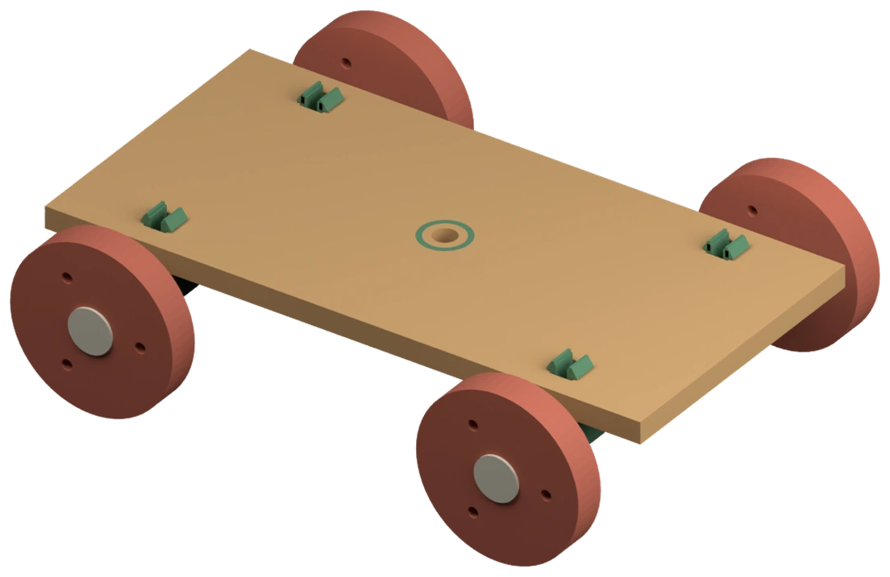

  {The tan board sits above four red wheels. Small green fittings and the green ring around the centre hole are visible on top.}
- `wind-racer` Wind racer
  - icon: 
  - animation: 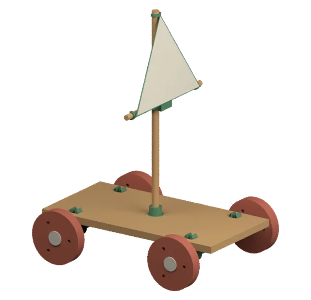

  {A cream triangular sail rises above a tan rectangular chassis with four red wheels.}

  ---

  The wheels turn together with each straw axle inside the bearings. Outdoors, moving air can push against the sail.
- `wr-flip` Flip
- `wr-front-bearing` Bearing
  - icon: 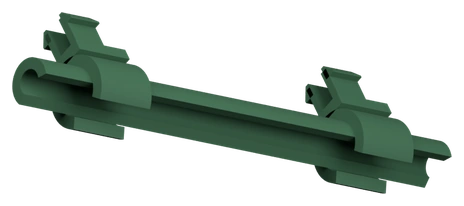

  {A long green open channel with two raised clip fittings.}

  ---

  An open bearing clips beneath the chassis. Its spring lips let the axle snap into the channel.
- `wr-front-axle` Front straw
  - icon: 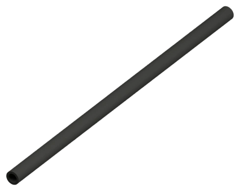

  {A thin dark tube lying diagonally, with a round opening at its nearer end.}

  ---

  A stiff hollow plastic axle. Push one wheel onto each end.
- `wr-front-one-wheel` Front axle
  - icon: 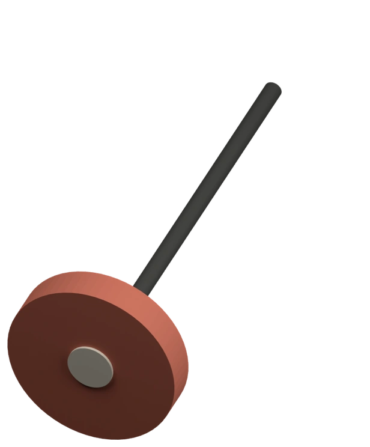

  {One red wheel sits on the end of a long dark axle; its other end is bare.}
- `wr-front-wheels` Front wheels
  - icon: 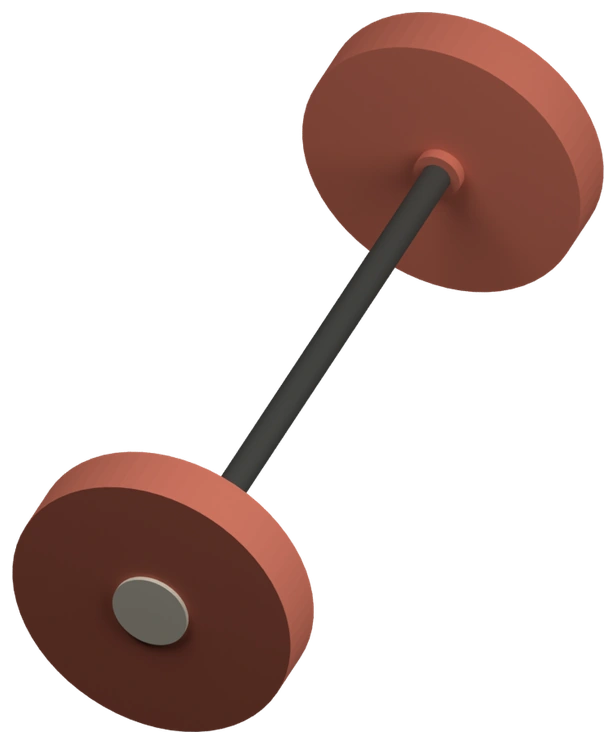

  {Two red wheels sit at opposite ends of one dark axle.}
- `wr-rear-bearing` Bearing
  - icon: 

  {A long green open channel with two raised clip fittings.}

  ---

  An open bearing clips beneath the chassis. Its spring lips let the axle snap into the channel.
- `wr-rear-axle` Rear straw
  - icon: 

  {A thin dark tube lying diagonally, with a round opening at its nearer end.}

  ---

  A stiff hollow plastic axle. Push one wheel onto each end.
- `wr-rear-one-wheel` Rear axle
  - icon: 

  {One red wheel sits on the end of a long dark axle; its other end is bare.}
- `wr-rear-wheels` Rear wheels
  - icon: 

  {Two red wheels sit at opposite ends of one dark axle.}
- `wr-wheel-1` Wheel
  - icon: 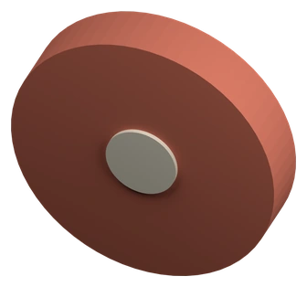

  {A thick brick-red wheel with a pale round centre.}

  ---

  The wheel has a blind centre socket and an integral spacer. Any wheel fits either straw.
- `wr-wheel-2` Wheel
  - icon: 

  {A thick brick-red wheel with a pale round centre.}

  ---

  The wheel has a blind centre socket and an integral spacer. Any wheel fits either straw.
- `wr-wheel-3` Wheel
  - icon: 

  {A thick brick-red wheel with a pale round centre.}

  ---

  The wheel has a blind centre socket and an integral spacer. Any wheel fits either straw.
- `wr-wheel-4` Wheel
  - icon: 

  {A thick brick-red wheel with a pale round centre.}

  ---

  The wheel has a blind centre socket and an integral spacer. Any wheel fits either straw.

**Combinations**
- `wr-chassis-top` [transform] @ `wr-flip` -> `wr-chassis`
- `wr-wheel-1` [consume] + `wr-front-axle` [transform] -> `wr-front-one-wheel`
- `wr-wheel-1` [consume] + `wr-front-one-wheel` [transform] -> `wr-front-wheels`
- `wr-wheel-2` [consume] + `wr-front-axle` [transform] -> `wr-front-one-wheel`
- `wr-wheel-2` [consume] + `wr-front-one-wheel` [transform] -> `wr-front-wheels`
- `wr-wheel-3` [consume] + `wr-front-axle` [transform] -> `wr-front-one-wheel`
- `wr-wheel-3` [consume] + `wr-front-one-wheel` [transform] -> `wr-front-wheels`
- `wr-wheel-4` [consume] + `wr-front-axle` [transform] -> `wr-front-one-wheel`
- `wr-wheel-4` [consume] + `wr-front-one-wheel` [transform] -> `wr-front-wheels`
- `wr-wheel-1` [consume] + `wr-rear-axle` [transform] -> `wr-rear-one-wheel`
- `wr-wheel-1` [consume] + `wr-rear-one-wheel` [transform] -> `wr-rear-wheels`
- `wr-wheel-2` [consume] + `wr-rear-axle` [transform] -> `wr-rear-one-wheel`
- `wr-wheel-2` [consume] + `wr-rear-one-wheel` [transform] -> `wr-rear-wheels`
- `wr-wheel-3` [consume] + `wr-rear-axle` [transform] -> `wr-rear-one-wheel`
- `wr-wheel-3` [consume] + `wr-rear-one-wheel` [transform] -> `wr-rear-wheels`
- `wr-wheel-4` [consume] + `wr-rear-axle` [transform] -> `wr-rear-one-wheel`
- `wr-wheel-4` [consume] + `wr-rear-one-wheel` [transform] -> `wr-rear-wheels`
- `wr-front-bearing` [consume] + `wr-chassis` [transform] -> `wr-front-bearing-chassis`
- `wr-rear-bearing` [consume] + `wr-chassis` [transform] -> `wr-rear-bearing-chassis`
- `wr-front-bearing` [consume] + `wr-rear-bearing-chassis` [transform] -> `wr-bearing-chassis`
- `wr-rear-wheels` [consume] + `wr-rear-bearing-chassis` [transform] -> `wr-rear-rolling-chassis`
- `wr-front-bearing` [consume] + `wr-rear-rolling-chassis` [transform] -> `wr-rear-wheel-chassis`
- `wr-front-wheels` [consume] + `wr-front-bearing-chassis` [transform] -> `wr-front-rolling-chassis`
- `wr-rear-bearing` [consume] + `wr-front-bearing-chassis` [transform] -> `wr-bearing-chassis`
- `wr-front-wheels` [consume] + `wr-bearing-chassis` [transform] -> `wr-front-wheel-chassis`
- `wr-rear-wheels` [consume] + `wr-bearing-chassis` [transform] -> `wr-rear-wheel-chassis`
- `wr-front-wheels` [consume] + `wr-rear-wheel-chassis` [transform] -> `wr-rolling-chassis`
- `wr-rear-bearing` [consume] + `wr-front-rolling-chassis` [transform] -> `wr-front-wheel-chassis`
- `wr-rear-wheels` [consume] + `wr-front-wheel-chassis` [transform] -> `wr-rolling-chassis`
- `wr-rolling-chassis` [transform] @ `wr-flip` -> `wr-upright`
- `wr-sail` [consume] + `wr-upright` [transform] -> `wind-racer`

## `bf-pb-rails` A marble table
background: 
reference: 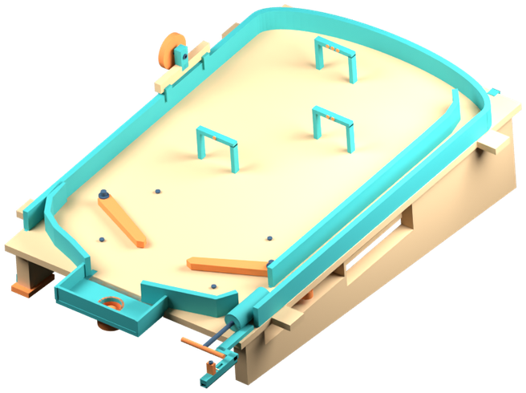

**Goals**
- Fit the Left rail -- `bf-pb-rail-1`
- next: Fit the Right rail -- `bf-pb-rail-2`
- next: Fit the Top rail -- `bf-pb-rail-3`
- next: Fit the Lane rail -- `bf-pb-rail-4`
- next: Fit the Left return -- `bf-pb-rail-5`
- next: Fit the Right return -- `bf-pb-rail-6`
- next: Fit the Marble cup -- `bf-pb-rimmed`

**Items**
- `bf-pb-tray` Tray
  - icon: 

  {A long flat tan board with small holes, slots and a shallow notch across its nearer end.}

  ---

  Prepared plywood with rail slots, flipper holes and integral carrying handles.
- `bf-pb-left-rail` Left rail
  - icon: 

  {A long straight green rail with small projecting feet along its lower edge.}
- `bf-pb-rail-1` Table
  - icon: 

  {One straight green rail runs along the left side of the tan board.}
- `bf-pb-right-rail` Right rail
  - icon: 

  {A long straight green rail with small projecting feet along its lower edge.}
- `bf-pb-rail-2` Table
  - icon: 

  {Straight green rails run along both long sides of the tan board.}
- `bf-pb-top-rail` Top rail
  - icon: 

  {A broad curved green rail with small feet beneath it.}
- `bf-pb-rail-3` Table
  - icon: 

  {A curved green rail joins the two side rails around the far end of the tan board.}
- `bf-pb-lane` Lane rail
  - icon: 

  {A long thin green rail with a short bent tip and small feet underneath.}
- `bf-pb-rail-4` Table
  - icon: 

  {A second narrow green rail forms a long lane inside the board’s right-hand edge.}
- `bf-pb-left-lip` Left return
  - icon: 

  {A short green rail bends through a broad curve, with small feet beneath it.}
- `bf-pb-rail-5` Table
  - icon: 

  {The left rail curves inward near the front of the board.}
- `bf-pb-right-lip` Right return
  - icon: 

  {A short green rail has one angled end and small feet underneath.}
- `bf-pb-rail-6` Table
  - icon: 

  {Both front rail ends turn inward, leaving a gap between them.}
- `bf-pb-cup` Marble cup
  - icon: 

  {A green shallow tray has raised edge rails and a round recessed cup near its centre.}
- `bf-pb-rimmed` Table
  - icon: 

  {A small green tray and round cup extend from the gap at the front of the railed board.}

**Combinations**
- `bf-pb-left-rail` [consume] + `bf-pb-tray` [transform] -> `bf-pb-rail-1`
- `bf-pb-right-rail` [consume] + `bf-pb-rail-1` [transform] -> `bf-pb-rail-2`
- `bf-pb-top-rail` [consume] + `bf-pb-rail-2` [transform] -> `bf-pb-rail-3`
- `bf-pb-lane` [consume] + `bf-pb-rail-3` [transform] -> `bf-pb-rail-4`
- `bf-pb-left-lip` [consume] + `bf-pb-rail-4` [transform] -> `bf-pb-rail-5`
- `bf-pb-right-lip` [consume] + `bf-pb-rail-5` [transform] -> `bf-pb-rail-6`
- `bf-pb-cup` [consume] + `bf-pb-rail-6` [transform] -> `bf-pb-rimmed`

## `bf-pb-flippers` Two flippers
background: 
reference: 

**Goals**
- Flip the Table -- `bf-pb-under`
- next: Fit the Pivot plate -- `bf-pb-plated-under`
- next: Fit the Support -- `bf-pb-supported-under`
- next: Flip the Table upright -- `bf-pb-upright`
- next: Snap on the Left paddle -- `bf-pb-left`
- next: Snap on the Right paddle -- `bf-pb-flipped`

**Hotspots**
- `bf-pb-flip` (center 390px, 216px)
  - icon: 
  - hitbox: (center 390px, 216px) (size 236px, 248px)

**Items**
- `bf-pb-rimmed` Table
  - icon: 

  {A small green tray and round cup extend from the gap at the front of the railed board.}
- `bf-pb-flip` Flip
  - icon: 
- `bf-pb-under` Table
  - icon: 

  {The underside of the tan board faces up, showing slots, small holes and two narrow wooden strips; the green cup projects behind its far edge.}
- `bf-pb-plate` Pivot plate
  - icon: 

  {A flat green rectangular plate carries black upright pins and small red paddles at its sides.}

  ---

  A plate with retained spindles, finger buttons and return loops. The shoulders pass through the prepared tray clearances. Captive screws enter the tray’s threaded receivers from beneath.
- `bf-pb-plated-under` Table
  - icon: 

  {A green rectangular plate with black pins and red side fittings lies across the exposed underside of the board.}
- `bf-pb-support` Support
  - icon: 

  {A tan U-shaped stand has two long slotted arms and a taller connecting back.}

  ---

  One connected U-shaped support with locating tongues and retaining clips. It slopes the table towards its marble cup without tilting sideways.
- `bf-pb-supported-under` Table
  - icon: 

  {A tan U-shaped stand surrounds the underside of the board, beside the fitted green plate.}
- `bf-pb-upright` Table
  - icon: 

  {A tilted tan rectangular board has raised green rails around its edges and two small dark pins near one end.}
- `bf-pb-left-paddle` Left paddle
  - icon: 

  {A long, flat red-orange piece with a forked notch at its broad end and a tapered opposite end.}

  ---

  One polymer paddle with an open keyed snap socket. Its flexible mouth clips sideways around the spindle neck between the retaining shoulders.
- `bf-pb-left` Table
  - icon: 

  {One red-orange paddle lies near the lower end of the tan board, beside the opening between the green rails.}
- `bf-pb-right-paddle` Right paddle
  - icon: 

  {A long, flat red-orange piece with a forked notch at one end and a tapered opposite end.}

  ---

  One polymer paddle with an open keyed snap socket. Its flexible mouth clips sideways around the spindle neck between the retaining shoulders.
- `bf-pb-flipped` Table
  - icon: 

  {Two red-orange paddles lie at different angles near the lower end of the tan board.}

**Combinations**
- `bf-pb-rimmed` [transform] @ `bf-pb-flip` -> `bf-pb-under`
- `bf-pb-plate` [consume] + `bf-pb-under` [transform] -> `bf-pb-plated-under`
- `bf-pb-support` [consume] + `bf-pb-plated-under` [transform] -> `bf-pb-supported-under`
- `bf-pb-supported-under` [transform] @ `bf-pb-flip` -> `bf-pb-upright`
- `bf-pb-left-paddle` [consume] + `bf-pb-upright` [transform] -> `bf-pb-left`
- `bf-pb-right-paddle` [consume] + `bf-pb-left` [transform] -> `bf-pb-flipped`

## `bf-pb-launcher-build` A spring launcher
background: 
reference: 

**Goals**
- Slide the Spring onto the Plunger rod -- `bf-pb-sprung-rod`
- next: Fit the Plunger tip -- `bf-pb-tipped`
- next: Lower the Plunger into the Launcher cradle -- `bf-pb-open-launcher`
- next: Clip on the Launcher cover -- `bf-pb-launcher`
- next: Fit the Launcher to the Table -- `bf-pb-launched`

**Items**
- `bf-pb-rod` Plunger rod
  - icon: 

  {A long charcoal rod meets a red-orange crossbar at a right angle, forming a T shape.}

  ---

  A six-millimetre plunger rod with a fitted pull handle and an open front end for threading the spring.
- `bf-pb-spring` Spring
  - icon: 

  {A black coil with open ends, shown diagonally.}
- `bf-pb-sprung-rod` Plunger
  - icon: 

  {A black coil surrounds the far section of a long charcoal rod; a red-orange crossbar meets the rod near its other end.}
- `bf-pb-tip` Plunger tip
  - icon: 

  {A red-orange stepped cylinder with a round hole through its centre.}

  ---

  A soft striking tip and piston with a blind gripping socket for the rod.
- `bf-pb-tipped` Plunger
  - icon: 

  {A red-orange stepped cylinder caps the far end of a charcoal rod with a black coil; a red-orange crossbar meets the other end.}
- `bf-pb-barrel` Launcher cradle
  - icon: 

  {A grey open trough and a red-orange block sit at opposite ends of a bent green bar.}

  ---

  An open-topped cradle with half-round end guides, mounting feet and a travel stop. The assembled plunger lowers through its open top.
- `bf-pb-open-launcher` Launcher
  - icon: 

  {A black coil and charcoal rod sit inside an open grey trough on a bent green support; a red-orange crossbar meets the rod near the lower end.}
- `bf-pb-cover` Launcher cover
  - icon: 

  {A grey half-cylinder with dark rims and small green clips along its sides.}

  ---

  A clear upper shell with matching half-guides and flexible retaining clips. Closing it captures the plunger and encloses the spring.
- `bf-pb-launcher` Launcher
  - icon: 

  {A grey cylindrical cover with green clips surrounds a charcoal rod on a bent green support; a red-orange crossbar meets the rod near the lower end.}
- `bf-pb-flipped` Table
  - icon: 

  {Two red-orange paddles lie at different angles near the lower end of the tan board.}
- `bf-pb-launched` Table
  - icon: 

  {A grey cylinder on a bent green support sits beside the edge of the tan board; a charcoal rod and red-orange crossbar extend outward.}

**Combinations**
- `bf-pb-spring` [consume] + `bf-pb-rod` [transform] -> `bf-pb-sprung-rod`
- `bf-pb-tip` [consume] + `bf-pb-sprung-rod` [transform] -> `bf-pb-tipped`
- `bf-pb-barrel` [consume] + `bf-pb-tipped` [transform] -> `bf-pb-open-launcher`
- `bf-pb-cover` [consume] + `bf-pb-open-launcher` [transform] -> `bf-pb-launcher`
- `bf-pb-launcher` [consume] + `bf-pb-flipped` [transform] -> `bf-pb-launched`

## `bf-pb-targets` One more go
background: 
reference: 

**Goals**
- Fit the Lower arch -- `bf-pb-target-1`
- next: Fit the Middle arch -- `bf-pb-target-2`
- next: Fit the Upper arch -- `bf-pb-target-3`
- next: Turn the Table toward the Score wheel -- `bf-pb-score-facing`
- next: Fit the Score wheel -- `bf-pb-scored`
- next: Set the Marble on the Table -- `pinball-table`

**Hotspots**
- `bf-pb-score-flip` (center 390px, 216px)
  - icon: 
  - hitbox: (center 390px, 216px) (size 236px, 248px)

**Items**
- `bf-pb-launched` Table
  - icon: 

  {A grey cylinder on a bent green support sits beside the edge of the tan board; a charcoal rod and red-orange crossbar extend outward.}
- `bf-pb-arch-low` Lower arch
  - icon: 

  {A green rectangular arch with one red-orange dot on its top bar and dark round pegs below its legs.}
- `bf-pb-target-1` Table
  - icon: 

  {One small green arch with a red dot on its top bar stands on the tan board above two red-orange paddles.}
- `bf-pb-arch-mid` Middle arch
  - icon: 

  {A green rectangular arch with two red-orange dots on its top bar and dark round pegs below its legs.}
- `bf-pb-target-2` Table
  - icon: 

  {Two small green arches with red dots on their top bars stand on the tan board above two red-orange paddles.}
- `bf-pb-arch-high` Upper arch
  - icon: 

  {A green rectangular arch with three red-orange dots on its top bar and dark round pegs below its legs.}
- `bf-pb-target-3` Table
  - icon: 

  {Three small green arches with red dots on their top bars stand in a staggered line on the tan board above two red-orange paddles.}
- `bf-pb-score-flip` Flip
  - icon: 
- `bf-pb-score-facing` Table
  - icon: 

  {A tan board with green curved side rails has three green arches and two red bars near the front. A red numbered wheel on a tan-and-green bar stands beside its left edge.}
- `bf-pb-score` Score wheel
  - icon: 

  {A red wheel sits on a green support above a tan rail with green clips underneath.}
- `bf-pb-scored` Table
  - icon: 

  {A red wheel on a tan rail rises outside the table’s left edge, beside the three green arches.}
- `bf-pb-marble` Marble
  - icon: 

  {One red ball.}
- `pinball-table` Pinball table
  - icon: 
  - animation: 

  {A tan board with raised green rails, three green arches, two red-orange paddles, a side-mounted grey cylinder and a red-orange wheel. A pink ball rests just below the middle arch.}

**Combinations**
- `bf-pb-arch-low` [consume] + `bf-pb-launched` [transform] -> `bf-pb-target-1`
- `bf-pb-arch-mid` [consume] + `bf-pb-target-1` [transform] -> `bf-pb-target-2`
- `bf-pb-arch-high` [consume] + `bf-pb-target-2` [transform] -> `bf-pb-target-3`
- `bf-pb-target-3` [transform] @ `bf-pb-score-flip` -> `bf-pb-score-facing`
- `bf-pb-score` [consume] + `bf-pb-score-facing` [transform] -> `bf-pb-scored`
- `bf-pb-marble` [consume] + `bf-pb-scored` [transform] -> `pinball-table`

## `bf-cd-crank` Round and round
background: 
reference: 

**Goals**
- Slide the Cam onto the Shaft -- `bf-cd-cammed`
- next: Fit the Front bearing -- `bf-cd-bearing-1`
- next: Fit the Rear bearing -- `bf-cd-bearings`
- next: Fit the Front collar -- `bf-cd-front-retained`
- next: Flip to the back of the bearings -- `bf-cd-rear-facing`
- next: Fit the Rear collar -- `bf-cd-retained-rear`
- next: Flip back to the front -- `bf-cd-retained`
- next: Fit the Crank -- `bf-cd-cranked`
- next: Secure the Crank with its clip -- `bf-cd-clipped`

**Hotspots**
- `bf-cd-flip` (center 390px, 216px)
  - icon: 
  - hitbox: (center 390px, 216px) (size 236px, 248px)

**Items**
- `bf-cd-shaft` Shaft
  - icon: 

  {A long, thin charcoal rod with dark circular ends, shown diagonally.}

  ---

  A plain six-millimetre shaft, supplied without its collars. The cam and bearings slide on before the separate collars retain the shaft.
- `bf-cd-cam` Cam
  - icon: 

  {A red-orange round disc with a short split cylindrical projection near the centre of one face.}

  ---

  The shaft hole sits off centre. Turning the round disc raises and lowers the broad follower foot.
- `bf-cd-cammed` Frame
  - icon: 

  {A charcoal rod passes through the centre of a thick red-orange disc; a short raised cylinder sits off-centre on the disc face.}
- `bf-cd-front-bearing` Front bearing
  - icon: 

  {A green frame with two upright legs, a thick base, a round opening in the top bar and two dark pegs below the base.}
- `bf-cd-bearing-1` Frame
  - icon: 

  {A red-orange disc on a charcoal rod stands beside one green rectangular frame; the rod projects through the frame.}
- `bf-cd-rear-bearing` Rear bearing
  - icon: 

  {A green frame with two upright legs, a thick base, a round opening in the top bar and two dark pegs below the base.}
- `bf-cd-bearings` Frame
  - icon: 

  {A red-orange disc on a charcoal rod sits between two green rectangular frames, with the rod projecting through the nearer frame.}
- `bf-cd-front-collar` Front collar
  - icon: 

  {A thick green ring with a gap in its rim and several small holes.}
- `bf-cd-front-retained` Frame
  - icon: 

  {A green ring surrounds the projecting charcoal rod beside the nearer green frame; a red-orange disc sits between the frames.}
- `bf-cd-flip` Flip
  - icon: 
- `bf-cd-rear-facing` Frame
  - icon: 

  {The plain face of a red-orange disc is between two green frames; a charcoal rod projects beyond the nearer frame.}
- `bf-cd-rear-collar` Rear collar
  - icon: 

  {A thick green ring with a gap in its rim and small holes.}
- `bf-cd-retained-rear` Frame
  - icon: 

  {A green ring encircles the projecting charcoal rod beside the nearer green frame, viewed from the other side of the assembly.}
- `bf-cd-retained` Frame
  - icon: 

  {A red-orange disc sits between two green frames; a green ring surrounds the rod beside the nearer frame.}
- `bf-cd-handle` Crank
  - icon: 

  {A green cylinder joined to a short red-orange arm.}

  ---

  A D-shaped socket fits the matching shaft end. Its separate retaining clip enters the aligned cross holes after the crank is fitted.
- `bf-cd-cranked` Frame
  - icon: 

  {A green cylindrical piece and short red-orange arm extend from the charcoal rod beside the nearer green frame.}
- `bf-cd-crank-clip` Crank clip
  - icon: 

  {A thin black wire bent into an open, angular loop with two free ends.}

  ---

  One spring-wire clip. Its straight leg passes through the aligned crank and shaft holes; the curved leg grips outside the socket.
- `bf-cd-clipped` Crank
  - icon: 
  - from chapter `bf-cd-lift` icon: 

  {A green cylinder and red-orange arm project from the nearer frame; a small dark loop is visible around the rod near the disc.}

**Combinations**
- `bf-cd-cam` [consume] + `bf-cd-shaft` [transform] -> `bf-cd-cammed`
- `bf-cd-front-bearing` [consume] + `bf-cd-cammed` [transform] -> `bf-cd-bearing-1`
- `bf-cd-rear-bearing` [consume] + `bf-cd-bearing-1` [transform] -> `bf-cd-bearings`
- `bf-cd-front-collar` [consume] + `bf-cd-bearings` [transform] -> `bf-cd-front-retained`
- `bf-cd-front-retained` [transform] @ `bf-cd-flip` -> `bf-cd-rear-facing`
- `bf-cd-rear-collar` [consume] + `bf-cd-rear-facing` [transform] -> `bf-cd-retained-rear`
- `bf-cd-retained-rear` [transform] @ `bf-cd-flip` -> `bf-cd-retained`
- `bf-cd-handle` [consume] + `bf-cd-retained` [transform] -> `bf-cd-cranked`
- `bf-cd-crank-clip` [consume] + `bf-cd-cranked` [transform] -> `bf-cd-clipped`

## `bf-cd-lift` Round becomes up
background: 
reference: 

**Goals**
- Mount the Crank on the Base -- `bf-cd-frame`
- next: Slide the Follower into the Guide -- `bf-cd-open-follower`
- next: Snap on the Cover -- `bf-cd-guided`
- next: Mount the Follower above the Cam -- `bf-cd-mounted`
- next: Hook on the Spring -- `bf-cd-lifter`

**Items**
- `bf-cd-base` Base
  - icon: 

  {A flat tan rectangular board with small round holes near its edges and across its surface.}
- `bf-cd-clipped` Crank
  - icon: 

  {A green cylinder and red-orange arm project from the nearer frame; a small dark loop is visible around the rod near the disc.}
- `bf-cd-frame` Frame
  - icon: 

  {Two green rectangular frames, a red-orange disc and a green cylinder with a red-orange arm sit on a broad tan board.}
- `bf-cd-guide` Guide
  - icon: 

  {A tall tan post on a square foot, with a green open frame near the top.}

  ---

  An open square channel with a mounting foot and spring anchor. The separate cover closes around the follower; its broad foot never has to pass through the narrow channel.
- `bf-cd-follower` Follower
  - icon: 

  {A thin red-orange upright with a long flat foot, a broad crosspiece near the top, and a dark peg at its upper end.}

  ---

  A sliding rod with a broad cam foot, spring collar and retained crosshead pin for two independently pivoting links.
- `bf-cd-open-follower` Follower
  - icon: 

  {A red-orange upright with broad crosspieces stands beside a tan post, within an open green frame.}
- `bf-cd-cover` Cover
  - icon: 

  {A flat green rectangular plate with small tabs projecting from its back.}
- `bf-cd-guided` Follower
  - icon: 

  {A green plate covers part of the open frame around the red-orange upright and tan post.}
- `bf-cd-mounted` Lifter
  - icon: 

  {A tall tan upright with red-orange crosspieces stands behind a red-orange disc on a tan board; green frames and fittings surround the lower section.}
- `bf-cd-spring` Spring
  - icon: 

  {A black coil with an open hook at each end.}
- `bf-cd-lifter` Lifter
  - icon: 

  {A tall tan upright with red-orange crosspieces stands behind a red-orange disc; a black coil is visible beside the upper crosspiece, between green fittings.}

**Combinations**
- `bf-cd-clipped` [consume] + `bf-cd-base` [transform] -> `bf-cd-frame`
- `bf-cd-follower` [consume] + `bf-cd-guide` [transform] -> `bf-cd-open-follower`
- `bf-cd-cover` [consume] + `bf-cd-open-follower` [transform] -> `bf-cd-guided`
- `bf-cd-guided` [consume] + `bf-cd-frame` [transform] -> `bf-cd-mounted`
- `bf-cd-spring` [consume] + `bf-cd-mounted` [transform] -> `bf-cd-lifter`

## `bf-cd-dragon` The dragon
background: 
reference: 

**Goals**
- Attach the Left wing -- `bf-cd-body-left`
- next: Attach the Right wing -- `bf-cd-winged`
- next: Flip the Body to its back -- `bf-cd-winged-rear`
- next: Attach the Tail -- `bf-cd-bodied-rear`
- next: Flip the Body to its front -- `bf-cd-bodied`
- next: Mount the Dragon on the Lifter -- `bf-cd-mounted-body`
- next: Fit the Left link -- `bf-cd-linked-left`
- next: Fit the Right link -- `crank-dragon`

**Hotspots**
- `bf-cd-body-flip` (center 390px, 216px)
  - icon: 
  - hitbox: (center 390px, 216px) (size 236px, 248px)

**Items**
- `bf-cd-body` Body
  - icon: 

  {A flat green dragon shape with round eyes, a curved smile, triangular head and neck spikes, and two long legs with small feet.}
- `bf-cd-left-wing` Left wing
  - icon: 

  {A pointed red-orange wing with dark lines along it and a short tan peg near its lower end.}

  ---

  One card wing with a prepared split snap pin and spacer. The two tapered tips compress through the body hole and reopen behind it.
- `bf-cd-body-left` Body
  - icon: 

  {A flat green dragon shape with one red-orange wing; the other side of its back is bare.}
- `bf-cd-right-wing` Right wing
  - icon: 

  {A pointed red-orange wing with dark lines along it and a short tan peg near its lower end.}

  ---

  One card wing with a prepared split snap pin and spacer. The two tapered tips compress through the body hole and reopen behind it.
- `bf-cd-winged` Body
  - icon: 

  {A flat green dragon shape with two raised, pointed red-orange wings.}
- `bf-cd-body-flip` Flip
  - icon: 
- `bf-cd-winged-rear` Body
  - icon: 

  {Seen from behind, a flat green dragon shape has two raised red-orange wings; tan pegs and dark round fittings are visible near the wings’ lower ends.}
- `bf-cd-tail` Tail
  - icon: 

  {A flat green curved piece with an upturned tip and a small round fitting at the other end.}

  ---

  The tail carries a split snap pin. Its tapered tip passes through the body hole before its flexible barbs reopen.
- `bf-cd-bodied-rear` Body
  - icon: 

  {Seen from behind, a flat green dragon shape has two raised red-orange wings and a curved green tail with an upturned tip.}
- `bf-cd-bodied` Dragon
  - icon: 

  {A flat green dragon shape with two raised red-orange wings and a curved green tail with an upturned tip.}
- `bf-cd-lifter` Lifter
  - icon: 

  {A tall tan upright with red-orange crosspieces stands behind a red-orange disc; a black coil is visible beside the upper crosspiece, between green fittings.}
- `bf-cd-mounted-body` Dragon
  - icon: 

  {A flat green dragon with two raised red-orange wings stands on a tan board around a green frame, red-orange disc and upright pieces; tan pegs project from the wings’ lower ends.}
- `bf-cd-left-link` Left link
  - icon: 

  {A narrow green bar with a round opening at each end.}

  ---

  One rigid 55 mm polymer link with two open snap eyes. Fit both eyes sideways over the exposed pin necks; their heads stay in place.
- `bf-cd-linked-left` Dragon
  - icon: 

  {A narrow green bar runs from the lower end of one red-orange wing to the central red-orange upright; a tan peg projects from the other wing.}
- `bf-cd-right-link` Right link
  - icon: 

  {A narrow green bar with a round opening at each end.}

  ---

  One rigid 55 mm polymer link with two open snap eyes. It pivots independently beside the other link.
- `crank-dragon` Crank dragon
  - icon: 
  - animation: 

  {A flat green dragon with two raised red-orange wings and a curved tail stands above a red-orange disc and green crank on a tan board; two green bars extend from the wings toward the central upright.}

**Combinations**
- `bf-cd-left-wing` [consume] + `bf-cd-body` [transform] -> `bf-cd-body-left`
- `bf-cd-right-wing` [consume] + `bf-cd-body-left` [transform] -> `bf-cd-winged`
- `bf-cd-winged` [transform] @ `bf-cd-body-flip` -> `bf-cd-winged-rear`
- `bf-cd-tail` [consume] + `bf-cd-winged-rear` [transform] -> `bf-cd-bodied-rear`
- `bf-cd-bodied-rear` [transform] @ `bf-cd-body-flip` -> `bf-cd-bodied`
- `bf-cd-bodied` [consume] + `bf-cd-lifter` [transform] -> `bf-cd-mounted-body`
- `bf-cd-left-link` [consume] + `bf-cd-mounted-body` [transform] -> `bf-cd-linked-left`
- `bf-cd-right-link` [consume] + `bf-cd-linked-left` [transform] -> `crank-dragon`

## `c-gantry-frame` A lifting frame
background: 
reference: 

**Goals**
- Fit a side frame -- `gh-one-side`
- next: Fit the other side frame -- `gh-two-sides`
- next: Join the frames with the beam -- `gh-frame`
- next: Fit the ratchet to the winch
  - either: `gh-ratchet-winch`
  - or: `gh-winch`
- next: Turn the winch toward its crank end
  - either: `gh-rear-drum`
  - or: `gh-rear-ratchet-winch`
- next: Fit the crank
  - either: `gh-crank-winch`
  - or: `gh-rear-winch`
- next: Turn the winch back toward the ratchet
  - either: `gh-front-crank-winch`
  - or: `gh-winch`
- next: Mount the winch -- `gh-mounted`

**Hotspots**
- `gh-winch-flip` (center 390px, 216px)
  - icon: 
  - hitbox: (center 390px, 216px) (size 236px, 248px)

**Items**
- `gh-base` Base
  - icon: 

  {A flat tan rectangle with small dark round marks near its corners.}
- `gh-side-1` Side frame
  - icon: 

  {A narrow tan triangular assembly with a low crosspiece and short dark projections at its corners.}

  ---

  A prepared triangular frame with joined braces and captive foot pegs. Either frame fits either side of the base.

- `gh-side-2` Side frame
  - icon: 

  {A narrow tan triangular assembly with a low crosspiece and short dark projections at its corners.}

  ---

  A prepared triangular frame with joined braces and captive foot pegs. Either frame fits either side of the base.

- `gh-crossbeam` Beam
  - icon: 

  {A long tan rectangular bar with small dark round marks along one face.}

  ---

  The beam has two end sockets and separate sockets underneath for the pulley forks.

- `gh-one-side` Frame
  - icon: 

  {One tan triangular assembly stands on the left end of a flat tan rectangle.}
- `gh-two-sides` Frame
  - icon: 

  {Two tan triangular assemblies stand at opposite ends of a flat tan rectangle, with a gap between their tops.}
- `gh-frame` Frame
  - icon: 

  {A long tan bar joins the tops of two triangular assemblies above a flat tan rectangle.}
- `gh-drum` Winch
  - icon: 

  {A tan cylinder with broad red discs at both ends sits between two green upright blocks; short dark rods project from its sides.}

  ---

  The winch drum comes with its axle, two bearing cheeks, captive base fasteners and a sprung cord clamp.

- `gh-ratchet` Ratchet
  - icon: 

  {A red disc with square teeth around its edge and a square centre opening.}
- `gh-crank` Crank
  - icon: 

  {A straight red bar has a small square opening near one end and a short green cylinder at the other.}
- `gh-ratchet-winch` Winch
  - icon: 

  {A red toothed disc is beside the outer face of the left green upright block; tan and red cylinders sit between the green blocks.}
- `gh-crank-winch` Winch
  - icon: 

  {A red upright bar with a green cylinder at its top stands behind tan and red cylinders held between green blocks.}
- `gh-winch` Winch
  - icon: 

  {A red toothed disc is on one side of tan and red cylinders between green blocks; a red upright bar with a green cylinder at its top stands behind them.}
- `gh-rear-drum` Winch
  - icon: 

  {Tan and red cylinders sit between two green upright blocks; short dark rods project from their sides.}
- `gh-rear-ratchet-winch` Winch
  - icon: 

  {A red toothed disc is at the far side of tan and red cylinders held between green blocks.}
- `gh-rear-winch` Winch
  - icon: 

  {A green cylinder at the end of a red upright bar is behind tan and red cylinders held between green blocks; a red toothed disc is at the far side.}
- `gh-front-crank-winch` Winch
  - icon: 

  {A red upright bar with a green cylinder at its top stands behind tan and red cylinders held between green blocks.}
- `gh-mounted` Gantry
  - icon: 

  {A small green assembly with tan and red cylinders sits on the left side of a broad tan rectangular base inside a tan triangular frame.}
- `gh-winch-flip` Flip

**Combinations**
- `gh-side-1` [consume] + `gh-base` [transform] -> `gh-one-side`
- `gh-side-2` [consume] + `gh-base` [transform] -> `gh-one-side`
- `gh-side-1` [consume] + `gh-one-side` [transform] -> `gh-two-sides`
- `gh-side-2` [consume] + `gh-one-side` [transform] -> `gh-two-sides`
- `gh-crossbeam` [consume] + `gh-two-sides` [transform] -> `gh-frame`
- `gh-ratchet` [consume] + `gh-drum` [transform] -> `gh-ratchet-winch`
- `gh-ratchet` [consume] + `gh-front-crank-winch` [transform] -> `gh-winch`
- `gh-drum` [transform] @ `gh-winch-flip` -> `gh-rear-drum`
- `gh-ratchet-winch` [transform] @ `gh-winch-flip` -> `gh-rear-ratchet-winch`
- `gh-crank` [consume] + `gh-rear-drum` [transform] -> `gh-crank-winch`
- `gh-crank` [consume] + `gh-rear-ratchet-winch` [transform] -> `gh-rear-winch`
- `gh-crank-winch` [transform] @ `gh-winch-flip` -> `gh-front-crank-winch`
- `gh-rear-winch` [transform] @ `gh-winch-flip` -> `gh-winch`
- `gh-winch` [consume] + `gh-frame` [transform] -> `gh-mounted`

## `c-gantry-rope` Over the beam
background: 
reference: 

**Goals**
- Fit a pulley into the side fork -- `gh-side-pulley`
- next: Fit the other pulley into its fork -- `gh-drop-pulley`
- next: Mount the side pulley
  - either: `gh-fitted-1`
  - or: `gh-fitted-3`
  - or: `gh-fitted-5`
  - or: `gh-fitted-7`
- next: Mount the drop pulley
  - either: `gh-fitted-2`
  - or: `gh-fitted-3`
  - or: `gh-fitted-6`
  - or: `gh-fitted-7`
- next: Fit the pawl
  - either: `gh-fitted-4`
  - or: `gh-fitted-5`
  - or: `gh-fitted-6`
  - or: `gh-fitted-7`
- next: Thread the rope over both pulleys -- `gh-roped`
- next: Hang the basket on the hook -- `gantry-hoist`

**Items**
- `gh-side-fork` Side fork
  - icon: 

  {A green right-angled piece has a short horizontal green projection and a long dark upright projection with a split tip.}

  ---

  An open pulley bracket with a split snap axle and a barbed mounting stem. Press a pulley over the axle tip, then push the stem through the beam until its head opens above the wood.

- `gh-side-pulley` Pulley unit
  - icon: 

  {A thick red wheel with a grooved edge sits on a short green horizontal projection; a long dark pin rises above it.}
- `gh-drop-fork` Drop fork
  - icon: 

  {A green right-angled piece has a short horizontal green projection and a long dark upright projection with a split tip.}

  ---

  An open pulley bracket with a split snap axle and a barbed mounting stem. Press a pulley over the axle tip, then push the stem through the beam until its head opens above the wood.

- `gh-drop-pulley` Pulley unit
  - icon: 

  {A thick red wheel with a grooved edge sits on a short green horizontal projection; a long dark pin rises above it.}
- `gh-pulley-1` Pulley
  - icon: 

  {A thick red wheel has a narrow groove around its edge and a small round centre hole.}

  ---

  A grooved pulley that turns on either fork axle. The split axle tip retains it.

- `gh-pulley-2` Pulley
  - icon: 

  {A thick red wheel has a narrow groove around its edge and a small round centre hole.}

  ---

  A grooved pulley that turns on either fork axle. The split axle tip retains it.

- `gh-pawl` Pawl
  - icon: 

  {A bent dark bar rises from a green block and ends in a broad angled tip.}

  ---

  A spring pawl and its connected mounting foot. Its tooth rests in the ratchet so the drum cannot freely unwind.

- `gh-rope` Rope and hook
  - icon: 

  {A thin dark cord lies in a loose spiral, with a curved hook at one end.}

  ---

  One continuous cord, already tied to its hook. Push its free end under the drum’s prepared spring clamp, wind one turn, then thread it over the two pulleys.

- `gh-basket` Basket
  - icon: 

  {A square green open box has a tan floor, a dark strip along its bottom and a tall dark handle.}

  ---

  A small rigid basket with a connected lifting handle. It hangs directly on the hook.

- `gh-fitted-1` Gantry
  - icon: 

  {One red wheel hangs below the left end of the tan top bar; a small green assembly sits below it.}
- `gh-fitted-2` Gantry
  - icon: 

  {One red wheel hangs below the middle of the tan top bar; a small green assembly sits below its left end.}
- `gh-fitted-3` Gantry
  - icon: 

  {Two red wheels hang below the tan top bar, one near each end; a small green assembly sits below the left end.}
- `gh-fitted-4` Gantry
  - icon: 

  {A small green block and dark bent bar sit beside the red toothed disc; the tan top bar is bare.}
- `gh-fitted-5` Gantry
  - icon: 

  {A dark bent bar stands beside the green and red assembly; one red wheel hangs below the left end of the tan top bar.}
- `gh-fitted-6` Gantry
  - icon: 

  {A dark bent bar stands beside the green and red assembly; one red wheel hangs below the middle of the tan top bar.}
- `gh-fitted-7` Gantry
  - icon: 

  {A dark bent bar stands beside the green and red assembly; two red wheels hang below the tan top bar.}
- `gh-roped` Hoist
  - icon: 

  {A thin dark cord runs from the small green and red assembly, over two red wheels beneath the tan top bar, then down to a curved hook.}
- `gantry-hoist` Gantry hoist
  - icon: 
  - animation: 

  {A green open box hangs from a dark hook and cord between the legs of a tan triangular frame. Two red wheels sit beneath its top bar.}

  ---

  Two fixed pulleys guide the cord; they change its direction without multiplying the lifting force. Turning the crank winds the drum. The pawl holds the drum between turns.

**Combinations**
- `gh-pulley-1` [consume] + `gh-side-fork` [transform] -> `gh-side-pulley`
- `gh-pulley-2` [consume] + `gh-side-fork` [transform] -> `gh-side-pulley`
- `gh-pulley-1` [consume] + `gh-drop-fork` [transform] -> `gh-drop-pulley`
- `gh-pulley-2` [consume] + `gh-drop-fork` [transform] -> `gh-drop-pulley`
- `gh-side-pulley` [consume] + `gh-mounted` [transform] -> `gh-fitted-1`
- `gh-drop-pulley` [consume] + `gh-mounted` [transform] -> `gh-fitted-2`
- `gh-pawl` [consume] + `gh-mounted` [transform] -> `gh-fitted-4`
- `gh-drop-pulley` [consume] + `gh-fitted-1` [transform] -> `gh-fitted-3`
- `gh-pawl` [consume] + `gh-fitted-1` [transform] -> `gh-fitted-5`
- `gh-side-pulley` [consume] + `gh-fitted-2` [transform] -> `gh-fitted-3`
- `gh-pawl` [consume] + `gh-fitted-2` [transform] -> `gh-fitted-6`
- `gh-pawl` [consume] + `gh-fitted-3` [transform] -> `gh-fitted-7`
- `gh-side-pulley` [consume] + `gh-fitted-4` [transform] -> `gh-fitted-5`
- `gh-drop-pulley` [consume] + `gh-fitted-4` [transform] -> `gh-fitted-6`
- `gh-drop-pulley` [consume] + `gh-fitted-5` [transform] -> `gh-fitted-7`
- `gh-side-pulley` [consume] + `gh-fitted-6` [transform] -> `gh-fitted-7`
- `gh-rope` [consume] + `gh-fitted-7` [transform] -> `gh-roped`
- `gh-basket` [consume] + `gh-roped` [transform] -> `gantry-hoist`

## `c-carousel-drive` A turning deck
background: 
reference: 

**Goals**
- Fit the spindle
  - either: `ca-spindle-base`
  - or: `ca-drive-base`
- next: Fit the motor -- `ca-drive-base`
- next: Loop the belt around both pulleys -- `ca-belted`
- next: Set the guard over the drive
  - either: `ca-guarded`
  - or: `ca-ready`
- next: Plug in the battery -- `ca-ready`
- next: Fit the deck onto the spindle -- `ca-platform`

**Items**
- `ca-base` Base
  - icon: 

  {A thick tan disc has a central round opening, several smaller round holes and square recesses.}

  ---

  A broad prepared base with sockets for the bearing, motor and battery. The motor and controller are matching low-voltage modules.

- `ca-spindle` Spindle
  - icon: 

  {A broad green disc with a grooved edge sits on a square green block; a short dark rod projects from its centre.}

  ---

  A vertical spindle and pulley retained inside a bearing block. The square upper end drives the deck; a shoulder supports its hub above the guard.

- `ca-motor` Motor
  - icon: 

  {A dark upright cylinder sits on a green foot, with a red round piece above it and a short dark lead ending in a green block.}

  ---

  A small enclosed geared motor, its pulley, retaining strap, mounting foot and plugged lead form one supplied module.

- `ca-belt` Belt
  - icon: 

  {A thin dark loop has one broad rounded end and one narrow end.}
- `ca-guard` Guard
  - icon: 

  {A dark transparent box has a small opening on top, green feet at its corners and an opening along its lower edge.}

  ---

  A clear cover with a real shaft opening, cable opening and attached locating feet.

- `ca-battery` Battery and dial
  - icon: 

  {A blue rectangular box has a dark square button and a red round button on top.}

  ---

  The battery holder, switch and speed dial share one case. Its connected lead plugs into the motor.

- `ca-deck` Deck
  - icon: 

  {A thin tan disc has a central round opening and three smaller holes.}

  ---

  A round deck with a central drive socket and three prepared pole sockets.

- `ca-spindle-base` Base
  - icon: 

  {A broad green disc on a square green block stands near the centre of a thick tan disc.}
- `ca-motor-base` Base
  - icon: 

  {A dark cylinder with a red round piece above it stands near the left edge of the tan disc; a dark lead and small green block lie beside it.}
- `ca-drive-base` Base
  - icon: 

  {A dark cylinder with a red round piece above it stands beside a broad green disc on the tan disc.}
- `ca-belted` Base
  - icon: 

  {A thin dark loop runs between a small red wheel and a larger green disc.}
- `ca-guarded` Base
  - icon: 

  {A dark transparent box surrounds a dark cylinder and broad green disc; their shapes show through its sides.}
- `ca-wired` Base
  - icon: 

  {A blue box with a dark square button and red round button sits in front of two wheels joined by a dark loop.}
- `ca-ready` Base
  - icon: 

  {A dark transparent box covers two wheels joined by a dark loop; a blue box with dark and red buttons sits at the front.}
- `ca-platform` Carousel
  - icon: 

  {A tan disc sits above a dark transparent box and another tan disc; a blue box projects at the front.}

**Combinations**
- `ca-spindle` [consume] + `ca-base` [transform] -> `ca-spindle-base`
- `ca-motor` [consume] + `ca-base` [transform] -> `ca-motor-base`
- `ca-motor` [consume] + `ca-spindle-base` [transform] -> `ca-drive-base`
- `ca-spindle` [consume] + `ca-motor-base` [transform] -> `ca-drive-base`
- `ca-belt` [consume] + `ca-drive-base` [transform] -> `ca-belted`
- `ca-guard` [consume] + `ca-belted` [transform] -> `ca-guarded`
- `ca-battery` [consume] + `ca-belted` [transform] -> `ca-wired`
- `ca-battery` [consume] + `ca-guarded` [transform] -> `ca-ready`
- `ca-guard` [consume] + `ca-wired` [transform] -> `ca-ready`
- `ca-deck` [consume] + `ca-ready` [transform] -> `ca-platform`

## `c-carousel-horses` Three horses
background: 
reference: 

**Goals**
- Fit a pole through the red horse -- `ca-rider-1`
- next: Fit the red horse onto the deck
  - either: `ca-horses-1`
  - or: `ca-horses-3`
  - or: `ca-horses-5`
  - or: `ca-horses-7`
- next: Fit a pole through the green horse -- `ca-rider-2`
- next: Fit the green horse onto the deck
  - either: `ca-horses-2`
  - or: `ca-horses-3`
  - or: `ca-horses-6`
  - or: `ca-horses-7`
- next: Fit a pole through the cream horse -- `ca-rider-3`
- next: Fit the cream horse onto the deck
  - either: `ca-horses-4`
  - or: `ca-horses-5`
  - or: `ca-horses-6`
  - or: `ca-horses-7`
- next: Fit the roof post -- `ca-posted`
- next: Fit the canopy -- `electric-carousel`

**Items**
- `ca-horse-1` Red horse
  - icon: 

  {A small blocky red horse shape has a round hole in its back.}

  ---

  A single connected horse with a through socket in its back. Any of the three poles fits it.

- `ca-pole-1` Pole
  - icon: 

  {A thin upright dark rod has two small green rings around its lower half.}

  ---

  A straight pole with a lower mounting peg and a shoulder that supports the horse. Any pole fits any horse.

- `ca-rider-1` Red horse
  - icon: 

  {A dark upright rod passes through the red horse shape, with a green ring below it.}
- `ca-horse-2` Green horse
  - icon: 

  {A small blocky green horse shape has a round hole in its back.}

  ---

  A single connected horse with a through socket in its back. Any of the three poles fits it.

- `ca-pole-2` Pole
  - icon: 

  {A thin upright dark rod has two small green rings around its lower half.}

  ---

  A straight pole with a lower mounting peg and a shoulder that supports the horse. Any pole fits any horse.

- `ca-rider-2` Green horse
  - icon: 

  {A dark upright rod passes through the green horse shape, with a green ring below it.}
- `ca-horse-3` Cream horse
  - icon: 

  {A small blocky cream horse shape has a round hole in its back.}

  ---

  A single connected horse with a through socket in its back. Any of the three poles fits it.

- `ca-pole-3` Pole
  - icon: 

  {A thin upright dark rod has two small green rings around its lower half.}

  ---

  A straight pole with a lower mounting peg and a shoulder that supports the horse. Any pole fits any horse.

- `ca-rider-3` Cream horse
  - icon: 

  {A dark upright rod passes through the cream horse shape, with a green ring below it.}
- `ca-horses-1` Carousel
  - icon: 

  {A red horse shape on a dark upright rod stands on the right side of the upper tan disc.}
- `ca-horses-2` Carousel
  - icon: 

  {A green horse shape on a dark upright rod stands near the back of the upper tan disc.}
- `ca-horses-3` Carousel
  - icon: 

  {A red horse shape at the right and a green horse shape at the back stand on dark upright rods above the tan disc.}
- `ca-horses-4` Carousel
  - icon: 

  {A cream horse shape on a dark upright rod stands at the left front of the upper tan disc.}
- `ca-horses-5` Carousel
  - icon: 

  {Cream and red horse shapes on dark upright rods stand at opposite sides of the upper tan disc.}
- `ca-horses-6` Carousel
  - icon: 

  {Cream and green horse shapes on dark upright rods stand at the left front and back of the upper tan disc.}
- `ca-horses-7` Carousel
  - icon: 

  {Cream, green and red horse shapes on dark upright rods stand around the upper tan disc.}
- `ca-roofpost` Roof post
  - icon: 

  {A long tan upright rod has a short green ring around its lower end.}
- `ca-canopy` Canopy
  - icon: 

  {A shallow red disc has a small green disc at its centre.}

  ---

  A small moulded canopy with a centre socket. It sits high enough to leave the horses visible.

- `ca-posted` Carousel
  - icon: 

  {A tall tan rod rises from the centre of the upper disc between three horse shapes.}
- `electric-carousel` Electric carousel
  - icon: 
  - animation: 

  {A broad red disc with a small green disc at its centre sits atop a tan upright rod. Three horse shapes on dark upright rods stand above a tan disc; below it are a dark transparent box, a second tan disc and a blue box with dark and red buttons.}

  ---

  The small motor pulley drives the larger spindle pulley through the belt. All three horses turn with the deck. The roof, poles and horses keep their actual sizes throughout the build.

**Combinations**
- `ca-pole-1` [consume] + `ca-horse-1` [transform] -> `ca-rider-1`
- `ca-pole-2` [consume] + `ca-horse-1` [transform] -> `ca-rider-1`
- `ca-pole-3` [consume] + `ca-horse-1` [transform] -> `ca-rider-1`
- `ca-pole-1` [consume] + `ca-horse-2` [transform] -> `ca-rider-2`
- `ca-pole-2` [consume] + `ca-horse-2` [transform] -> `ca-rider-2`
- `ca-pole-3` [consume] + `ca-horse-2` [transform] -> `ca-rider-2`
- `ca-pole-1` [consume] + `ca-horse-3` [transform] -> `ca-rider-3`
- `ca-pole-2` [consume] + `ca-horse-3` [transform] -> `ca-rider-3`
- `ca-pole-3` [consume] + `ca-horse-3` [transform] -> `ca-rider-3`
- `ca-rider-1` [consume] + `ca-platform` [transform] -> `ca-horses-1`
- `ca-rider-2` [consume] + `ca-platform` [transform] -> `ca-horses-2`
- `ca-rider-3` [consume] + `ca-platform` [transform] -> `ca-horses-4`
- `ca-rider-2` [consume] + `ca-horses-1` [transform] -> `ca-horses-3`
- `ca-rider-3` [consume] + `ca-horses-1` [transform] -> `ca-horses-5`
- `ca-rider-1` [consume] + `ca-horses-2` [transform] -> `ca-horses-3`
- `ca-rider-3` [consume] + `ca-horses-2` [transform] -> `ca-horses-6`
- `ca-rider-3` [consume] + `ca-horses-3` [transform] -> `ca-horses-7`
- `ca-rider-1` [consume] + `ca-horses-4` [transform] -> `ca-horses-5`
- `ca-rider-2` [consume] + `ca-horses-4` [transform] -> `ca-horses-6`
- `ca-rider-2` [consume] + `ca-horses-5` [transform] -> `ca-horses-7`
- `ca-rider-1` [consume] + `ca-horses-6` [transform] -> `ca-horses-7`
- `ca-roofpost` [consume] + `ca-horses-7` [transform] -> `ca-posted`
- `ca-canopy` [consume] + `ca-posted` [transform] -> `electric-carousel`

## `c-claw-jaws` A small claw
background: 
reference: 

**Goals**
- Fit the left jaw
  - either: `cl-mech-1`
  - or: `cl-mech-3`
  - or: `cl-mech-5`
  - or: `cl-mech-7`
  - or: `cl-mech-13`
  - or: `cl-mech-15`
  - or: `cl-mech-23`
  - or: `cl-mech-31`
  - or: `cl-mech-33`
  - or: `cl-mech-35`
  - or: `cl-mech-37`
  - or: `cl-mech-39`
  - or: `cl-mech-45`
  - or: `cl-mech-47`
  - or: `cl-mech-55`
  - or: `cl-mech-63`
  - or: `cl-mech-67`
  - or: `cl-mech-71`
  - or: `cl-mech-79`
  - or: `cl-mech-87`
  - or: `cl-mech-95`
  - or: `cl-mech-99`
  - or: `cl-mech-103`
  - or: `cl-mech-111`
  - or: `cl-mech-119`
  - or: `cl-mechanical`
- next: Fit the right jaw
  - either: `cl-mech-2`
  - or: `cl-mech-3`
  - or: `cl-mech-6`
  - or: `cl-mech-7`
  - or: `cl-mech-15`
  - or: `cl-mech-22`
  - or: `cl-mech-23`
  - or: `cl-mech-31`
  - or: `cl-mech-35`
  - or: `cl-mech-39`
  - or: `cl-mech-47`
  - or: `cl-mech-55`
  - or: `cl-mech-63`
  - or: `cl-mech-66`
  - or: `cl-mech-67`
  - or: `cl-mech-70`
  - or: `cl-mech-71`
  - or: `cl-mech-79`
  - or: `cl-mech-86`
  - or: `cl-mech-87`
  - or: `cl-mech-95`
  - or: `cl-mech-99`
  - or: `cl-mech-103`
  - or: `cl-mech-111`
  - or: `cl-mech-119`
  - or: `cl-mechanical`
- next: Fit the slider
  - either: `cl-mech-4`
  - or: `cl-mech-5`
  - or: `cl-mech-6`
  - or: `cl-mech-7`
  - or: `cl-mech-13`
  - or: `cl-mech-15`
  - or: `cl-mech-22`
  - or: `cl-mech-23`
  - or: `cl-mech-31`
  - or: `cl-mech-37`
  - or: `cl-mech-39`
  - or: `cl-mech-45`
  - or: `cl-mech-47`
  - or: `cl-mech-55`
  - or: `cl-mech-63`
  - or: `cl-mech-70`
  - or: `cl-mech-71`
  - or: `cl-mech-79`
  - or: `cl-mech-86`
  - or: `cl-mech-87`
  - or: `cl-mech-95`
  - or: `cl-mech-103`
  - or: `cl-mech-111`
  - or: `cl-mech-119`
  - or: `cl-mechanical`
- next: Snap a link onto the left pins
  - either: `cl-mech-13`
  - or: `cl-mech-15`
  - or: `cl-mech-31`
  - or: `cl-mech-45`
  - or: `cl-mech-47`
  - or: `cl-mech-63`
  - or: `cl-mech-79`
  - or: `cl-mech-95`
  - or: `cl-mech-111`
  - or: `cl-mechanical`
- next: Fit the other link
  - either: `cl-mech-22`
  - or: `cl-mech-23`
  - or: `cl-mech-31`
  - or: `cl-mech-55`
  - or: `cl-mech-63`
  - or: `cl-mech-86`
  - or: `cl-mech-87`
  - or: `cl-mech-95`
  - or: `cl-mech-119`
  - or: `cl-mechanical`
- next: Fit a pad to the left jaw
  - either: `cl-mech-33`
  - or: `cl-mech-35`
  - or: `cl-mech-37`
  - or: `cl-mech-39`
  - or: `cl-mech-45`
  - or: `cl-mech-47`
  - or: `cl-mech-55`
  - or: `cl-mech-63`
  - or: `cl-mech-99`
  - or: `cl-mech-103`
  - or: `cl-mech-111`
  - or: `cl-mech-119`
  - or: `cl-mechanical`
- next: Fit the other pad
  - either: `cl-mech-66`
  - or: `cl-mech-67`
  - or: `cl-mech-70`
  - or: `cl-mech-71`
  - or: `cl-mech-79`
  - or: `cl-mech-86`
  - or: `cl-mech-87`
  - or: `cl-mech-95`
  - or: `cl-mech-99`
  - or: `cl-mech-103`
  - or: `cl-mech-111`
  - or: `cl-mech-119`
  - or: `cl-mechanical`

**Items**
- `cl-base` Palm
  - icon: 

  {A diagonal tan board has a narrow tan strip along its left side and a green strip with a dark round knob on the right.}

  ---

  A broad prepared palm with pivot holes and a fixed return-band hook. The jaws reach just beyond its front edge.

- `cl-jaw-1` Left jaw
  - icon: 

  {A tan hooked arm has two projecting pins and a dark edge.}

  ---

  A single jaw with captive pivot and link pins. Its left-facing shape matches the left side of the palm.

- `cl-jaw-2` Right jaw
  - icon: 

  {A tan hooked arm has two projecting pins and a dark edge.}

  ---

  The reflected right jaw has its own captive pins.

- `cl-slider` Slider
  - icon: 

  {A green frame surrounds a red block and a dark crosspiece. Two dark prongs project from one side; a longer green arm ends in a dark knob.}

  ---

  One retained sliding shoe inside its guide, including travel stops and the moving return-band hook.

- `cl-link-1` Link
  - icon: 

  {A thin red rod has an open round clip at each end.}

  ---

  A rigid 52 mm link with split eyes that snap sideways onto the captive pins. Either link fits either side.

- `cl-link-2` Link
  - icon: 

  {A thin red rod has an open round clip at each end.}

  ---

  A rigid 52 mm link with split eyes. Either link fits either side.

- `cl-pad-1` Pad
  - icon: 

  {A small dark block has a flat green face.}

  ---

  One soft pad for the inside face of a jaw. Either pad fits either jaw.

- `cl-pad-2` Pad
  - icon: 

  {A small dark block has a flat green face.}

  ---

  One soft pad. Either pad fits either jaw.

- `cl-mech-1` Claw
  - icon: 

  {A diagonal tan board carries one hooked tan arm at the lower left. A narrow green strip with a dark round knob sits on the right.}
- `cl-mech-2` Claw
  - icon: 

  {A diagonal tan board carries one hooked tan arm at the upper left. A narrow green strip with a dark round knob sits on the right.}
- `cl-mech-3` Claw
  - icon: 

  {A diagonal tan board carries two hooked tan arms, one at the upper left and one at the lower left. A narrow green strip with a dark round knob sits on the right.}
- `cl-mech-4` Claw
  - icon: 

  {A diagonal tan board has a narrow tan strip along its left side. A green frame surrounding a red block and dark crosspiece sits on the right.}
- `cl-mech-5` Claw
  - icon: 

  {A diagonal tan board carries one hooked tan arm at the lower left. A green frame surrounding a red block and dark crosspiece sits on the right.}
- `cl-mech-6` Claw
  - icon: 

  {A diagonal tan board carries one hooked tan arm at the upper left. A green frame surrounding a red block and dark crosspiece sits on the right.}
- `cl-mech-7` Claw
  - icon: 

  {A diagonal tan board carries two hooked tan arms, one at the upper left and one at the lower left. A green frame surrounding a red block and dark crosspiece sits on the right.}
- `cl-mech-13` Claw
  - icon: 

  {A diagonal tan board carries one hooked tan arm at the lower left. A green frame surrounding a red block and dark crosspiece sits on the right. One red rod connects the lower arm to the red block.}
- `cl-mech-15` Claw
  - icon: 

  {A diagonal tan board carries two hooked tan arms, one at the upper left and one at the lower left. A green frame surrounding a red block and dark crosspiece sits on the right. One red rod connects the lower arm to the red block.}
- `cl-mech-22` Claw
  - icon: 

  {A diagonal tan board carries one hooked tan arm at the upper left. A green frame surrounding a red block and dark crosspiece sits on the right. One red rod connects the upper arm to the red block.}
- `cl-mech-23` Claw
  - icon: 

  {A diagonal tan board carries two hooked tan arms, one at the upper left and one at the lower left. A green frame surrounding a red block and dark crosspiece sits on the right. One red rod connects the upper arm to the red block.}
- `cl-mech-31` Claw
  - icon: 

  {A diagonal tan board carries two hooked tan arms, one at the upper left and one at the lower left. A green frame surrounding a red block and dark crosspiece sits on the right. Two red rods connect the arms to the red block.}
- `cl-mech-33` Claw
  - icon: 

  {A diagonal tan board carries one hooked tan arm at the lower left. A narrow green strip with a dark round knob sits on the right. The lower hooked tip has a green pad.}
- `cl-mech-35` Claw
  - icon: 

  {A diagonal tan board carries two hooked tan arms, one at the upper left and one at the lower left. A narrow green strip with a dark round knob sits on the right. The lower hooked tip has a green pad.}
- `cl-mech-37` Claw
  - icon: 

  {A diagonal tan board carries one hooked tan arm at the lower left. A green frame surrounding a red block and dark crosspiece sits on the right. The lower hooked tip has a green pad.}
- `cl-mech-39` Claw
  - icon: 

  {A diagonal tan board carries two hooked tan arms, one at the upper left and one at the lower left. A green frame surrounding a red block and dark crosspiece sits on the right. The lower hooked tip has a green pad.}
- `cl-mech-45` Claw
  - icon: 

  {A diagonal tan board carries one hooked tan arm at the lower left. A green frame surrounding a red block and dark crosspiece sits on the right. One red rod connects the lower arm to the red block. The lower hooked tip has a green pad.}
- `cl-mech-47` Claw
  - icon: 

  {A diagonal tan board carries two hooked tan arms, one at the upper left and one at the lower left. A green frame surrounding a red block and dark crosspiece sits on the right. One red rod connects the lower arm to the red block. The lower hooked tip has a green pad.}
- `cl-mech-55` Claw
  - icon: 

  {A diagonal tan board carries two hooked tan arms, one at the upper left and one at the lower left. A green frame surrounding a red block and dark crosspiece sits on the right. One red rod connects the upper arm to the red block. The lower hooked tip has a green pad.}
- `cl-mech-63` Claw
  - icon: 

  {A diagonal tan board carries two hooked tan arms, one at the upper left and one at the lower left. A green frame surrounding a red block and dark crosspiece sits on the right. Two red rods connect the arms to the red block. The lower hooked tip has a green pad.}
- `cl-mech-66` Claw
  - icon: 

  {A diagonal tan board carries one hooked tan arm at the upper left. A narrow green strip with a dark round knob sits on the right. The upper hooked tip has a green pad.}
- `cl-mech-67` Claw
  - icon: 

  {A diagonal tan board carries two hooked tan arms, one at the upper left and one at the lower left. A narrow green strip with a dark round knob sits on the right. The upper hooked tip has a green pad.}
- `cl-mech-70` Claw
  - icon: 

  {A diagonal tan board carries one hooked tan arm at the upper left. A green frame surrounding a red block and dark crosspiece sits on the right. The upper hooked tip has a green pad.}
- `cl-mech-71` Claw
  - icon: 

  {A diagonal tan board carries two hooked tan arms, one at the upper left and one at the lower left. A green frame surrounding a red block and dark crosspiece sits on the right. The upper hooked tip has a green pad.}
- `cl-mech-79` Claw
  - icon: 

  {A diagonal tan board carries two hooked tan arms, one at the upper left and one at the lower left. A green frame surrounding a red block and dark crosspiece sits on the right. One red rod connects the lower arm to the red block. The upper hooked tip has a green pad.}
- `cl-mech-86` Claw
  - icon: 

  {A diagonal tan board carries one hooked tan arm at the upper left. A green frame surrounding a red block and dark crosspiece sits on the right. One red rod connects the upper arm to the red block. The upper hooked tip has a green pad.}
- `cl-mech-87` Claw
  - icon: 

  {A diagonal tan board carries two hooked tan arms, one at the upper left and one at the lower left. A green frame surrounding a red block and dark crosspiece sits on the right. One red rod connects the upper arm to the red block. The upper hooked tip has a green pad.}
- `cl-mech-95` Claw
  - icon: 

  {A diagonal tan board carries two hooked tan arms, one at the upper left and one at the lower left. A green frame surrounding a red block and dark crosspiece sits on the right. Two red rods connect the arms to the red block. The upper hooked tip has a green pad.}
- `cl-mech-99` Claw
  - icon: 

  {A diagonal tan board carries two hooked tan arms, one at the upper left and one at the lower left. A narrow green strip with a dark round knob sits on the right. Both hooked tips have green pads.}
- `cl-mech-103` Claw
  - icon: 

  {A diagonal tan board carries two hooked tan arms, one at the upper left and one at the lower left. A green frame surrounding a red block and dark crosspiece sits on the right. Both hooked tips have green pads.}
- `cl-mech-111` Claw
  - icon: 

  {A diagonal tan board carries two hooked tan arms, one at the upper left and one at the lower left. A green frame surrounding a red block and dark crosspiece sits on the right. One red rod connects the lower arm to the red block. Both hooked tips have green pads.}
- `cl-mech-119` Claw
  - icon: 

  {A diagonal tan board carries two hooked tan arms, one at the upper left and one at the lower left. A green frame surrounding a red block and dark crosspiece sits on the right. One red rod connects the upper arm to the red block. Both hooked tips have green pads.}
- `cl-mechanical` Claw
  - icon: 

  {A diagonal tan board carries two hooked tan arms with green tips. Two red rods connect them to a red block within a green frame on the right.}

**Combinations**
- `cl-jaw-1` [consume] + `cl-base` [transform] -> `cl-mech-1`
- `cl-jaw-2` [consume] + `cl-base` [transform] -> `cl-mech-2`
- `cl-slider` [consume] + `cl-base` [transform] -> `cl-mech-4`
- `cl-jaw-2` [consume] + `cl-mech-1` [transform] -> `cl-mech-3`
- `cl-slider` [consume] + `cl-mech-1` [transform] -> `cl-mech-5`
- `cl-pad-1` [consume] + `cl-mech-1` [transform] -> `cl-mech-33`
- `cl-pad-2` [consume] + `cl-mech-1` [transform] -> `cl-mech-33`
- `cl-jaw-1` [consume] + `cl-mech-2` [transform] -> `cl-mech-3`
- `cl-slider` [consume] + `cl-mech-2` [transform] -> `cl-mech-6`
- `cl-pad-1` [consume] + `cl-mech-2` [transform] -> `cl-mech-66`
- `cl-pad-2` [consume] + `cl-mech-2` [transform] -> `cl-mech-66`
- `cl-slider` [consume] + `cl-mech-3` [transform] -> `cl-mech-7`
- `cl-pad-1` [consume] + `cl-mech-3` [transform] -> `cl-mech-35`
- `cl-pad-2` [consume] + `cl-mech-3` [transform] -> `cl-mech-35`
- `cl-jaw-1` [consume] + `cl-mech-4` [transform] -> `cl-mech-5`
- `cl-jaw-2` [consume] + `cl-mech-4` [transform] -> `cl-mech-6`
- `cl-jaw-2` [consume] + `cl-mech-5` [transform] -> `cl-mech-7`
- `cl-link-1` [consume] + `cl-mech-5` [transform] -> `cl-mech-13`
- `cl-link-2` [consume] + `cl-mech-5` [transform] -> `cl-mech-13`
- `cl-pad-1` [consume] + `cl-mech-5` [transform] -> `cl-mech-37`
- `cl-pad-2` [consume] + `cl-mech-5` [transform] -> `cl-mech-37`
- `cl-jaw-1` [consume] + `cl-mech-6` [transform] -> `cl-mech-7`
- `cl-link-1` [consume] + `cl-mech-6` [transform] -> `cl-mech-22`
- `cl-link-2` [consume] + `cl-mech-6` [transform] -> `cl-mech-22`
- `cl-pad-1` [consume] + `cl-mech-6` [transform] -> `cl-mech-70`
- `cl-pad-2` [consume] + `cl-mech-6` [transform] -> `cl-mech-70`
- `cl-link-1` [consume] + `cl-mech-7` [transform] -> `cl-mech-15`
- `cl-link-2` [consume] + `cl-mech-7` [transform] -> `cl-mech-15`
- `cl-pad-1` [consume] + `cl-mech-7` [transform] -> `cl-mech-39`
- `cl-pad-2` [consume] + `cl-mech-7` [transform] -> `cl-mech-39`
- `cl-jaw-2` [consume] + `cl-mech-13` [transform] -> `cl-mech-15`
- `cl-pad-1` [consume] + `cl-mech-13` [transform] -> `cl-mech-45`
- `cl-pad-2` [consume] + `cl-mech-13` [transform] -> `cl-mech-45`
- `cl-link-1` [consume] + `cl-mech-15` [transform] -> `cl-mech-31`
- `cl-link-2` [consume] + `cl-mech-15` [transform] -> `cl-mech-31`
- `cl-pad-1` [consume] + `cl-mech-15` [transform] -> `cl-mech-47`
- `cl-pad-2` [consume] + `cl-mech-15` [transform] -> `cl-mech-47`
- `cl-jaw-1` [consume] + `cl-mech-22` [transform] -> `cl-mech-23`
- `cl-pad-1` [consume] + `cl-mech-22` [transform] -> `cl-mech-86`
- `cl-pad-2` [consume] + `cl-mech-22` [transform] -> `cl-mech-86`
- `cl-link-1` [consume] + `cl-mech-23` [transform] -> `cl-mech-31`
- `cl-link-2` [consume] + `cl-mech-23` [transform] -> `cl-mech-31`
- `cl-pad-1` [consume] + `cl-mech-23` [transform] -> `cl-mech-55`
- `cl-pad-2` [consume] + `cl-mech-23` [transform] -> `cl-mech-55`
- `cl-pad-1` [consume] + `cl-mech-31` [transform] -> `cl-mech-63`
- `cl-pad-2` [consume] + `cl-mech-31` [transform] -> `cl-mech-63`
- `cl-jaw-2` [consume] + `cl-mech-33` [transform] -> `cl-mech-35`
- `cl-slider` [consume] + `cl-mech-33` [transform] -> `cl-mech-37`
- `cl-slider` [consume] + `cl-mech-35` [transform] -> `cl-mech-39`
- `cl-pad-1` [consume] + `cl-mech-35` [transform] -> `cl-mech-99`
- `cl-pad-2` [consume] + `cl-mech-35` [transform] -> `cl-mech-99`
- `cl-jaw-2` [consume] + `cl-mech-37` [transform] -> `cl-mech-39`
- `cl-link-1` [consume] + `cl-mech-37` [transform] -> `cl-mech-45`
- `cl-link-2` [consume] + `cl-mech-37` [transform] -> `cl-mech-45`
- `cl-link-1` [consume] + `cl-mech-39` [transform] -> `cl-mech-47`
- `cl-link-2` [consume] + `cl-mech-39` [transform] -> `cl-mech-47`
- `cl-pad-1` [consume] + `cl-mech-39` [transform] -> `cl-mech-103`
- `cl-pad-2` [consume] + `cl-mech-39` [transform] -> `cl-mech-103`
- `cl-jaw-2` [consume] + `cl-mech-45` [transform] -> `cl-mech-47`
- `cl-link-1` [consume] + `cl-mech-47` [transform] -> `cl-mech-63`
- `cl-link-2` [consume] + `cl-mech-47` [transform] -> `cl-mech-63`
- `cl-pad-1` [consume] + `cl-mech-47` [transform] -> `cl-mech-111`
- `cl-pad-2` [consume] + `cl-mech-47` [transform] -> `cl-mech-111`
- `cl-link-1` [consume] + `cl-mech-55` [transform] -> `cl-mech-63`
- `cl-link-2` [consume] + `cl-mech-55` [transform] -> `cl-mech-63`
- `cl-pad-1` [consume] + `cl-mech-55` [transform] -> `cl-mech-119`
- `cl-pad-2` [consume] + `cl-mech-55` [transform] -> `cl-mech-119`
- `cl-pad-1` [consume] + `cl-mech-63` [transform] -> `cl-mechanical`
- `cl-pad-2` [consume] + `cl-mech-63` [transform] -> `cl-mechanical`
- `cl-jaw-1` [consume] + `cl-mech-66` [transform] -> `cl-mech-67`
- `cl-slider` [consume] + `cl-mech-66` [transform] -> `cl-mech-70`
- `cl-slider` [consume] + `cl-mech-67` [transform] -> `cl-mech-71`
- `cl-pad-1` [consume] + `cl-mech-67` [transform] -> `cl-mech-99`
- `cl-pad-2` [consume] + `cl-mech-67` [transform] -> `cl-mech-99`
- `cl-jaw-1` [consume] + `cl-mech-70` [transform] -> `cl-mech-71`
- `cl-link-1` [consume] + `cl-mech-70` [transform] -> `cl-mech-86`
- `cl-link-2` [consume] + `cl-mech-70` [transform] -> `cl-mech-86`
- `cl-link-1` [consume] + `cl-mech-71` [transform] -> `cl-mech-79`
- `cl-link-2` [consume] + `cl-mech-71` [transform] -> `cl-mech-79`
- `cl-pad-1` [consume] + `cl-mech-71` [transform] -> `cl-mech-103`
- `cl-pad-2` [consume] + `cl-mech-71` [transform] -> `cl-mech-103`
- `cl-link-1` [consume] + `cl-mech-79` [transform] -> `cl-mech-95`
- `cl-link-2` [consume] + `cl-mech-79` [transform] -> `cl-mech-95`
- `cl-pad-1` [consume] + `cl-mech-79` [transform] -> `cl-mech-111`
- `cl-pad-2` [consume] + `cl-mech-79` [transform] -> `cl-mech-111`
- `cl-jaw-1` [consume] + `cl-mech-86` [transform] -> `cl-mech-87`
- `cl-link-1` [consume] + `cl-mech-87` [transform] -> `cl-mech-95`
- `cl-link-2` [consume] + `cl-mech-87` [transform] -> `cl-mech-95`
- `cl-pad-1` [consume] + `cl-mech-87` [transform] -> `cl-mech-119`
- `cl-pad-2` [consume] + `cl-mech-87` [transform] -> `cl-mech-119`
- `cl-pad-1` [consume] + `cl-mech-95` [transform] -> `cl-mechanical`
- `cl-pad-2` [consume] + `cl-mech-95` [transform] -> `cl-mechanical`
- `cl-slider` [consume] + `cl-mech-99` [transform] -> `cl-mech-103`
- `cl-link-1` [consume] + `cl-mech-103` [transform] -> `cl-mech-111`
- `cl-link-2` [consume] + `cl-mech-103` [transform] -> `cl-mech-111`
- `cl-link-1` [consume] + `cl-mech-111` [transform] -> `cl-mechanical`
- `cl-link-2` [consume] + `cl-mech-111` [transform] -> `cl-mechanical`
- `cl-link-1` [consume] + `cl-mech-119` [transform] -> `cl-mechanical`
- `cl-link-2` [consume] + `cl-mech-119` [transform] -> `cl-mechanical`

## `c-claw-air` Syringes and a hose
background: 
reference: 

**Goals**
- Slide a Cup onto the Syringe
  - either: `cl-front-supported`
  - or: `cl-supported-output`
- next: Slide the other Cup onto the Syringe -- `cl-supported-output`
- next: Fit the Plunger clip to the Claw
  - either: `cl-air-1`
  - or: `cl-air-3`
  - or: `cl-air-5`
  - or: `cl-air-7`
- next: Fit the syringe into the claw
  - either: `cl-air-3`
  - or: `cl-air-7`
- next: Loop the return band over its hooks
  - either: `cl-air-4`
  - or: `cl-air-5`
  - or: `cl-air-7`
- next: Push the hose onto the hand syringe -- `cl-controller`
- next: Connect the hose to the claw -- `pneumatic-claw`

**Items**
- `cl-output` Output syringe
  - icon: 

  {A blue-gray cylinder has a square green flange and a round red end.}

  ---

  A prepared needleless syringe. Its rigid piston and stem move inside a real hollow barrel.

- `cl-rear-cup` Cup
  - icon: 

  {A green plate has a large round opening with a red rim and two thin dark pins.}

  ---

  Either identical cup fits either barrel seat. Slide the first over the nozzle to the farther seat, then slide the other onto the nearer seat. Each has a soft retaining strap and captive mounting pins.

- `cl-front-cup` Cup
  - icon: 

  {A green plate has a large round opening with a red rim and two thin dark pins.}

  ---

  Either identical cup fits either barrel seat. Slide the first over the nozzle to the farther seat, then slide the other onto the nearer seat. Each has a soft retaining strap and captive mounting pins.

- `cl-clip` Plunger clip
  - icon: 

  {A green crosspiece joins two open fork-shaped ends, with two short stems projecting from its side.}

  ---

  A connected clip that plugs into the slider and captures the syringe thumb flange.

- `cl-band` Return band
  - icon: 

  {A pale rounded rectangular loop.}

  ---

  One soft elastic loop. Its two hook brackets are already attached to the palm and slider.

- `cl-input` Hand syringe
  - icon: 

  {A blue-gray cylinder has a green square flange and a long red rod ending in a round red disc.}

  ---

  A second prepared needleless syringe. It stays beside the claw, joined by the flexible hose.

- `cl-tube` Air hose
  - icon: 

  {A curved blue-green tube has an open end at each tip.}

  ---

  One continuous flexible hose with an open end for each syringe nozzle.

- `cl-front-supported` Syringe
  - icon: 

  {A blue-gray cylinder with a round red end rests in a green support. A red ring circles its middle, and two dark pins project forward.}
- `cl-supported-output` Syringe
  - icon: 

  {A blue-gray cylinder with a round red end rests in a longer green support. Red rings circle its middle and far end, and dark pins project forward.}
- `cl-air-1` Claw
  - icon: 

  {A diagonal tan board carries two hooked tan arms with green tips. Two red rods connect them to a red block within a green frame on the right. Two green fork-shaped ends extend from the upper right of the frame.}
- `cl-air-3` Claw
  - icon: 

  {A diagonal tan board carries two hooked tan arms with green tips. Two red rods connect them to a red block within a green frame on the right. A blue-gray cylinder with red rings projects from the upper right, held between green supports.}
- `cl-air-4` Claw
  - icon: 

  {A diagonal tan board carries two hooked tan arms with green tips. Two red rods connect them to a red block within a green frame on the right. A pale narrow loop stretches between two dark knobs along the lower right edge of the frame.}
- `cl-air-5` Claw
  - icon: 

  {A diagonal tan board carries two hooked tan arms with green tips. Two red rods connect them to a red block within a green frame on the right. Two green fork-shaped ends extend from the upper right of the frame. A pale narrow loop stretches between two dark knobs along the lower right edge of the frame.}
- `cl-air-7` Claw
  - icon: 

  {A diagonal tan board carries two hooked tan arms with green tips. Two red rods connect them to a red block within a green frame on the right. A blue-gray cylinder with red rings projects from the upper right, held between green supports. A pale narrow loop stretches between two dark knobs along the lower right edge of the frame.}
- `cl-controller` Hand syringe
  - icon: 

  {A blue-gray cylinder with a green flange and long red rod connects to a curved blue-green tube.}
- `pneumatic-claw` Pneumatic claw
  - icon: 
  - animation: 

  {Two tan hooked arms with green tips sit on a board, joined by red rods to a green frame. A blue-gray cylinder projects from the frame; a pale loop stretches between two dark knobs. A curved blue-green tube connects the cylinder to a second cylinder with an extended red rod.}

  ---

  Pushing the hand syringe moves air through the hose into the output syringe. The output plunger moves the slider; the two rigid links turn the jaws. The elastic loop opens them as the plunger returns. The drawings show the available mechanism travel, not a measured grip force.

**Combinations**
- `cl-front-cup` [consume] + `cl-output` [transform] -> `cl-front-supported`
- `cl-rear-cup` [consume] + `cl-output` [transform] -> `cl-front-supported`
- `cl-front-cup` [consume] + `cl-front-supported` [transform] -> `cl-supported-output`
- `cl-rear-cup` [consume] + `cl-front-supported` [transform] -> `cl-supported-output`
- `cl-clip` [consume] + `cl-mechanical` [transform] -> `cl-air-1`
- `cl-band` [consume] + `cl-mechanical` [transform] -> `cl-air-4`
- `cl-supported-output` [consume] + `cl-air-1` [transform] -> `cl-air-3`
- `cl-band` [consume] + `cl-air-1` [transform] -> `cl-air-5`
- `cl-band` [consume] + `cl-air-3` [transform] -> `cl-air-7`
- `cl-clip` [consume] + `cl-air-4` [transform] -> `cl-air-5`
- `cl-supported-output` [consume] + `cl-air-5` [transform] -> `cl-air-7`
- `cl-tube` [consume] + `cl-input` [transform] -> `cl-controller`
- `cl-controller` [consume] + `cl-air-7` [transform] -> `pneumatic-claw`

## `bf-film-build` A slit drum
background: 
reference: 

**Goals**
- Cut the marked viewing slits -- `bf-film-cut`
- next: Roll the Drum wall -- `bf-film-rolled`
- next: Tape the seam -- `bf-film-seamed`

**Hotspots**
- `bf-film-cut-process` (center 130px, 216px)
  - icon: 
  - hitbox: (center 130px, 216px) (size 236px, 248px)
- `bf-film-roll-process` (center 390px, 216px)
  - icon: 
  - hitbox: (center 390px, 216px) (size 236px, 248px)

**Items**
- `bf-film-wall` Drum wall
  - icon: 

  {A long black strip has fine vertical lines near its upper edge and short tabs along its lower edge.}

  ---

  One card strip with twelve marked slots and scored floor tabs. Their tips stay straight until the floor is seated. Cut down to the stopping line; the lower band stays continuous.
- `bf-film-cut-process` Cut
  - icon: 
- `bf-film-cut` Drum wall
  - icon: 

  {A long black strip has narrow slits descending from its upper edge and short tabs along its lower edge.}
- `bf-film-roll-process` Roll
  - icon: 
- `bf-film-rolled` Drum
  - icon: 

  {A black open cylinder has narrow slits descending from its upper rim and short tabs projecting from its lower rim.}
- `bf-film-tape` Tape
  - icon: 

  {A narrow, flat green strip.}
- `bf-film-seamed` Drum
  - icon: 

  {A black open cylinder has narrow slits near its upper rim, short lower tabs and a green rectangle on its side.}

**Combinations**
- `bf-film-wall` [transform] @ `bf-film-cut-process` -> `bf-film-cut`
- `bf-film-cut` [transform] @ `bf-film-roll-process` -> `bf-film-rolled`
- `bf-film-tape` [consume] + `bf-film-rolled` [transform] -> `bf-film-seamed`

## `bf-film-floor-build` A turning drum
background: 
reference: 

**Goals**
- Flip the Drum over -- `bf-film-under`
- next: Fold the scored tabs inward -- `bf-film-prepared`
- next: Slide the Floor over the straight tips -- `bf-film-seated`
- next: Fold the tabs under the Floor -- `bf-film-shell`
- next: Fit the Turntable to the Base -- `bf-film-turntable`
- next: Flip the Base over -- `bf-film-inverted-base`
- next: Fit the Base beneath the Drum -- `bf-film-mounted-under`
- next: Flip the Drum upright -- `bf-film-standing`

**Hotspots**
- `bf-film-flip-process` (center 130px, 216px)
  - icon: 
  - hitbox: (center 130px, 216px) (size 236px, 248px)
- `bf-film-fold-process` (center 390px, 216px)
  - icon: 
  - hitbox: (center 390px, 216px) (size 236px, 248px)

**Items**
- `bf-film-seamed` Drum
  - icon: 

  {A black open cylinder has narrow slits near its upper rim, short lower tabs and a green rectangle on its side.}
- `bf-film-flip-process` Flip
  - icon: 
- `bf-film-under` Drum
  - icon: 

  {A black open cylinder has long slits reaching its lower rim and short tabs projecting from its upper rim.}
- `bf-film-fold-process` Fold
  - icon: 
- `bf-film-prepared` Drum
  - icon: 

  {A black open cylinder has long slits reaching its lower rim and short dark tabs around its upper rim.}
- `bf-film-floor` Floor
  - icon: 

  {A thin tan circular disc has a centre hole and small slots around its rim.}

  ---

  A 178.8 mm disc, smaller than the wall opening, with twelve slots for the straight tabs. Fold the tips underneath only after inserting it.
- `bf-film-seated` Drum
  - icon: 

  {A tan disc covers the upper opening of a black cylinder; small dark tabs show around the disc edge.}
- `bf-film-shell` Drum
  - icon: 

  {A black cylinder has a tan disc across its top, small dark tabs around the disc rim and long slits in its side.}
- `bf-film-base` Base
  - icon: 

  {A thick tan circular disc has a small centre hole.}
- `bf-film-bearing` Turntable
  - icon: 

  {A broad green disc sits above a narrow green stem and pale ring, with a dark pin projecting below.}

  ---

  One retained spindle, sleeve bearing and platform. The spindle stays fixed in the base while the platform turns.
- `bf-film-turntable` Base
  - icon: 

  {A green disc on a short stem stands above the centre of a thick tan circular disc.}
- `bf-film-inverted-base` Base
  - icon: 

  {A thick tan circular disc has a small dark centre hole and three green round pads on one face.}
- `bf-film-mounted-under` Drum
  - icon: 

  {A smaller tan disc with three green round pads sits above a black cylinder; another tan rim and the cylinder’s long slits are visible below.}
- `bf-film-standing` Drum
  - icon: 

  {A black cylinder with long vertical slits stands on a tan circular base; a green strip is visible on its side.}

**Combinations**
- `bf-film-seamed` [transform] @ `bf-film-flip-process` -> `bf-film-under`
- `bf-film-under` [transform] @ `bf-film-fold-process` -> `bf-film-prepared`
- `bf-film-floor` [consume] + `bf-film-prepared` [transform] -> `bf-film-seated`
- `bf-film-seated` [transform] @ `bf-film-fold-process` -> `bf-film-shell`
- `bf-film-bearing` [consume] + `bf-film-base` [transform] -> `bf-film-turntable`
- `bf-film-turntable` [transform] @ `bf-film-flip-process` -> `bf-film-inverted-base`
- `bf-film-inverted-base` [consume] + `bf-film-shell` [transform] -> `bf-film-mounted-under`
- `bf-film-mounted-under` [transform] @ `bf-film-flip-process` -> `bf-film-standing`

## `bf-film-pictures` A tiny picture show
background: 
reference: 

**Goals**
- Roll the Picture strip -- `bf-film-loop`
- next: Fit the Picture ring inside the Drum -- `animation-drum`

**Hotspots**
- `bf-film-picture-roll` (center 390px, 216px)
  - icon: 
  - hitbox: (center 390px, 216px) (size 236px, 248px)

**Items**
- `bf-film-strip` Picture strip
  - icon: 

  {A long pale strip is divided into panels marked with small red outlined fish and thin green lines.}

  ---

  A printed sequence of twelve fish pictures, one per viewing slit, with a prepared adhesive overlap. The pictures face inward when rolled.
- `bf-film-picture-roll` Roll
  - icon: 
- `bf-film-loop` Picture ring
  - icon: 

  {A pale open ring is divided into panels marked with red outlined fish and thin green lines.}
- `bf-film-standing` Drum
  - icon: 

  {A black cylinder with long vertical slits stands on a tan circular base; a green strip is visible on its side.}
- `animation-drum` Animation drum
  - icon: 
  - animation: 

  {A black slotted cylinder surrounds a pale band marked with red outlined fish; a tan circular disc is visible below.}

  ---

  Looking through the slits gives brief separated glimpses of successive pictures, with darkness between them.

**Combinations**
- `bf-film-strip` [transform] @ `bf-film-picture-roll` -> `bf-film-loop`
- `bf-film-loop` [consume] + `bf-film-standing` [transform] -> `animation-drum`

## `c-rover-drive` Two wheels, two motors
background: 
reference: 

**Goals**
- Flip the deck over -- `rv-under`
- next: Fit a wheel to the left motor -- `rv-drive-a`
- next: Fit a wheel to the right motor -- `rv-drive-b`
- next: Fit the left drive to the deck
  - either: `rv-deck-01`
  - or: `rv-deck-03`
  - or: `rv-deck-05`
  - or: `rv-deck-07`
  - or: `rv-deck-09`
  - or: `rv-deck-11`
  - or: `rv-deck-13`
  - or: `rv-deck-15`
  - or: `rv-deck-17`
  - or: `rv-deck-19`
  - or: `rv-deck-21`
  - or: `rv-deck-23`
  - or: `rv-deck-25`
  - or: `rv-deck-27`
  - or: `rv-deck-29`
  - or: `rv-mounted`
- next: Fit the right drive
  - either: `rv-deck-03`
  - or: `rv-deck-07`
  - or: `rv-deck-11`
  - or: `rv-deck-15`
  - or: `rv-deck-19`
  - or: `rv-deck-23`
  - or: `rv-deck-27`
  - or: `rv-mounted`
- next: Fit the caster
  - either: `rv-deck-04`
  - or: `rv-deck-05`
  - or: `rv-deck-06`
  - or: `rv-deck-07`
  - or: `rv-deck-12`
  - or: `rv-deck-13`
  - or: `rv-deck-14`
  - or: `rv-deck-15`
  - or: `rv-deck-20`
  - or: `rv-deck-21`
  - or: `rv-deck-22`
  - or: `rv-deck-23`
  - or: `rv-deck-28`
  - or: `rv-deck-29`
  - or: `rv-deck-30`
  - or: `rv-mounted`
- next: Fit the battery pack
  - either: `rv-deck-08`
  - or: `rv-deck-09`
  - or: `rv-deck-10`
  - or: `rv-deck-11`
  - or: `rv-deck-12`
  - or: `rv-deck-13`
  - or: `rv-deck-14`
  - or: `rv-deck-15`
  - or: `rv-deck-24`
  - or: `rv-deck-25`
  - or: `rv-deck-26`
  - or: `rv-deck-27`
  - or: `rv-deck-28`
  - or: `rv-deck-29`
  - or: `rv-deck-30`
  - or: `rv-mounted`
- next: Fit the receiver -- `rv-mounted`

**Hotspots**
- `rv-flip-build` (center 390px, 216px)
  - icon: 
  - hitbox: (center 390px, 216px) (size 236px, 248px)

**Items**
- `rv-deck` Deck
  - icon: 

  {A tan rectangular board has several round holes, a rectangular opening near one corner, green fittings, two long thin dark rods, a green crossbar, and a short red lever.}

  ---

  The prepared deck includes two bare pen guide rods and a hand-operated lift cam. Fit the carriage, then its return spring and connected guide cap.
- `rv-motor-a` Left motor
  - icon: 

  {A green rectangular box sits on a flat green plate. A dark round fitting is on top; a dark shaft and thin red lead project from opposite sides.}

  ---

  An enclosed slow gearmotor, mounting flange and attached lead. Its output shaft drives one wheel.
- `rv-motor-b` Right motor
  - icon: 

  {A green rectangular box sits on a flat green plate. A dark round fitting is on top; a dark shaft projects from one side and a thin red lead from the other.}

  ---

  An enclosed slow gearmotor, mounting flange and attached lead. Its output shaft drives one wheel.
- `rv-wheel-a` Wheel
  - icon: 

  {A thick black wheel has eight red spokes and a green centre cap.}

  ---

  Either wheel fits either geared motor. Its retained centre fastener locks the hub to the flat-sided shaft.
- `rv-wheel-b` Wheel
  - icon: 

  {A thick black wheel has eight red spokes and a green centre cap.}

  ---

  Either wheel fits either geared motor. Its retained centre fastener locks the hub to the flat-sided shaft.
- `rv-caster` Caster
  - icon: 

  {A green rounded foot hangs below a short stem and square mounting plate with two black screws.}

  ---

  The free-turning ball supports the third corner.
- `rv-pack` Battery pack
  - icon: 

  {A blue rectangular case with a dark inset top sits on a blue plate; a thin red lead ends in a dark block.}

  ---

  An enclosed compatible low-voltage pack with cells already fitted.
- `rv-receiver` Receiver
  - icon: 

  {A green rectangular box sits on a flat green plate, with one dark round fitting visible on the plate.}

  ---

  The supplied receiver and motor driver control the wheels independently. Its matching ready-to-use remote needs no construction here.
- `rv-under` Deck
  - icon: 

  {A bare tan rectangular board has several round holes and a narrow rectangular slot.}
- `rv-drive-a` Left drive
  - icon: 

  {A black wheel with red spokes sits on the green box’s shaft; its red lead extends from the other side.}
- `rv-drive-b` Right drive
  - icon: 

  {A black wheel stands behind a green box with two mounting screws and a red side lead.}
- `rv-deck-01` Rover
  - icon: 

  {A tan board carries a green box and a black wheel at its far edge.}
- `rv-deck-02` Rover
  - icon: 

  {A tan board carries a green box and a black wheel with red-brown spokes at its near edge.}
- `rv-deck-03` Rover
  - icon: 

  {A tan board carries two green boxes, each beside a black wheel; the near wheel has red-brown spokes.}
- `rv-deck-04` Rover
  - icon: 

  {The tan board carries a green round-topped foot at the right.}
- `rv-deck-05` Rover
  - icon: 

  {The tan board carries one black wheel unit on a green mount at its far edge and a green round-topped foot at the right.}
- `rv-deck-06` Rover
  - icon: 

  {The tan board carries one red-spoked black wheel unit on a green mount at its near edge and a green round-topped foot at the right.}
- `rv-deck-07` Rover
  - icon: 

  {The tan board carries two black wheel units on green mounts and a green round-topped foot at the right.}
- `rv-deck-08` Rover
  - icon: 

  {The tan board carries a dark-topped blue box near the back.}
- `rv-deck-09` Rover
  - icon: 

  {The tan board carries one black wheel unit on a green mount at its far edge and a dark-topped blue box near the back.}
- `rv-deck-10` Rover
  - icon: 

  {The tan board carries one red-spoked black wheel unit on a green mount at its near edge and a dark-topped blue box near the back.}
- `rv-deck-11` Rover
  - icon: 

  {The tan board carries two black wheel units on green mounts and a dark-topped blue box near the back.}
- `rv-deck-12` Rover
  - icon: 

  {The tan board carries a green round-topped foot at the right and a dark-topped blue box near the back.}
- `rv-deck-13` Rover
  - icon: 

  {The tan board carries one black wheel unit on a green mount at its far edge, a green round-topped foot at the right and a dark-topped blue box near the back.}
- `rv-deck-14` Rover
  - icon: 

  {The tan board carries one red-spoked black wheel unit on a green mount at its near edge, a green round-topped foot at the right and a dark-topped blue box near the back.}
- `rv-deck-15` Rover
  - icon: 

  {The tan board carries two black wheel units on green mounts, a green round-topped foot at the right and a dark-topped blue box near the back.}
- `rv-deck-16` Rover
  - icon: 

  {The tan board carries a closed green box near the front.}
- `rv-deck-17` Rover
  - icon: 

  {The tan board carries one black wheel unit on a green mount at its far edge and a closed green box near the front.}
- `rv-deck-18` Rover
  - icon: 

  {The tan board carries one red-spoked black wheel unit on a green mount at its near edge and a closed green box near the front.}
- `rv-deck-19` Rover
  - icon: 

  {The tan board carries two black wheel units on green mounts and a closed green box near the front.}
- `rv-deck-20` Rover
  - icon: 

  {The tan board carries a green round-topped foot at the right and a closed green box near the front.}
- `rv-deck-21` Rover
  - icon: 

  {The tan board carries one black wheel unit on a green mount at its far edge, a green round-topped foot at the right and a closed green box near the front.}
- `rv-deck-22` Rover
  - icon: 

  {The tan board carries one red-spoked black wheel unit on a green mount at its near edge, a green round-topped foot at the right and a closed green box near the front.}
- `rv-deck-23` Rover
  - icon: 

  {The tan board carries two black wheel units on green mounts, a green round-topped foot at the right and a closed green box near the front.}
- `rv-deck-24` Rover
  - icon: 

  {The tan board carries a dark-topped blue box near the back and a closed green box near the front.}
- `rv-deck-25` Rover
  - icon: 

  {The tan board carries one black wheel unit on a green mount at its far edge, a dark-topped blue box near the back and a closed green box near the front.}
- `rv-deck-26` Rover
  - icon: 

  {The tan board carries one red-spoked black wheel unit on a green mount at its near edge, a dark-topped blue box near the back and a closed green box near the front.}
- `rv-deck-27` Rover
  - icon: 

  {The tan board carries two black wheel units on green mounts, a dark-topped blue box near the back and a closed green box near the front.}
- `rv-deck-28` Rover
  - icon: 

  {The tan board carries a green round-topped foot at the right, a dark-topped blue box near the back and a closed green box near the front.}
- `rv-deck-29` Rover
  - icon: 

  {The tan board carries one black wheel unit on a green mount at its far edge, a green round-topped foot at the right, a dark-topped blue box near the back and a closed green box near the front.}
- `rv-deck-30` Rover
  - icon: 

  {The tan board carries one red-spoked black wheel unit on a green mount at its near edge, a green round-topped foot at the right, a dark-topped blue box near the back and a closed green box near the front.}
- `rv-mounted` Rover
  - icon: 

  {The tan board carries two green boxes beside black wheels, a green round-topped post, a blue case with a dark top and a closed green box.}
- `rv-flip-build` Flip

**Combinations**
- `rv-wheel-a` [consume] + `rv-motor-a` [transform] -> `rv-drive-a`
- `rv-wheel-b` [consume] + `rv-motor-a` [transform] -> `rv-drive-a`
- `rv-wheel-a` [consume] + `rv-motor-b` [transform] -> `rv-drive-b`
- `rv-wheel-b` [consume] + `rv-motor-b` [transform] -> `rv-drive-b`
- `rv-drive-a` [consume] + `rv-under` [transform] -> `rv-deck-01`
- `rv-drive-b` [consume] + `rv-under` [transform] -> `rv-deck-02`
- `rv-caster` [consume] + `rv-under` [transform] -> `rv-deck-04`
- `rv-pack` [consume] + `rv-under` [transform] -> `rv-deck-08`
- `rv-receiver` [consume] + `rv-under` [transform] -> `rv-deck-16`
- `rv-drive-b` [consume] + `rv-deck-01` [transform] -> `rv-deck-03`
- `rv-caster` [consume] + `rv-deck-01` [transform] -> `rv-deck-05`
- `rv-pack` [consume] + `rv-deck-01` [transform] -> `rv-deck-09`
- `rv-receiver` [consume] + `rv-deck-01` [transform] -> `rv-deck-17`
- `rv-drive-a` [consume] + `rv-deck-02` [transform] -> `rv-deck-03`
- `rv-caster` [consume] + `rv-deck-02` [transform] -> `rv-deck-06`
- `rv-pack` [consume] + `rv-deck-02` [transform] -> `rv-deck-10`
- `rv-receiver` [consume] + `rv-deck-02` [transform] -> `rv-deck-18`
- `rv-caster` [consume] + `rv-deck-03` [transform] -> `rv-deck-07`
- `rv-pack` [consume] + `rv-deck-03` [transform] -> `rv-deck-11`
- `rv-receiver` [consume] + `rv-deck-03` [transform] -> `rv-deck-19`
- `rv-drive-a` [consume] + `rv-deck-04` [transform] -> `rv-deck-05`
- `rv-drive-b` [consume] + `rv-deck-04` [transform] -> `rv-deck-06`
- `rv-pack` [consume] + `rv-deck-04` [transform] -> `rv-deck-12`
- `rv-receiver` [consume] + `rv-deck-04` [transform] -> `rv-deck-20`
- `rv-drive-b` [consume] + `rv-deck-05` [transform] -> `rv-deck-07`
- `rv-pack` [consume] + `rv-deck-05` [transform] -> `rv-deck-13`
- `rv-receiver` [consume] + `rv-deck-05` [transform] -> `rv-deck-21`
- `rv-drive-a` [consume] + `rv-deck-06` [transform] -> `rv-deck-07`
- `rv-pack` [consume] + `rv-deck-06` [transform] -> `rv-deck-14`
- `rv-receiver` [consume] + `rv-deck-06` [transform] -> `rv-deck-22`
- `rv-pack` [consume] + `rv-deck-07` [transform] -> `rv-deck-15`
- `rv-receiver` [consume] + `rv-deck-07` [transform] -> `rv-deck-23`
- `rv-drive-a` [consume] + `rv-deck-08` [transform] -> `rv-deck-09`
- `rv-drive-b` [consume] + `rv-deck-08` [transform] -> `rv-deck-10`
- `rv-caster` [consume] + `rv-deck-08` [transform] -> `rv-deck-12`
- `rv-receiver` [consume] + `rv-deck-08` [transform] -> `rv-deck-24`
- `rv-drive-b` [consume] + `rv-deck-09` [transform] -> `rv-deck-11`
- `rv-caster` [consume] + `rv-deck-09` [transform] -> `rv-deck-13`
- `rv-receiver` [consume] + `rv-deck-09` [transform] -> `rv-deck-25`
- `rv-drive-a` [consume] + `rv-deck-10` [transform] -> `rv-deck-11`
- `rv-caster` [consume] + `rv-deck-10` [transform] -> `rv-deck-14`
- `rv-receiver` [consume] + `rv-deck-10` [transform] -> `rv-deck-26`
- `rv-caster` [consume] + `rv-deck-11` [transform] -> `rv-deck-15`
- `rv-receiver` [consume] + `rv-deck-11` [transform] -> `rv-deck-27`
- `rv-drive-a` [consume] + `rv-deck-12` [transform] -> `rv-deck-13`
- `rv-drive-b` [consume] + `rv-deck-12` [transform] -> `rv-deck-14`
- `rv-receiver` [consume] + `rv-deck-12` [transform] -> `rv-deck-28`
- `rv-drive-b` [consume] + `rv-deck-13` [transform] -> `rv-deck-15`
- `rv-receiver` [consume] + `rv-deck-13` [transform] -> `rv-deck-29`
- `rv-drive-a` [consume] + `rv-deck-14` [transform] -> `rv-deck-15`
- `rv-receiver` [consume] + `rv-deck-14` [transform] -> `rv-deck-30`
- `rv-receiver` [consume] + `rv-deck-15` [transform] -> `rv-mounted`
- `rv-drive-a` [consume] + `rv-deck-16` [transform] -> `rv-deck-17`
- `rv-drive-b` [consume] + `rv-deck-16` [transform] -> `rv-deck-18`
- `rv-caster` [consume] + `rv-deck-16` [transform] -> `rv-deck-20`
- `rv-pack` [consume] + `rv-deck-16` [transform] -> `rv-deck-24`
- `rv-drive-b` [consume] + `rv-deck-17` [transform] -> `rv-deck-19`
- `rv-caster` [consume] + `rv-deck-17` [transform] -> `rv-deck-21`
- `rv-pack` [consume] + `rv-deck-17` [transform] -> `rv-deck-25`
- `rv-drive-a` [consume] + `rv-deck-18` [transform] -> `rv-deck-19`
- `rv-caster` [consume] + `rv-deck-18` [transform] -> `rv-deck-22`
- `rv-pack` [consume] + `rv-deck-18` [transform] -> `rv-deck-26`
- `rv-caster` [consume] + `rv-deck-19` [transform] -> `rv-deck-23`
- `rv-pack` [consume] + `rv-deck-19` [transform] -> `rv-deck-27`
- `rv-drive-a` [consume] + `rv-deck-20` [transform] -> `rv-deck-21`
- `rv-drive-b` [consume] + `rv-deck-20` [transform] -> `rv-deck-22`
- `rv-pack` [consume] + `rv-deck-20` [transform] -> `rv-deck-28`
- `rv-drive-b` [consume] + `rv-deck-21` [transform] -> `rv-deck-23`
- `rv-pack` [consume] + `rv-deck-21` [transform] -> `rv-deck-29`
- `rv-drive-a` [consume] + `rv-deck-22` [transform] -> `rv-deck-23`
- `rv-pack` [consume] + `rv-deck-22` [transform] -> `rv-deck-30`
- `rv-pack` [consume] + `rv-deck-23` [transform] -> `rv-mounted`
- `rv-drive-a` [consume] + `rv-deck-24` [transform] -> `rv-deck-25`
- `rv-drive-b` [consume] + `rv-deck-24` [transform] -> `rv-deck-26`
- `rv-caster` [consume] + `rv-deck-24` [transform] -> `rv-deck-28`
- `rv-drive-b` [consume] + `rv-deck-25` [transform] -> `rv-deck-27`
- `rv-caster` [consume] + `rv-deck-25` [transform] -> `rv-deck-29`
- `rv-drive-a` [consume] + `rv-deck-26` [transform] -> `rv-deck-27`
- `rv-caster` [consume] + `rv-deck-26` [transform] -> `rv-deck-30`
- `rv-caster` [consume] + `rv-deck-27` [transform] -> `rv-mounted`
- `rv-drive-a` [consume] + `rv-deck-28` [transform] -> `rv-deck-29`
- `rv-drive-b` [consume] + `rv-deck-28` [transform] -> `rv-deck-30`
- `rv-drive-b` [consume] + `rv-deck-29` [transform] -> `rv-mounted`
- `rv-drive-a` [consume] + `rv-deck-30` [transform] -> `rv-mounted`
- `rv-deck` [transform] @ `rv-flip-build` -> `rv-under`

## `c-rover-pen` A pen for the rover
background: 
reference: 

**Goals**
- Connect the switch harness -- `rv-wired`
- next: Fit a guard
  - either: `rv-one-guard-a`
  - or: `rv-one-guard-b`
  - or: `rv-guarded`
- next: Fit the other guard -- `rv-guarded`
- next: Flip the rover upright -- `rv-upright`
- next: Clip the pen into its carriage -- `rv-pen-carriage`
- next: Slide the carriage onto the guides -- `rv-pen-fitted`
- next: Slide on the return spring -- `rv-sprung`
- next: Press on the guide cap -- `drawing-rover`

**Hotspots**
- `rv-flip-pen` (center 390px, 216px)
  - icon: 
  - hitbox: (center 390px, 216px) (size 236px, 248px)

**Items**
- `rv-harness` Switch harness
  - icon: 

  {A red rectangular box sits on a red plate. A dark round fitting is on top; a thin dark lead ends in a small red block.}

  ---

  A connected fused harness and switch. Fit with the power off and connect the parked battery and motor plugs to their matching sockets.
- `rv-guard-a` Guard
  - icon: 

  {A cream box-shaped piece has a rectangular opening along its lower edge and a small dark fitting on its side.}

  ---

  One hollow snap-on guard. Its open shaft slot and split cable channel fit around the already attached wheel and lead.
- `rv-guard-b` Guard
  - icon: 

  {A cream box-shaped piece has a short pale tube projecting from one face and a small dark fitting on its side.}

  ---

  One hollow snap-on guard, fitted independently on the other drive.
- `rv-pen` Pen
  - icon: 

  {A long green rod has a dark rounded cap at one end.}

  ---

  A felt-tip pen with its cap removed.
- `rv-clip` Pen carriage
  - icon: 

  {A green flat bracket has a red-brown ring and a long flat arm projecting to one side.}

  ---

  One connected bridge, spring clip and follower shoe. The deck already carries the guides and lift lever.
- `rv-spring` Return spring
  - icon: 

  {A large black helical coil has open ends.}

  ---

  One compression spring slides down the near guide rod after the carriage. The guide cap retains its upper end.
- `rv-cap` Guide cap
  - icon: 

  {A long green bar has a widened rounded end.}

  ---

  One connected bridge with two soft lined sockets. Press it onto the two bare guide ends to retain the carriage and compress its return spring.
- `rv-wired` Rover
  - icon: 

  {Two black wheels, a green round-topped post, green and blue boxes, and a small red box sit on the tan board; thin red and dark lines cross between them.}
- `rv-one-guard-a` Rover
  - icon: 

  {A cream box-shaped piece covers the green box beside the far wheel; the other green box is exposed.}
- `rv-one-guard-b` Rover
  - icon: 

  {A cream box-shaped piece covers the green box beside the near wheel; the other green box is exposed.}
- `rv-guarded` Rover
  - icon: 

  {Two cream box-shaped pieces sit beside the wheels. Between them are two green boxes, a blue case, a green round-topped post, a closed green box and a small red box.}
- `rv-upright` Rover
  - icon: 

  {A tan board is raised above two black wheels and a green round-topped post. Two long thin dark rods, green fittings, a green crossbar and a short red lever stand on the board.}
- `rv-pen-carriage` Pen carriage
  - icon: 

  {A green rod passes through a red-brown ring on a green bracket with a long flat arm.}
- `rv-pen-fitted` Rover
  - icon: 

  {A long green rod and bracket stand between two long thin dark rods above a tan board with black wheels.}
- `rv-sprung` Rover
  - icon: 

  {A large black coil surrounds one of the dark rods beside the green rod and bracket.}
- `drawing-rover` Drawing rover
  - icon: 
  - animation: 

  {A tan board on two black wheels carries a compact arrangement of green rods and fittings, with a green crossbar, a red-brown lever and a thin dark circular line beneath it.}

  ---

  Different wheel speeds steer the rover. The hand lever lifts the pen between strokes. A slight motor mismatch makes a curve; the receiver has a trim screw. These are ordinary mechanisms, not a promise of precise handwriting.
- `rv-flip-pen` Flip

**Combinations**
- `rv-harness` [consume] + `rv-mounted` [transform] -> `rv-wired`
- `rv-guard-a` [consume] + `rv-wired` [transform] -> `rv-one-guard-a`
- `rv-guard-b` [consume] + `rv-one-guard-a` [transform] -> `rv-guarded`
- `rv-guard-b` [consume] + `rv-wired` [transform] -> `rv-one-guard-b`
- `rv-guard-a` [consume] + `rv-one-guard-b` [transform] -> `rv-guarded`
- `rv-guarded` [transform] @ `rv-flip-pen` -> `rv-upright`
- `rv-pen` [consume] + `rv-clip` [transform] -> `rv-pen-carriage`
- `rv-pen-carriage` [consume] + `rv-upright` [transform] -> `rv-pen-fitted`
- `rv-spring` [consume] + `rv-pen-fitted` [transform] -> `rv-sprung`
- `rv-cap` [consume] + `rv-sprung` [transform] -> `drawing-rover`

## `c-projector-box` A box of stars
background: 
reference: 

**Goals**
- Fit the reflector inside the box -- `pj-lined`
- next: Punch stars around the disc -- `pj-stars`
- next: Slide the disc onto the spindle -- `pj-disc-shaft`
- next: Fit the disc collar -- `pj-wheel`
- next: Turn the star wheel to its loading side -- `pj-wheel-loading`
- next: Lower the star wheel into the bearings -- `pj-loaded`
- next: Turn the box toward the lamp seat -- `pj-lamp-facing`
- next: Fit the lamp -- `pj-lamped`
- next: Connect the battery pack -- `pj-wheel-box`

**Hotspots**
- `pj-punch` (center 130px, 216px)
  - icon: 
  - hitbox: (center 130px, 216px) (size 236px, 248px)
- `pj-flip` (center 390px, 216px)
  - icon: 
  - hitbox: (center 390px, 216px) (size 236px, 248px)

**Items**
- `pj-box` Box
  - icon: 

  {An open tan box has a dark panel across its interior, round floor holes and shaped openings in its walls.}

  ---

  An open prepared box with two upward-opening bearing cradles. Prepared loading slots let the complete star wheel lower into them; the lid closes those slots and retains the shaft.
- `pj-liner` Reflector
  - icon: 

  {A pale U-shaped piece has a flat bottom, two tall sides and a round hole.}

  ---

  One folded U-shaped reflector joins its floor and side faces. It leaves the electrical contacts clear.
- `pj-lamp` Lamp
  - icon: 

  {A green rectangular fitting holds a pale flat panel; a long thin dark lead extends from it.}

  ---

  A cool-running diffused LED module, holder, current-limiting resistor and attached lead.
- `pj-battery` Battery pack
  - icon: 

  {A blue-sided rectangular case has two blue blocks, a green end piece and a small red round button.}

  ---

  An enclosed compatible switched low-voltage pack with its connected holder and fused lead. Connect with the switch off.
- `pj-card` Card disc
  - icon: 

  {A flat dark circular disc has one small centre hole.}

  ---

  The flat-sided centre hole matches the spindle.
- `pj-spindle` Spindle
  - icon: 

  {A long dark shaft has small green and red round fittings near one end.}

  ---

  The flat continues from the free front end to the disc seat. Slide the disc along it until it reaches the fixed rear shoulder. The two rear flanges locate the shaft in its bearing.
- `pj-collar` Disc collar
  - icon: 

  {A thick green ring has a large central opening.}

  ---

  Slide this flat-sided collar along the same free end, then tighten its captive screw against the shaft flat. It holds the disc against the fixed shoulder.
- `pj-lined` Projector
  - icon: 

  {A pale liner covers much of the open box floor beside a dark interior panel; round holes remain visible.}
- `pj-loaded` Projector
  - icon: 

  {An open tan box has a long dark shaft and a tilted dark disc across its nearer compartment.}
- `pj-lamp-facing` Projector
  - icon: 

  {An open tan box has a dark panel across its far interior and a pale fitting near the far wall. A long dark shaft projects through the box.}
- `pj-lamped` Projector
  - icon: 

  {A pale rectangular panel in a green fitting sits near the far wall of the open box; a long dark shaft runs through the box.}
- `pj-stars` Star disc
  - icon: 

  {A dark circular disc has many tiny holes around its outer area and one larger centre hole.}
- `pj-disc-shaft` Star wheel
  - icon: 

  {A long dark shaft projects diagonally from a dark circular disc with many small holes around its outer area.}
- `pj-wheel` Star wheel
  - icon: 

  {A green ring surrounds the end of a long dark shaft at the centre of a perforated dark disc.}
- `pj-wheel-loading` Star wheel
  - icon: 

  {A long dark shaft runs from a tilted dark disc; small green and red fittings are visible at its lower end.}
- `pj-wheel-box` Projector
  - icon: 

  {A blue rectangular case is visible in one compartment of the open tan box, beside a tilted dark disc and long shaft.}
- `pj-punch` Punch
- `pj-flip` Flip

**Combinations**
- `pj-card` [transform] @ `pj-punch` -> `pj-stars`
- `pj-stars` [consume] + `pj-spindle` [transform] -> `pj-disc-shaft`
- `pj-collar` [consume] + `pj-disc-shaft` [transform] -> `pj-wheel`
- `pj-wheel` [transform] @ `pj-flip` -> `pj-wheel-loading`
- `pj-loaded` [transform] @ `pj-flip` -> `pj-lamp-facing`
- `pj-liner` [consume] + `pj-box` [transform] -> `pj-lined`
- `pj-wheel-loading` [consume] + `pj-lined` [transform] -> `pj-loaded`
- `pj-lamp` [consume] + `pj-lamp-facing` [transform] -> `pj-lamped`
- `pj-battery` [consume] + `pj-lamped` [transform] -> `pj-wheel-box`

## `c-projector-lens` Bring the stars into focus
background: 
reference: 

**Goals**
- Close the box with its lid -- `pj-closed`
- next: Turn the box toward the lens opening -- `pj-front-closed`
- next: Fit the lens into its holder -- `pj-focus`
- next: Fit the holder to the box -- `pj-focused`
- next: Fit the hood around the lens -- `pj-hooded`
- next: Fit the handle to the spindle -- `star-projector`

**Hotspots**
- `pj-flip` (center 390px, 216px)
  - icon: 
  - hitbox: (center 390px, 216px) (size 236px, 248px)

**Items**
- `pj-lens` Lens
  - icon: 

  {A pale blue-grey circular disc has a darker blue rim.}

  ---

  A single convex lens forms an inverted image of the lit holes.
- `pj-holder` Lens holder
  - icon: 

  {A green ring sits on a green frame with red rectangular blocks on either side.}

  ---

  A connected sliding carriage retained on its rails. Move it along the rails to focus.
- `pj-hood` Hood
  - icon: 

  {A short black hollow tube has a thick rim.}

  ---

  The dark tube surrounds the lens without covering its clear aperture.
- `pj-handle` Handle
  - icon: 

  {A red-brown circular disc has a centre hole, a groove around its edge and a short green peg on its face.}

  ---

  The handwheel has a real belt groove behind its grip. It can be turned by hand now and driven by a belt later.
- `pj-lid` Lid
  - icon: 

  {A flat tan panel has a narrow dark slot and a shaped tab beneath one edge.}

  ---

  One connected lid with locating tabs, shaft retainers and two downward tongues. The inner tongue carries the real projection window. Fit the lid before the external lens rails, which pass through its prepared openings.
- `pj-closed` Projector
  - icon: 

  {A tan lid covers the box; a shaped opening and long dark shaft remain visible on its front face.}
- `pj-front-closed` Projector
  - icon: 

  {A tan box has a flat lid and a dark irregular opening on its front; a long dark shaft projects from the lower front.}
- `pj-focus` Lens holder
  - icon: 

  {A pale blue-grey disc sits inside the green ring on a green frame with red blocks.}
- `pj-focused` Projector
  - icon: 

  {A green ring and red-brown fittings sit around an opening on the front of a closed tan box.}
- `pj-hooded` Projector
  - icon: 

  {A short black tube projects from a green ring and red-brown fittings on the front of a closed tan box.}
- `star-projector` Star projector
  - icon: 
  - animation: 

  {A tan box has a black tube in a green frame with red-brown fittings on its front. Below it, a long dark shaft ends in a red-brown disc with a small green peg.}

  ---

  Turning the disc brings new holes past the fixed aperture. Sliding the lens brings their projected image into focus. The optical model uses one ideal thin lens; brightness and real component tolerances are not measured.

**Combinations**
- `pj-lens` [consume] + `pj-holder` [transform] -> `pj-focus`
- `pj-lid` [consume] + `pj-wheel-box` [transform] -> `pj-closed`
- `pj-closed` [transform] @ `pj-flip` -> `pj-front-closed`
- `pj-focus` [consume] + `pj-front-closed` [transform] -> `pj-focused`
- `pj-hood` [consume] + `pj-focused` [transform] -> `pj-hooded`
- `pj-handle` [consume] + `pj-hooded` [transform] -> `star-projector`

## `c-window-foot` A broad foot
background: 
reference: 

**Goals**
- Fit a foot
  - either: `wn-one-foot`
  - or: `wn-right-foot`
- next: Fit the other foot -- `wn-two-feet`
- next: Fit the battery
  - either: `wn-fitted-1`
  - or: `wn-fitted-3`
  - or: `wn-fitted-5`
  - or: `wn-fitted-7`
  - or: `wn-fitted-9`
  - or: `wn-fitted-11`
  - or: `wn-fitted-13`
  - or: `wn-foot-ready`
- next: Fit the switch
  - either: `wn-fitted-2`
  - or: `wn-fitted-3`
  - or: `wn-fitted-6`
  - or: `wn-fitted-7`
  - or: `wn-fitted-10`
  - or: `wn-fitted-11`
  - or: `wn-fitted-14`
  - or: `wn-foot-ready`
- next: Fit the block
  - either: `wn-fitted-4`
  - or: `wn-fitted-5`
  - or: `wn-fitted-6`
  - or: `wn-fitted-7`
  - or: `wn-fitted-12`
  - or: `wn-fitted-13`
  - or: `wn-fitted-14`
  - or: `wn-foot-ready`
- next: Fit the sill -- `wn-foot-ready`

**Items**
- `wn-base` Base
  - icon: 

  {A long tan rectangular board with a raised strip along one edge, several small holes, and a narrow raised block at each end.}
- `wn-foot-1` Left foot
  - icon: 

  {A tan stepped block with a green rectangular fitting and dark round detail on its end.}
- `wn-foot-2` Right foot
  - icon: 

  {A tan stepped block with a green rectangular fitting and dark round detail on its end.}
- `wn-battery` Battery
  - icon: 

  {A blue rectangular box with two dark round marks on top and a small red-brown block on a short dark lead.}
- `wn-switch` Switch
  - icon: 

  {A green rectangular box with a raised red-brown button, two dark round marks on top, and a square opening on its face.}
- `wn-block` Block
  - icon: 

  {A pink rectangular block with two dark round marks on top and a square opening on its face.}
- `wn-sill` Sill
  - icon: 

  {A long narrow tan bar with small holes near its ends and along its length.}
- `wn-one-foot` Base
  - icon: 

  {A long tan board with a green block at one end and a raised tan piece beside it.}
- `wn-right-foot` Base
  - icon: 

  {A long tan board with a raised tan piece and green end block at the right end.}
- `wn-two-feet` Base
  - icon: 

  {A long tan board with raised pieces and green end blocks at both ends.}
- `wn-fitted-1` Window base
  - icon: 

  {A long tan board with green end blocks; a blue rectangular box sits near the middle.}
- `wn-fitted-2` Window base
  - icon: 

  {A long tan board with green end blocks; a green box with a raised red-brown button sits near one end.}
- `wn-fitted-3` Window base
  - icon: 

  {A long tan board with green end blocks; a blue box and a green box with a raised red-brown button sit near the middle.}
- `wn-fitted-4` Window base
  - icon: 

  {A long tan board with green end blocks; a pink rectangular block sits near one end.}
- `wn-fitted-5` Window base
  - icon: 

  {A long tan board with green end blocks; a blue box and a pink block sit near the middle.}
- `wn-fitted-6` Window base
  - icon: 

  {A long tan board with green end blocks; a green button box and a pink block sit near the middle.}
- `wn-fitted-7` Window base
  - icon: 

  {A long tan board with green end blocks; a green button box, blue box, and pink block sit along the board.}
- `wn-fitted-8` Window base
  - icon: 

  {A long tan board with green end blocks and a raised tan strip along one edge.}
- `wn-fitted-9` Window base
  - icon: 

  {A long tan board with green end blocks and a raised tan strip; a blue box sits near the middle.}
- `wn-fitted-10` Window base
  - icon: 

  {A long tan board with green end blocks and a raised tan strip; a green button box sits near one end.}
- `wn-fitted-11` Window base
  - icon: 

  {A long tan board with green end blocks and a raised tan strip; a green button box and blue box sit near the middle.}
- `wn-fitted-12` Window base
  - icon: 

  {A long tan board with green end blocks and a raised tan strip; a pink block sits near one end.}
- `wn-fitted-13` Window base
  - icon: 

  {A long tan board with green end blocks and a raised tan strip; a blue box and pink block sit along it.}
- `wn-fitted-14` Window base
  - icon: 

  {A long tan board with green end blocks and a raised tan strip; a green button box and pink block sit along it.}
- `wn-foot-ready` Window base
  - icon: 
  - from chapter `c-window-frame` icon: 

  {A long tan board with green end blocks; a green button box, blue box, and pink block sit along it.}

**Combinations**
- `wn-foot-1` [consume] + `wn-base` [transform] -> `wn-one-foot`
- `wn-foot-2` [consume] + `wn-base` [transform] -> `wn-right-foot`
- `wn-foot-2` [consume] + `wn-one-foot` [transform] -> `wn-two-feet`
- `wn-foot-1` [consume] + `wn-right-foot` [transform] -> `wn-two-feet`
- `wn-battery` [consume] + `wn-two-feet` [transform] -> `wn-fitted-1`
- `wn-switch` [consume] + `wn-two-feet` [transform] -> `wn-fitted-2`
- `wn-block` [consume] + `wn-two-feet` [transform] -> `wn-fitted-4`
- `wn-sill` [consume] + `wn-two-feet` [transform] -> `wn-fitted-8`
- `wn-switch` [consume] + `wn-fitted-1` [transform] -> `wn-fitted-3`
- `wn-block` [consume] + `wn-fitted-1` [transform] -> `wn-fitted-5`
- `wn-sill` [consume] + `wn-fitted-1` [transform] -> `wn-fitted-9`
- `wn-battery` [consume] + `wn-fitted-2` [transform] -> `wn-fitted-3`
- `wn-block` [consume] + `wn-fitted-2` [transform] -> `wn-fitted-6`
- `wn-sill` [consume] + `wn-fitted-2` [transform] -> `wn-fitted-10`
- `wn-block` [consume] + `wn-fitted-3` [transform] -> `wn-fitted-7`
- `wn-sill` [consume] + `wn-fitted-3` [transform] -> `wn-fitted-11`
- `wn-battery` [consume] + `wn-fitted-4` [transform] -> `wn-fitted-5`
- `wn-switch` [consume] + `wn-fitted-4` [transform] -> `wn-fitted-6`
- `wn-sill` [consume] + `wn-fitted-4` [transform] -> `wn-fitted-12`
- `wn-switch` [consume] + `wn-fitted-5` [transform] -> `wn-fitted-7`
- `wn-sill` [consume] + `wn-fitted-5` [transform] -> `wn-fitted-13`
- `wn-battery` [consume] + `wn-fitted-6` [transform] -> `wn-fitted-7`
- `wn-sill` [consume] + `wn-fitted-6` [transform] -> `wn-fitted-14`
- `wn-sill` [consume] + `wn-fitted-7` [transform] -> `wn-foot-ready`
- `wn-battery` [consume] + `wn-fitted-8` [transform] -> `wn-fitted-9`
- `wn-switch` [consume] + `wn-fitted-8` [transform] -> `wn-fitted-10`
- `wn-block` [consume] + `wn-fitted-8` [transform] -> `wn-fitted-12`
- `wn-switch` [consume] + `wn-fitted-9` [transform] -> `wn-fitted-11`
- `wn-block` [consume] + `wn-fitted-9` [transform] -> `wn-fitted-13`
- `wn-battery` [consume] + `wn-fitted-10` [transform] -> `wn-fitted-11`
- `wn-block` [consume] + `wn-fitted-10` [transform] -> `wn-fitted-14`
- `wn-block` [consume] + `wn-fitted-11` [transform] -> `wn-foot-ready`
- `wn-battery` [consume] + `wn-fitted-12` [transform] -> `wn-fitted-13`
- `wn-switch` [consume] + `wn-fitted-12` [transform] -> `wn-fitted-14`
- `wn-switch` [consume] + `wn-fitted-13` [transform] -> `wn-foot-ready`
- `wn-battery` [consume] + `wn-fitted-14` [transform] -> `wn-foot-ready`

## `c-window-frame` An open frame
background: 
reference: 

**Goals**
- Fit an upright -- `wn-one-upright`
- next: Fit the other upright -- `wn-uprights`
- next: Join them with the crossbar -- `wn-frame`
- next: Flip the window -- `wn-back`
- next: Fit a strut -- `wn-one-strut`
- next: Fit the other strut -- `wn-braced-back`
- next: Flip the window -- `wn-braced`
- next: Connect the lead -- `open-window`

**Hotspots**
- `wn-flip` (center 390px, 216px)
  - icon: 
  - hitbox: (center 390px, 216px) (size 236px, 248px)

**Items**
- `wn-upright-1` Upright
  - icon: 

  {A tall tan post with small dark holes and a green fitting at its lower end.}
- `wn-upright-2` Upright
  - icon: 

  {A tall tan post with small dark holes and a green fitting at its lower end.}
- `wn-top` Crossbar
  - icon: 

  {A long tan rectangular bar with small dark fittings near both ends.}
- `wn-strut-1` Strut
  - icon: 

  {A tall green narrow piece with a square block and dark fitting at the top and a short foot at the bottom.}
- `wn-strut-2` Strut
  - icon: 

  {A tall green narrow piece with a square block and dark fitting at the top and a short foot at the bottom.}
- `wn-lead` Lead
  - icon: 

  {A thin dark bent wire with a green block at each end.}
- `wn-one-upright` Window
  - icon: 

  {A tan board with green end blocks and three colored boxes; one tall tan post stands at one end.}
- `wn-uprights` Window
  - icon: 

  {A tan board with green end blocks and three colored boxes; two tall tan posts stand at its ends.}
- `wn-frame` Window
  - icon: 

  {A tan rectangular frame stands on a board with green end blocks; three colored boxes sit on the board.}
- `wn-back` Window
  - icon: 

  {A tan rectangular frame stands on a board; three colored boxes sit along the board and a raised tan strip runs behind them.}
- `wn-one-strut` Window
  - icon: 

  {A tan rectangular frame stands on a board with three colored boxes; a green fitting is attached to one side post.}
- `wn-braced-back` Window
  - icon: 

  {A tan rectangular frame stands on a board with three colored boxes; green fittings are attached to both side posts.}
- `wn-braced` Window
  - icon: 

  {A tan rectangular frame stands on a board with green end blocks and three colored boxes; small green fittings are attached to both side posts.}
- `open-window` Window
  - icon: 
  - animation: 

  {A wooden frame on a broad foot. Green, blue and pink blocks sit along the base, with pale blue and brown areas visible inside the opening.}
- `wn-flip` Flip

**Combinations**
- `wn-upright-1` [consume] + `wn-foot-ready` [transform] -> `wn-one-upright`
- `wn-upright-1` [consume] + `wn-one-upright` [transform] -> `wn-uprights`
- `wn-upright-2` [consume] + `wn-foot-ready` [transform] -> `wn-one-upright`
- `wn-upright-2` [consume] + `wn-one-upright` [transform] -> `wn-uprights`
- `wn-top` [consume] + `wn-uprights` [transform] -> `wn-frame`
- `wn-frame` [transform] @ `wn-flip` -> `wn-back`
- `wn-strut-1` [consume] + `wn-back` [transform] -> `wn-one-strut`
- `wn-strut-1` [consume] + `wn-one-strut` [transform] -> `wn-braced-back`
- `wn-strut-2` [consume] + `wn-back` [transform] -> `wn-one-strut`
- `wn-strut-2` [consume] + `wn-one-strut` [transform] -> `wn-braced-back`
- `wn-braced-back` [transform] @ `wn-flip` -> `wn-braced`
- `wn-lead` [consume] + `wn-braced` [transform] -> `open-window`

## `c-spinner-drive` Two pulleys
background: 
reference: 

**Goals**
- Mount the motor
  - either: `sp-drive-1`
  - or: `sp-drive-3`
  - or: `sp-drive-11`
  - or: `sp-drive-5`
  - or: `sp-drive-7`
  - or: `sp-drive`
- next: Mount the spindle
  - either: `sp-drive-2`
  - or: `sp-drive-10`
  - or: `sp-drive-3`
  - or: `sp-drive-11`
  - or: `sp-drive-7`
  - or: `sp-drive`
- next: Fit the small pulley
  - either: `sp-motor-unit`
  - or: `sp-drive-5`
  - or: `sp-drive-7`
  - or: `sp-drive`
- next: Fit the large pulley -- `sp-drive`
- next: Loop the belt around both pulleys -- `sp-belted`
- next: Fit the guard -- `sp-guarded`
- next: Fit the wheel -- `sp-wheeled`
- next: Fit the collar -- `sp-drive-ready`

**Items**
- `sp-base` Base
  - icon: 

  {A flat tan rectangular board with several small dark square marks near its edges.}
- `sp-motor` Motor
  - icon: 

  {A dark charcoal cylinder mounted horizontally in a dark green U-shaped bracket on a rectangular green base.}
- `sp-bearing` Spindle
  - icon: 

  {A dark green upright rectangular support on a low base, with a long dark rod projecting diagonally forward.}
- `sp-motor-pulley` Small pulley
  - icon: 

  {A reddish-brown stepped circular disk with a square hole in its center and a small dark peg on its rim.}
- `sp-driven-pulley` Large pulley
  - icon: 

  {A large dark green circular disk with a raised center hub, a square opening and a small dark side peg.}
- `sp-belt` Belt
  - icon: 

  {A thin black elongated loop with rounded ends.}
- `sp-guard` Guard
  - icon: 

  {A clear rectangular box-like panel with a narrow opening at the bottom and two small green blocks at its lower corners.}
- `sp-wheel` Wheel
  - icon: 

  {A large pink stepped disk with a square center opening, a short pale rectangular bar across its face and a small dark side peg.}
- `sp-collar` Collar
  - icon: 

  {A reddish-brown thick round disk with a square opening and a small dark peg on its side.}
- `sp-motor-unit` Motor
  - icon: 

  {A dark horizontal cylinder held in a green bracket, with a reddish-brown stepped disk fitted at its front.}
- `sp-bearing-unit` Spindle
  - icon: 

  {A green upright support carrying a large green disk, with a dark rod projecting forward from its center.}
- `sp-drive-2` Base
  - icon: 

  {A tan rectangular board with a green upright support and a long dark rod mounted near its back edge.}
- `sp-drive-10` Base
  - icon: 

  {A tan rectangular board with a green upright support, a large green disk and a dark rod projecting toward the front.}
- `sp-drive-1` Base
  - icon: 

  {A tan rectangular board with a dark cylinder in a green bracket near one corner.}
- `sp-drive-3` Base
  - icon: 

  {A tan rectangular board holding a dark cylinder in a green bracket on the left and a green upright support with a projecting dark rod on the right.}
- `sp-drive-11` Base
  - icon: 

  {A tan rectangular board holding a dark cylinder in a green bracket on the left and a green disk with a projecting dark rod on the right.}
- `sp-drive-5` Base
  - icon: 

  {A tan rectangular board with a dark cylinder in a green bracket and a reddish-brown stepped disk at the cylinder’s front.}
- `sp-drive-7` Base
  - icon: 

  {A tan rectangular board holds a dark cylinder with a small reddish front disk on the left, and a green upright support with a projecting dark rod on the right.}
- `sp-drive` Base
  - icon: 

  {A tan rectangular board holds a dark cylinder with a small reddish front disk on the left, and a large green disk with a projecting dark rod on the right.}
- `sp-belted` Drive
  - icon: 

  {A thin dark loop connects the small reddish disk on the left to the large green disk on the right, above a tan board with green mounts.}
- `sp-guarded` Drive
  - icon: 

  {A clear box covers the dark cylinder, two disks and their connecting dark loop. A dark rod projects through the front of the box above a tan base.}
- `sp-wheeled` Drive
  - icon: 

  {A tan rectangular board with a dark cylinder and disks behind a clear box, plus a large pink disk at the right.}
- `sp-drive-ready` Drive
  - icon: 

  {A tan rectangular board with a dark cylinder and disks inside a clear box, plus a large pink disk and a reddish-brown disk at its front.}

**Combinations**
- `sp-motor-pulley` [consume] + `sp-motor` [transform] -> `sp-motor-unit`
- `sp-driven-pulley` [consume] + `sp-bearing` [transform] -> `sp-bearing-unit`
- `sp-motor` [consume] + `sp-base` [transform] -> `sp-drive-1`
- `sp-bearing` [consume] + `sp-base` [transform] -> `sp-drive-2`
- `sp-motor-unit` [consume] + `sp-base` [transform] -> `sp-drive-5`
- `sp-bearing-unit` [consume] + `sp-base` [transform] -> `sp-drive-10`
- `sp-motor` [consume] + `sp-drive-2` [transform] -> `sp-drive-3`
- `sp-driven-pulley` [consume] + `sp-drive-2` [transform] -> `sp-drive-10`
- `sp-motor-unit` [consume] + `sp-drive-2` [transform] -> `sp-drive-7`
- `sp-motor` [consume] + `sp-drive-10` [transform] -> `sp-drive-11`
- `sp-motor-unit` [consume] + `sp-drive-10` [transform] -> `sp-drive`
- `sp-bearing` [consume] + `sp-drive-1` [transform] -> `sp-drive-3`
- `sp-motor-pulley` [consume] + `sp-drive-1` [transform] -> `sp-drive-5`
- `sp-bearing-unit` [consume] + `sp-drive-1` [transform] -> `sp-drive-11`
- `sp-motor-pulley` [consume] + `sp-drive-3` [transform] -> `sp-drive-7`
- `sp-driven-pulley` [consume] + `sp-drive-3` [transform] -> `sp-drive-11`
- `sp-motor-pulley` [consume] + `sp-drive-11` [transform] -> `sp-drive`
- `sp-bearing` [consume] + `sp-drive-5` [transform] -> `sp-drive-7`
- `sp-bearing-unit` [consume] + `sp-drive-5` [transform] -> `sp-drive`
- `sp-driven-pulley` [consume] + `sp-drive-7` [transform] -> `sp-drive`
- `sp-belt` [consume] + `sp-drive` [transform] -> `sp-belted`
- `sp-guard` [consume] + `sp-belted` [transform] -> `sp-guarded`
- `sp-wheel` [consume] + `sp-guarded` [transform] -> `sp-wheeled`
- `sp-collar` [consume] + `sp-wheeled` [transform] -> `sp-drive-ready`

## `c-spinner-ribbon` A loop of string
background: 
reference: 

**Goals**
- Fit the battery
  - either: `sp-fitted-1`
  - or: `sp-fitted-3`
  - or: `sp-fitted-5`
  - or: `sp-fitted-7`
- next: Fit the switch
  - either: `sp-fitted-2`
  - or: `sp-fitted-3`
  - or: `sp-fitted-6`
  - or: `sp-fitted-7`
- next: Fit the fork
  - either: `sp-fitted-4`
  - or: `sp-fitted-5`
  - or: `sp-fitted-6`
  - or: `sp-fitted-7`
- next: Join the ends of the string -- `sp-string-loop`
- next: Thread the loop over the wheel -- `ribbon-spinner`

**Items**
- `sp-battery` Battery
  - icon: 

  {A blue rectangular box with two dark round marks on top and a black wire ending in a small reddish block.}
- `sp-switch` Switch
  - icon: 

  {A small green rectangular block with a reddish button on top, connected by a black wire to a reddish block at the other end.}
- `sp-fork` Fork
  - icon: 

  {A tan U-shaped frame has a green block at the top of each upright and small dark pins below.}
- `sp-string` String
  - icon: 

  {A dark cord with pale bands forms a tall open loop; its two ends are separated on the right.}
- `sp-joiner` Joiner
  - icon: 

  {A small reddish-brown tapered hollow tube, wider at one end and open at the other.}
- `sp-string-loop` Loop
  - icon: 

  {A dark cord with pale bands forms a tall closed loop, with a short red sleeve on its right side.}
- `sp-fitted-1` Spinner
  - icon: 

  {A tan board supports a dark cylinder and two disks behind a clear box; a large pink disk sits at the right, and a blue rectangular box stands at the front left.}
- `sp-fitted-2` Spinner
  - icon: 

  {A tan board supports a dark cylinder and pink disk behind a clear box; a green block with a reddish top sits at the front right.}
- `sp-fitted-3` Spinner
  - icon: 

  {A tan board supports a dark cylinder and pink disk behind a clear box, with a blue box at the front left and a green block with a reddish top at the front right.}
- `sp-fitted-4` Spinner
  - icon: 

  {A tan board supports a dark cylinder and large pink wheel inside a clear box. Two tan posts with green tops stand on either side of the pink wheel.}
- `sp-fitted-5` Spinner
  - icon: 

  {A tan board supports a dark cylinder and large pink wheel inside a clear box, between two tan posts with green tops. A blue box and black wire sit at the front left.}
- `sp-fitted-6` Spinner
  - icon: 

  {A tan board supports a dark cylinder and large pink wheel inside a clear box, between two tan posts with green tops. A green box with a red top sits at the front right; a black wire runs around the board edge.}
- `sp-fitted-7` Spinner
  - icon: 

  {A tan board supports a dark cylinder and large pink wheel inside a clear box, between two tan posts with green tops. A blue box sits at the front left and a green box with a red top at the front right, joined by black wires.}
- `ribbon-spinner` String spinner
  - icon: 
  - animation: 

  {A tall dark loop with pale bands and a red sleeve rises above a large pink wheel. Below it, a tan base holds two tan posts, a clear box, a blue box and a green box with a red top.}

**Combinations**
- `sp-joiner` [consume] + `sp-string` [transform] -> `sp-string-loop`
- `sp-battery` [consume] + `sp-drive-ready` [transform] -> `sp-fitted-1`
- `sp-switch` [consume] + `sp-drive-ready` [transform] -> `sp-fitted-2`
- `sp-fork` [consume] + `sp-drive-ready` [transform] -> `sp-fitted-4`
- `sp-switch` [consume] + `sp-fitted-1` [transform] -> `sp-fitted-3`
- `sp-fork` [consume] + `sp-fitted-1` [transform] -> `sp-fitted-5`
- `sp-battery` [consume] + `sp-fitted-2` [transform] -> `sp-fitted-3`
- `sp-fork` [consume] + `sp-fitted-2` [transform] -> `sp-fitted-6`
- `sp-fork` [consume] + `sp-fitted-3` [transform] -> `sp-fitted-7`
- `sp-battery` [consume] + `sp-fitted-4` [transform] -> `sp-fitted-5`
- `sp-switch` [consume] + `sp-fitted-4` [transform] -> `sp-fitted-6`
- `sp-switch` [consume] + `sp-fitted-5` [transform] -> `sp-fitted-7`
- `sp-battery` [consume] + `sp-fitted-6` [transform] -> `sp-fitted-7`
- `sp-string-loop` [consume] + `sp-fitted-7` [transform] -> `ribbon-spinner`

## `c-lift-frame` A wide frame
background: 
reference: 

**Goals**
- Fit an arch to the deck -- `fc-one-arch`
- next: Fit the second arch -- `fc-arches`
- next: Clip the cradle across the arches -- `fc-top`
- next: Seat the Tile -- `fc-tiled`
- next: Flip the frame over -- `fc-inverted`
- next: Fit the battery underneath -- `fc-powered`
- next: Flip the frame upright -- `fc-upright`
- next: Fit the Control -- `fc-lift-frame`

**Hotspots**
- `fc-flip-lift` (center 390px, 216px)
  - icon: 
  - hitbox: (center 390px, 216px) (size 236px, 248px)

**Items**
- `fc-deck` Deck
  - icon: 

  {A flat tan rectangular board with small dark marks and a square opening near one corner.}

  ---

  A 400 × 300 mm prepared plywood deck. The mounting holes and wire passages are already cut.
- `fc-arch-a` Arch
  - icon: 

  {A tall tan right-angle frame with a green foot at each end.}

  ---

  One connected rigid arch with two feet and captive bolts.
- `fc-arch-b` Arch
  - icon: 

  {A tall tan right-angle frame with a green foot at each end.}

  ---

  A second identical connected arch. Either arch fits either side of the deck.
- `fc-cradle` Tile cradle
  - icon: 

  {A dark green rectangular frame with two crossbars and raised blocks at the corners.}

  ---

  One connected top cradle. Four integral saddles clip over the arches; its padded rails receive the tile.
- `fc-tile` Tile
  - icon: 

  {A flat pink rectangular slab.}

  ---

  A flat pink tile with a keyed power socket and retaining holes.
- `fc-battery` Battery pack
  - icon: 

  {A blue rectangular box with a darker blue end face sits on a dark green base. A thin black wire trails from it to a small green piece at the far end.}

  ---

  A compatible enclosed battery in its integral retained bracket. It mounts below the deck, keeping weight low.
- `fc-control` Control
  - icon: 

  {A small green rectangular base with two red round buttons and a thin bent wire ending in a dark block.}

  ---

  A prepared controller and latching stop button in one pod with a connected fused harness. Keep power off while fitting it.
- `fc-one-arch` Frame
  - icon: 

  {A tan rectangular board with one tall tan frame and green feet.}
- `fc-arches` Frame
  - icon: 

  {A tan rectangular board with two tall tan frames and green feet.}
- `fc-top` Frame
  - icon: 

  {A tan rectangular board beneath a dark green rectangular frame with crossbars.}
- `fc-tiled` Frame
  - icon: 

  {A tan board beneath a green frame, with a pink rectangle across the top.}
- `fc-inverted` Frame
  - icon: 

  {A tan board above a green frame, with a pink rectangle hanging beneath it.}
- `fc-powered` Frame
  - icon: 

  {A tan board and green frame surrounding a pink lower rectangle; a blue block and thin dark wire sit on top.}
- `fc-upright` Frame
  - icon: 

  {A tan board beneath a green frame and pink rectangle, with a small green upright block at one corner.}
- `fc-lift-frame` Frame
  - icon: 

  {A tan board beneath a green frame and pink rectangle; a green block and red-button unit sit beside it.}
- `fc-flip-lift` Flip

**Combinations**
- `fc-arch-a` [consume] + `fc-deck` [transform] -> `fc-one-arch`
- `fc-arch-a` [consume] + `fc-one-arch` [transform] -> `fc-arches`
- `fc-arch-b` [consume] + `fc-deck` [transform] -> `fc-one-arch`
- `fc-arch-b` [consume] + `fc-one-arch` [transform] -> `fc-arches`
- `fc-cradle` [consume] + `fc-arches` [transform] -> `fc-top`
- `fc-tile` [consume] + `fc-top` [transform] -> `fc-tiled`
- `fc-tiled` [transform] @ `fc-flip-lift` -> `fc-inverted`
- `fc-battery` [consume] + `fc-inverted` [transform] -> `fc-powered`
- `fc-powered` [transform] @ `fc-flip-lift` -> `fc-upright`
- `fc-control` [consume] + `fc-upright` [transform] -> `fc-lift-frame`

## `c-lift-projector` Stars aboard
background: 
reference: 

**Goals**
- Fit the projector dock -- `fc-docked`
- next: Press your projector onto the dock -- `fc-projector-aboard`
- next: Fit the small pulley to the motor -- `fc-drive`
- next: Mount the drive motor -- `fc-motor-mounted`
- next: Loop the belt around both pulleys -- `fc-belted`
- next: Flip to the underside -- `fc-drive-under`
- next: Fit the Battery pack -- `fc-supply-under`
- next: Flip the Frame upright -- `fc-powered-show`

**Hotspots**
- `fc-flip-drive` (center 390px, 216px)
  - icon: 
  - hitbox: (center 390px, 216px) (size 236px, 248px)

**Items**
- `star-projector` Star projector
  - from chapter `c-lift-projector` icon: 
  - from chapter `c-lift-projector` animation: none
- `fc-dock` Projector dock
  - icon: 

  {A dark green rectangular frame with raised corner blocks and small round details.}

  ---

  One connected projector dock. Four feet bear on the deck and two recessed captive screws fasten it down. Four split snap studs pass through the original mounting holes; their flexible heads spring out above the box collars to retain the unchanged projector.
- `fc-motor` Gearmotor
  - icon: 

  {A green block on a flat base, topped by a black cylinder with a thin rod through it and a wire extending to the side.}

  ---

  An enclosed slow gearmotor with its integral pedestal and lead. The shaft is parallel to the projector spindle.
- `fc-pulley` Small pulley
  - icon: 

  {A reddish-brown round wheel with a central hole and a groove around its rim.}

  ---

  One small pulley with a captive screw that clamps onto the motor shaft flat.
- `fc-belt` Belt
  - icon: 

  {A thin dark loop with long straight sides and rounded ends.}

  ---

  One continuous soft belt. Its small pulley drives the larger grooved handwheel more slowly.
- `fc-motor-pack` Battery pack
  - icon: 

  {A small blue rectangular box with a green top piece and a reddish circular detail rests on a dark green base. A long thin black wire runs from it to a small green piece at the end.}

  ---

  An enclosed low-voltage motor supply with its own switch, lead and integral mounting bracket. The lamp keeps its original supply.
- `fc-docked` Frame
  - icon: 

  {Four tan posts carry a green upper frame and pink panel above a tan base. An open green rectangular frame sits on the base, beside a green box with red buttons.}
- `fc-projector-aboard` Frame
  - icon: 

  {A tan box with a black cylinder and brown round disk on its side, beneath a pink panel and green frame; a green button unit stands beside it.}
- `fc-drive` Drive motor
  - icon: 

  {A green block on a base topped by a black cylinder, with a long rod and a thin wire.}
- `fc-motor-mounted` Frame
  - icon: 

  {A brown round wheel beside a green block topped with a black cylinder; a dark rod and wire extend from it.}
- `fc-belted` Frame
  - icon: 

  {A tan box and green frame beneath a pink panel, with a brown round disk, black cylinder, thin line, and green button unit.}
- `fc-drive-under` Frame
  - icon: 

  {A tan board and green frame with a pink lower panel; a blue block sits on top and dark parts show underneath.}
- `fc-supply-under` Frame
  - icon: 

  {A tan board and green frame with a pink lower panel; two blue blocks sit on top and dark parts show underneath.}
- `fc-powered-show` Frame
  - icon: 

  {A tan box, pink panel, green frame, brown round disk, black cylinder, wires, and green button unit arranged together.}
- `fc-flip-drive` Flip

**Combinations**
- `fc-dock` [consume] + `fc-lift-frame` [transform] -> `fc-docked`
- `star-projector` [consume] + `fc-docked` [transform] -> `fc-projector-aboard`
- `fc-pulley` [consume] + `fc-motor` [transform] -> `fc-drive`
- `fc-drive` [consume] + `fc-projector-aboard` [transform] -> `fc-motor-mounted`
- `fc-belt` [consume] + `fc-motor-mounted` [transform] -> `fc-belted`
- `fc-belted` [transform] @ `fc-flip-drive` -> `fc-drive-under`
- `fc-motor-pack` [consume] + `fc-drive-under` [transform] -> `fc-supply-under`
- `fc-supply-under` [transform] @ `fc-flip-drive` -> `fc-powered-show`

## `c-whale-shape` A whale takes shape
background: 
reference: 

**Goals**
- Fit the Tail -- `fc-tailed`
- next: Fit the Front side -- `fc-near-side`
- next: Turn to the back -- `fc-side-rear`
- next: Fit the Back side -- `fc-sided`
- next: Fit the Back fin -- `fc-one-fin-b`
- next: Turn to the front -- `fc-fin-front`
- next: Fit the Front fin -- `fc-whale`

**Hotspots**
- `fc-flip-shell` (center 390px, 216px)
  - icon: 
  - hitbox: (center 390px, 216px) (size 236px, 248px)

**Items**
- `fc-tail` Tail
  - icon: 

  {A reddish-brown angular flat piece with a green block at one end.}

  ---

  One continuous fixed tail with its prepared root fitting.
- `fc-side-a` Front side
  - icon: 

  {A long dark green tapered panel with small protrusions and two pale openings.}

  ---

  One cut whale side panel with its mounting tabs. Its top edge stays below the projector beam.
- `fc-side-b` Back side
  - icon: 

  {A flat dark green elongated polygonal panel has pointed, clipped ends, small dark details near both ends, and three small pale marks near the middle.}

  ---

  A second whale side panel, fitted separately.
- `fc-fin-a` Front fin
  - icon: 

  {A broad reddish-brown triangular panel with two green round pieces along one edge.}

  ---

  One fixed fin with two integral mushroom studs and a captive centre screw. The keyhole entries sit below the deck. With the screw retracted, pass the heads through the wide openings and lower the fin into the narrow slots. Tighten the screw to retain it during flips.
- `fc-fin-b` Back fin
  - icon: 

  {A flat reddish-brown quadrilateral panel has a narrow dark edge and two dark green rounded pieces along its far edge.}

  ---

  The other fixed fin.
- `fc-tailed` Whale
  - icon: 

  {A tan board and green frame with a pink panel, green box, brown round disk, and reddish angular panels extending at the sides.}
- `fc-near-side` Whale
  - icon: 

  {A tan box beneath a pink panel and green frame, with a long dark green panel along the near edge and reddish angular pieces at the sides.}
- `fc-side-rear` Whale
  - icon: 

  {A tan box, green frame, and pink panel with dark green and reddish panels extending around the lower edges.}
- `fc-sided` Whale
  - icon: 

  {A tan box beneath a pink panel and green frame, with dark green panels along the sides and reddish angular panels at the ends.}
- `fc-one-fin-b` Whale
  - icon: 

  {A tan box and green frame beneath a pink panel, with one long dark green panel and reddish angular pieces around the base.}
- `fc-fin-front` Whale
  - icon: 

  {A tan box beneath a pink panel and green frame, with a dark green front panel and reddish angular pieces at the lower edges.}
- `fc-whale` Whale
  - icon: 

  {A tan box beneath a pink panel and green frame, with dark green side panels and reddish angular panels around the base.}
- `fc-flip-shell` Flip

**Combinations**
- `fc-tail` [consume] + `fc-powered-show` [transform] -> `fc-tailed`
- `fc-side-a` [consume] + `fc-tailed` [transform] -> `fc-near-side`
- `fc-near-side` [transform] @ `fc-flip-shell` -> `fc-side-rear`
- `fc-side-b` [consume] + `fc-side-rear` [transform] -> `fc-sided`
- `fc-fin-b` [consume] + `fc-sided` [transform] -> `fc-one-fin-b`
- `fc-one-fin-b` [transform] @ `fc-flip-shell` -> `fc-fin-front`
- `fc-fin-a` [consume] + `fc-fin-front` [transform] -> `fc-whale`

## `c-whale-finish` Landing feet
background: 
reference: 

**Goals**
- Flip the whale over -- `fc-whale-under`
- next: Fit a landing skid
  - either: `fc-one-skid-a`
  - or: `fc-one-skid-b`
  - or: `fc-skids`
- next: Fit the other skid -- `fc-skids`
- next: Fit the weight rail -- `fc-railed`
- next: Fit the weight through the wide slot -- `fc-weighted`
- next: Flip the whale upright -- `fc-standing`
- next: Fit the clear drive guard -- `fc-guarded`

**Hotspots**
- `fc-flip-feet` (center 390px, 216px)
  - icon: 
  - hitbox: (center 390px, 216px) (size 236px, 248px)

**Items**
- `fc-skid-a` Landing skid
  - icon: 

  {A long tan rectangular beam rests across two dark green supports, each with a flat foot.}

  ---

  One connected landing skid with two upright legs and captive deck bolts.
- `fc-skid-b` Landing skid
  - icon: 

  {A long tan rectangular beam rests across two dark green supports, each with a flat foot.}

  ---

  A second landing skid. Their feet reach below the batteries and trim weight.
- `fc-rail` Weight rail
  - icon: 

  {Two parallel dark green rails are joined by small dark green end blocks. A reddish-brown piece is visible on the left end, and dark details appear near the right end.}

  ---

  One slotted rail with integral mounting ears, closed travel ends and a wide keyhole entry near the right end. The weight shoe enters through that opening from below.
- `fc-weight` Counterweight
  - icon: 

  {A large black rectangular block sits above a small dark green foot. A short reddish cylinder with a green ring at its base stands on top.}

  ---

  A single sliding weight with a captive shoe, vertical clamp screw and washer. Raise the shoe through the wide rail entry, slide into the narrow track, then tighten the screw to clamp the rail between shoe and pad.
- `fc-guard` Guard
  - icon: 

  {A long gray rectangular panel with small green fittings beneath its ends.}

  ---

  One hollow clear hood, open underneath and at the rear. Lower it over the drive, then tighten the captive screws on its exposed side feet. It encloses the belt and hand grip without covering the lens.
- `fc-whale-under` Whale
  - icon: 

  {A tan board and green frame viewed from below, with two blue blocks on top and dark green and reddish panels projecting around it.}
- `fc-one-skid-a` Whale
  - icon: 

  {A tan board and green frame with blue blocks, dark green panels, and a long tan bar with two green posts beneath it.}
- `fc-one-skid-b` Whale
  - icon: 

  {A tan board and green frame with blue blocks, dark green panels, and a tan bar with one green post beneath it.}
- `fc-skids` Whale
  - icon: 

  {A tan board and green frame with blue blocks, dark green panels, and two long tan bars along the top.}
- `fc-railed` Whale
  - icon: 

  {A tan board and green frame with blue blocks, dark green panels, and two tan bars joined by green end pieces.}
- `fc-weighted` Whale
  - icon: 

  {A tan board and green frame with blue blocks, dark green panels, reddish pieces, and a dark rectangular block on top.}
- `fc-standing` Whale
  - icon: 

  {A tan box beneath a pink panel and green frame, with dark green side panels, reddish pieces, and a brown round disk.}
- `fc-guarded` Whale
  - icon: 

  {A tan box, pink panel, and green frame with a translucent gray rectangular panel across the front.}

  ---

  The sliding weight balances a heavier end. Adjust it with the machine resting on its skids and the power off.
- `fc-flip-feet` Flip

**Combinations**
- `fc-whale` [transform] @ `fc-flip-feet` -> `fc-whale-under`
- `fc-skid-a` [consume] + `fc-whale-under` [transform] -> `fc-one-skid-a`
- `fc-skid-b` [consume] + `fc-one-skid-a` [transform] -> `fc-skids`
- `fc-skid-b` [consume] + `fc-whale-under` [transform] -> `fc-one-skid-b`
- `fc-skid-a` [consume] + `fc-one-skid-b` [transform] -> `fc-skids`
- `fc-rail` [consume] + `fc-skids` [transform] -> `fc-railed`
- `fc-weight` [consume] + `fc-railed` [transform] -> `fc-weighted`
- `fc-weighted` [transform] @ `fc-flip-feet` -> `fc-standing`
- `fc-guard` [consume] + `fc-standing` [transform] -> `fc-guarded`

## `c-whale-cargo` One more thing
background: 
reference: 

**Goals**
- Fit the Clip onto the arch -- `fc-clipped`
- next: Slide the Pinwheel into the Clip -- `flying-whale`

**Items**
- `fc-guarded` Whale
  - from chapter `c-whale-cargo` icon: 
- `pinwheel` Pinwheel
  - from chapter `c-whale-cargo` icon: 
  - from chapter `c-whale-cargo` animation: none
- `fc-cargo` Clip
  - icon: 

  {A green rectangular box with a square opening on top, a round opening on one side, and a reddish round piece on the other.}

  ---

  A connected socket and open saddle. The open saddle sits over the arch and a captive side screw clamps it; the deep socket receives the wooden pinwheel handle. Soft side pads hold the handle by friction, with a small clearance above the socket floor.
- `fc-clipped` Whale
  - icon: 

  {A green block with a dark recessed top and reddish knob sits at the end of the upper right rail, beside the pink panel.}
- `flying-whale` Whale
  - icon: 
  - animation: 

  {A tan box beneath a pink panel and green frame, with dark green side panels, reddish angular pieces, a brown pinwheel, and green fittings.}

**Combinations**
- `fc-cargo` [consume] + `fc-guarded` [transform] -> `fc-clipped`
- `pinwheel` [consume] + `fc-clipped` [transform] -> `flying-whale`

## `c-end` The End
background: 
background animation: 
