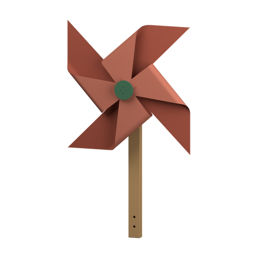

#  Across the Gap
background: 

A hand-cranked snack carrier from the desk to the reading nook.

> NOTE: Executable word-only prototype. Every `{...}` passage is an unaudited proposed picture, not a description checked against existing artwork. The final use scene is proposed prose, not an existing animation. The borrowed heading icon and white background are placeholders; there are no item or reference pictures yet. This candidate tests whether making a small useful transport mechanism earns its guided assembly. It makes no claim of demonstrated enjoyment or learning. The current authority is `stories/builder/design-brief.md`.
>
> Physical assumptions for later diagrams: two sturdy, level table edges approximately 0.8 m apart; a 0.23 m-high support track; a 120 by 90 mm tray; total moving mass at most about 150 g. The supplied far clamp and its permanently tied support cord are one connected part. Show the cord coiled beside its clamp before joining and actually hooked to the winding station afterward. A nominal metre of low-stretch cord includes the tied end and terminal eye; choose its exact length from the dimensioned model, rather than stretching the same drawing. The near anchor has a captive screw and visible spring indicator, allowing tension adjustment during attachment. Budget roughly 20 mm loaded sag and approximately 15 N horizontal support tension; these are design assumptions, not qualified load ratings. Both table clamps need real opposing jaws and positive retention against the lateral pull.
>
> The upper support cord remains stationary. The separate endless haul cord runs around the crank wheel, far return wheel and near spring guide. Nominal main-wheel radius is 25 mm, giving approximately 1.76 m of haul path before the guide detour and take-up; determine the manufactured loop length from that path. The crank wheel is one retained shaft, wheel and captive handle unit. The guide is one connected spring-loaded pulley cartridge. Rubber-lined grooves, modest preload and a small moving load are assumed; traction, spring travel, derailment and cord creep still need mechanical review. No drum winds up an ever-growing pile of cord. Reverse the crank for return travel.
>
> Keep the haul plane about 60 mm beside the support cord so its returning strand clears the hanger. The tray back and brace form the complete retaining sockets, so neither alone can hold an axle cartridge or grip. The trolley's two separate wheel cartridges include captive axles and opening keeper gates; each cartridge remains one connected supply. Either wheel fits either seat. The gates make it possible to clip the trolley onto the slack support cord before joining the stations. Its single grip reaches sideways to the outgoing haul strand. In diagrams verify loaded sag, grip height, return-strand clearance, end stops, clamp retention and access to every fitting. The winding body, tray and return bracket are compact substantial parts; do not draw detached stations as one icon before the cord joins them. Ordinary tightening and closing a captive gate belong to fitting that part, not to an extra testing or operating token.
>
> Each compound caption below is its own standalone declaration, with its condition at the beginning. The component captions describe only their added geometry. The trolley body must be joined before its sockets can retain fittings; those fittings and all four winder fittings allow every order; the last chapter also permits hanging the trolley and fitting the return wheel before or after joining the stations, and threading the loop before or after hanging the trolley. The haul loop requires both pulley stations. The final useful fitting completes the construction; the use scene adds no action.

## `carrier-trolley` Trolley
background: 

The biscuits are on the desk; your book is across the gap.

**Goals**
- Fit Brace to Tray -- `trolley`
- next: Fit a Wheel to Trolley
  - either: `trolley`[`wheel-a`]
  - or: `trolley`[`wheel-b`]
- next: Fit the other Wheel -- `trolley`[`wheel-a`,`wheel-b`]
- next: Fit Grip to Trolley -- `trolley`[`wheel-a`,`wheel-b`,`grip`]

**Items**
- `tray` Tray

  {A shallow red tray with a tall back. Its upper edge has two half-round recesses and a split side socket.}
- `brace` Brace

  {A cream brace has matching half-round recesses, a half socket at its side and broad clips along its edge.}
- `wheel-a` Wheel

  {A charcoal grooved wheel in a cream axle cartridge, with a small hinged keeper beneath its rim.}
- `wheel-b` Wheel

  {A charcoal grooved wheel in a cream axle cartridge, with a small hinged keeper beneath its rim.}
- `grip` Grip

  {A short green arm ends in a captive cord clamp. Its other end has a mounting socket.}
- `trolley` Trolley (compound)
  - unnamed slot: accepts `wheel-a`
  - unnamed slot: accepts `wheel-b`
  - unnamed slot: accepts `grip`

  {The cream brace clips against the tall red tray back. The paired recesses form two complete axle sockets along the top and a complete mounting socket at the side. The shallow tray projects beneath them.}
- `trolley`

  [`wheel-a`] {A grooved wheel with a small keeper gate occupies the left axle socket.}
- `trolley`

  [`wheel-b`] {A grooved wheel with a small keeper gate occupies the right axle socket.}
- `trolley`

  [`grip`] {A green cord grip projects sideways from the mounting socket, just below the wheels.}

**Combinations**
- `brace` [consume] + `tray` [transform] -> `trolley` (tutorial)

## `carrier-winder` Winder
background: 

**Goals**
- Fit Clamp to Winder -- `winder`[`clamp`]
- next: Fit Crank to Winder -- `winder`[`crank`]
- next: Fit Guide to Winder -- `winder`[`guide`]
- next: Fit Anchor to Winder -- `winder`[`clamp`,`crank`,`guide`,`anchor`]

**Items**
- `winder` Winder (compound)
  - unnamed slot: accepts `clamp`
  - unnamed slot: accepts `crank`
  - unnamed slot: accepts `guide`
  - unnamed slot: accepts `anchor`

  {A compact green winding body rises from a broad foot. Its open front has a circular shaft socket, a lower guide seat and an upper anchor socket.}
- `winder`

  [`clamp`] {A cream screw clamp locks under the broad foot, with two opposing jaws.}
- `winder`

  [`crank`] {A charcoal grooved wheel sits in the front socket. A red crank handle projects from its face.}
- `winder`

  [`guide`] {A small grooved guide wheel hangs below and beside the main socket on a visible spring arm.}
- `winder`

  [`anchor`] {A screw-adjusted anchor projects from the top, with an eye and a short spring indicator.}
- `clamp` Clamp

  {A cream C-shaped clamp with a captive screw and two broad jaws. A mounting tongue rises from its top.}
- `crank` Crank

  {A charcoal grooved wheel with a red captive handle on its front and a short retained shaft behind it.}
- `guide` Guide

  {A small grooved pulley retained in a green bracket with a spring arm and mounting tongue.}
- `anchor` Anchor

  {A cream screw adjuster with a captive eye, short spring indicator and threaded mounting stem.}

## `carrier-span` Across the gap
background: 

**Goals**
- Hook the Far clamp's cord to Anchor
  - either: `span`
  - or: `span-wheel`
  - or: `span-trolley`
  - or: `span-both`
  - or: `span-loop`
  - or: `carrier`
- next: Fit Wheel to Far clamp
  - either: `far-wheel`
  - or: `far-both`
  - or: `span-wheel`
  - or: `span-both`
  - or: `span-loop`
  - or: `carrier`
- next: Hang Trolley on the upper cord
  - either: `far-trolley`
  - or: `far-both`
  - or: `span-trolley`
  - or: `span-both`
  - or: `carrier`
- next: Fit Loop around the wheels and into Grip -- `carrier`

**Items**
- `far` Far clamp

  {A cream table clamp supports a short green upright with an empty wheel socket. A pale cord is permanently tied through its upper eye; the rest lies coiled beside it and ends in a small hook.}
- `return-wheel` Wheel

  {A charcoal grooved wheel turns on a retained cream axle cartridge with a mounting tongue.}
- `loop` Loop

  {One continuous dark cord forms a long closed loop.}
- `far-wheel` Far clamp

  {A charcoal wheel occupies the green upright's socket. The pale support cord remains tied to the upper eye and coiled beside the clamp, with its hook free.}
- `far-trolley` Far clamp

  {The two trolley wheels enclose a loose length of the pale cord tied to the far clamp. The red tray hangs below the cream hanger. The cord's hooked end remains free; the far wheel socket is empty.}
- `far-both` Far clamp

  {A charcoal wheel occupies the far clamp's socket. The trolley's two wheels enclose a loose length of the pale cord tied above it; the red tray hangs below the hanger. The cord's hooked end remains free.}
- `span` Track

  {The pale cord joins the far clamp's upper eye to the winding station's screw anchor. Both clamps sit at opposite ends of the connected span. The far wheel socket is empty; the near crank wheel and spring guide are fitted.}
- `span-wheel` Track

  {The pale support cord joins the winding station and far clamp. A charcoal return wheel now occupies the far socket, facing the near crank wheel and spring guide below the cord.}
- `span-trolley` Track

  {The trolley's two wheels enclose the pale support cord between the clamps. Its red tray hangs below, with the green grip projecting sideways. The far wheel socket remains empty.}
- `span-both` Track

  {The trolley hangs from the pale support cord between the clamps. Below and beside that cord, the near crank wheel and spring guide face the fitted far return wheel. The green trolley grip is empty.}
- `span-loop` Track

  {A dark endless cord passes around the crank wheel, far return wheel and spring guide. Its two long strands run beside the pale support cord. No trolley is attached.}
- `carrier` Carrier

  {The cream trolley rides the pale support cord between the two clamps. Its red tray hangs below. A separate dark loop runs around the crank wheel, far wheel and spring guide; the trolley's green grip clasps its upper strand. The lower strand passes clear of the hanger.}

  The clamps grip the desk and the little table beside the reading chair. A hand puts a biscuit in the tray and turns the red crank: the dark loop travels, the trolley wheels roll along the pale cord, and the tray crosses the gap. A hand beside the open book lifts out the biscuit. The crank turns back; the empty tray returns to the desk.

**Combinations**
- `return-wheel` [consume] + `far` [transform] -> `far-wheel`
- `trolley`[`wheel-a`,`wheel-b`,`grip`] [consume] + `far` [transform] -> `far-trolley`
- `return-wheel` [consume] + `far-trolley` [transform] -> `far-both`
- `trolley`[`wheel-a`,`wheel-b`,`grip`] [consume] + `far-wheel` [transform] -> `far-both`
- `winder`[`clamp`,`crank`,`guide`,`anchor`] [transform] + `far` [transform] -> `span`
- `winder`[`clamp`,`crank`,`guide`,`anchor`] [transform] + `far-wheel` [transform] -> `span-wheel`
- `winder`[`clamp`,`crank`,`guide`,`anchor`] [transform] + `far-trolley` [transform] -> `span-trolley`
- `winder`[`clamp`,`crank`,`guide`,`anchor`] [transform] + `far-both` [transform] -> `span-both`
- `return-wheel` [consume] + `span` [transform] -> `span-wheel`
- `trolley`[`wheel-a`,`wheel-b`,`grip`] [consume] + `span` [transform] -> `span-trolley`
- `return-wheel` [consume] + `span-trolley` [transform] -> `span-both`
- `trolley`[`wheel-a`,`wheel-b`,`grip`] [consume] + `span-wheel` [transform] -> `span-both`
- `loop` [consume] + `span-wheel` [transform] -> `span-loop`
- `loop` [consume] + `span-both` [transform] -> `carrier`
- `trolley`[`wheel-a`,`wheel-b`,`grip`] [consume] + `span-loop` [transform] -> `carrier`

## `carrier-end` The End
background: 

One biscuit beside the book.
