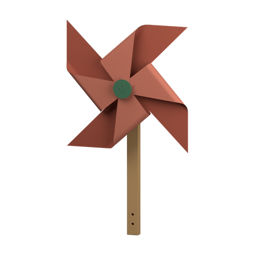

#  Across the Gap
background: 

A hand-cranked snack carrier from the desk to the reading nook.

> NOTE: Executable word-only prototype. Every `{...}` passage is an unaudited proposed picture, not a description checked against existing artwork. The final use scene is proposed prose, not an existing animation. The borrowed heading icon and white background are placeholders; there are no item or reference pictures yet. This candidate tests whether making a small useful transport mechanism earns its guided assembly. It makes no claim of demonstrated enjoyment or learning. The current authority is `stories/builder/design-brief.md`.
>
> Physical assumptions for later diagrams: two sturdy, level table edges approximately 0.8 m apart; a 0.23 m-high support track; a 120 by 90 mm tray; total moving mass at most about 150 g. The supplied far clamp and its permanently tied support cord are one connected part. Show the cord coiled beside its clamp before joining and actually hooked to the winding station afterward. A nominal metre of low-stretch cord includes the tied end and terminal eye; choose its exact length from the dimensioned model, rather than stretching the same drawing. The near anchor has a captive screw and visible spring indicator, allowing tension adjustment during attachment. Budget roughly 20 mm loaded sag and approximately 15 N horizontal support tension; these are design assumptions, not qualified load ratings. Both table clamps need real opposing jaws and positive retention against the lateral pull.
>
> The upper support cord remains stationary. The separate endless haul cord runs around the crank wheel, far return wheel and near spring guide. Nominal main-wheel radius is 25 mm, giving approximately 1.76 m of haul path before the guide detour and take-up; determine the manufactured loop length from that path. The crank wheel is one retained shaft, wheel and captive handle unit. The guide is one connected spring-loaded pulley cartridge. Rubber-lined grooves, modest preload and a small moving load are assumed; traction, spring travel, derailment and cord creep still need mechanical review. No drum winds up an ever-growing pile of cord. Reverse the crank for return travel.
>
> Keep the haul plane about 60 mm beside the support cord so its returning strand clears the hanger. The tray back and brace form the complete retaining sockets, so neither alone can hold an axle cartridge. The tray has one integral sideways arm with a captive cord grip; it is already visibly connected in the loose supply. The trolley's two separate wheel cartridges include captive axles and opening keeper gates; each cartridge remains one connected supply. Either wheel fits either seat. The gates make it possible to clip the trolley onto the slack support cord before joining the stations. Its single grip reaches sideways to the outgoing haul strand. In diagrams verify loaded sag, grip height, return-strand clearance, end stops, clamp retention and access to every fitting. The winding body, tray and return bracket are compact substantial parts; do not draw detached stations as one icon before the cord joins them. Ordinary tightening and closing a captive gate belong to fitting that part, not to an extra testing or operating token.
>
> Revision hypothesis: remove four little-valued fittings while keeping the trolley body joint, two actual wheel additions and the complete support/haul arrangement. The grip remains physically present as part of the supplied tray. The winding station arrives as one connected manufactured unit with its table clamp, spring guide and upper track anchor fitted; its crank-wheel cartridge is still separate. This is a change in assembly granularity, not a claim that the parts are unnecessary or that the shorter version is more enjoyable.
>
> Presentation is deferred. The complete span is intrinsically wide and slender; shrinking it into a tiny phone icon is not an accepted artwork solution. Compact trolley and station working views can be developed separately, but the connected span and its final use need an overall scene view with inspectable fitting details. No phone-size visual quality or usability has been verified for this word-only prototype. The body must be joined before its two wheel sockets can retain cartridges. Both wheels remain interchangeable. All later fittings may occur before or after joining the stations when physically possible; the closed haul loop requires both main wheels. The final useful fitting completes construction without a testing or operating action.

## `carrier-trolley` Trolley
background: 

The biscuits are on the desk; your book is across the gap.

**Goals**
- Fit Brace to Tray -- `trolley`
- next: Fit a Wheel to Trolley
  - either: `trolley`[`wheel-a`]
  - or: `trolley`[`wheel-b`]
- next: Fit the other Wheel -- `trolley`[`wheel-a`,`wheel-b`]

**Items**
- `tray` Tray

  {A shallow red tray with a tall back. Its upper edge has two half-round recesses. An integral side arm ends in a captive green cord grip.}
- `brace` Brace

  {A cream brace has matching half-round recesses and broad clips along its edge.}
- `wheel-a` Wheel

  {A charcoal grooved wheel in a cream axle cartridge, with a small hinged keeper beneath its rim.}
- `wheel-b` Wheel

  {A charcoal grooved wheel in a cream axle cartridge, with a small hinged keeper beneath its rim.}
- `trolley` Trolley (compound)
  - unnamed slot: accepts `wheel-a`
  - unnamed slot: accepts `wheel-b`

  {The cream brace clips against the tall red tray back. The paired recesses form two complete axle sockets along the top. The shallow tray projects beneath them; its integral side arm ends in a captive green cord grip.}
- `trolley`

  [`wheel-a`] {A grooved wheel with a small keeper gate occupies the left axle socket.}
- `trolley`

  [`wheel-b`] {A grooved wheel with a small keeper gate occupies the right axle socket.}
**Combinations**
- `brace` [consume] + `tray` [transform] -> `trolley` (tutorial)

## `carrier-span` Across the gap
background: 

**Goals**
- Fit Crank to Winder
  - either: `winder-1`
  - or: `span-1`
  - or: `span-3`
  - or: `span-5`
  - or: `span-7`
  - or: `span-11`
  - or: `carrier`
- next: Fit Wheel to Far clamp
  - either: `far-2`
  - or: `far-6`
  - or: `span-2`
  - or: `span-3`
  - or: `span-6`
  - or: `span-7`
  - or: `span-11`
  - or: `carrier`
- next: Hook the Far clamp's cord to Winder
  - either: `span-0`
  - or: `span-1`
  - or: `span-2`
  - or: `span-3`
  - or: `span-4`
  - or: `span-5`
  - or: `span-6`
  - or: `span-7`
  - or: `span-11`
  - or: `carrier`
- next: Hang Trolley on the upper cord
  - either: `far-4`
  - or: `far-6`
  - or: `span-4`
  - or: `span-5`
  - or: `span-6`
  - or: `span-7`
  - or: `carrier`
- next: Fit Loop around the wheels and into the grip
  - `carrier`

**Items**
- `winder-0` Winder

  {A compact green winding station has a cream table clamp beneath its foot, a spring-loaded guide pulley near its base and a screw-adjusted cord anchor at its top. The main wheel socket on its front is empty.}
- `winder-1` Winder

  {A compact green winding station has a cream table clamp beneath its foot, a spring-loaded guide pulley near its base and a screw-adjusted cord anchor at its top. A charcoal grooved wheel with a red crank handle occupies its front socket.}
- `crank` Crank

  {A charcoal grooved wheel with a red captive handle on its front and a short retained shaft behind it.}
- `return-wheel` Wheel

  {A charcoal grooved wheel turns on a retained cream axle cartridge with a mounting tongue.}
- `loop` Loop

  {One continuous dark cord forms a long closed loop.}
- `far-0` Far clamp

  {A cream table clamp supports a short green upright. A pale support cord is permanently tied through its upper eye; its hooked end remains free. The wheel socket is empty. The support cord lies coiled beside the clamp.}
- `far-2` Far clamp

  {A cream table clamp supports a short green upright. A pale support cord is permanently tied through its upper eye; its hooked end remains free. A charcoal return wheel occupies the upright's socket. The support cord lies coiled beside the clamp.}
- `far-4` Far clamp

  {A cream table clamp supports a short green upright. A pale support cord is permanently tied through its upper eye; its hooked end remains free. The wheel socket is empty. The trolley's two wheels enclose a loose length of the support cord; its red tray and integral green grip hang below.}
- `far-6` Far clamp

  {A cream table clamp supports a short green upright. A pale support cord is permanently tied through its upper eye; its hooked end remains free. A charcoal return wheel occupies the upright's socket. The trolley's two wheels enclose a loose length of the support cord; its red tray and integral green grip hang below.}
- `span-0` Track

  {The pale support cord joins the far clamp's upper eye to the winding station's screw anchor. The near station's main wheel socket is empty. The far wheel socket is empty.}
- `span-1` Track

  {The pale support cord joins the far clamp's upper eye to the winding station's screw anchor. The near station has its crank wheel fitted. The far wheel socket is empty.}
- `span-2` Track

  {The pale support cord joins the far clamp's upper eye to the winding station's screw anchor. The near station's main wheel socket is empty. A charcoal return wheel occupies the far socket.}
- `span-3` Track

  {The pale support cord joins the far clamp's upper eye to the winding station's screw anchor. The near station has its crank wheel fitted. A charcoal return wheel occupies the far socket.}
- `span-4` Track

  {The pale support cord joins the far clamp's upper eye to the winding station's screw anchor. The near station's main wheel socket is empty. The far wheel socket is empty. The trolley rides the upper cord, with its red tray below and green grip projecting sideways.}
- `span-5` Track

  {The pale support cord joins the far clamp's upper eye to the winding station's screw anchor. The near station has its crank wheel fitted. The far wheel socket is empty. The trolley rides the upper cord, with its red tray below and green grip projecting sideways.}
- `span-6` Track

  {The pale support cord joins the far clamp's upper eye to the winding station's screw anchor. The near station's main wheel socket is empty. A charcoal return wheel occupies the far socket. The trolley rides the upper cord, with its red tray below and green grip projecting sideways.}
- `span-7` Track

  {The pale support cord joins the far clamp's upper eye to the winding station's screw anchor. The near station has its crank wheel fitted. A charcoal return wheel occupies the far socket. The trolley rides the upper cord, with its red tray below and green grip projecting sideways.}
- `span-11` Track

  {The pale support cord joins the far clamp's upper eye to the winding station's screw anchor. The near station has its crank wheel fitted. A charcoal return wheel occupies the far socket. A separate dark loop passes around the crank wheel, far return wheel and near spring guide. Its two long strands run beside the pale support cord; no trolley is attached.}
- `carrier` Carrier

  {The pale support cord joins the far clamp's upper eye to the winding station's screw anchor. The near station has its crank wheel fitted. A charcoal return wheel occupies the far socket. The trolley rides the upper cord, with its red tray below and green grip projecting sideways. A separate dark loop passes around the crank wheel, far return wheel and near spring guide. The trolley's grip clasps the loop's upper strand; its lower strand passes clear of the hanger.}

  The clamps grip the desk and the little table beside the reading chair. A hand puts a biscuit in the tray and turns the crank. The loop travels; the trolley rolls across the gap on the upper cord. A hand beside the open book lifts out the biscuit. The crank turns back, bringing the empty tray home.

**Combinations**
- `crank` [consume] + `winder-0` [transform] -> `winder-1`
- `return-wheel` [consume] + `far-0` [transform] -> `far-2`
- `trolley`[`wheel-a`,`wheel-b`] [consume] + `far-0` [transform] -> `far-4`
- `winder-0` [transform] + `far-0` [transform] -> `span-0`
- `winder-1` [transform] + `far-0` [transform] -> `span-1`
- `trolley`[`wheel-a`,`wheel-b`] [consume] + `far-2` [transform] -> `far-6`
- `winder-0` [transform] + `far-2` [transform] -> `span-2`
- `winder-1` [transform] + `far-2` [transform] -> `span-3`
- `return-wheel` [consume] + `far-4` [transform] -> `far-6`
- `winder-0` [transform] + `far-4` [transform] -> `span-4`
- `winder-1` [transform] + `far-4` [transform] -> `span-5`
- `winder-0` [transform] + `far-6` [transform] -> `span-6`
- `winder-1` [transform] + `far-6` [transform] -> `span-7`
- `crank` [consume] + `span-0` [transform] -> `span-1`
- `return-wheel` [consume] + `span-0` [transform] -> `span-2`
- `trolley`[`wheel-a`,`wheel-b`] [consume] + `span-0` [transform] -> `span-4`
- `return-wheel` [consume] + `span-1` [transform] -> `span-3`
- `trolley`[`wheel-a`,`wheel-b`] [consume] + `span-1` [transform] -> `span-5`
- `crank` [consume] + `span-2` [transform] -> `span-3`
- `trolley`[`wheel-a`,`wheel-b`] [consume] + `span-2` [transform] -> `span-6`
- `trolley`[`wheel-a`,`wheel-b`] [consume] + `span-3` [transform] -> `span-7`
- `loop` [consume] + `span-3` [transform] -> `span-11`
- `crank` [consume] + `span-4` [transform] -> `span-5`
- `return-wheel` [consume] + `span-4` [transform] -> `span-6`
- `return-wheel` [consume] + `span-5` [transform] -> `span-7`
- `crank` [consume] + `span-6` [transform] -> `span-7`
- `loop` [consume] + `span-7` [transform] -> `carrier`
- `trolley`[`wheel-a`,`wheel-b`] [consume] + `span-11` [transform] -> `carrier`

## `carrier-end` The End
background: 

One biscuit beside the book.
