# 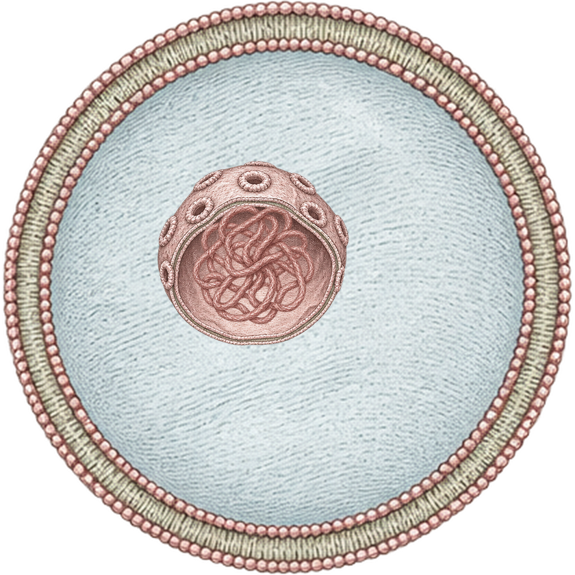 Anatomy

background: 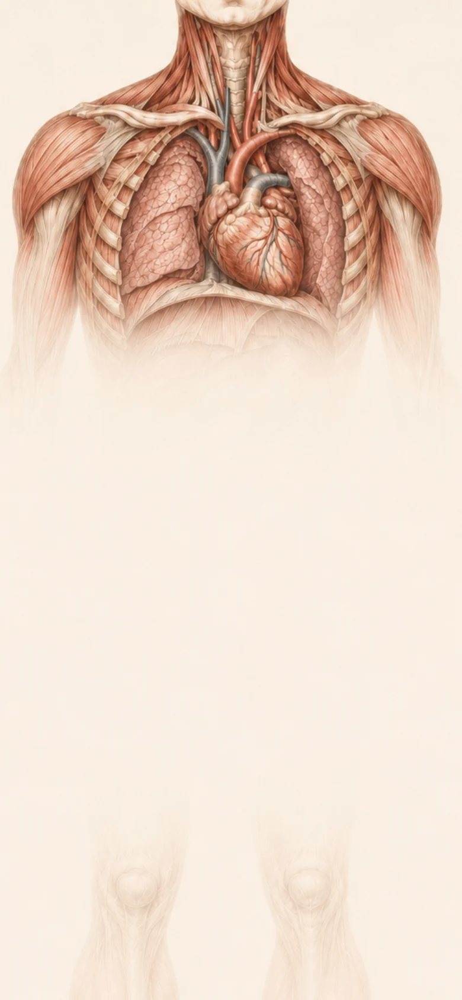

Build an anatomy and physiology textbook, one combination at a time: cells, tissues, organs and systems. Discover how their structures make movement, exchange, regulation and renewal possible.

> NOTE: Grades 9–10 ordinary biology, non-AP/non-Honors. The active brief and curriculum.md define the audience, taught terms and limited advanced exceptions. These are explanatory reconstructions of selected processes and mature anatomical cutaways, not manufacture of life, surgery or a complete developmental timeline. Braces describe physical artwork. The selected atlas edition supplies the complete illustrated story; verification records distinguish technical checks from learning evidence.

## `cell-boundary` An inside of its own
background: 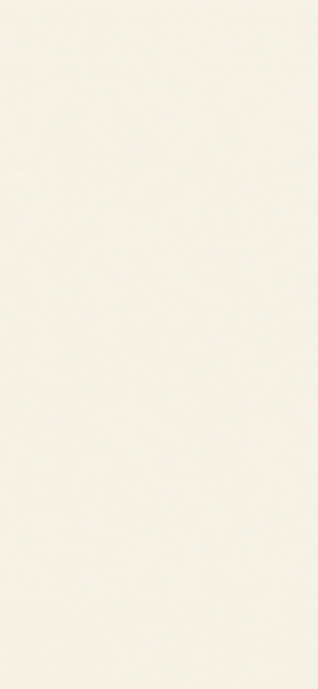

A cell has an inside that differs from its surroundings. Begin with the outer membrane and a smaller enclosure for its DNA. Bring those two constructions together.

**Goals**
- Build the cell's outer enclosure -- `opening-cell`
- Enclose DNA in a nucleus -- `opening-nucleus`
- next: Put the nucleus inside the outer boundary -- `opening-cell`[`opening-nucleus`]

**Items**
- `prelude-phospholipids` Lipid membrane
  - icon: 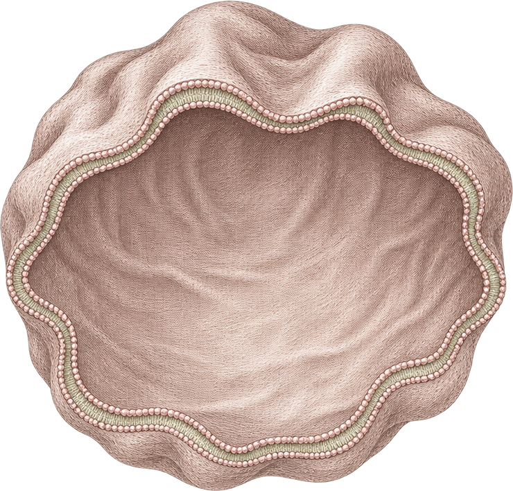
  {A complete, slightly collapsed membrane enclosure has a folded, uneven circular outline. Its cut edge reveals two close layers with water-facing heads and inward-facing tails. The enclosure contains no fluid, DNA or future fittings.}
- `prelude-water` Water
  - icon: 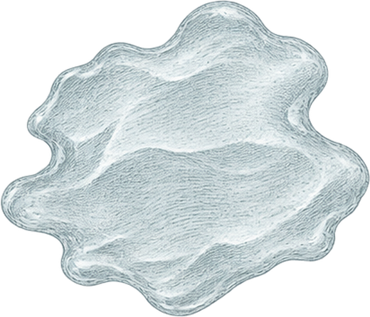
  {An irregular, softly pooling volume of clear water has no circular rim or droplet emblem. It matches the fluid that will fill the membrane enclosure, at the same magnification.}
- `opening-dna` DNA
  - icon: 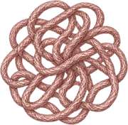
  {Fine, tangled chromatin threads coil into an irregular bundle. The strands alone are visible, without a helix badge, lettering or future proteins.}
- `opening-nuclear-envelope` Nuclear envelope
  - icon: 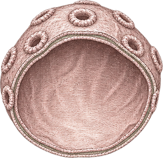
  {A shallow, irregularly rounded cutaway shell has a visibly double wall, a narrow space between its membranes, and several pores passing through both layers. Short folds of outer membrane extend at one edge. It is a thin biological envelope, not a smooth ring or generic container, and contains no DNA yet.}
- `opening-nucleus` Nucleus
  - icon: 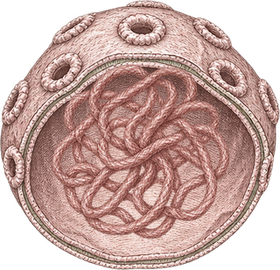
  {The same tangled chromatin fills the double-walled nuclear envelope. Its pores, cut edge and outer membrane folds remain visible; no absent RNA product or explanatory inset is added.}
- `opening-cell` Membrane bag (compound)
  - icon: 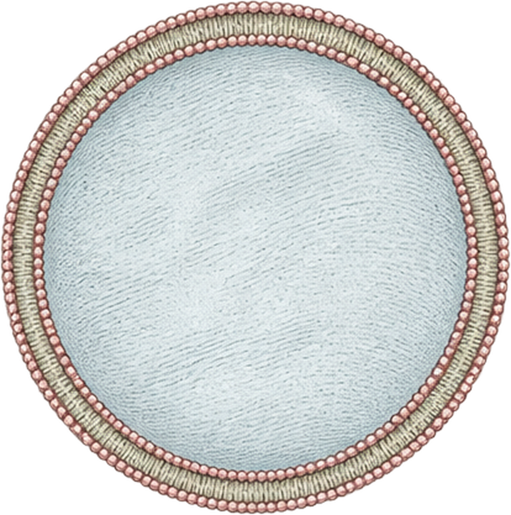
  - from chapter `cell-energy`: Cell
  - unnamed slot: accepts `opening-nucleus`, icon: 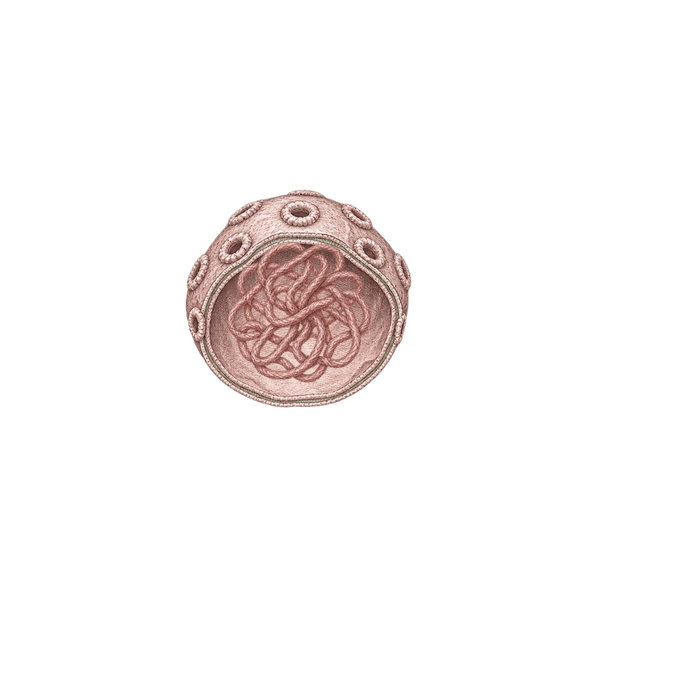
  - unnamed slot: accepts `opening-mitochondria`, icon: 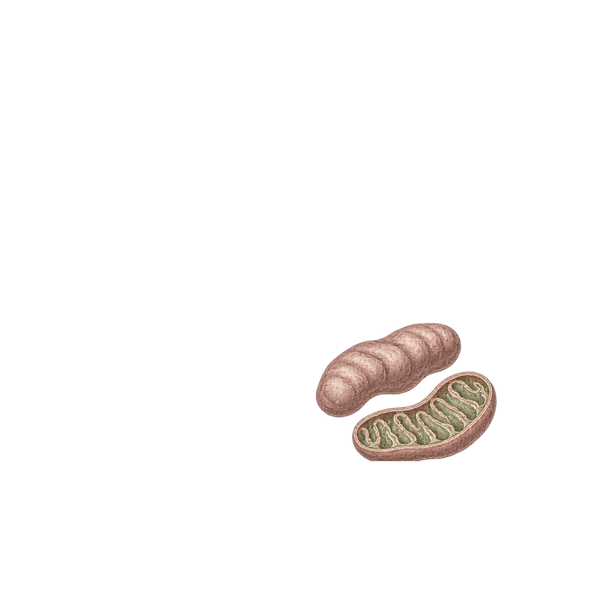
  - unnamed slot: accepts `school-sugar-carrier`, icon: 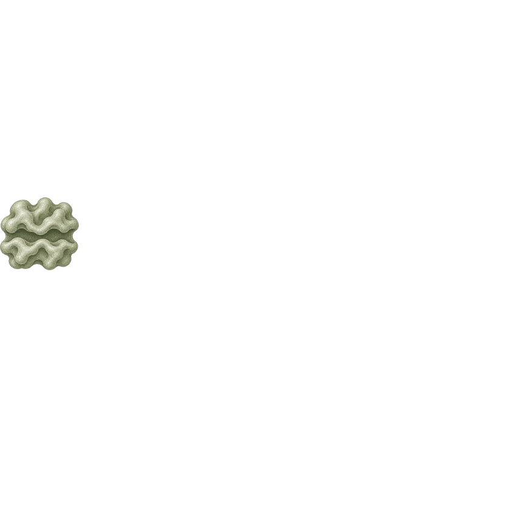
  - unnamed slot: accepts `school-ribosome`, icon: 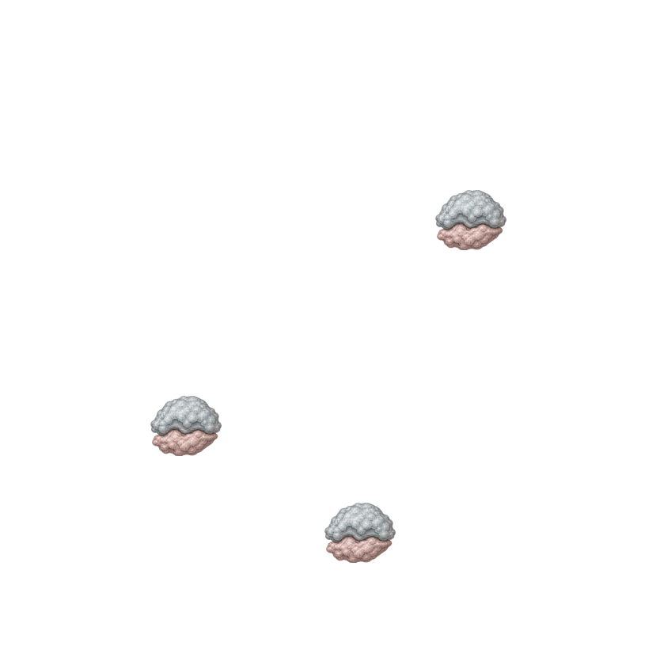
  {The membrane now encloses the supplied water and has a full rounded outline. The fluid takes its boundary from the membrane. A cutaway exposes the enclosed fluid while retaining the rear membrane surface and the bilayer at the cut edge. No separate enlargement, water molecule or recipe symbol accompanies the object.}

  A boundary makes an inside and an outside. A living cell needs much more than a bag.
- `opening-cell`
  [`opening-nucleus`] {The nucleus sits in the enclosed fluid. DNA remains inside its own smaller envelope.}
- `opening-cell`
  [`opening-mitochondria`] {Mitochondria sit in the cell fluid. One is cut open to show its folded inner membrane. All earlier fitted parts remain.}
- `opening-cell`
  [`school-sugar-carrier`] {The carrier sits across the outer membrane, with its pore and folded protein structure visible in the same cell cutaway. No detached copy, state diagram or glucose symbol is added.}
- `opening-cell`
  [`school-ribosome`] {Ribosomes sit in the fluid outside the nucleus within the same cell cutaway. Short RNA strands and free amino acids are physically present in that fluid. The fitted ribosomes retain their recognizable two-part shapes without a separate magnifying window.}

**Combinations**
- `prelude-phospholipids` [consume] + `prelude-water` [consume] -> `opening-cell` (tutorial)
- `opening-dna` [consume] + `opening-nuclear-envelope` [consume] -> `opening-nucleus`

> NOTE: Three operations, two independent starting constructions. This is a textbook reconstruction, not a recipe for manufacturing life. The cell's later function includes ordinary cytosol, enzymes and supporting machinery. The nuclear envelope includes pores and associated proteins. The early model shows DNA's physical location; later RNA production belongs to the cell's subsequent activity. No nutrient, ATP, water-flow event or activated status is a compound slot. Only persistent physical structures are fitted. Closed lipid vesicles: https://pmc.ncbi.nlm.nih.gov/articles/PMC1434845/ ; OpenStax A&P 3.1. Ordinary school scope: curriculum.md.

## `cell-energy` The powerhouse of the cell
background: 

Cells use food both as fuel and as building material. Add mitochondria to make ATP from glucose, and ribosomes to make proteins following RNA copies from the nucleus. Oxygen is dissolved around the cell and can cross its membrane. The watery interior—cytosol—already contains RNA, amino acids and the usual supporting machinery.

**Goals**
- Add mitochondria and a route for glucose
  - both: `opening-cell`[`opening-mitochondria`]
  - and: `opening-cell`[`school-sugar-carrier`]
- next: Feed glucose to the cell to make ATP -- `school-atp`
- Add the cell's protein builders -- `opening-cell`[`school-ribosome`]
- next: Use ATP in the cell to build a protein from amino acids -- `school-protein`

**Items**
- `opening-cell`
- `opening-mitochondria` Mitochondria
  - icon: 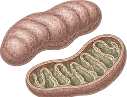
  {Bean-shaped mitochondria have a continuous outer membrane and folded inner membrane, exposed in one organelle cutaway.}
- `school-sugar-carrier` Sugar-carrier protein
  - icon: 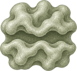
  {A folded membrane-spanning carrier protein has a narrow central passage. Only the protein is present.}
- `school-glucose` Glucose
  - icon: 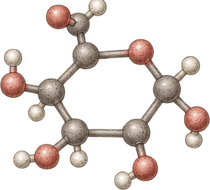
  {One compact glucose molecule is represented by its connected constituent atoms, without a carrier or food badge.}
- `school-ribosome` Ribosomes
  - icon: 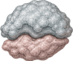
  {A ribosome has two unequal rounded subunits meeting around a groove. Only the supplied structures are present.}
- `school-atp` ATP
  - icon: 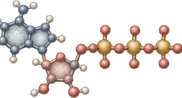
  {One ATP molecule has its connected molecular groups and three linked phosphate groups. No cell, energy symbol or reaction diagram accompanies it.}

  Glucose is used up. Respiration replenishes ATP, which powers work such as building proteins.
- `school-protein` Protein
  - icon: 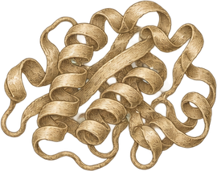
  {A protein chain folds into a compact three-dimensional form. Only the produced protein is shown.}

  Food provides both fuel and building material. ATP helps pay for the work; amino acids become the protein.

**Combinations**
- `school-glucose` [consume] + `opening-cell`[`opening-mitochondria`,`school-sugar-carrier`] [preserve] -> `school-atp`
- `school-atp` [consume] + `opening-cell`[`opening-nucleus`,`school-ribosome`] [preserve] -> `school-protein`

> NOTE: Five operations. Ribosomes are structural components: they must be fitted inside the cell before they can make protein in this model. The separate Ribosomes supply has no production recipe. RNA is already present within the cell, made from its existing nuclear DNA; it is shown reaching installed ribosomes, not dragged in from outside or made into a detachable second ribosome. The stable cell is the receiving producer for both glucose-to-ATP and ATP-supported protein production. Glucose and ATP are consumed supplies; only persistent structures occupy slots. Protein is a real molecular product, shown enlarged with its location made explicit. Amino acids are disclosed in the opening and consumed in protein formation; ATP contributes energy, not the protein material. The next chapter gives amino acids their own icon while comparing different RNA instructions. The operation includes ordinary translation machinery, amino-acid activation and GTP. Oxygen, ADP/phosphate, water and supporting enzymes are supplied; glycolysis in the cytosol makes some ATP and mitochondria support much aerobic ATP production. No fixed yield, glucose entering mitochondria unchanged, or activation of an otherwise inactive cell is claimed. Nucleus, carrier, mitochondria and ribosomes each have a visible use. Sources: OpenStax Biology [glycolysis](https://openstax.org/books/biology-2e/pages/7-2-glycolysis), [oxidative phosphorylation](https://openstax.org/books/biology-2e/pages/7-4-oxidative-phosphorylation), and A&P 3.4.

## `cell-specialization` Same DNA, different jobs
background: 

Step back to an embryo's growing limb. Earlier, a rear-edge patch called the zone of polarizing activity releases Sonic hedgehog; later, developing cartilage and muscle release TGF-beta2. These proteins help already prepared cells use different genes. The cell you built now stands for appropriately prepared embryonic descendants. Follow two groups: one makes muscle; the other builds tendons, the tough links between muscle and bone.

> NOTE: The chapter opening locates the two developmental contexts in time and tissue. Artwork shows only each physical protein or cell state, with no background anatomy, source locator or timeline. The reusable population stands for distinct prepared recipients, not arbitrary interchangeable cells.

**Goals**
- Follow Sonic hedgehog into muscle development -- `school-young-muscle`
- next: Build pulling proteins inside the cells -- `prelude-myoblasts`
- Follow TGF-beta2 into tendon development -- `school-young-support`
- next: Build tendon fibres around the cells -- `prelude-matrix`

**Items**
- `prelude-daughters` Embryonic cells
  - icon: 
  {The single recognizable cell from the previous chapter retains its membrane, nucleus and fitted organelles. It represents the appropriate embryonic descendants for each developmental setting, without a new cluster or future tissue symbols.}
- `school-muscle-signals` Sonic hedgehog protein
  - icon: 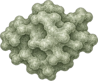
  {A compact folded Sonic hedgehog protein is shown alone. Its releasing tissue and recipient cells are explained in the chapter text.}
- `school-support-signals` TGF-beta2 protein
  - icon: 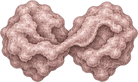
  {A folded, double-lobed TGF-beta2 protein is shown alone, with no source-tissue or target-cell badge.}
- `school-amino-acids` Amino acids — protein building blocks
  - icon: 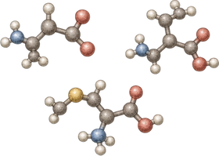
- `school-young-muscle` Cells with muscle-protein RNA
  - icon: 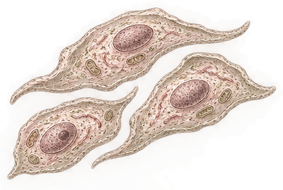
  {The selected muscle precursors retain their nuclei and contain fine RNA strands. Their cell bodies are beginning to elongate; contractile fibres are not yet present.}
- `school-young-support` Tendon cells with collagen RNA
  - icon: 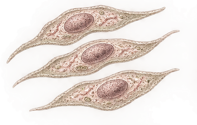
  {Slender tendon precursor cells retain nuclei and contain RNA strands. No extracellular collagen fibres have yet been added.}
- `prelude-myoblasts` Muscle cells
  - icon: 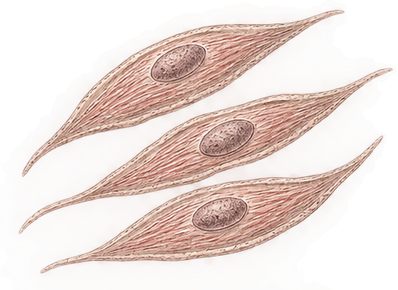
  {Separate elongated muscle cells contain parallel contractile fibres and their own nuclei and membranes. No detached cell or muscle enlargement accompanies them.}
- `prelude-matrix` Tendon tissue
  - icon: 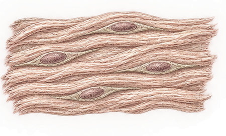
  {Living tendon cells lie between dense aligned collagen fibres in one continuous tissue strip.}

  Muscle cells keep their pulling proteins inside. Tendon cells build tough fibres outside. Different uses of the same DNA help make a limb.

**Combinations**
- `prelude-daughters` [preserve] + `school-muscle-signals` [consume] -> `school-young-muscle`
- `prelude-daughters` [preserve] + `school-support-signals` [consume] -> `school-young-support`
- `school-young-muscle` [transform] + `school-amino-acids` [consume] -> `prelude-myoblasts`
- `school-young-support` [transform] + `school-amino-acids` [consume] -> `prelude-matrix`

> NOTE: This chapter is an explicit developmental flashback, not the main game's assembly timeline. The reusable population represents distinct, appropriately prepared descendants in different places and at different times, not any one interchangeable cell. Selected limb muscle precursors are somite-derived; tendon precursors here have a different, limb-mesenchymal history. The later neuron chapter still selects appropriate neural-tube/neural-crest descendants from the broad model population, not from these limb precursors. Each signal operation compresses cellular responses over time; neither protein alone converts an arbitrary cell or directly makes contractile/collagen RNA without intervening regulation. Existing organelles, ATP, other cues, growth and tissue organization are supplied. Muscle cells remain precursors before the fusion into long skeletal fibres pictured in the next chapter. This is one route into muscle development, not the origin of every skeletal muscle or a claim that the same limb cells later become both biceps and triceps.

> NOTE: [Anderson et al., 2012](https://pmc.ncbi.nlm.nih.gov/articles/PMC3444735/) experimentally connect ZPA-derived Shh to Myf5 activation specifically in ventral limb muscle precursors in mouse embryos. That result supports the selected source, recipients and developmental setting; the game omits the regulatory cascade and later gene-expression steps. [Pryce et al., 2009](https://journals.biologists.com/dev/article-pdf/136/8/1351/1213661/1351.pdf) establish TGF-beta2/3's importance for maintaining tendon progenitors, with expression in developing cartilage, muscle and tendon cells. Initial progenitor induction persists in the mutants; recruitment of additional progenitors is the authors' proposed model. Accordingly, this scene supplies already prepared tendon precursors and teaches continued development, not a proven first-induction switch. The mature collagen-rich result additionally includes protein production, secretion and organization over time (OpenStax A&P 3.4 and 4.3). These vertebrate experiments ground an explanatory human-anatomy model; mouse embryonic days are not human dates. The two protein names and ZPA are locally taught, user-requested extensions beyond ordinary school vocabulary, not prerequisites or a pathway memorization exercise.

## `full-strong-and-movable` Bones first, then muscles
background: 

An arm needs living bone as well as pulling muscle. Return to the embryonic-cell model: in developing skeletal tissue, BMP-2 helps prepared connective-tissue precursors become bone-building cells. These cells make a soft collagen-rich tissue; mineral makes that tissue hard. Use it to build the arm's main bones, then add the biceps and triceps on opposite sides of the elbow. This is an anatomical reconstruction, with ordinary growth and supporting tissues included.

**Goals**
- Develop bone-building cells -- `arm-bone-cells`
- next: Make living, mineralized bone tissue -- `arm-bone-tissue`
- next: Add the upper-arm bone, the humerus -- `arm-humerus`
- next: Add the ulna on the little-finger side -- `arm-humerus-ulna`
- next: Add the radius on the thumb side -- `arm-long-bones`
- next: Add the wrist and hand bones -- `arm-skeleton`
- next: Build the biceps in front of the elbow -- `arm-with-biceps`
- next: Build the triceps behind the elbow -- `arm-with-muscles`

**Hotspots**
- `arm-shoulder` (center 780px, 1010px)
  - hitbox: (center 948px, 551.5px) (size 412px, 373px)
- `arm-humerus` (center 780px, 1010px)
  - hitbox: (center 920.5px, 671px) (size 467px, 612px)
- `arm-humerus-ulna` (center 780px, 1010px)
  - hitbox: (center 883.5px, 840px) (size 541px, 950px)
- `arm-long-bones` (center 780px, 1010px)
  - hitbox: (center 849px, 838.5px) (size 610px, 947px)
- `arm-skeleton` (center 780px, 1010px)
  - hitbox: (center 779px, 1013px) (size 750px, 1296px)
- `arm-with-biceps` (center 780px, 1010px)
  - hitbox: (center 779px, 1011.5px) (size 754px, 1301px)
- `arm-with-muscles` (center 780px, 1010px)
  - hitbox: (center 779px, 1012.5px) (size 752px, 1297px)

**Items**
- `prelude-daughters`
- `arm-bmp2` BMP-2 protein
  - icon: 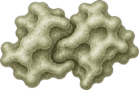
  {A compact folded protein dimer is shown alone, without bone or a future-product symbol.}

  Bone morphogenetic protein 2 helps suitable precursor cells develop into osteoblasts, the cells that build bone. Other local signals and the cells' prior development also matter.
- `arm-bone-cells` Bone-building cells
  - icon: 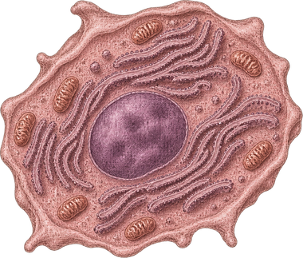
  {One representative osteoblast retains its membrane and rounded nucleus, with abundant protein-making membranes in its cytoplasm. It stands for the cells that will make the tissue; no bone, mineral badge or future collagen is included.}
- `school-amino-acids`
- `school-bone-mineral` Bone mineral
  - icon: 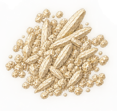
  {A small cluster of calcium-phosphate crystals is shown at the same tissue magnification as the soft bone tissue. It contains no miniature skeleton, arrows or bone-strength symbol.}
- `arm-soft-bone` Soft bone tissue
  - icon: 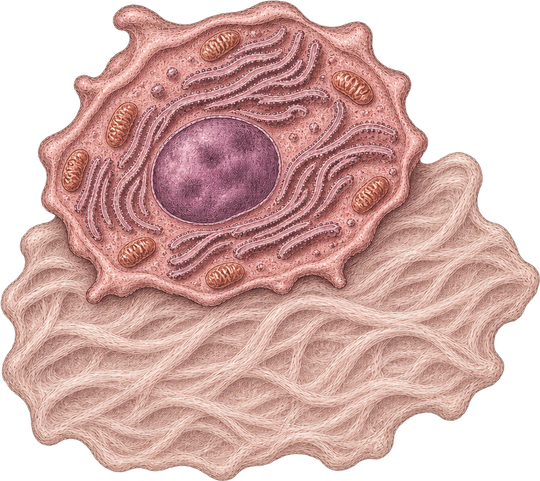
  {The recognizable representative osteoblast rests against newly secreted, interwoven collagen-rich matrix at the same cellular scale. The soft tissue has no mineral deposits or pre-drawn whole bone.}

  Bone is living tissue. Its cells build a collagen-rich matrix before mineral hardens it.
- `arm-bone-tissue` Bone tissue
  - icon: 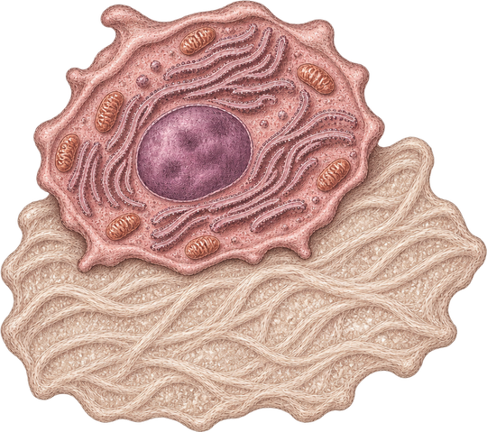
  {The same osteoblast and collagen-rich tissue retain their size and arrangement while fine mineral deposits fill spaces within the matrix. No separate bone or mineral badge accompanies the tissue.}
- `prelude-myoblasts`
- `arm-shoulder` Shoulder girdle
  - icon: 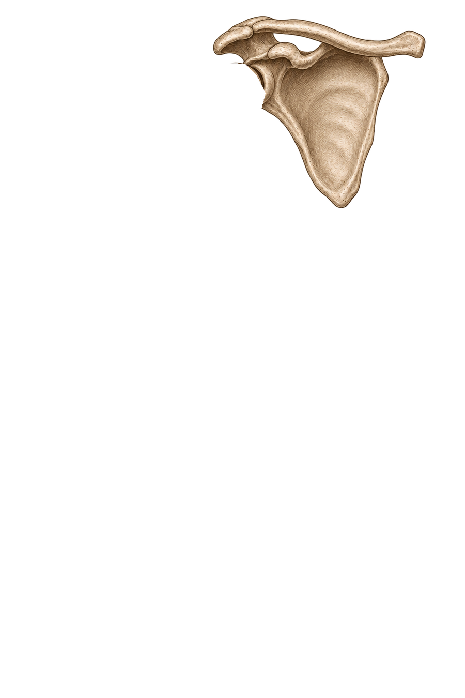
  {A shoulder blade and collarbone, with a cartilage-lined shoulder socket and ordinary supporting connective tissue, form a real anatomical starting piece. Nothing below the socket has been constructed. No arm outline, missing-bone ghost or labelled empty place is drawn.}
- `arm-humerus` Shoulder and humerus
  - icon: 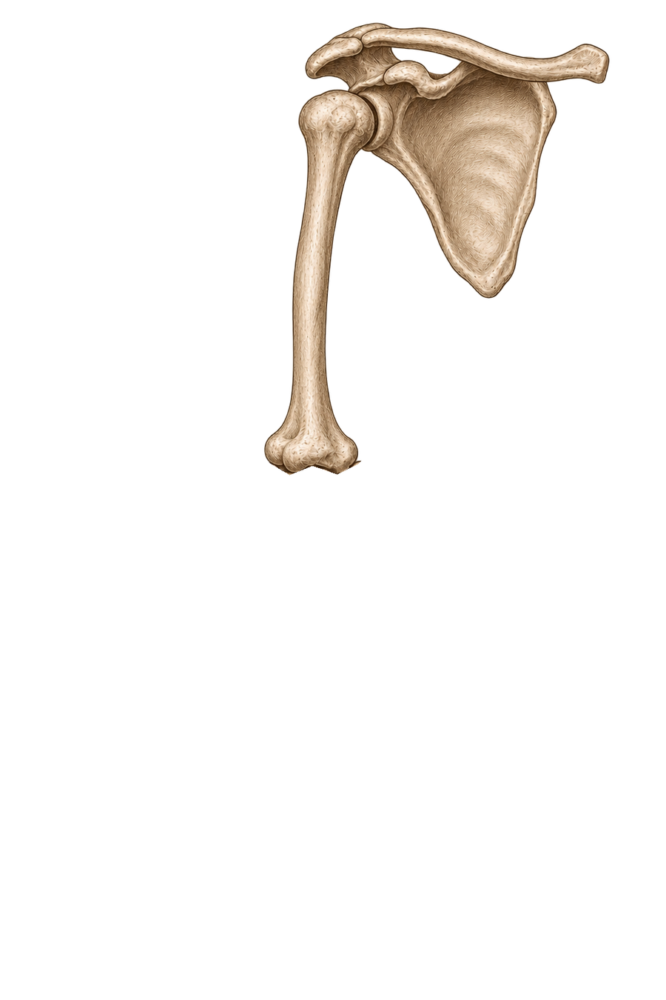
  {The humerus extends from the same shoulder socket to its elbow end. Its bone surface and cutaway contain the mineralized living tissue just made; cartilage caps the joint surfaces. No forearm or hand is present.}

  The humerus is the upper arm's single long bone.
- `arm-humerus-ulna` Shoulder, humerus and ulna
  - icon: 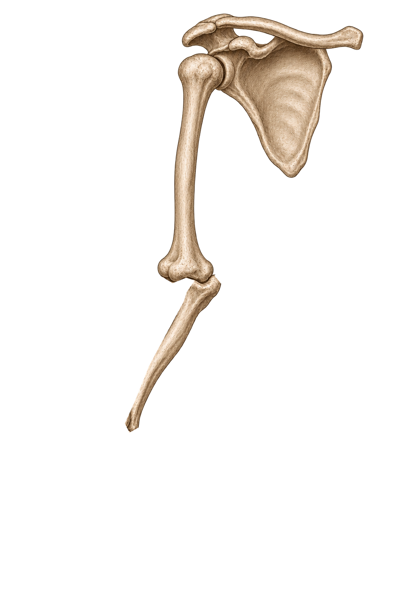
  {The ulna now meets the humerus at the elbow. Its projecting elbow tip and long shaft remain distinct from the humerus. The radius and hand are absent.}
- `arm-long-bones` Shoulder and three long bones
  - icon: 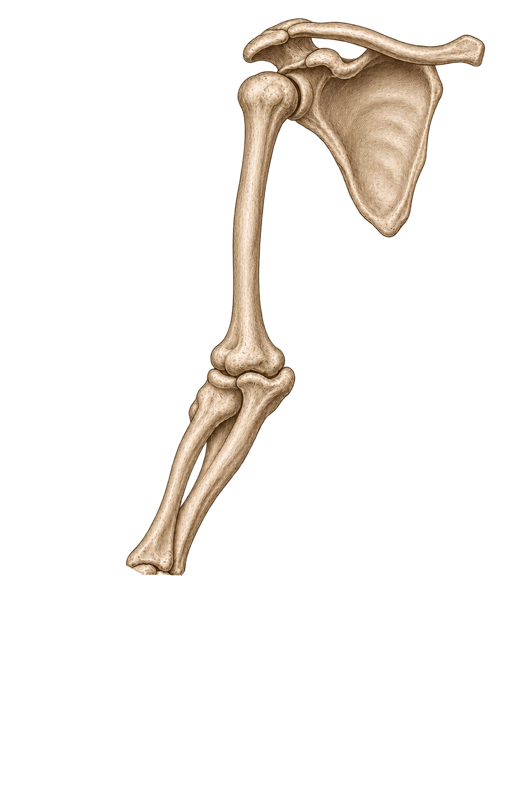
  {The radius runs beside the ulna from elbow to wrist, on the thumb side. The humerus remains above them. Both forearm bones and their real joint surfaces are visible in one continuous anatomical view.}

  The forearm has two long bones: the ulna on the little-finger side and the radius on the thumb side.
- `arm-skeleton` Arm and hand bones
  - icon: 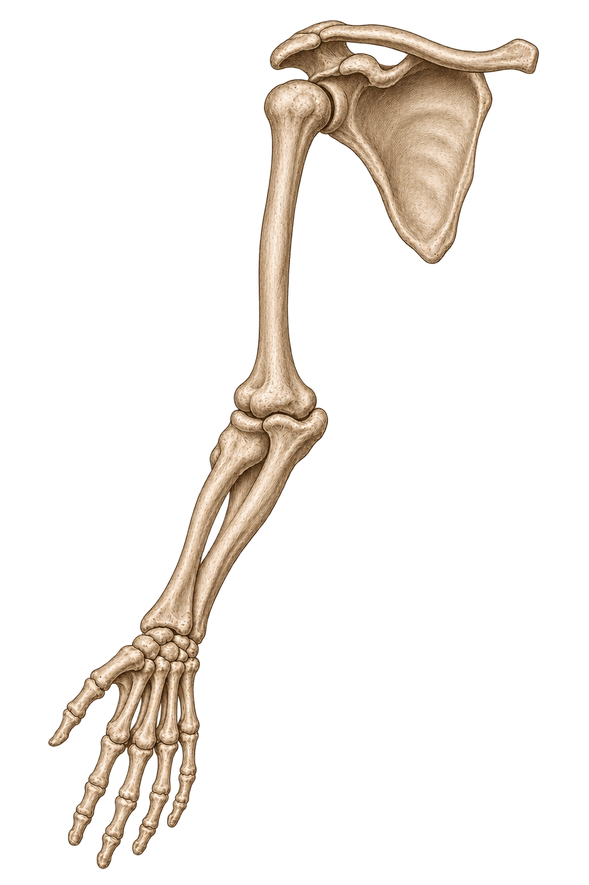
  {The same shoulder, humerus, ulna and radius now connect to a compact group of wrist bones, five palm bones and the finger bones. The thumb lies on the radius side. Joint cartilage and ordinary connective support remain; no muscles appear before they are built.}
- `arm-with-biceps` Arm with biceps
  - icon: 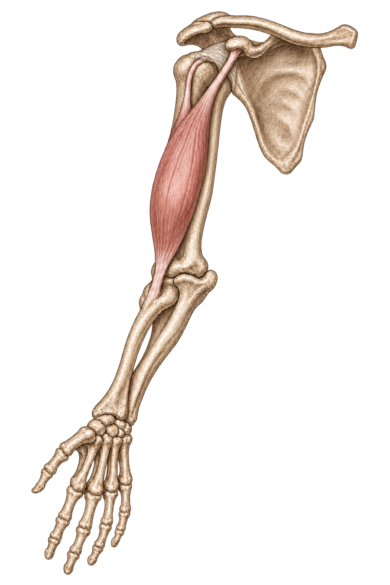
  {The same arm skeleton now has a biceps muscle in front of the upper arm. Its tendons run from the shoulder blade to the radius across the front of the elbow. Only the actual muscle, tendons and existing bones are shown, with no cell inset or pulling arrow.}

  The biceps attaches across the front of the elbow. When it shortens, it bends the joint.
- `arm-with-muscles` Arm with biceps and triceps
  - icon: 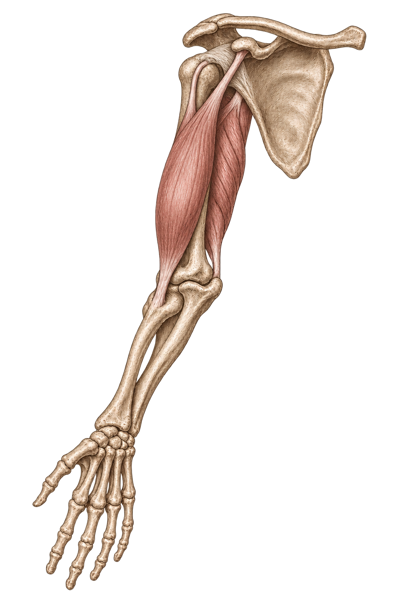
  {The triceps now lies behind the upper arm, with its tendon reaching the ulna's elbow tip. The biceps and all bones remain in their original positions. The completed physical assembly has no duplicate arm, loose cell callout or action diagram.}

  The triceps attaches behind the elbow. Its pull straightens the joint; the biceps bends it.

**Combinations**
- `prelude-daughters` [preserve] + `arm-bmp2` [consume] -> `arm-bone-cells`
- `arm-bone-cells` [transform] + `school-amino-acids` [consume] -> `arm-soft-bone`
- `arm-soft-bone` [transform] + `school-bone-mineral` [consume] -> `arm-bone-tissue`
- `arm-bone-tissue` [consume] + `arm-shoulder` [transform] -> `arm-humerus`
- `arm-bone-tissue` [consume] + `arm-humerus` [transform] -> `arm-humerus-ulna`
- `arm-bone-tissue` [consume] + `arm-humerus-ulna` [transform] -> `arm-long-bones`
- `arm-bone-tissue` [consume] + `arm-long-bones` [transform] -> `arm-skeleton`
- `prelude-myoblasts` [consume] + `arm-skeleton` [transform] -> `arm-with-biceps`
- `prelude-myoblasts` [consume] + `arm-with-biceps` [transform] -> `arm-with-muscles`

> NOTE: Nine operations include bone-cell differentiation before matrix production. The representative embryonic cell stands here for prepared mesenchymal descendants in developing skeletal tissue, not a muscle cell converted into bone or BMP-2 acting alone on any arbitrary cell. Differentiation includes gene regulation, protein synthesis, other necessary signals and time. A single osteoblast represents enough cells for tissue formation; growth need not be a separate action. [Wagley et al., 2020](https://pubmed.ncbi.nlm.nih.gov/32535942/) demonstrate BMP-2-mediated osteoblast differentiation in human mesenchymal cells and its dependence on other signaling; the chapter is an explanatory developmental simplification, not a complete pathway. Bone-building cells use supplied amino acids to secrete collagen-rich osteoid, with ordinary organelles, ATP, other matrix substances and elapsed growth included. Mineralization produces living bone tissue before it contributes to a whole bone. The reusable tissue supply represents enough material for the selected bones; it is not one chip that becomes four bones. The existing muscle-cell population likewise supplies both muscles. The shoulder girdle is real supplied anatomy, not an invisible arm destination or empty status token. Every arm stage is one fixed specimen replacing its previous state; at most one is present. The hand is grouped to avoid a repetitive carpal/metacarpal/phalangeal catalogue. Humerus, ulna, radius, biceps and triceps are explicitly taught names.

> NOTE: This sequence is an anatomical-model assembly, not the chronological development of a human arm. Long-bone formation normally involves cartilage models, coordinated growth, vascular supply and remodelling. Those processes, joint cartilage, ordinary tendons and supporting tissues are included rather than separately simulated. Bone tissue is represented at a useful material scale and then incorporated into named bones; its constituents remain within the bone instead of becoming a detached enlargement. The prescribed humerus–ulna–radius–hand and biceps–triceps order is a bounded teaching sequence requested for this study, not a claim that alternative anatomical development is impossible. The finale re-presents this same completed fixed specimen as a movable model component at body scale. Sources: OpenStax A&P [6.3 Bone Structure](https://openstax.org/books/anatomy-and-physiology-2e/pages/6-3-bone-structure), [6.4 Bone Formation and Development](https://openstax.org/books/anatomy-and-physiology-2e/pages/6-4-bone-formation-and-development), [8.2 Bones of the Upper Limb](https://openstax.org/books/anatomy-and-physiology-2e/pages/8-2-bones-of-the-upper-limb), and [11.5 Muscles of the Pectoral Girdle and Upper Limbs](https://openstax.org/books/anatomy-and-physiology-2e/pages/11-5-muscles-of-the-pectoral-girdle-and-upper-limbs).

## `neural-circuits` Cells that send messages
background: 

Return to the embryo and examine two other precursor groups, retaining the familiar cell structures. Sonic hedgehog from beneath the early spinal cord helps prepared cells become motor nerve cells. Later, neuregulin-1 on growing nerve fibres helps neighbouring cells develop into insulating Schwann cells. Then examine the mature cells: channels carry electrical changes along the nerve cell, while other cells wrap its long extension.

**Goals**
- Develop spinal motor nerve cells -- `school-neurons`
- next: Fit channels through the nerve cells' membranes -- `school-neurons`[`school-ion-channels`]
- Develop insulating Schwann cells beside nerve fibres -- `neural-wrapping-cells`
- next: Wrap the long extensions with those cells -- `school-neurons`[`neural-wrapping-cells`]

**Hotspots**
- `neural-wrapping-messengers` (center 780px, 600px)

**Items**
- `school-muscle-signals`
- `neural-spinal-precursors` Spinal-cord precursor cells
  - icon: 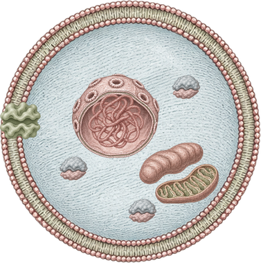 (center 780px, 1250px)
  {The recognizable single cell model represents prepared spinal-cord precursors, retaining membrane, nucleus and ordinary organelles. Its developmental setting is stated in the chapter; no spinal-cord locator or future neuron is added.}
- `neural-schwann-precursors` Schwann-cell precursors
  - icon:  (center 340px, 1670px)
  {The recognizable single cell model represents prepared Schwann-cell precursors with their own nucleus and membrane. No lineage diagram or future wrapping is shown.}
- `neural-wrapping-messengers` Neuregulin-1 protein
  - icon: 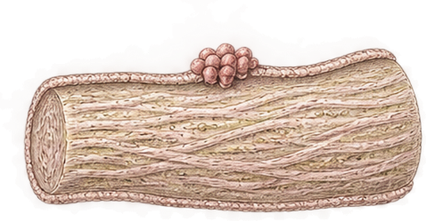
  {The protein remains physically anchored on the surface of one continuous supplied peripheral axon segment. The fixed view contains that actual source membrane and its attached protein, without a detached molecular copy.}
- `school-ion-channels` Gated ion channels
  - icon: 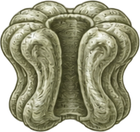 (center 1000px, 1670px)
  {A folded channel protein has a pore and gate within its structure. The loose supply contains only the protein.}
- `neural-wrapping-cells` Schwann cells
  - icon: 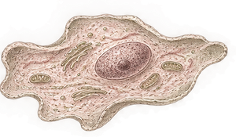
  {A broad living Schwann cell has its own nucleus and flexible membrane. Its membrane is not yet wrapped around a nerve.}
- `school-neurons` Motor nerve cells (compound)
  - icon: 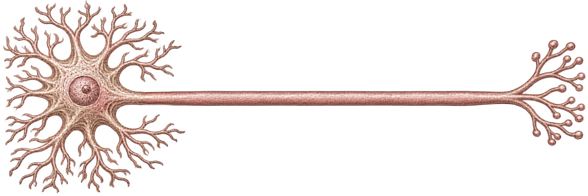
  - unnamed slot: accepts `school-ion-channels`, icon: 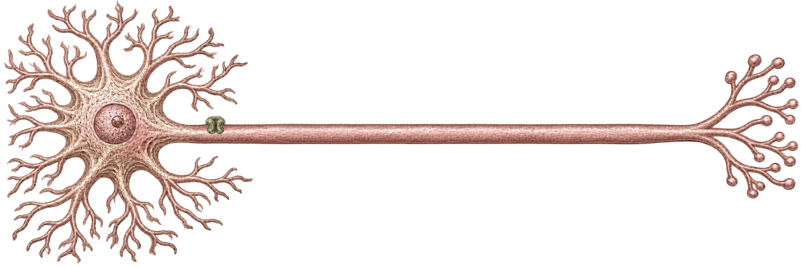
  - unnamed slot: accepts `neural-wrapping-cells`, icon: 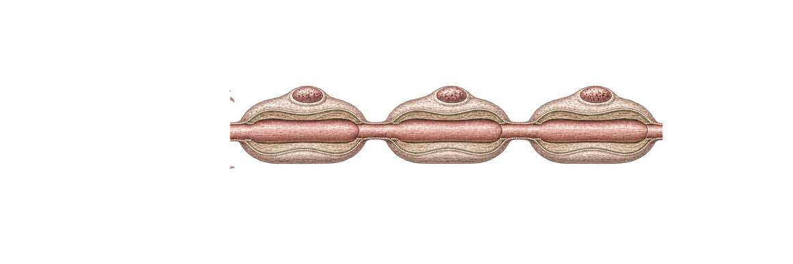
  {One whole motor neuron has a nucleated cell body, branching dendrites and a continuous long axon ending in terminals. All parts belong to the same cell; there are no detached detail views or future fittings.}
- `school-neurons`
  [`school-ion-channels`] {One representative channel protein crosses the upper membrane wall of the exposed initial axon, with its pore joining the outside to the cytoplasm. The whole neuron remains at the same magnification.}

  A message travels along the membrane through local electrical changes. No single ion has to travel the whole length.
- `school-neurons`
  [`neural-wrapping-cells`] {Schwann cells wrap separate lengths of the same continuous extension outside the spinal cord. The nerve-cell membrane stays inside; another cell's membrane makes the outer layers, with that cell's nucleus to one side. Short gaps remain between wraps. The cell body and receiving branches stay unwrapped. The representative fitted channel remains in the exposed initial axon membrane; ordinary additional channels along the membrane and at the gaps are implicit.}

  The long fibre belongs to one cell. Other cells make insulating wraps that help its messages travel quickly.

**Combinations**
- `neural-spinal-precursors` [transform] + `school-muscle-signals` [consume] -> `school-neurons`
- `neural-schwann-precursors` [transform] @ `neural-wrapping-messengers` -> `neural-wrapping-cells`

> NOTE: Four operations: two independent cell-development examples followed by two anatomical fittings. The named precursor groups are explicit local views of distinct descendants of the earlier embryonic population, not new organelles, detached fibres or arbitrary mature cells made pluripotent. This source/recipient distinction also makes the reused Sonic hedgehog recipe unambiguous: limb muscle precursors and spinal precursors are not the same cells. No extra conversion action is charged merely for the change of scale. Neural regionalization, other prior signals, nutrients, ATP and gene/protein machinery are supplied. The chapter opening and readings distinguish early development, later outgrowth and the mature anatomical reconstruction; object art shows only the current cell state.

> NOTE: [Ericson et al., 1996](https://pubmed.ncbi.nlm.nih.gov/8929535/) establish Shh's roles in ventral preparation and motor-neuron differentiation. Here its source is the notochord and floor plate, not the limb ZPA. This is one spinal motor-neuron example, not a recipe for all neurons. [Leimeroth et al., 2002](https://pubmed.ncbi.nlm.nih.gov/12051814/) support membrane-associated neuregulin-1 type III promoting Schwann-cell features in appropriate neural-crest-derived progenitors. The fixed protein view selects contact signalling on a supplied existing peripheral axon; this source is not one of the neurons the player must first construct. Thus either project can be pursued first. Other forms and released fragments are outside the example, not denied. [Taveggia et al., 2005](https://pmc.ncbi.nlm.nih.gov/articles/PMC2387056/) ground its later role in ensheathment/myelination and show that neuregulin alone is insufficient. Additional axonal and extracellular conditions remain supplied. These animal experiments ground a mammalian anatomy model, not a precise human embryonic calendar.

> NOTE: The selected whole neuron keeps its continuous axon; wrapping cells keep separate nuclei and membranes. Several Schwann cells wrap its peripheral portion, never the central cell body or receiving branches. Not every neuron has this shape or these wraps. The signal names, named recipients and source anatomy are locally taught specialist vocabulary; “type III,” regulatory genes and receptor cascades remain author-only. Channel fitting is an anatomical reconstruction, not a laboratory insertion procedure. Existing pumps maintain gradients; they do not directly carry each message. The ion-channel detour omits channel subtypes, voltage arithmetic, named ions and a saltatory-conduction lesson. [OpenStax A&P 12.2](https://openstax.org/books/anatomy-and-physiology-2e/pages/12-2-nervous-tissue) and [12.4](https://openstax.org/books/anatomy-and-physiology-2e/pages/12-4-the-action-potential) ground cellular continuity and the membrane close-up.

## `nervous-system-anatomy` Brain, spinal cord and nerves
background: 
The kinds of nerve cells we have examined are organized into the brain, spinal cord and nerves. These soft structures need protection as well as routes into the rest of the body. Fit their protective bones while building one spinal nerve as an example of the many routes branching from the cord.

**Goals**
- Protect the brain and spinal cord
  - both: `school-protected-brain`
  - and: `school-protected-cord`
- next: Connect the protected brain and spinal cord -- `central-nervous-system-model`
- Join sensory and motor roots into a spinal nerve -- `school-peripheral-nerves`
- next: Connect the spinal nerve to the brain-and-cord model -- `nervous-system-model`

**Items**
- `brain-model` Brain
  - icon: 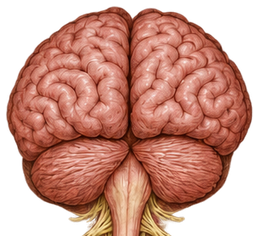
  {A rear-view brain specimen shows its paired folded cerebral hemispheres, lower cerebellum and attached brainstem. No separate nerve-cell inset is present.}
- `spinal-cord-model` Spinal cord
  - icon: 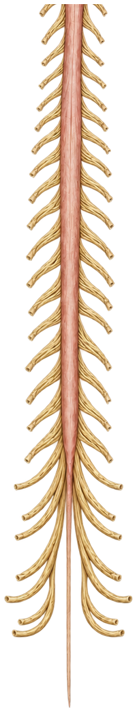
  {A long spinal cord carries representative attached roots at several levels and a bundle of descending lower roots. One lateral root attachment is exposed. Only continuous nervous tissue is shown.}
- `school-skull` Skull
  - icon: 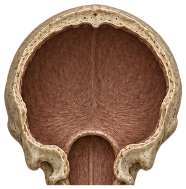
  {A skull opened from behind has an empty cranial cavity and a clear basal opening. No face, jaw or future brain outline is added.}
- `school-backbone` Backbone
  - icon: 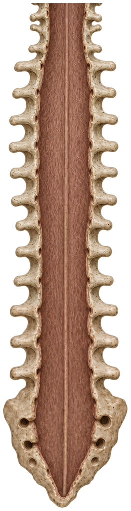
  {A vertebral column opened from behind exposes its continuous central canal, descending sacral canal and lateral openings between the supporting bony processes. One selected side opening is clearly exposed.}
- `school-protected-brain` Brain inside the skull
  - icon: 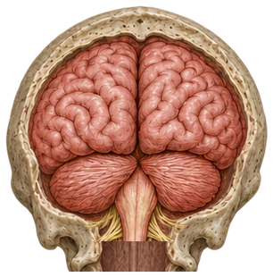
  ---
  {The rear-view brain occupies the same opened skull, with its brainstem extending into the basal passage. Ordinary protective membranes and fluid are included.}
- `school-protected-cord` Spinal cord inside the backbone
  - icon: 
  ---
  {The spinal cord lies within the vertebral canal and ends above its lower end; lower roots continue downward before leaving through side openings. This is one continuous specimen.}
- `central-nervous-system-model` Brain and spinal cord
  - icon: 
  {The rear-view brainstem continues through the skull base into the cord inside the opened posterior vertebral canal. Descending lower roots continue into the sacrum, and one selected lateral nerve exit remains open.}

  The spinal cord carries signals between body and brain. Its local circuits can also produce rapid responses without waiting for a conscious decision.
- `sensory-routes` Sensory nerve root
  - icon: 
  {A sensory root has fine rootlets at its inner end, an oval ganglion swelling and a short continuing bundle. Only actual nervous tissue and its connective covering are present.}
- `motor-routes` Motor nerve root
  - icon: 
  {Several fine motor rootlets converge into one short narrow bundle. It has no ganglion and no directional arrows.}
- `school-peripheral-nerves` Spinal nerve
  - icon: 
  {Sensory and motor roots form one continuous Y-shaped junction. The sensory ganglion and converging motor rootlets remain distinct before their fibres enter a shared short trunk with a prepared outer cut end.}
- `nervous-system-model` Nervous system model
  - icon: 
  - from chapter `full-assembly-regions` icon: 
  {The same rear-view skull and column enclose continuous brainstem, cord and descending roots. One selected nerve shows converging sensory rootlets, an oval ganglion, a separate lower motor root and one common trunk extending through the exposed lateral exit. No separate inset, arrow or duplicate organ is added.}

**Combinations**
- `brain-model` [transform] + `school-skull` [consume] -> `school-protected-brain`
- `spinal-cord-model` [transform] + `school-backbone` [consume] -> `school-protected-cord`
- `school-protected-brain` [transform] + `school-protected-cord` [consume] -> `central-nervous-system-model`
- `sensory-routes` [transform] + `motor-routes` [consume] -> `school-peripheral-nerves`
- `central-nervous-system-model` [transform] + `school-peripheral-nerves` [consume] -> `nervous-system-model`

> NOTE: Five required actions independently protect brain and cord and prepare peripheral routes before their meeting. The whole-organ views contain the already organized nervous tissue examined previously; they are supplied changes of scale, not newly fabricated organs or a second addition of fibres to tissue that already contained them. This sacrifices a literal recipe from generic tissue to brain in favour of honest anatomy and simpler knowledge demands. The brain includes its regions without a naming catalogue. The cord ends above the bottom of the adult vertebral canal. Protective membranes, fluid and openings for nerves are included. Sensory cell bodies remain peripheral where appropriate; motor cell bodies remain central. A spinal nerve is a real tissue-bound anatomical trunk formed where sensory and motor roots meet, not an arbitrary collection of fibres. The root names are introduced by their visible positions and message directions; dorsal/ventral vocabulary, nerve-layer names and plexus routes are not tested. This selected nerve represents the same pattern repeated along the cord, with the rest of the peripheral anatomy supplied in the system view. Roots and nerve carry their normal connective tissue. Mixed spinal nerves contain separate incoming and outgoing fibres. Source: [OpenStax, peripheral nerves and roots](https://openstax.org/books/anatomy-and-physiology-2e/pages/13-4-the-peripheral-nervous-system). Further sources: [OpenStax, central nervous system](https://openstax.org/books/anatomy-and-physiology-2e/pages/13-2-the-central-nervous-system) and [peripheral nervous system](https://openstax.org/books/anatomy-and-physiology-2e/pages/13-4-the-peripheral-nervous-system).

## `full-vision` From light to sight
background: 

Light from a leaf must be focused before the eye can detect its shape. Build the focusing front and the light-sensitive lining independently, then bring them together in one eye cutaway. The optic nerve carries the resulting signals toward the existing brain.

**Goals**

- Build an eye front that focuses and controls light -- Light-controlling eye front
- Build a light-sensitive lining with an outgoing nerve -- Retina with optic nerve
- next: Bring the focusing front and sensing lining together -- `art-eye-with-optic-nerve`

**Items**

- Clear dome (cornea)
  - icon: 

  {A thin transparent corneal dome has a curved front and fine tissue edge, seen obliquely so its cap shape is visible.}

  ---

  The cornea is the clear front surface of the eye. Its curve bends incoming light.

- Clear lens
  - icon: 

  {A transparent biconvex lens is thicker centrally and thinner at its rim.}

  ---

  The lens sits inside the eye and helps focus light onto its back lining.

- Coloured muscle ring (iris)
  - icon: 

  {An ochre-brown iris forms a muscular annulus with its actual pupil opening. Only one physical iris is shown.}

  ---

  The iris is the coloured ring at the front of the eye. Its muscles change the size of the opening, called the pupil, to control how much light enters.

- Light-sensitive cells
  - icon: 

  {A broad cup-shaped layer of photoreceptor tissue has a curved inner surface and closely aligned fine rods and cones along its cut edge.}

  ---

  Light-sensitive cells in the eye respond to light by starting electrical signals.

- Retinal nerve cells
  - icon: 

  {A broad cup-shaped layer of retinal neural tissue carries branching fibres that gather into an attached outgoing optic nerve.}

  ---

  Nerve cells can pass signals to other cells. Their long fibres carry signals over a distance.

- Focusing eye front
  - icon: 

  {The corneal dome and lens occupy their actual front-to-back relationship, with supplied supporting tissue connecting them.}

- Light-controlling eye front
  - icon: 

  {The iris now lies between the cornea and lens in the same continuous eye-front cutaway.}

  The iris changes how much light gets in. The cornea and lens focus it.

  ---

  The cornea and lens bend light towards the retina at the back of the eye. The iris adjusts the pupil's size to admit more or less light. [National Eye Institute: parts of the eye](https://www.nei.nih.gov/eye-health-information/healthy-vision/nei-for-kids/about-eye).

- Retina with optic nerve
  - icon: 

  {The photoreceptor and neural tissue layers form one broad curved retinal lining within supplied supporting eye wall, with fibres gathering into its attached optic nerve. No duplicate magnified strip is shown.}

  This light-sensitive lining is the retina. Its cells pass signals onwards, through a bundle of nerve fibres called the optic nerve.

  ---

  The retina is a layer of tissue lining the back of the eye. Light-sensitive cells begin electrical signals, and other nerve cells process and pass them on. Long fibres from nerve cells in the retina gather into the optic nerve, carrying signals towards the brain. [National Eye Institute: how eyes work](https://www.nei.nih.gov/eye-health-information/healthy-vision/how-eyes-work).

- `art-eye-with-optic-nerve` Eye with optic nerve
  - icon: 
  - from chapter `full-assembly-regions` icon: 

  {The eye front and curved retina now occupy one continuous eyeball cutaway. The optic nerve remains attached at the back. No leaf, light ray, brain or signal diagram is added.}

  The eye focuses light onto living cells. The optic nerve carries their information toward the brain.

- Cornea and iris
  - icon: 
  {The coloured muscle ring sits behind the clear dome; its opening leaves room for the lens behind it.}

**Combinations**
- Clear dome (cornea) [transform] + Coloured muscle ring (iris) [consume] -> Cornea and iris
- Cornea and iris [transform] + Clear lens [consume] -> Light-controlling eye front

- Clear dome (cornea) [transform] + Clear lens [consume] -> Focusing eye front
- Focusing eye front [transform] + Coloured muscle ring (iris) [consume] -> Light-controlling eye front
- Light-sensitive cells [transform] + Retinal nerve cells [consume] -> Retina with optic nerve
- Light-controlling eye front [transform] + Retina with optic nerve [consume] -> `art-eye-with-optic-nerve`

> NOTE: Four operations assemble optical and sensory anatomy independently, then join them within the same local eye. The local eye is an anatomical model with its own optic nerve. The final assembly fits that completed sensory anatomy into the head; the local chapter does not add a brain. No whole-body identity or repair result is an operand. The iris may join the cornea before or after the lens. The finished eye depicts only its continuous optical and sensory anatomy. Prose explains focusing and onward signals; no leaf, brain or signal diagram is added to the object. Existing supporting eye tissues, muscles, supply and visual brain pathways are included. OpenStax A&P 14.1 grounds optical focusing and sensory reception; the daily-light/sleep exercise is omitted rather than represented by time or observation ingredients.

## `full-hearing` Vibration into signals
background: 

A voice begins as moving air. Build the route that passes vibrations inward and the delicate cells that detect them. Keep the ear as one local structure; its connection to the head comes later.

**Goals**
- Carry vibrations from the ear canal inward -- Sound-conducting ears
- Build the inner ear's sensing tissue -- Vibration-sensitive inner ears
- next: Join the outer and inner parts -- Ears

**Items**
- Outer ears and canals
  - icon: 
  {One representative outer ear and canal appear in cutaway, with their actual cartilage, skin and surrounding tissue continuing around the open middle-ear cavity. No vibration arrows or head silhouette accompany them.}
- Eardrums
  - icon: 
  {A thin, slightly conical membrane has a fibrous surface and a reinforced rim, matching the open end of the canal. No duplicate motion positions appear.}
- Outer ears with eardrums
  - icon: 
  {The same canal now ends at its fitted eardrum, with the membrane's surface and rim visibly retained.}
- Middle-ear bones
  - icon: 
  {Three tiny articulated bones form one chain, with their joint surfaces and the stirrup-shaped end visible. They match the size and orientation of the installed chain.}
- Sound-conducting ears
  - icon: 
  {The linked bones now join the eardrum to the inner end of the same cutaway. Only the assembled ear tissue, membrane and bones are present.}

  The eardrum moves the tiny bones. Their movement pushes on fluid inside the inner ear.
- Coiled inner-ear chambers and fluid
  - icon: 
  {A cochlear chamber is opened along its coil, exposing fluid and its tissue partition continuously within the spiral. A small bounded oval window is visible at its base. The partition has room for its sensory tissue; no detached enlargement or missing-part symbol appears.}
- Hearing cells with tiny hairs
  - icon: 
  {A short curved piece of sensory tissue carries rows of hair cells, their hair bundles and supporting cells. The piece matches the exposed partition within the coiled chamber at the same illustrative magnification.}
- Vibration-sensitive inner ears
  - icon: 
  {The sensory tissue now lies within the same opened cochlear coil. Its small hair bundles remain part of the continuous chamber cutaway. Nothing is copied into a separate inset and no brain, nerve bundle, arrows or extra diagram appears.}

  Tiny movements bend the hearing cells' hair bundles. The cells change the signals they pass to neighboring nerve endings.
- Ears
  - icon: 
  {The same outer ear, canal, eardrum, bone chain and hearing coil form one continuous local cutaway. The hair-cell tissue remains physically inside the coil. Ordinary local nerve endings are included in that tissue; there is no loose nerve-plus-brain piece, detached enlargement or diagram of the next assembly.}

  Air moves the eardrum, the tiny bones move fluid, and sensory cells detect that movement. The completed ear is ready for its later connection to the head.

**Combinations**
- Outer ears and canals [transform] + Eardrums [consume] -> Outer ears with eardrums
- Outer ears with eardrums [transform] + Middle-ear bones [consume] -> Sound-conducting ears
- Coiled inner-ear chambers and fluid [transform] + Hearing cells with tiny hairs [consume] -> Vibration-sensitive inner ears
- Sound-conducting ears [transform] + Vibration-sensitive inner ears [consume] -> Ears

> NOTE: Four operations preserve independent conducting and sensory constructions before they join. The former hearing-pathway ingredient and both nerve-bearing intermediates are removed. Hair cells fit physically inside the cochlea, at compatible magnification; fitting them never creates a second diagram, a detached enlargement or a brain. Local supporting cells, membranes, ordinary nerve endings and attachments are included. The head-scale ear handoff in the finale supplies the connecting auditory nerve route, then joins it to the already built brain; it does not add another ear or brain. The cutaway compresses real scales to keep the constructed structures visible without multiplying representations. Relative movement in the cochlea bends stereocilia and changes hair-cell transmitter release to auditory nerve fibres; hair cells do not themselves send action potentials down the nerve. Those details ground the art without adding new vocabulary requirements. Source: OpenStax [14.1 Sensory Perception](https://openstax.org/books/anatomy-and-physiology-2e/pages/14-1-sensory-perception).

## `full-balance` Head turns, eyes stay
background: 

Beside the hearing coil, the inner ear has sensors for turning, tilt and changes in straight-line movement. Build their two different physical mechanisms. Their signals will later help the nervous system steady the eyes and adjust posture.

**Goals**
- Build the turning sensors -- Turn-sensing canals
- Build the weighted tilt sensors -- Weighted balance sensors
- next: Join both kinds of balance sensor -- Balance organs

**Items**
- Fluid-filled loops
  - icon: 
  {Three narrow fluid-filled ducts occupy different, roughly perpendicular planes. An oblique cutaway shows a foreshortened horizontal loop crossing in front of two differently oriented vertical loops, each with an exposed widened chamber.}
- Turning sensor cells
  - icon: 
  {Three prepared sensory ridges carry hair-bearing cells beneath broad translucent jelly partitions. Their differing shapes match the full cross-sections of the three widened duct chambers.}
- Turn-sensing canals
  - icon: 
  {The sensory ridges and broad jelly partitions occupy the widened duct chambers. Each partition spans its chamber and meets the surrounding tissue wall; the three loops retain their distinct spatial planes.}

  When a turn starts or changes, fluid movement bends the jelly flaps and their attached sensory hairs.
- Tiny mineral weights
  - icon: 
  {A scatter of small pale calcium-carbonate crystals is shown alone. No sensory-cell outline, balance emblem, arrow or tilted-head symbol appears.}
- Tilt sensor cells
  - icon: 
  {Two separate sensory tissue patches carry hair cells whose bundles project into soft translucent jelly layers. One patch lies horizontally and the other stands vertically; neither contains mineral crystals yet.}
- Weighted balance sensors
  - icon: 
  {The same sensory patches now have small crystals resting within their jelly layers above the hair bundles. Nothing is copied into a second scale or a before-and-after panel.}

  The weighted jelly shifts when the head tilts or its straight-line movement changes, bending the sensory hairs.
- Balance organs
  - icon: 
  {The fluid-filled ducts and two weighted sensory patches now connect in one continuous vestibular tissue assembly. The same flap-bearing chambers and crystal-bearing layers remain visible in its cutaway. There is no hearing coil, duplicated ear, brain, eye, posture muscle or diagrammatic nerve route in this new object.}

  These two kinds of sensor detect different movements. Their signals later join information from vision, muscles and joints to help steady the eyes and body.

**Combinations**
- Fluid-filled loops [transform] + Turning sensor cells [consume] -> Turn-sensing canals
- Tiny mineral weights [consume] + Tilt sensor cells [transform] -> Weighted balance sensors
- Turn-sensing canals [transform] + Weighted balance sensors [consume] -> Balance organs

> NOTE: Three operations construct local balance anatomy. The former nerve-route project and all incoming/response-route intermediates are removed. Hair cells, their membranes, ordinary supporting cells and local nerve endings belong to the supplied sensory tissue; no central nervous system or future eye/posture result is drawn into it. The hearing coil from chapter 8 is not remade from balance ingredients. The finale re-presents the completed hearing and balance structures together, with ordinary connective tissue and their connecting nerve routes supplied at head scale. Semicircular ducts respond chiefly to angular acceleration; otolith organs respond to gravity and linear acceleration. Otolith, vestibular, angular acceleration, brainstem nuclei and motor-tract names are author background rather than player prerequisites. The two weighted patches have different orientations, retained physically in their tissue. Balance remains multisensory: the organs alone do not guarantee stable sight or posture. Source: OpenStax [14.1 Sensory Perception](https://openstax.org/books/anatomy-and-physiology-2e/pages/14-1-sensory-perception) and [14.2 Central Processing](https://openstax.org/books/anatomy-and-physiology-2e/pages/14-2-central-processing).

## `full-blood-on-the-move` Blood carries more than oxygen
background: 
Blood contains living cells suspended in a liquid called plasma. Prepare its oxygen-carrying cells and its liquid separately, then bring the components together. The liquid can carry dissolved materials that do not ride on red cells.

**Goals**
- Prepare red cells carrying oxygen -- Red cells carrying oxygen
- Make the liquid that carries the cells -- Plasma
- next: Bring the blood components together -- Blood

**Items**
- Developing red blood cells
  - icon: 
  {Three developing red cells contain rounded nuclei within their rose-colored cytoplasm.}
- Iron and amino acids
  - icon: 
  {Small iron particles lie with discrete molecular units of amino acids.}
- Red blood cells
  - icon: 
  {Three flexible biconcave red cells have thin centers and no nuclei.}
- Oxygen molecules
  - icon: 
  {Several separate oxygen molecules each consist of two joined atoms.}
- Red cells carrying oxygen
  - icon: 
  {The same biconcave red cells contain oxygen bound internally to hemoglobin; that binding is below the resolution of this cell-scale view.}

  Red cells carry much of the blood's oxygen. It can attach in the lungs and leave again near tissues that use it.
- Plasma water
  - icon: 
  {An irregular pale-blue aqueous volume has a soft, freely spreading boundary.}
- Plasma proteins, nutrients and salts
  - icon: 
  {A small sample contains clustered protein molecules and smaller dissolved-material particles.}
- Plasma
  - icon: 
  {An irregular pale-straw liquid contains small dispersed solute particles.}
- White cells and platelets
  - icon: 
  {Several pale nucleated white cells lie beside much smaller irregular platelets.}
- Plasma with white cells and platelets
  - icon: 
  ---
  {The same white cells and tiny platelets are suspended in the pale-straw plasma.}
- Plasma with oxygen-carrying red cells
  - icon: 
  ---
  {The same biconcave red cells are suspended in the pale-straw plasma.}
- Blood
  - icon: 
  {Biconcave red cells, pale nucleated white cells and tiny platelets occupy one plasma sample.}

  Blood has several jobs at once: transporting materials, carrying defenders and bringing the parts needed to seal a leak.

**Combinations**
- Developing red blood cells [transform] + Iron and amino acids [consume] -> Red blood cells
- Red blood cells [transform] + Oxygen molecules [consume] -> Red cells carrying oxygen
- Plasma water [transform] + Plasma proteins, nutrients and salts [consume] -> Plasma
- Plasma [transform] + White cells and platelets [consume] -> Plasma with white cells and platelets
- Plasma with white cells and platelets [transform] + Red cells carrying oxygen [consume] -> Blood
- Plasma [transform] + Red cells carrying oxygen [consume] -> Plasma with oxygen-carrying red cells
- Plasma with oxygen-carrying red cells [transform] + White cells and platelets [consume] -> Blood

> NOTE: Five required actions. The two initial projects are real oxygen carriers and their liquid carrier, not two additions to one object. The red-cell operation compresses maturation, haemoglobin synthesis and loss of the nucleus in a living developing population; iron and amino acids are selected material inputs, not a complete nutritional recipe. Mature red cells cannot make new haemoglobin. The liquid input includes ordinary plasma proteins and other solutes. Oxygen binding is reversible and does not imply that all blood is fully oxygenated. White cells and platelets have different roles, developed in later defense and wound chapters. Sources: [OpenStax, blood overview](https://openstax.org/books/anatomy-and-physiology-2e/pages/18-1-an-overview-of-blood), [red cells](https://openstax.org/books/anatomy-and-physiology-2e/pages/18-3-erythrocytes) and [gas transport](https://openstax.org/books/anatomy-and-physiology-2e/pages/22-5-transport-of-gases). Haemoglobin is introduced with its function, not tested as unexplained biochemical knowledge.

## `full-routes-through-the-body` Outward, across and back
background: 
Blood needs a route out from the heart, a place to exchange materials and a route back. Build those three parts side by side. Their different walls suit different jobs.

**Goals**
- Make arteries with strong, elastic walls -- Arterial vessels
- Bring tiny exchange vessels close to body cells -- Capillary bed
- Make a return route with one-way valves -- Venous return
- next: Join the three routes -- `art-body-blood-vessel-network`
- (three goals are a lot but okay here because arteries, exchange vessels and returning veins are independent constructions with visibly different jobs)

**Items**
- Blood-facing lining cells
  - icon: 
  {A thin curled sheet of flattened endothelial cells has fine visible cell boundaries.}
- Arterial wall
  - icon: 
  {A short thick muscular arterial segment tapers toward a smaller branch; a longitudinal opening exposes the wall awaiting its thin inner lining.}
- Tiny capillary tubes
  - icon: 
  {A connected fine red-to-blue vascular mesh has supplying and collecting branches at opposite sides.}
- Nearby body cells
  - icon: 
  {A thin connected patch of living tissue has fine cellular texture and no added vessel network.}
- Venous wall
  - icon: 
  {A short thin-walled venous segment widens from its collecting branch; a longitudinal opening exposes the wall awaiting its thin inner lining.}
- One-way valve flaps
  - icon: 
  {Two supple venous valve cusps retain their curved bases and free edges.}
- Arterial vessels
  - icon: 
  {The same tapered arterial segment has a continuous thin inner surface within its longitudinal cutaway.}
- Capillary bed
  - icon: 
  {The fine blood-vessel network runs through one thin patch of tissue, with gradually branching red inlet and blue outlet.}

  Red blood cells normally stay inside while water and dissolved materials can cross the thin walls. Each body cell needs to be close enough to a supply.
- Thin-walled veins
  - icon: 
  {The same thin venous segment has a smooth broad inner surface, with no valve leaflets yet.}
- Venous return
  - icon: 
  {The thin venous segment contains two curved valve cusps rooted in its inner wall.}
- Distribution and exchange bed
  - icon: 
  ---
  {The thick arterial segment narrows smoothly into the branches of the tissue capillary bed.}
- `art-body-blood-vessel-network` Body blood-vessel network
  - icon: 
  - from chapter `full-a-pump-with-two-routes` icon: 
  {One continuous tissue preparation contains a thick arterial inlet, branching fine exchange vessels and a thin valved venous outlet.}

  Arteries carry blood away from the heart; veins carry it back. Capillaries provide the close contact for exchange.

- Capillaries and venous return
  - icon: 
  {The tissue capillary bed merges through collecting branches into a thin-walled valved vein.}

**Combinations**
- Capillary bed [transform] + Venous return [consume] -> Capillaries and venous return
- Arterial vessels [transform] + Capillaries and venous return [consume] -> `art-body-blood-vessel-network`
- Blood-facing lining cells [preserve] + Arterial wall [consume] -> Arterial vessels
- Tiny capillary tubes [transform] + Nearby body cells [consume] -> Capillary bed
- Blood-facing lining cells [preserve] + Venous wall [consume] -> Thin-walled veins
- Thin-walled veins [transform] + One-way valve flaps [consume] -> Venous return
- Arterial vessels [transform] + Capillary bed [consume] -> Distribution and exchange bed
- Distribution and exchange bed [transform] + Venous return [consume] -> `art-body-blood-vessel-network`

> NOTE: Six required actions preserve three independent useful projects. The capillary operation places complete tiny vessels beside the tissue they supply, removing the earlier basement-membrane/pericyte assembly. Supplied capillaries include their real thin walls; adding nearby body cells establishes a tissue exchange bed, not the formation of capillary endothelium. The other cutaways highlight lining and outer wall as constituents of mature arteries and veins, not a surgical procedure. The network includes smaller arteries and veins between the illustrated scales. Not all veins have valves; this selects a limb return route. Vessel identity is defined by direction relative to the heart, not oxygen content. Source: [OpenStax, vessel structure](https://openstax.org/books/anatomy-and-physiology-2e/pages/20-1-structure-and-function-of-blood-vessels).

## `full-a-pump-with-two-routes` A pump with two routes
background: 

The heart sends blood to the lungs and around the body. Its own working muscle needs a blood supply too.

> NOTE: Fresh chapter fragment. The carried vessel input is the existing Body blood-vessel network. The blood examined earlier is pictured within these anatomical cutaways; filling them is not another assembly operation. This is a diagram-building abstraction, not an account of embryonic development or surgery. Selected raster specimen art is included; its sheets and registered chest layers have been visually inspected, while fresh learner recognition remains untested. The supplied cardiac pieces are complementary prepared parts of one heart. The completed assembly includes its chambers, muscle, valves and normal electrical conduction system; these are not separate assembly ingredients. The blood-vessel route through the lungs is present, but the next chapter builds the air side and exchange surface.

The body-vessel network is represented at organ scale by its aortic route. The venous return trunks are attached to the right-heart preparation. Join the prepared right ventricular wall and left ventricular core to their routes, then reunite them as a mostly exterior heart with small lateral inspection windows.

**Goals**

- Make the route through the lungs -- Right heart and lung route
- Make the route around the body -- Left heart and body route
- Give the heart muscle its own vessel network -- Heart-muscle vessel network
- next: Connect the heart and its vessel networks -- Heart with connected vessels
- (three goals are a lot but okay here because the lung route, body route and heart-muscle supply are three separate useful constructions that can be made in any order before joining)

**Items**

- Right side of heart
  - icon: 

  {A prepared right atrium and right ventricular free-wall shell retain a small lateral inspection window, a natural thick medial section edge, attached venae cavae and a short pulmonary outlet.}

  ---

  The right side of the heart receives blood returning from the body and pumps it toward the lungs. Muscle around the chambers squeezes to push blood onward; valves prevent backward flow. [NHLBI: heart structure](https://www.nhlbi.nih.gov/health/heart/anatomy)

- Left side of heart
  - icon: 

  {The matching left atrium and thick left ventricular core retain a small lateral inspection window, a prepared medial receiving surface and a short aortic outlet.}

  ---

  The left side of the heart receives blood returning from the lungs and pumps it around the body. Its lower chamber produces higher pressure than the right side, which sends blood through the lungs. [American Heart Association: healthy circulation](https://www.heart.org/en/health-topics/congenital-heart-defects/about-congenital-heart-defects/how-the-healthy-heart-works)

- Lung blood-vessel network
  - icon: 

  {Two open pulmonary vascular trees share a blue arterial inlet and retain red returning venous cuffs for the left atrium.}

- `art-body-blood-vessel-network`

- Arteries for the heart muscle
  - icon: 

  {A few red coronary arterial trunks divide into fine branches over a curved preparation matching the exterior heart surface.}

- Heart-muscle capillaries and veins
  - icon: 

  {Fine exchanging vessels merge into a few branching blue coronary veins over the same curved exterior-surface preparation.}

- Right heart and lung route
  - icon: 

  {The right atrium and prepared right ventricular wall connect to the pulmonary arterial trunk and both open lung vascular trees; the red returning veins remain ready for the left atrium.}

- Left heart and body route
  - icon: 

  {The left atrium and thick left ventricular core connect to one continuous ascending aorta, arch and descending thoracic trunk. The medial prepared surface receives the right ventricular wall.}

- Heart-muscle vessel network
  - icon: 

  {Red coronary arteries join the fine exchanging mesh and blue coronary veins in one curved preparation matching the exterior heart wall.}

  ---

  Heart muscle needs oxygen and nutrients like other muscles. Coronary arteries carry its blood supply, and small vessels reach through the muscle. Veins return the blood to the right side of the heart. [NHLBI: blood supply to heart muscle](https://www.nhlbi.nih.gov/health/heart/blood-flow)

- Heart and two routes
  - icon: 

  {One mostly exterior heart connects to both open pulmonary vascular trees, the aorta and the venae cavae. Small lateral windows reveal the ventricular interiors; the broad convex anterior wall remains intact.}

  One full lap passes through the heart twice: once on the way to the lungs and once on the way to the body.

  ---

  The heart's right and left sides serve two linked routes. Blood passes from the right side to the lungs, returns to the left side, travels through the body and returns to the right side. The routes meet through the heart's separate sides, rather than through a hole in its dividing wall. [American Heart Association: healthy circulation](https://www.heart.org/en/health-topics/congenital-heart-defects/about-congenital-heart-defects/how-the-healthy-heart-works)

- Heart with connected vessels
  - icon: 

  {The same heart and regional routes now carry coronary branches in shallow grooves on the intact exterior myocardial surface. The small lateral inspection windows and great vessels retain their positions.}

  The pump needs a delivery route too. These coronary vessels carry blood into the heart muscle itself.

  ---

  Coronary arteries branch from the aorta, the main artery leaving the left side of the heart. They supply the heart muscle, while coronary veins return blood toward the right side. This supply is a branch of the body route. [NHLBI: coronary circulation](https://www.nhlbi.nih.gov/health/heart/blood-flow)

**Combinations**

- Right side of heart [transform] + Lung blood-vessel network [consume] -> Right heart and lung route
- Left side of heart [transform] + `art-body-blood-vessel-network` [consume] -> Left heart and body route
- Arteries for the heart muscle [transform] + Heart-muscle capillaries and veins [consume] -> Heart-muscle vessel network
- Right heart and lung route [transform] + Left heart and body route [consume] -> Heart and two routes
- Heart and two routes [transform] + Heart-muscle vessel network [consume] -> Heart with connected vessels

> NOTE: Five structural operations. Adding blood no longer produces a new circulation-status identity. The final item is the heart with real attached body, lung and heart-muscle vessels; the next chest chapter uses those physical connections. Blood remains the earlier material and is used again in the kidney chapter. Larger-scale integration remains a planned-art readability question; this cut does not establish that every route diagram reads as a convincing object.

## `full-close-enough-to-exchange` Air beside blood
background: 
Air and blood stay in separate spaces inside the lungs. At an enlarged local scale, build one lung lobule: a branching terminal airway and the thin air-sac walls beside blood vessels. Many such units make up the whole lungs.

**Goals**
- Bring air sacs and tiny blood vessels close together -- Elastic air sacs with blood vessels
- Build the branching air route -- Lobular airways
- next: Join the airways and exchange surfaces into a lung lobule -- Lung lobule

**Items**
- Tiny air sacs
  - icon: 
  {A continuous pyramidal patch of alveolar epithelium contains many thin-walled sacs and small open duct mouths; the front section exposes clear air spaces.}
- Lung capillaries
  - icon: 
  {A fine red-and-blue capillary network follows the shape of the alveolar tissue, with open interstices and no duplicate sac walls.}
- Elastic supporting tissue
  - icon: 
  {A delicate pale elastic-fiber reticulum follows the tissue shape and air-sac contours.}
- Terminal airway
  - icon: 
  {A short pale terminal airway has a hollow lumen and a thin wall without cartilage rings.}
- Fine branching air tubes
  - icon: 
  {A small terminal airway tree divides repeatedly into fine hollow branches at the same magnification as the air-sac tissue.}
- Air sacs with blood vessels
  - icon: 
  {Red-and-blue capillaries lie closely along retained alveolar walls while the opened front air spaces remain clear.}

- Elastic air sacs with blood vessels
  - icon: 
  {The alveolar tissue contains its close capillary network and fine elastic support, with small open mouths for the terminal airway branches.}

  Gases cross the thin walls. Air does not need to bubble into the blood.
- Lobular airways
  - icon: 
  {The terminal airway joins its fine branching tree as one continuous set of hollow tubes.}
- Lung lobule
  - icon: 
  {One continuous enlarged lung lobule joins the branching terminal airway to its alveolar tissue, close capillary network and fine supporting fibers.}

- Elastic air sacs
  - icon: 
  {Fine pale elastic fibers are integrated along the retained alveolar walls; the front sectional air spaces remain clear.}

**Combinations**
- Tiny air sacs [transform] + Lung capillaries [consume] -> Air sacs with blood vessels
- Air sacs with blood vessels [transform] + Elastic supporting tissue [consume] -> Elastic air sacs with blood vessels
- Terminal airway [transform] + Fine branching air tubes [consume] -> Lobular airways
- Lobular airways [transform] + Elastic air sacs with blood vessels [consume] -> Lung lobule

- Tiny air sacs [transform] + Elastic supporting tissue [consume] -> Elastic air sacs
- Elastic air sacs [transform] + Lung capillaries [consume] -> Elastic air sacs with blood vessels

> NOTE: Four required actions, allowing either capillary or elastic support preparation first, reconstruct independent conducting and exchange regions, then join them. Connecting the lungs to blood flow is reserved for the next chapter alongside the chest construction; global recipes still permit useful earlier completion. The small supplied air sacs include surfactant and ordinary supporting cells; surfactant is no longer a required named ingredient. Capillaries are the pulmonary loop's specialized exchange view, not an additional circulation. The diagram depicts ordinary gradients under ventilation and blood flow; the two gases move according to their own partial-pressure differences. That advanced quantitative vocabulary is omitted from play without replacing it with a false claim about total gas concentration in haemoglobin-bearing blood. The local air tubes are fine bronchioles, without requiring that name as prior vocabulary. Elastic recoil is a property of lung tissue, not an independent motor for inhalation. Sources: [OpenStax, respiratory structures](https://openstax.org/books/anatomy-and-physiology-2e/pages/22-1-organs-and-structures-of-the-respiratory-system) and [gas exchange](https://openstax.org/books/anatomy-and-physiology-2e/pages/22-4-gas-exchange).

## `full-moving-the-lungs` Making room for a breath
background: 
The lungs need both fresh air and flowing blood. Connect them to the circulation while building the chest that moves air. Chest muscles enlarge the space around the lungs, so the lungs expand and air flows in.

The paired whole lungs contain many of the lobules just examined. They are now supplied at the same thoracic scale as the heart, ribs and diaphragm; this is a change of anatomical view, not the enlargement of one literal lobule.

**Goals**
- Connect the lungs to their blood supply -- Heart and lungs
- Build the muscular chest -- `art-breathing-apparatus`[Diaphragm]
- next: Bring breathing and blood flow together -- `art-breathing-apparatus`[Diaphragm, Heart and lungs]

**Items**
- `atlas-whole-lungs` Lungs
  - icon: 
  {The paired whole lungs comprise many of the lobules just examined. The trachea and branching bronchi remain attached at this larger anatomical scale.}
- Heart and lungs
  - icon: 
  {The heart rests between the paired lungs, with continuous pulmonary vessels entering their hila alongside the pale bronchi.}

  Blood brings carbon dioxide to the lungs and carries oxygen away. Fresh air must keep reaching the sacs for exchange to continue.
- Rib cage
  - icon: 
  {The open anterior thorax retains its lateral and posterior ribs attached to the posterior thoracic spine; the sternum is absent.}
- Muscles between the ribs
  - icon: 
  {Curved intercostal muscle bands occupy the spaces between adjacent ribs at the same thoracic scale.}
- Diaphragm
  - icon: 
  {A shallow double-domed diaphragm has a pale central tendon and radiating muscular fibers.}
- `art-breathing-apparatus` Breathing apparatus (compound)
  - icon: 
  - from chapter `full-assembly-regions` icon: 
  - slot: Lower chest muscle, accepts Diaphragm, icon: 
  - slot: Heart and lungs, accepts Heart and lungs, icon: 
  {The open rib cage contains its intercostal muscle bands, with the posterior spine visible through the empty cavity.}
- `art-breathing-apparatus`
  [Diaphragm]
  {The muscular rib cage contains its shallow domed diaphragm attached at the lower ribs.}
- `art-breathing-apparatus`
  [Heart and lungs]
  {The heart and paired lungs occupy the muscular rib cage, obscuring the posterior spine; the diaphragm is not yet fitted.}
- `art-breathing-apparatus`
  [Diaphragm, Heart and lungs]
  {One coherent open thorax contains lateral ribs and intercostal muscles, with both lungs and heart resting directly on the domed diaphragm.}

  Making more room lowers the air pressure inside the lungs, so air flows in. When the muscles relax, the lungs recoil and air flows out.

**Combinations**
- Rib cage [transform] + Muscles between the ribs [consume] -> `art-breathing-apparatus`
- `atlas-whole-lungs` [transform] + Heart with connected vessels [consume] -> Heart and lungs

> NOTE: Four required actions include two independent projects: connect the built lungs to circulation, and make a muscular chest with diaphragm. Their convergence links ventilation and blood flow without adding an artificial ingredient or action. Diaphragm/lung fitting order alone is not credited as Fun; this short chapter is retained as a physiology payoff after constructing blood, vessels, the heart and lung exchange surfaces. It has two initial projects but low measured decision density; the matched merge experiment did not improve its combined passage. The payoff is the contrast between moving air and exchanging gases, not mere anatomical completion. The lung coverings and fluid film supply the real pleural coupling; no operand tests pleural anatomy. The construction supplies the anatomy used for ordinary quiet inspiration and passive expiration; the still artwork depicts one physical arrangement rather than a motion sequence. The later final assembly joins the constructed neural routes to the same chest anatomy. Existing ribs, diaphragm and circulation are anatomical views of one body, not implanted detached organs. Source: [OpenStax, breathing](https://openstax.org/books/anatomy-and-physiology-2e/pages/22-3-the-process-of-breathing).

## `full-the-air-we-breathe` The air we breathe
background: 
Air brings dust and microbes as well as oxygen. Build two defenses: a moving, sticky lining in the air passages, and white blood cells that catch some microbes farther inside.

**Goals**
- Catch and sweep particles toward the throat -- Mucus with trapped particles
- Catch bacteria in a lung air sac -- Lung white cells containing bacteria

**Items**
- Airway mucus
  - icon: 
  {A shallow translucent mucus sheet has the same oblique surface plane and outline as the top of the airway-cell strip. It contains only its own material.}
- Airway lining with sweeping hairs
  - icon: 
  {A continuous shallow oblique strip of columnar airway cells carries a fringe of fine cilia above its apical surface and a connected basal tissue layer below.}
- Inhaled particles and bacteria
  - icon: 
  {Several irregular dust grains lie with small rod-shaped bacteria.}
- Mucus-covered airway lining
  - icon: 
  {A thin translucent mucus blanket follows the apical surface of the same epithelial strip, directly contacting its ciliary tips without crossing the cell bodies.}
- Mucus with trapped particles
  - icon: 
  {The same shallow mucus sheet holds dust grains and small rods within its translucent surface layer.}
  The airway's tiny hairs move mucus and its trapped particles away from the lungs.
- Lung white blood cells
  - icon: 
  {One pale amoeboid macrophage has a kidney-shaped nucleus, granular cytoplasm and small internal vesicles.}
- Bacteria in a lung air sac
  - icon: 
  {Several rod-shaped bacteria form the local microbial sample.}
- Lung white cells containing bacteria
  - icon: 
  {The same macrophage contains intact small rod-shaped bacteria inside a clearly bounded cytoplasmic vesicle, separate from the nucleus.}
**Combinations**
- Airway lining with sweeping hairs [transform] + Airway mucus [consume] -> Mucus-covered airway lining
- Mucus-covered airway lining [preserve] + Inhaled particles and bacteria [consume] -> Mucus with trapped particles
- Lung white blood cells [transform] + Bacteria in a lung air sac [consume] -> Lung white cells containing bacteria

> NOTE: Three operations in two distinct physical locations. The living airway lining persists as mucus with its trapped material moves toward the throat; white cells physically contain the deeper bacteria. Both are closeups of tissues in the existing body, not new organs to reinstall. Cilia move mucus; the air sacs use resident macrophages rather than mucus/cilia. The bacterial supplies denote different members of the inhaled population. No result claims complete protection. Sources: OpenStax 21.2. The later injury example returns to the previously built skin segment.

## `full-supply-and-return` A return route for tissue fluid
background: 
Some fluid continually leaves the smallest blood vessels and enters the spaces around cells. Without enough return, fluid builds up around the cells. A separate network of lymph vessels brings excess fluid back to the blood.

**Goals**
- Bring tiny lymph vessels beside the tissue -- Tissue with lymph capillaries
- Connect larger lymph vessels to a vein -- Lymph return route
- next: Join the small and large return vessels -- `art-lymph-drainage-network`

**Items**
- Tissue beside blood capillaries
  - icon: 
  {A thin living tissue patch contains a distinct red-and-blue blood capillary network.}
- Tiny lymph vessels
  - icon: 
  {Several fine lymphatic branches retain rounded closed blind ends and join toward small collecting vessels.}
- Larger lymph vessels
  - icon: 
  {Pale collecting lymphatic branches merge into a larger thin-walled duct with visible one-way valve windows.}
- Neck vein segment
  - icon: 
  {A Y-shaped venous junction has open specimen ends and a receiving side-wall opening visible in cutaway.}
- Tissue with lymph capillaries
  - icon: 
  {Blind-ended lymphatic branches lie among the blood capillaries in one continuous tissue patch.}
- Lymph return route
  - icon: 
  {The collecting lymphatic duct opens through the side wall into the cutaway venous junction, with a continuous lumen interface.}
- `art-lymph-drainage-network` Lymph drainage network
  - icon: 
  - from chapter `full-assembly-regions` icon: 
  {One continuous simplified specimen joins tissue lymphatic branches, valved collectors and the receiving venous junction.}

  The fluid becomes lymph when it enters these vessels. Returning it helps stop fluid building up around the cells.
**Combinations**
- Tissue beside blood capillaries [transform] + Tiny lymph vessels [consume] -> Tissue with lymph capillaries
- Larger lymph vessels [transform] + Neck vein segment [consume] -> Lymph return route
- Tissue with lymph capillaries [transform] + Lymph return route [consume] -> `art-lymph-drainage-network`

> NOTE: Three required actions retain two independent vessel constructions and their physical junction. Whole-body assembly is deferred to the final chapters; the nervous system, arm and chest are kept as completed parts. This chapter's selected beyond-core relationship is continuous tissue-fluid return by the lymphatic system. It earns a candidate place because the player builds a previously missing return route and learns that supplying cells also creates a recovery job; fresh Fun/hook evidence must justify retaining it. The idea is taught in the opening and pictured entry and return routes, not assumed through specialist vocabulary. Entry flaps, one-way collecting valves and venous return are distinct structures. The model omits lymph nodes and many branches; it does not claim every fluid molecule becomes lymph, that all swelling has one cause, or that most filtered fluid returns through venous capillary ends. Sources: [OpenStax, lymphatic anatomy](https://openstax.org/books/anatomy-and-physiology-2e/pages/21-1-anatomy-of-the-lymphatic-and-immune-systems) and [Levick and Michel, fluid exchange](https://pubmed.ncbi.nlm.nih.gov/20200043/). The continuous vessel specimen compresses distance and scale between the tissue entry and venous return; it contains no detached inset or body locator and produces no whole-body status item.

## `full-adaptive-memory` A response that remembers
background: 

Some bacteria escape the first defenses. In a lymph node—a small immune organ along the lymph vessels—white blood cells called lymphocytes encounter recognizable bacterial molecules called antigens. Help from neighbouring immune cells can activate a matching lymphocyte, and the node supports its descendants as they multiply. Some descendants make antibodies; others remain as memory cells.

**Goals**

- Help white blood cells clear these bacteria -- White blood cells containing bacterial remains
- Grow antibody-producing and memory cells in the node -- Responding lymph node

**Hotspots**

- Living lymph node (center 780px, 1000px)
- Responding lymph node (center 780px, 1000px)

**Items**

- Bacterial fragments with antigens
  - icon: 

  {Three irregular bacterial membrane fragments have granular surfaces and small protruding molecules.}

  ---

  An antigen is a molecule that can be recognized by the specific immune system. Bacterial surface molecules can remain recognizable on fragments of the bacterium.

- Resting lymphocytes
  - icon: 

  {One rounded pale lymphocyte has a dense nucleus and a narrow surrounding rim of cytoplasm.}

  ---

  Lymphocytes are white blood cells involved in specific immune responses. Among them are cells whose descendants make antibodies. Different cells recognize different antigens; the matching surface proteins already exist before the encounter.

- Living lymph node
  - icon: 

  {A bean-shaped lymph-node cutaway shows its capsule, densely cellular outer tissue, branching inner tissue and attached vessels as one continuous organ.}

  ---

  A lymph node is a small organ where lymphocytes can encounter antigens, receive help from other immune cells and multiply. Its living tissue and blood supply support the response.

- Amino acids
  - icon: 

  {Several amino-acid molecules consist of joined atomic spheres with differing small side groups.}

  ---

  Cells join amino acids into proteins. Antibodies are one kind of protein.

- Bacteria
  - icon: 

  {Several separate rod-shaped bacteria retain their textured outer membranes.}

  ---

  These bacteria carry antigens that the responding lymphocytes recognize.

- Activated matching lymphocyte
  - icon: 

  {A larger lymphocyte contains a dense nucleus and ample cytoplasm, with a small bacterial membrane fragment adhering to its outer surface.}

  A matching antigen has selected this lymphocyte. With help from neighboring immune cells, it becomes active.

  ---

  Recognition selects a lymphocyte with a matching surface protein. Cooperation with other immune cells helps activate it; activation allows it to begin the response. [NIAID: immune cells and their products](https://static.nsta.org/extras/debatable/theimmunesystem.pdf).

- Responding lymph node
  - icon: 

  {The same lymph-node cutaway contains expanded pale germinal centres and dense populations of descendants embedded within its supporting tissue. No oversized isolated cells cover its surface.}

  Several days of division produce many descendants. Some make antibodies—proteins that bind matching antigens—while others persist as memory cells, helping a faster response to a later encounter with that antigen.

  ---

  Activated lymphocytes multiply by cell division. Their descendants specialize: some produce antibodies, while memory lymphocytes can persist after the response. [Pearson Edexcel GCSE Biology, section 5.13](https://qualifications.pearson.com/content/dam/pdf/GCSE/Science/2016/Specification/gcse-biology-spec.pdf).

- Matching antibodies
  - icon: 

  {Several separate Y-shaped antibody proteins retain the same illustrative size used for their bound counterparts.}

  ---

  Antibodies bind particular antigens. Antibody-producing cells use their protein-making machinery to join amino acids into these proteins and release them.

- Antibody-coated bacteria
  - icon: 

  {The same three rod-shaped bacteria carry Y-shaped antibody proteins attached by their arm tips to the bacterial surfaces. The stems project outward; no antibody floats apart from a bacterium.}

  ---

  Bound antibodies can help engulfing white blood cells take up bacteria. The antibodies bind; the white blood cells perform the engulfment. [NIAID: B cells and antibodies](https://static.nsta.org/extras/debatable/theimmunesystem.pdf).

- Engulfing white blood cells
  - icon: 

  {One pale amoeboid white cell has a kidney-shaped nucleus and clear surrounding cytoplasm with small vesicles.}

- White blood cells containing bacterial remains
  - icon: 

  {The same white cell contains irregular bacterial fragments within a bounded digestive vesicle in its cytoplasm, clearly separate from its nucleus.}

  Antibodies mark a matching target. Engulfing cells can then take it in and break it down.

**Combinations**

- Bacterial fragments with antigens [consume] + Resting lymphocytes [transform] -> Activated matching lymphocyte
- Activated matching lymphocyte [consume] + Living lymph node [transform] -> Responding lymph node
- Responding lymph node [preserve] + Amino acids [consume] -> Matching antibodies
- Matching antibodies [consume] + Bacteria [transform] -> Antibody-coated bacteria
- Antibody-coated bacteria [consume] + Engulfing white blood cells [transform] -> White blood cells containing bacterial remains

> NOTE: Five operations show recognition, growth of a real immune-cell population, protein secretion, antibody coating and engulfment. Matching lymphocytes and their appropriate helper signals are supplied. Cells are not manufactured from an antigen: it is a recognized stimulus. The lymph node supplies existing nutrients and supporting cells. The memory cells are actual surviving cells in the same node. Their image depicts the cells themselves; the later response is explained in the text rather than drawn as a second time panel. This compact converging passage is a payoff for the earlier protein-production and specialization choices and the immediately preceding independent airway defenses; its actual Fun must still be reported. No body or node is reinstalled. Antibodies bind; white cells engulf. Sources: Pearson Edexcel GCSE 5.13–5.14 and the NIAID immune-system reference above.

> NOTE: The living node transforms into the same responding node: descendants remain embedded in its tissue, rather than appearing as large cells laid across an unchanged organ. Both node states are fixed at the same position and only one is present at a time. Antibody secretion preserves the responding node. Engulfment transforms the receiving white cell into its digestive state. Representative cell populations and molecular samples do not imply literal counts or stoichiometry.

## `full-nutrition-meal` Breaking down a meal
background: 

Food contains molecules too large to cross the gut lining. Different enzymes break different bonds: amylase starts starch digestion, other sugar-digesting enzymes finish it, proteases act on proteins, and lipase acts on fat. Bile has a different job: it spreads fat into smaller droplets. Water and the appropriate digestive conditions are included in these samples.

**Goals**
- Break starch and protein into small molecules
  - both: Meal glucose
  - and: Meal amino acids
- Spread fat into smaller droplets -- Small fat droplets
- next: Break fat molecules into smaller ones -- Fat digestion products

**Items**
- Starchy food
  - icon: 
  {A chewed, moist piece of bread has visible porous crumb. A cut surface exposes starch granules and their long molecular chains within the same physical piece. No detached bread badge or separate glucose-chain example floats beside it.}
- `meal-salivary-fluid` Salivary fluid
  - icon: 
  {An irregular transparent pool contains water and fine mucus strands, without an enzyme, bread, future product or directional arrow. This is the fluid component of saliva before the separate amylase is mixed in.}
- `meal-amylase` Amylase
  - icon: 
  {One folded green protein has an irregular surface cleft. Only the enzyme is depicted: no starch lodged in it, substrate-shaped icon, saliva droplet, arrows or anticipated products.}
- `meal-saliva` Saliva with amylase
  - icon: 
  {The same green amylase protein is physically dispersed in the irregular salivary fluid. It contains no bread, starch chain or digestion product before food is added.}
- Shorter starch chains
  - icon: 
  {Several short chains of linked sugar units lie in clear fluid. Every visible unit is part of the current short chains; no original long chain, bread fragment, enzyme or destination is pictured beside them.}
- `meal-sugar-enzymes` Intestinal sugar-digesting enzymes
  - icon: 
  {A small group of folded green proteins has distinct irregular surface folds. Only the proteins are drawn, without matching sugar pieces, food badges, an intestine locator or products.}
- Meal glucose
  - icon: 
  {Separate glucose molecules share a consistent shape and color with the units formerly linked in starch. They are loose current molecules in a clear aqueous sample, without old chains or a bread icon.}

  Digestion releases small molecules from larger ones. These glucose molecules can cross the intestinal lining.
- Protein food
  - icon: 
  {A moist piece of cooked egg white has a cut surface exposing folded protein strands within the tissue. No separate amino-acid necklace, egg emblem or future digestion products accompany the specimen.}
- `meal-proteases` Proteases
  - icon: 
  {A small group of folded green proteins has its own consistent irregular shape and surface clefts. There is no bound food chain, egg, amino-acid example or purpose symbol.}
- Meal amino acids
  - icon: 
  {Separate amino-acid molecules have several distinguishable side-group shapes. Every molecule is part of the current product; no protein chain, egg or future muscle is drawn.}
- Fat food
  - icon: 
  {One broad pale-gold fat droplet occupies a clear watery sample. Its surface is smooth and continuous. There is no miniature bottle, digestive organ or separately displayed molecular explanation.}
- Bile
  - icon: 
  {A small irregular pool of translucent yellow-green fluid contains only its own dissolved material. No fat droplets, fragmentation arrows or already-made digestion products are depicted in the bile.}
- Small fat droplets
  - icon: 
  {Many separate pale-gold droplets occupy the watery sample. They retain the same material appearance as the original fat. No large former droplet, bile badge, arrows or broken molecules remain beside them.}
- `meal-lipase` Lipase
  - icon: 
  {A folded green protein has a broad irregular surface and cleft. It is shown alone, without a fat droplet, molecular tails, product pieces or a digestive-organ badge.}
- Fat digestion products
  - icon: 
  {Separate fatty-acid molecules and monoglycerides occupy the fluid. Each monoglyceride retains one fatty-acid chain attached to its glycerol part. There is no intact former fat droplet, enzyme, bile or diagram of the breaking process.}

  Bile spreads fat out. Lipase breaks its molecules apart: two different jobs.

**Combinations**
- `meal-amylase` [consume] + `meal-salivary-fluid` [consume] -> `meal-saliva`
- Starchy food [transform] + `meal-saliva` [preserve] -> Shorter starch chains
- Shorter starch chains [transform] + `meal-sugar-enzymes` [preserve] -> Meal glucose
- Protein food [transform] + `meal-proteases` [preserve] -> Meal amino acids
- Fat food [transform] + Bile [preserve] -> Small fat droplets
- Small fat droplets [transform] + `meal-lipase` [preserve] -> Fat digestion products
- Fat food [transform] + `meal-lipase` [preserve] -> Fat digestion products

> NOTE: Six operations on the route that assembles amylase-containing saliva, digests starch and protein, emulsifies fat and digests the smaller droplets. Four separately drawn enzyme supplies replace the old generic Digestive enzymes item. Amylase alone does not make free glucose: the separate intestinal enzyme collection includes enzymes that finish digesting the short carbohydrate products, such as maltase and alpha-dextrinase. Proteases represent the complementary endopeptidases and peptidases needed for the amino-acid endpoint, not one universal enzyme. Lipase represents pancreatic lipase with its ordinary supporting conditions and colipase included; the selected fat products are chiefly free fatty acids and monoacylglycerols, not a compulsory completely stripped glycerol. Digestive catalysts are preserved resources, not ingredients of the separated product icons. The saliva mixing operation adds the enzyme itself, never an enzyme already carrying a pictured substrate. Ordinary salivary fluid contains other substances; this preparation isolates its watery/mucous component for the construction.

> NOTE: Bile emulsification and lipid hydrolysis remain separate physical changes. Lipase may act before bile, so a direct route from the large droplets is legal; the separate emulsification goal still asks the player to see the smaller-droplet state. The material supply represents enough fat for both examples rather than a single irrecoverably exhausted droplet. Enzymes and supporting fluid accompany digestion at the appropriate mouth, gastric and intestinal sites and conditions; these samples do not imply that all catalysts act in one universal juice or at one pH. Those locations are explained in the text rather than embedded as anatomical badges in every reagent. The later absorption chapter receives the same Meal glucose and Meal amino acids identities. Sources: OpenStax [23.2 Digestive System Processes and Regulation](https://openstax.org/books/anatomy-and-physiology-2e/pages/23-2-digestive-system-processes-and-regulation) and [23.7 Chemical Digestion and Absorption](https://openstax.org/books/anatomy-and-physiology-2e/pages/23-7-chemical-digestion-and-absorption-a-closer-look).

## `full-nutrition-boundary` Across the gut wall
background: 
Food inside the gut is still separated from the blood. Build either side first: a folded lining or a route joining capillaries to a vein. Bring the two constructions close together so dissolved food molecules have only a short crossing into the blood.

**Goals**
- Build the absorbing side: cover the villi with a thin lining -- Folded absorbing lining
- next: Bring the lining and blood close together -- Intestinal absorbing surface
- Build the blood side: join intestinal capillaries to the vein leading to the liver
  - either: Blood route from the intestine
  - or: Intestinal absorbing surface

**Items**
- Thin intestinal lining
  - icon: 
  {A long continuous sheet of closely joined living cells, one cell thick, gathered into loose folds. There is enough epithelial covering for the three villus cores; food faces its brush border and tissue fluid the other side.}
- Fingerlike intestinal folds
  - icon: 
  {Fingerlike connective-tissue cores rise from a common base. Their physical shape leaves room for the covering and vessels that will be added.}
- Folded absorbing lining
  - icon: 
  {The thin epithelial sheet follows the same fingerlike cores, forming one continuous folded tissue surface.}
- Intestinal capillaries
  - icon: 
  {Fine blood capillaries form loops within the three villus positions. An ordinary supplied arterial feeder brings blood to them; their fine venous ends await the collecting vein.}
- Collecting vein from the intestine
  - icon: 
  {A small collecting vein with three fine tributary ends, at the same microscopic scale as the villi. It drains onward through larger veins to the liver's portal route; the large portal vein itself is outside this local specimen.}
- Blood route from the intestine
  - icon: 
  {The villus capillary loops connect their fine venous ends to the small collecting vein. The supplied arterial feeder remains separate from that outgoing route.}
- Intestinal absorbing surface
  - icon: 
  {One continuous mucosal cutaway shows the thin epithelial covering around three connective-tissue villi. Capillaries run inside those cores, connected to the supplied arterial feeder and the small collecting vein within the common tissue base.}
  Folds provide more surface. Thin walls keep the crossing short, and flowing blood carries absorbed molecules away.
- Lining with intestinal capillaries
  - icon: 
  {The same folded epithelial covering and cores contain the capillary loops. The larger outgoing vein is not yet attached.}

**Combinations**
- Thin intestinal lining [consume] + Fingerlike intestinal folds [consume] -> Folded absorbing lining
- Intestinal capillaries [consume] + Collecting vein from the intestine [preserve] -> Blood route from the intestine
- Folded absorbing lining [consume] + Blood route from the intestine [consume] -> Intestinal absorbing surface
- Folded absorbing lining [consume] + Intestinal capillaries [consume] -> Lining with intestinal capillaries
- Lining with intestinal capillaries [consume] + Collecting vein from the intestine [preserve] -> Intestinal absorbing surface

> NOTE: Three actions on the direct route, with an additional natural order for connecting capillaries and the outgoing vein. Lining and circulation are independent constructions. Their completed cutaway places the lining beside the capillaries so glucose and amino acids can cross unchanged; transport is not a recipe that creates a destination-labelled substance. The following chapter reuses Meal glucose itself as material for liver storage. Amino acids remain the digestion product; this chapter does not invent a second kind of amino acid. Villi are projections of the mucosa, containing connective tissue, vessels and ordinary support; the cell layer is their covering, not an empty bag. Transport proteins, energy supply and microvilli are included rather than constructed or named. This chapter examines glucose and amino acids only. Absorption of most long-chain fat through intestinal packaging and lymph is deliberately omitted; do not draw fat following the illustrated blood route. The fat result from the previous chapter is a completed digestion example. The reusable vein stands for the same blood route in the later whole-organ cutaway, not a duplicate vessel. Grounding: [OpenStax 23.5](https://openstax.org/books/anatomy-and-physiology-2e/pages/23-5-the-small-and-large-intestines), [23.7](https://openstax.org/books/anatomy-and-physiology-2e/pages/23-7-chemical-digestion-and-absorption-a-closer-look). Worth: arrangement and scale explain absorption without requiring transporter or fat-particle names.

> NOTE: This local microscopic collecting vein drains through larger intestinal veins into the hepatic portal route. The portal trunk is not shrunk beneath a few villi. The existing arterial feeder is supplied supporting anatomy. The later whole digestive tract includes the same drainage route at organ scale.

## `full-between-one-meal-and-the-next` Fuel between meals
background: 
Meals arrive in bursts, but cells keep using fuel between them. Store some of the meal’s glucose in liver cells while exploring how insulin helps muscle store its own supply. Then compare the later, between-meal scene: a different pancreatic message, glucagon, prompts the liver to release glucose.

**Goals**
- Release insulin, then store glucose in muscle -- Muscle carbohydrate store
- Store glucose in the liver -- Liver carbohydrate store
- next: Use the between-meal message to release glucose -- `meal-released-glucose`

**Hotspots**
- `meal-insulin-cells` (center 400px, 750px)
- `meal-glucagon-cells` (center 1160px, 750px)

**Items**
- Liver cells
  - icon: 
  {A group of intact liver cells with nuclei, mitochondria and ordinary cytoplasm. The cells contain their existing enzymes and other machinery.}
- Liver carbohydrate store
  - icon: 
  {The same intact liver cells now contain many small branched glycogen granules. The stored carbohydrate stays physically inside the cells.}

  The liver joins glucose into stored carbohydrate. Between meals, it can separate those units again.
- `meal-insulin-cells` Insulin-producing pancreatic cells
  - icon: 
  {A group of insulin-producing pancreatic cells, with nuclei and fine secretory granules inside their membranes.}
- `meal-glucagon-cells` Glucagon-producing pancreatic cells
  - icon: 
  {A group of glucagon-producing pancreatic cells, with nuclei and fine secretory granules inside their membranes.}
- Insulin in blood
  - icon: 
  {Insulin protein molecules suspended in blood plasma among red blood cells. No pancreatic cells or destination organs accompany this material.}
  Insulin is a chemical message carried in blood. It helps muscle cells take in glucose.
- Glucagon in blood
  - icon: 
  {Glucagon protein molecules suspended in blood plasma among red blood cells. The sample contains only its present physical constituents.}
  When blood glucose falls, this pancreatic message helps the liver break down stored carbohydrate.
- Muscle fibres beside a blood vessel
  - icon: 
  {Striated muscle fibres beside a narrow capillary, with their normal internal structure visible in a shallow cutaway.}
- Muscle carbohydrate store
  - icon: 
  {The same muscle fibres and capillary remain. Small branched glycogen granules now occupy the muscle cytoplasm.}
  Muscle stores some incoming glucose for its own later work. The hormone is a message, not the building material.
- `meal-released-glucose` Glucose
  - icon: 
  {Separate glucose molecules, using the same molecular representation as the earlier meal glucose. No liver cell, former store or pancreatic signal accompanies the released material.}
  Liver carbohydrate can supply glucose to the blood between meals. As blood glucose rises, the release signal eases.

**Combinations**
- Blood [preserve] @ `meal-insulin-cells` -> Insulin in blood
- Blood [preserve] @ `meal-glucagon-cells` -> Glucagon in blood
- Insulin in blood [preserve] + Muscle fibres beside a blood vessel [preserve] -> Muscle carbohydrate store
- Meal glucose [consume] + Liver cells [preserve] -> Liver carbohydrate store
- Liver carbohydrate store [transform] + Glucagon in blood [preserve] -> `meal-released-glucose`

> NOTE: Five operations in two independent projects: muscle storage and liver storage/release. The liver-storage operation is merged here from the former one-action chapter. Meal glucose is the same chemical material produced by digestion; its crossing of the intestinal wall did not create a new substance. The Glucose output is a later sample made by breaking down branched carbohydrate, not a transport-completed badge. Its separate engine identifier distinguishes this produced sample from the earlier supplies; all pictures use the same glucose symbol. Two fixed views of actual pancreatic cell populations supply the after-meal and between-meal contexts. The same existing Blood is used in both; no condition is turned into a new blood identity. These are two times, not one sample simultaneously at two glucose levels. The fixed contexts prevent these selected responses being performed before the scene that explains them. Muscle has a visibly supplied glucose pool in adjacent blood; it is consumed as storage material rather than represented by a separate preparatory placement. The newly made liver store remains pictured inside its intact producing cells; the release hormone binds those cells, not naked carbohydrate granules. Blood supplies the changing glucose stimulus in the shown context; it does not become a hormone. Alpha/beta cell names and release mechanisms are not required. Hormones are actual secreted proteins from stored cellular supplies, replenished using the cells' included amino acids, ATP and protein-making machinery. The existing muscle and liver remain producers/receivers, never materials to install again. Muscle storage consumes that supplied glucose; liver release transforms the actual store made earlier. Neither hormone provides the glucose atoms. Water, cellular enzymes, energy supply, transport and elapsed processing are included. Normal after-meal insulin conditions are supplied during liver storage; the later glucagon context changes the predominant response. The two pancreatic cutaways are temporal comparisons, not simultaneous contradictory conditions. Insulin and the liver-release hormone remain signals rather than structural fittings or glucose sources. Glucagon is introduced by name and immediately by its liver-release role; this stays within the already recorded blood-sugar-control detour, not a new advanced topic. Both hormones can coexist; this is a contrast of predominant responses, not an on/off switch, and the liver has other sources of glucose. These local tissue views share the same existing anatomy as the skin and later airway-defense chapters; no whole-body state changes here. Grounding: [OpenStax Biology 37.3](https://openstax.org/books/biology-2e/pages/37-3-regulation-of-body-processes), [OpenStax 24.5](https://openstax.org/books/anatomy-and-physiology-2e/pages/24-5-metabolic-states-of-the-body).

## `full-living-colon` A body is a habitat
background: 
The large intestine receives a wet remainder after much of a meal has been absorbed. Complete its inner wall while exploring what resident bacteria make from some of the fibre. The bacteria live in the contents; the lining keeps those contents apart from the blood.

**Goals**
- Build the colon's protected inner wall -- Colon inner wall
- next: Join the inner wall to the colon's muscle wall -- Colon
- next: Complete the continuous digestive tract -- `art-digestive-tract`
- Let microbes turn some fibre into smaller molecules -- Small fatty acids and gas

**Items**
- Upper digestive tract
  - icon: 
  {One continuous food pipe, stomach and small intestine, with attached liver, gallbladder, pancreas and ducts. A short terminal ileum has a visible open end at the lower left, ready to join the colon.}
- `art-digestive-tract` Digestive tract
  - icon: 
  - from chapter `full-assembly-regions` icon: 
  {The same upper tract now continues through the terminal ileum into the medial side of the cecum. The colon surrounds the small-intestinal loops, with its wall layers visible through a continuous anterior cutaway. No open inlet remains at the join.}

  Food stays inside a continuous tube. Absorbed material crosses its lining to reach the body's internal supplies.
- Colon lining
  - icon: 
  {A continuous delicate mucosal inner sleeve follows the whole colon course, with folded epithelial surfaces and fine crypt texture. This is the prepared organ-scale lining, not a small rectangular tissue sample.}
- Colon mucus
  - icon: 
  {A thin irregular layer of viscous mucus alone, without the cells that produced it.}
- Mucus-covered colon lining
  - icon: 
  {A thin mucus film coats the luminal surface of the same whole-colon mucosal sleeve.}
- Colon supporting tissue and vessels
  - icon: 
  {An organ-shaped connective-tissue sleeve with small embedded blood vessels supports the colon lining. Its continuous anterior opening exposes the inner receiving surface.}
- Colon inner wall
  - icon: 
  {The whole-colon mucosal sleeve, supporting connective tissue and small blood vessels form one continuous inner wall, with a thin mucus film on its luminal surface.}
  The lining recovers water. Some small molecules made by bacteria also cross it or become fuel for its cells.
- Wet food remainder
  - icon: 
  {Small wet clumps of water, plant fibre and other undigested material, without a container or surrounding organ.}
- Resident gut microbes
  - icon: 
  {A small population of gut microbes, with realistic cell membranes and varied rod and rounded forms. No food or product inset accompanies them.}
- Small fatty acids and gas
  - icon: 
  {An isolated sample of short-chain fatty-acid molecules with two-, three- and four-carbon backbones, plus carbon dioxide molecules. The product is shown at molecular inspection scale, without the residual food source or microbial producers.}
  Some gut bacteria break down fibre that our enzymes leave behind. They release small fatty-acid molecules and gas; some fibre remains unbroken.
- Colon lining with supporting tissue
  - icon: 
  {The same whole-colon mucosal sleeve lies directly against its vascular connective support. Their shared anterior cutaway shows one continuous layered inner wall.}
- Colon muscle wall
  - icon: 
  {The actual hollow muscular outer shell of the large intestine, with haustra, a blind cecal pouch and appendix, sigmoid and rectum. A broad continuous anterior opening reveals the muscle wall and space for its inner lining.}
- Colon
  - icon: 
  {The same inner wall now fits within the muscular shell. One continuous anterior cutaway reveals the adjacent layers. A small medial ileal inlet opens above the blind cecal pouch and appendix; the sigmoid continues into the rectum.}

**Combinations**
- Colon lining [transform] + Colon supporting tissue and vessels [consume] -> Colon lining with supporting tissue
- Colon lining with supporting tissue [transform] + Colon mucus [consume] -> Colon inner wall
- Colon lining [transform] + Colon mucus [consume] -> Mucus-covered colon lining
- Mucus-covered colon lining [consume] + Colon supporting tissue and vessels [consume] -> Colon inner wall
- Wet food remainder [preserve] + Resident gut microbes [preserve] -> Small fatty acids and gas
- Colon muscle wall [transform] + Colon inner wall [consume] -> Colon
- Upper digestive tract [transform] + Colon [consume] -> `art-digestive-tract`

> NOTE: Five required actions in two independent projects. This local reconstruction joins the built inner wall to the colon's supplied muscular wall; it finishes one real organ and never installs a second colon into a running body. The completed colon then joins the upper digestive tract through the supplied cecal junction, finishing the organ system before the finale. Whole-body placement is reserved for the finale. Fermentation preserves its living microbial producers and yields an isolated sample of short-chain fatty acids and gas at molecular inspection scale; the preserved wet remainder retains unfermented material. Existing microbial enzymes, water and elapsed time are included. Not all fibre is fermented and not every microbe or product is beneficial. Most water absorption has already occurred in the small intestine. The lining and vessel construction teaches their spatial relationship; this is not a claim that tissue survives without blood while being assembled. Sources: [OpenStax 23.5](https://openstax.org/books/anatomy-and-physiology-2e/pages/23-5-the-small-and-large-intestines), [OpenStax Microbiology 24.1](https://openstax.org/books/microbiology/pages/24-1-anatomy-and-normal-microbiota-of-the-digestive-system).

> NOTE: The colon layers are supplied as corresponding whole-organ preparations at a common scale, rather than treating local tissue strips as a complete organ. The muscle shell supplies the actual colon shape. Fermentation yields a sampled portion of short-chain fatty acids and gases, shown at molecular inspection scale. The preserved wet remainder retains water and unfermented fibre; the product illustration does not imply complete conversion of the entire remainder.

## `full-nutrition-kidney` Filter, then take back
background: 

Blood carries useful substances and wastes together. A kidney filter lets many small substances through, including some the body needs. Follow what the kidney takes back while building the route that carries the remaining urine to the bladder.

**Goals**
- Filter blood, then recover useful substances -- Urine
- Connect the kidneys to the bladder -- Urinary system[Ureters, Bladder]

**Hotspots**
- Kidney filter (center 370px, 1180px)
- Kidney recovery tube (center 1160px, 1170px)

**Items**
- Urinary system (compound)
  - icon:  (center 780px, 650px)
  - slot: Ureters, accepts Ureters, icon: 
  - slot: Bladder, accepts Bladder, icon: 
  {Two kidneys with their short blood vessels and renal drainage outlets. The ureters and bladder are absent until fitted.}
- Urinary system
  [Ureters] {The two ureters attach to the renal outlets and descend toward the bladder position. Any already fitted bladder remains in place.}
- Urinary system
  [Bladder] {The muscular bladder occupies its place below the kidneys. A cutaway reveals its folded interior and its short urethral outlet; any fitted ureters remain.}
- Urinary system
  [Ureters, Bladder] {Both ureters continuously join the renal outlets to the bladder. Only this completed physical urinary system is shown.}

  Urine travels down two tubes called ureters and collects in the bladder. It stays the same fluid along that route.
- Ureters
  - icon: 
  {Two muscular tubes, each leading from a kidney toward the bladder.}
- Bladder
  - icon: 
  {A muscular bladder cutaway with short distal receiving channels. Two oblique ureter passages open at the upper corners of the smooth basal trigone, above the separate urethral outlet.}
- Blood
- Kidney filter
  - icon: 
  {A ball of blood capillaries inside a cup-shaped Bowman capsule, shown as one continuous microscopic specimen with incoming and outgoing blood vessels and a short tubule outlet.}
- Filtered kidney fluid
  - icon: 
  {A small irregular sample of filtered aqueous fluid containing dissolved glucose, salts and small wastes. No kidney or vessel is included as a locator.}

  The filter does not simply pick out wastes. Useful small substances pass through too.
- Kidney recovery tube
  - icon: 
  {One continuous cream-walled renal tubule has a clearly open inlet, coiled portions, a long hairpin and a distinct open outlet. A fine red/blue capillary network runs beside and behind it with separate vascular ends. The tan tubular wall and its lumen never merge into a blood vessel.}
- Urine
  - icon: 
  {A small pale straw-colored sample of urine: water with dissolved wastes and salts. No kidney, recovered material or destination organ accompanies it.}

  Taking useful substances back is as important as filtering them out. The remaining fluid becomes urine.

**Combinations**
- Blood [preserve] @ Kidney filter -> Filtered kidney fluid
- Filtered kidney fluid [transform] @ Kidney recovery tube -> Urine

> NOTE: Four operations: two independent drainage fittings and filtration followed by recovery. Filter and recovery tube are fixed continuous microscopic specimens of the existing renal tissue. Their magnification is established by those specimens themselves, with no duplicate kidney or locator image. Blood is the familiar shared material; it is preserved because filtration removes only part of its fluid and small solutes. The filtrate result shows only the filtered fluid; the preserved Blood item remains independently visible. Urine is the compositionally changed output after recovery, not a new identity defined by its destination. The completed system preserves a continuous physical drainage route into the bladder; no extra combination manufactures “urine in the bladder.” The supplied outlet does not require a separate anatomy ingredient. Nephron, glomerulus and individual transport-protein names are not prerequisites. Active transport, water movement, blood flow and other ordinary machinery are included; secretion into the tubule is omitted, so this is a selected account rather than complete urine chemistry. [NIDDK](https://www.niddk.nih.gov/health-information/kidney-disease/kidneys-how-they-work), [OpenStax A&P 25.5](https://openstax.org/books/anatomy-and-physiology-2e/pages/25-5-physiology-of-urine-formation) and [25.6](https://openstax.org/books/anatomy-and-physiology-2e/pages/25-6-tubular-reabsorption) ground the filter/recovery distinction.

## `full-nutrition-water` Save water, replace water
background: 

The blood now contains less water relative to its dissolved substances, and water-saving signals have reached the kidneys. The kidneys can conserve more water while still releasing urine. A drink supplies replacement water: move it across the already-built gut wall into its blood vessels.

**Goals**
- Make urine while conserving more water -- Concentrated urine
- Move water from the gut into blood -- `water-gut-capillary`[Drinking water]

**Hotspots**
- Urinary system (center 430px, 900px)
- `water-gut-capillary` (center 1160px, 1050px)
  - hitbox: (center 1135px, 1130px) (size 300px, 240px)

**Items**
- Drinking water
  - icon: 
  {An amorphous clear water sample. After it crosses the gut wall it mixes into the blood plasma, taking the shape of the vessel lumen rather than retaining a separate puddle boundary.}
- `water-gut-capillary` Gut-wall blood vessel (compound)
  - icon: 
  - unnamed slot: accepts Drinking water, icon: 
  {A closer continuous view of the built intestinal wall shows epithelial-covered villi and their capillaries joining a collecting blood vessel in the supporting tissue. Its exposed lumen contains red cells and plasma; the intact epithelium remains the barrier crossed by absorbed water.}
- Concentrated urine
  - icon: 
  {A smaller, deeper amber urine sample containing less water relative to its dissolved substances. No kidney panel, arrows or locator is part of this material.}

  Kidneys conserve water already inside us. A drink replaces water from outside; both routes matter.

- `water-gut-capillary`
  [Drinking water]
  {The same blood-vessel lumen now contains the absorbed water mixed into its plasma around the retained red cells. The vessel wall contains the fluid; no free-standing puddle covers the surrounding tissue.}

**Combinations**
- Blood [preserve] @ Urinary system[Ureters, Bladder] -> Concentrated urine

> NOTE: Two independent actions compare conservation and replacement. The kidney operation produces a different concentration of urine in the supplied low-water context. The water fitting models material mixing after absorption: water crosses the intact gut wall and becomes part of the blood plasma. Its substance persists, but a free water-sample boundary does not persist in the mixture. The fixed compound is a closer continuous cutaway of the previously built gut wall, with an exposed collecting-vessel lumen; the cross-section is an illustration, not a wound. The slot is a bounded material-mixing convention for this chapter, not a new destination-labelled substance or a reusable physiological trigger.

> NOTE: Urinary system becomes fixed only in this comparison; its completed drainage slots remain required. Blood stays in circulation while some water and small dissolved materials enter urine. The water-short context and already-arrived hormonal response belong to the scene, not a renamed blood item. Sensing, hormones, kidney energy and processing time are supplied; hormone release and water-channel regulation are not reconstructed. [NIDDK](https://www.niddk.nih.gov/health-information/kidney-disease/kidneys-how-they-work) and [OpenStax A&P 26.2](https://openstax.org/books/anatomy-and-physiology-2e/pages/26-2-water-balance) ground the conservation/intake comparison.

## `full-a-living-surface` A living surface
background: 
Skin holds water in and helps keep unwelcome things out. This cross-section stays in the body: beneath its outer surface are living cells, blood vessels, glands and nerves. Build its protective layers and give sweat a way out.

**Goals**
- Build skin's protective and living layers -- Skin segment
- Make an outlet for sweat -- Sweat gland and duct
- next: Give the skin sweat outlets and sensory endings -- Skin segment[Sweat gland and duct, Skin nerve endings]

**Items**
- Outer skin cells
  - icon: 
  {Living nucleated basal cells beneath layers of progressively flattened outer skin cells.}
- Lipids between skin cells
  - icon: 
  {Thin irregular lipid lamellae: fatty material alone, shaped to fit between flattened outer cells.}
- Supporting skin tissue
  - icon: 
  {A flexible mesh of supporting fibres with sparse living spindle-shaped cells. Vessels, glands and nerves are not yet present.}
- Skin blood vessels
  - icon: 
  {A small supported longitudinal sample contains a red blood-filled capillary; it represents the vessel supply distributed through the deeper skin.}
- Sweat gland coil
  - icon: 
  {A coiled tube of living cells with sweat forming inside it.}
- Sweat gland duct
  - icon: 
  {A narrow tube leads to a pore at the skin surface.}
- Skin nerve endings
  - icon: 
  {Fine nerve branches end at different depths in a skin cutaway.}
- Water-resistant skin surface
  - icon: 
  {The same outer skin cells with thin lipid layers between them, forming one continuous protective surface.}
  Outer cells and the fats between them slow water loss. New cells replace those shed at the surface.
- Sweat gland and duct
  - icon: 
  {The gland coil sits below the surface and its duct opens at a pore.}
- Living deeper skin
  - icon: 
  {The same supporting tissue now contains branching blood vessels. The vessels remain in this deeper layer.}
  The outer layer contains no blood vessels. Its living cells receive supplies from the tissue beneath it.
- Skin segment (compound)
  - icon: 
  - slot: Sweat outlet, accepts Sweat gland and duct, icon: 
  - slot: Sensory endings, accepts Skin nerve endings, icon: 
  {One broad skin cross-section: the constructed outer surface covers living deeper tissue and its vessels. Sweat gland and nerve endings are absent until fitted. No body locator or repeated detail panel accompanies the specimen.}
- Skin segment
  [Sweat gland and duct, Skin nerve endings]
  {The same skin cross-section now contains a gland whose duct opens at the surface, with a droplet at its pore. Nerve branches and blood vessels occupy the deeper layer and continue into the surrounding tissue. Neighbouring layered cells resist water loss.}
  The same skin holds water in, senses contact and has openings that release sweat.

  ---

  {The same fitted skin cross-section remains visible, with its sweat duct opening at the surface and its nerve endings inside the deeper tissue.}

  Sweat removes heat as its water evaporates. In cold, shivering muscles make more heat. These responses use structures already present. [OpenStax, energy and heat balance](https://openstax.org/books/anatomy-and-physiology-2e/pages/24-6-energy-and-heat-balance).

- Skin layers awaiting blood vessels
  - icon: 
  {The constructed protective outer layer lies directly on the supporting tissue. Blood vessels have not yet been added.}

**Combinations**
- Water-resistant skin surface [transform] + Supporting skin tissue [consume] -> Skin layers awaiting blood vessels
- Skin layers awaiting blood vessels [transform] + Skin blood vessels [consume] -> Skin segment
- Outer skin cells [transform] + Lipids between skin cells [consume] -> Water-resistant skin surface
- Sweat gland coil [transform] + Sweat gland duct [consume] -> Sweat gland and duct
- Supporting skin tissue [transform] + Skin blood vessels [consume] -> Living deeper skin
- Living deeper skin [transform] + Water-resistant skin surface [consume] -> Skin segment

> NOTE: Six required actions including two fittings. The surface, supporting layer and sweat outlet are separate useful constructions. The final object remains the same local skin segment, an anatomical view continuous with the body rather than a detached patch. It is not installed on a whole-body tile; `full-renewal-breach` and `full-renewal-rebuild` return to this same cross-section. Ordinary anatomy names epidermis, dermis and keratinocyte remain in background rather than as required labels. The epidermis is avascular; blood vessels remain in the deeper dermis. Barrier lipids reduce water loss rather than sealing the skin completely; the result explicitly says water-resistant. Lipids is introduced locally as fat-like molecules, without a list of their chemical types. The eccrine gland includes its ordinary secretory apparatus; its duct crosses the outer layers. Source: [OpenStax 5.1](https://openstax.org/books/anatomy-and-physiology-2e/pages/5-1-layers-of-the-skin), [5.2](https://openstax.org/books/anatomy-and-physiology-2e/pages/5-2-accessory-structures-of-the-skin), [5.3](https://openstax.org/books/anatomy-and-physiology-2e/pages/5-3-functions-of-the-integumentary-system). Worth: a seemingly simple covering contains different structures that solve different problems. The former standalone temperature chapter is cut. This short comparison retains ordinary sweat evaporation and shivering, while the advanced vessel-width control relationship is removed from both picture and prose. It adds no organ or process token. Airflow, humidity and air temperature affect cooling, and shivering uses food-derived energy through ATP. No guaranteed temperature recovery is depicted.

## `full-renewal-breach` A small breach
background: 
Return to the skin cross-section. A rough edge breaks its surface and a tiny blood vessel. Platelets gather into a plug while dissolved blood proteins become reinforcing threads; stopping the leak is the first repair.

**Goals**
- Gather a platelet plug at the break -- Skin with a platelet plug
- Make threads to reinforce the plug -- Clotting protein threads
- next: Stop the bleeding -- Skin with a reinforced clot

**Hotspots**
- Rough edge (center 1170px, 700px)

**Items**
- Rough edge
  - icon: 
  {An irregular rough-edged wood fragment, without a skin sample or wound symbol.}
- Platelets at the cut
  - icon: 
  {Small irregular platelet cell fragments alone, shaped to gather into the vessel plug when combined.}
- Dissolved clotting protein
  - icon: 
  {Separate protein molecules float in the liquid part of blood.}
- Clotting enzymes
  - icon: 
  {Clotting enzyme protein molecules alone. No thread product, wound or target protein appears as a purpose symbol.}
- Skin with a cut
  - icon: 
  {The same rectangular skin cross-section has a narrow cut through its surface and into a small blood vessel. Two interrupted vessel ends leak at the base of the cut. The sweat gland, nearby nerve branches and unbroken skin retain their positions.}
- Skin with a platelet plug
  - icon: 
  {In the same skin cross-section, platelets pile up at the vessel break, slowing the escaping blood. The surface cut remains open above it; neighbouring anatomy stays in place.}
  Platelets gather at the damage and recruit more platelets. Their plug slows the leak.
- Clotting protein threads
  - icon: 
  {Linked proteins form a branching mesh in the blood near the break.}
- Skin with a reinforced clot
  - icon: 
  {In the same cross-section, a protein mesh reinforces the platelet plug in the broken vessel. Escaping blood has stopped; the skin above it is still open.}
  The threads reinforce the plug. Bleeding has stopped; the skin still needs to heal.

**Combinations**
- Skin segment[Sweat gland and duct, Skin nerve endings] [transform] + Rough edge [preserve] -> Skin with a cut
- Skin with a cut [transform] + Platelets at the cut [consume] -> Skin with a platelet plug
- Dissolved clotting protein [transform] + Clotting enzymes [preserve] -> Clotting protein threads
- Skin with a platelet plug [transform] + Clotting protein threads [consume] -> Skin with a reinforced clot

> NOTE: Four actions, with platelet-plug and reinforcing-thread branches. Every changing wound item is the same local skin cross-section first built in the skin chapter. The injury consumes no whole-body object and produces no whole-body status. The skin compound's contents remain physically present in later drawings even though its former slots no longer encode them. The injury context is a selected event, not a treatment instruction. The dissolved protein is fibrinogen; thrombin cleaves it, allowing fibrin to assemble, and further reactions stabilize the mesh. The clotting enzymes represent the already activated local cascade, not an externally applied treatment. Enzymes are preserved rather than used as construction material. Platelet adhesion, coagulation and vessel contraction overlap. Scientific names for the cascade stay in these notes. Worth: stopping blood loss and rebuilding skin are different jobs. Source: OpenStax, [18.5 Hemostasis](https://openstax.org/books/anatomy-and-physiology-2e/pages/18-5-hemostasis).

## `full-renewal-rebuild` Close and strengthen
background: 
The plug holds blood in, but a gap remains in the skin. Clear broken fragments from that gap while preparing replacement cells, supporting fibres and new blood vessels. Then join the new tissue across the cleared gap.

**Goals**
- Clear broken fragments from the wound -- Skin with a cleared wound
- next: Close the skin surface -- Skin with a cleared wound[New skin cells]
- Rebuild support and blood supply -- Skin with a cleared wound[New supporting protein fibres, Capillary sprout]
- next: Clear the temporary clot -- `art-repaired-skin-segment`

**Items**
- Debris-clearing white blood cells
  - icon: 
  {Large irregular white blood cells with visible nuclei and membranes. No detached wound or body locator accompanies this cell population.}
- Nearby capillary
  - icon: 
  {A tiny existing blood vessel runs beside the cut.}
- Protein messengers from the wound
  - icon: 
  {Small folded protein messenger molecules alone, without the cells that released them or the vessel they affect.}
- Support-building skin cells
  - icon: 
  {Living spindle-shaped fibroblasts with nuclei and cytoplasm. No future collagen product accompanies the cells.}
- `school-repair-protein-blocks` Protein building blocks
  - icon: 
  {Small amino-acid molecules alone, using the shared material representation.}
- Skin cells at the cut's edge
  - icon: 
  {A small section of living epidermal cells from the wound edge, with their nuclei and intact membranes.}
- `school-repair-fuel` Oxygen, glucose and amino acids
  - icon: 
  {An aqueous sample containing oxygen, glucose and amino acids, without a vessel or future skin tissue.}
- Clot-clearing enzymes
  - icon: 
  {Clot-clearing enzyme molecules alone, with no thread substrate or cleavage product included.}
- Capillary sprout
  - icon: 
  {A new branch extends from the nearby capillary toward another vessel at the wound.}
- Skin with a cleared wound (compound)
  - icon: 
  - slot: Supply, accepts Capillary sprout, icon: 
  - slot: Surface, accepts New skin cells, icon: 
  - slot: Support, accepts New supporting protein fibres, icon: 
  {In the same rectangular skin cross-section, broken cell fragments have been removed from around the clot; white cells remain beside the wound and the crossing clot threads remain in place. The surface gap, deeper skin, sweat gland, nerve branches and surrounding vessels retain their positions.}
- Skin with a cleared wound
  [Capillary sprout]
  {The new capillary branch physically meets the existing vessel in the wound section. The original anatomy and other fitted repair material retain their positions.}
- Skin with a cleared wound
  [New skin cells]
  {New skin cells span the wound gap. The deeper tissue remains visible below them.}
  The surface has closed. The tissue underneath is still gaining strength.
- Skin with a cleared wound
  [New supporting protein fibres]
  {New supporting fibres fill part of the deeper wound beneath the surface. Living cells remain among them.}
- New skin cells
  - icon: 
  {A small population of newly produced skin cells. Their membranes and nuclei are visible; no wound-gap outline or producer badge accompanies them.}
- New supporting protein fibres
  - icon: 
  {Fresh short bundles of supporting protein fibres alone, shaped to occupy the deeper wound when fitted.}
- `art-repaired-skin-segment` Repaired skin segment
  - icon: 
  - from chapter `full-assembly-regions` icon: 
  {The same skin cross-section has a closed surface and a small scar beneath it. Most temporary clot threads have gone; the original vessel wall is continuous beneath the retained new capillary arch. New supporting fibres and connected capillaries remain. The neighbouring sweat gland, nerve branches and unbroken skin retain their positions.}
  The clot was temporary. Living tissue takes its place and keeps changing as the scar matures.

**Combinations**
- Skin with a reinforced clot [transform] + Debris-clearing white blood cells [preserve] -> Skin with a cleared wound
- Nearby capillary [preserve] + Protein messengers from the wound [preserve] -> Capillary sprout
- Support-building skin cells [preserve] + `school-repair-protein-blocks` [consume] -> New supporting protein fibres
- Skin cells at the cut's edge [preserve] + `school-repair-fuel` [consume] -> New skin cells
- Skin with a cleared wound[Capillary sprout, New skin cells, New supporting protein fibres] [transform] + Clot-clearing enzymes [preserve] -> `art-repaired-skin-segment`

> NOTE: Eight required actions including three implicit fittings. All changing wound objects remain views of the same local skin segment from `full-a-living-surface` and `full-renewal-breach`; the repaired segment is the endpoint, with no whole-body installation. Surface growth, matrix production and vessel sprouting are independently available and can proceed while debris clearance prepares the whole-wound view. The opening and first goal explicitly name that preparation before incorporation; the model orders the depicted gap clearance and closure, not all biological repair into non-overlapping phases. The support-building cells are fibroblasts making extracellular matrix, including collagen. They retain their normal gene-expression, secretion and processing machinery; the operation supplies amino acids and represents elapsed growth, rather than treating nutrients as a differentiation instruction. No separate transcription/translation lesson is required here. The surface cells migrate and divide using existing local nutrition; their consumed material input explicitly provides oxygen, glucose and amino acids rather than implying that fuel alone builds tissue. A capillary sprout requires connection to another vessel before the model depicts through-flow. The fittings show the produced skin cells spreading into the open gap, new fibres joining the surviving supporting tissue, and the new vessel branch meeting another vessel. Before these fittings, the cell/fibre product views leave the corresponding gaps open; no creation and installation step both claim to close the same gap. These are local growth and incorporation, not detached grafts. Producer populations remain: support-building cells secrete fibres and edge cells produce descendants. The sprout remains attached to its parent vessel; local oxygen, glucose, amino acids and water supporting vessel growth are included rather than supplied by the chemical repair signal. Fibrin removal overlaps repair; the final operation selects its later visible consequence. Scars may persist and may not regain original tissue strength. Worth: closing a wound and restoring its strength require different living tissues. Sources: OpenStax [4.6 Tissue Injury and Aging](https://openstax.org/books/anatomy-and-physiology-2e/pages/4-6-tissue-injury-and-aging), [18.5 Hemostasis](https://openstax.org/books/anatomy-and-physiology-2e/pages/18-5-hemostasis).

## `full-renewal-turnover` Still becoming
background: 
The body stays itself while replacing many of its cells. Bone marrow can reuse iron from worn red blood cells, while new skin cells grow beneath a shedding surface. Follow these local tissues as they make replacement cells.

**Goals**
- Recover iron and use it in new red blood cells -- `rf-new-red-cells`
- Grow replacement skin cells -- `rf-new-skin-cells`

**Items**
- `rf-worn-red-cells` Worn red blood cells
  - icon: 
  {Worn biconcave red blood cells with slightly uneven rims. Their haemoglobin remains within them; there is no detached molecular enlargement.}
- `rf-spleen-recyclers` Blood-cell recycling cells
  - icon: 
  {Large irregular recycling cells, one containing an engulfed worn red cell physically inside its membrane. No spleen locator accompanies them.}
- `rf-recovered-iron` Iron recovered from old blood cells
  - icon: 
  {Iron atoms bound to carrier proteins. The former red cells and producer cells do not accompany this recovered material.}
  Old red cells are broken down, but their iron can be used again.
- `rf-blood-forming-marrow` Red bone marrow
  - icon: 
  {A continuous piece of soft red marrow between bone trabeculae, containing stem cells, developing blood cells and small vessels. Its ordinary nutrient supply and cellular machinery are included.}
  ---
  Marrow maintains a population of stem cells while descendants divide and become specialized blood cells. Iron is one of several materials needed to make new red cells.
- `rf-new-red-cells` New red blood cells
  - icon: 
  {New mature red blood cells alone: smooth biconcave discs without nuclei. Their haemoglobin is within them; marrow and carrier proteins are not repeated as history badges.}
  Recovered iron becomes part of the oxygen-carrying protein in new red cells. The marrow remains to make more.
- `rf-skin-base` Dividing cells at the skin's base
  - icon: 
  {A row of living basal skin cells beneath progressively flatter layers. A dividing cell remains part of that continuous basal population.}
- `rf-skin-materials` Water, glucose and cell building materials
  - icon: 
  {Water containing dissolved glucose, amino acids and small fat-like molecules. No vessel, skin layer or future growth icon is part of the material.}
- `rf-new-skin-cells` New skin cells beneath the surface
  - icon: 
  {New descendants occupy a layer just above the intact base population. Higher cells are progressively flatter; a few old flakes lift from the outer surface. The skin remains a continuous covering.}
  New cells grow below as old cells leave above. Their descendants change as they move toward the surface.

**Combinations**
- `rf-worn-red-cells` [consume] + `rf-spleen-recyclers` [preserve] -> `rf-recovered-iron`
- `rf-recovered-iron` [consume] + `rf-blood-forming-marrow` [preserve] -> `rf-new-red-cells`
- `rf-skin-materials` [consume] + `rf-skin-base` [preserve] -> `rf-new-skin-cells`

> NOTE: Three actions in two independent product chains. Recycling cells, marrow and the dividing skin base all persist. The iron input is reused material, not enough by itself to make a whole red cell: marrow includes its water, amino acids, glucose, other nutrients, oxygen, signals and supporting tissue. Skin growth explicitly consumes water and building materials; existing oxygen supply, ATP production, DNA replication and cell machinery accompany division and growth. Both examples compress normal elapsed time. These are local anatomical cutaways, not detached organs or implants; the whole-body model is assembled only in the final chapters. No whole-body token is needed: these existing local tissues make replacement cells without a final combination installing marrow or skin back into the body. Sources: [Red blood cell life cycle](https://pubmed.ncbi.nlm.nih.gov/34342697/), [Blood cell formation](https://www.ncbi.nlm.nih.gov/books/NBK26919/), [Building and maintaining the skin](https://cshperspectives.cshlp.org/content/14/7/a040840.full.pdf).

## `full-assembly-regions` All together
background: 

The parts you built now return at one whole-body scale. Prepare the head, chest, lower body and skin in whichever order helps you see their connections. The Chest region is the completed breathing apparatus shown at this scale, with its diaphragm, heart and lungs already present. The model supplies unstudied tissues and the opposite arm. Finish each region, join them, then fit the skin covering.

**Goals**
- Place the eye and ears in the head -- `nervous-system-model`[`art-eye-with-optic-nerve`, `final-ears`]
- Prepare both regions: gut and urinary organs below; arm and lymph vessels at the chest
  - both: Lower body[`art-digestive-tract`, `final-urinary-organs`]
  - and: `atlas-final-chest`[`art-arm-assembly`, `art-lymph-drainage-network`]
- Fit the repaired segment into the skin covering -- Skin covering[`art-repaired-skin-segment`]
- (three goals are a lot but okay here because head, regional anatomy and skin can be prepared independently)
- next: Join the chest to the lower body -- Trunk and limbs
- next: Join the head, spine and nerves to the trunk -- Body beneath the skin
- next: Fit the skin covering -- Body

**Items**
- `nervous-system-model` (compound)
  - from chapter `full-assembly-regions`: Head and spine
  - unnamed slot: accepts `art-eye-with-optic-nerve`, icon: 
  - unnamed slot: accepts `final-ears`, icon: 
- `nervous-system-model`
  [`art-eye-with-optic-nerve`]
  {The studied eye sits within the prepared orbit at the same head scale. Its optic route meets the existing cranial tissue; the far-side eye is supplied.}
- `nervous-system-model`
  [`final-ears`]
  {The near-side ear fills its temporal receiving region, representing the completed hearing and balance structures at this scale. Its cranial connections meet the same head; other fitted parts remain.}
- `art-eye-with-optic-nerve`
- `final-ears` Ears
  - icon:  (center 1120px, 105px)
  {The studied near-side ear represents the completed hearing and balance anatomy at the same scale as the head. It includes its supported outer ear and the small inner structures and cranial connections visible in the temporal preparation.}
- `art-digestive-tract`

- Skin covering (compound)
  - icon:  (center 1180px, 900px)
  - slot: Studied skin segment, accepts `art-repaired-skin-segment`, icon: 
  {A flexible anatomical-model covering follows the same adult body contour. Its continuous inspection window reveals the torso and studied upper arm. A small opening on the forearm awaits the healed surface piece.}
- Skin covering
  [`art-repaired-skin-segment`]
  {The small healed forearm surface fills its matching opening flush with the covering. Its modest linear scar remains visible without a magnified tissue block.}
- `art-repaired-skin-segment`

- Lower body (compound)
  - icon:  (center 490px, 1130px)
  - slot: Urinary organs, accepts `final-urinary-organs`, icon: 
  - slot: Digestive tract, accepts `art-digestive-tract`, icon: 
  {The adult abdominal and pelvic walls, pelvis and complete legs form one continuous region. Its posterior receiving cavity awaits the gut and urinary organs. No second spine is supplied; the single vertebral column joins with the head. The upper food-pipe continuation belongs to the fitted digestive tract.}
- Lower body
  [`art-digestive-tract`]
  {The gut occupies the abdomen, with the liver high beneath the future diaphragm and the colon surrounding loops of small intestine. The upper food pipe continues toward its matching route through the chest and throat. Its blood vessels retain the established route through the liver. Other fitted parts remain.}
- Lower body
  [`final-urinary-organs`]
  {The same kidneys lie toward the back of the upper abdomen. Their two ureters descend to the bladder low in the pelvis. The urinary outlet remains separate from the digestive outlet. Other fitted parts remain.}
- `final-urinary-organs` Urinary organs
  - icon:  (center 130px, 1670px)
  {The paired kidneys, complete ureters and bladder form a prepared urinary system at the same scale as the posterior abdomen and pelvis. Short renal vessel cuffs retain their hilar attachments.}
- `atlas-final-chest` Chest region (compound)
  - icon:  (center 670px, 400px)
  {The completed chest at whole-body scale contains its heart, lungs and diaphragm, with the opposite arm already attached. The studied arm's shoulder and clavicular attachment remain open, and an upper-thoracic tissue plane awaits the lymph return.}
  - unnamed slot: accepts `art-arm-assembly`, icon: 
  - unnamed slot: accepts `art-lymph-drainage-network`, icon: 
- `atlas-final-chest`
  [`art-arm-assembly`]
  {The studied complete arm meets the shoulder girdle and its clavicle meets the manubrium at the same body scale; the opposite arm and completed chest organs remain present.}
- `atlas-final-chest`
  [`art-lymph-drainage-network`]
  {The fine regional lymph return occupies its supported upper-thoracic tissue plane beside the venous junction; the receiving shoulder remains available.}
- `art-arm-assembly` Arm assembly
  - icon:  (center 945px, 1450px)
  - from chapter `full-assembly-regions` icon: 
  {The completed arm cutaway returns as one movable anatomical-model part at the final assembly scale. Its mineralized living bones, biceps in front of the elbow and triceps behind it retain their original attachments. This is the same arm examined earlier, with the studied structures already in place; its shoulder girdle, humerus, ulna, radius, wrist and hand are the structures already built, with other ordinary supporting tissues included.}
- `art-lymph-drainage-network`
- Trunk and limbs
  - icon: 
  {The completed chest and lower region form one naturally proportioned adult trunk with two complete arms and legs. Their continuous diaphragm-to-abdomen boundary carries the same organs; the head and single posterior vertebral column remain to be joined.}

  The diaphragm divides the chest from the abdomen. Nerves, blood vessels and the food pipe cross between regions through their own routes.
- Body beneath the skin
  - icon: 
  {One continuous adult anatomical body shows the same head, trunk, limbs and organs. The single vertebral column lies posterior to the thoracic and abdominal organs, and its nerves continue into the supplied peripheral routes.}

  Signals travel along nerves. Blood carries materials. The same muscle needs both.
- Body
  - icon: 
  {The covering follows the same adult body. A continuous anatomical window reveals its already assembled internal structures; the healed forearm surface lies flush with its surroundings and retains a modest linear scar.}

  Every part keeps doing its own work. Together, those continuing exchanges make one living body possible.

**Combinations**

> NOTE: The sensory and skin fittings can be pursued alongside the chest and lower-body constructions; the digestive tract was completed in the colon chapter. The two sensory fittings may happen in either order; gut and skin are independent projects. This is a single-scale anatomical model of the same structures, not removal and transplantation of living organs. The head's ordinary facial tissues and second eye are supplied around the already-built skull/brain view. Eye and ear nerves meet their existing brain pathways, not the spinal nerve roots. The ear handoff represents completed hearing and balance anatomy once. An anterior vertebral-body view places the single spine behind the organs, with the cord within its normal posterior canal. The skin opening is a model inspection opening, not a new wound; fitting it causes no new healing event. The gut's muscular walls, attachments, glands and duct connections are included. The model retains two distinct exits: digestive contents eventually leave the gut, while the separately built urinary organs drain through their own outlet. Sources: OpenStax [body regions and cavities](https://openstax.org/books/anatomy-and-physiology-2e/pages/1-6-anatomical-terminology), [cranial and spinal nerves](https://openstax.org/books/anatomy-and-physiology-2e/pages/13-4-the-peripheral-nervous-system), and the candidate's existing digestion/skin sources. The goal names test physical placement and continuity, not new advanced mechanisms.

- Lower body[`art-digestive-tract`, `final-urinary-organs`] [transform] + `atlas-final-chest`[`art-arm-assembly`, `art-lymph-drainage-network`] [consume] -> Trunk and limbs
- Trunk and limbs [transform] + `nervous-system-model`[`art-eye-with-optic-nerve`, `final-ears`] [consume] -> Body beneath the skin
- Body beneath the skin [transform] + Skin covering[`art-repaired-skin-segment`] [consume] -> Body

> NOTE: The regional preparation goal explicitly names all four required fittings before the model regions join. This is the model's assembly convention, not a claim that living anatomy requires this placement order. Ten required actions in this combined final chapter: two sensory fittings, one skin fitting, two lower-body fittings, two chest fittings and three physical joins. The lower-body and chest projects remain independently useful until convergence. Both chest fittings can occur in either order, and either lower-body organ system can be fitted first. The Chest region explicitly supplies the completed diaphragm/lung/circulation assembly at the final body scale. Its two new fittings add the studied arm and lymph return. The earlier breathing compound is not fitted again. The same principle requires the completed sensory and skin compounds in their final recipes. The final `Body` is a single genuine anatomical unity, produced by adding a substantial covering rather than a completion or zoom-out token.

> NOTE: At this scale the first arm includes its supplied hand, remaining muscles, collarbone and ordinary joint/supporting tissues; its constructed shoulder blade, upper/forearm bones, biceps and triceps are unchanged. The opposite arm is explicitly supplied already attached to the chest; repeating its placement did not earn an operation in the first test. The lower-body base supplies the pelvis and legs while leaving the constructed spine absent until the real join. The chest's existing systemic vessels and lymph return are aligned with the other regions, not recreated. The urinary handoff preserves the exact completed anatomy represented by the fixed kidney compound in the water-balance chapter. The upper digestive input includes the throat/food-pipe continuation: assembly places that same tube through its normal route, not entirely below the diaphragm. The lower-body picture places the abdominal part of the gut; its supplied upper section continues through the chest and into the head when the regions join. Eye and ear pathways enter the brain through their established cranial routes; they do not pass through spinal nerve roots. No new physiology is claimed. Sources: OpenStax [body cavities](https://openstax.org/books/anatomy-and-physiology-2e/pages/1-6-anatomical-terminology), [shoulder girdle](https://openstax.org/books/anatomy-and-physiology-2e/pages/8-1-the-pectoral-girdle) and [peripheral nerves](https://openstax.org/books/anatomy-and-physiology-2e/pages/13-4-the-peripheral-nervous-system).

## `full-finish` Epilogue: the same body, still changing

The body's shape can look steady while its cells keep working, making materials, sending messages and replacing worn parts. Those continuing relationships make the whole possible. The model is assembled; the living body is never finished.
