# 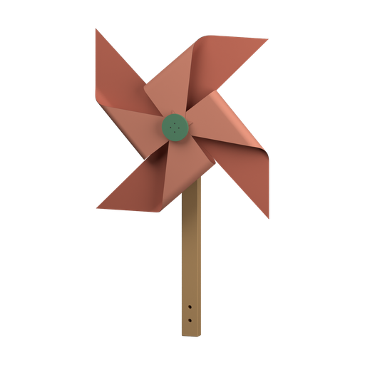 A Fair in the Air
background: 

Build toys that move, draw and shine—then make a little garden fair do something impossible.

## `c01` Something that moves
background: 
reference: 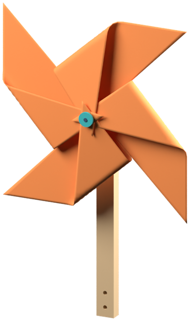

**Goals**
- Fold the first corner inward -- `pw-one-blade`
- next: Fold the second corner inward -- `pw-two-blades`
- next: Fold the third corner inward -- `pw-three-blades`
- next: Fold the last corner inward -- `pw-loose-rotor`
- next: Fit the hub to the blades -- `pw-folded-rotor`
- next: Flip the blades over -- `pw-rear-rotor`
- next: Fit the axle into the back of the hub -- `pw-bearing-rotor`
- next: Clip the handle onto the axle -- `pw-mounted`
- next: Flip the pinwheel to the front -- `pinwheel`

**Hotspots**
- `pw-fold` (center 390px, 216px)
  - icon: 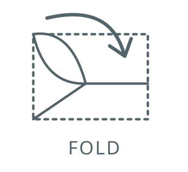
  - hitbox: (center 390px, 216px) (size 236px, 248px)
- `pw-flip` (center 130px, 216px)
  - icon: 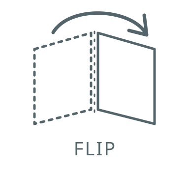
  - hitbox: (center 130px, 216px) (size 236px, 248px)

**Items**
- `pw-fold` Fold
- `pw-flip` Flip
- `pw-paper` Paper
  - icon: 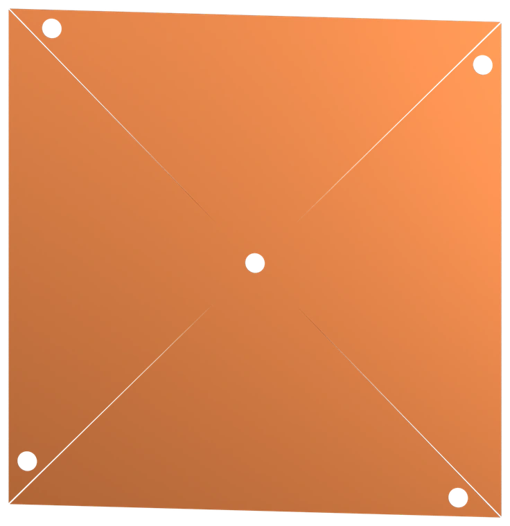 (center 358px, 830px)

  {A flat brick-red square. Fine diagonal lines run inward from its corners; round holes sit near the corners and centre.}

  ---

  The paper sheet is already cut along four diagonals, stopping short of the centre. Curl the four pierced corners inward; keep the uncut centre whole.
- `pw-hub` Hub
  - icon: 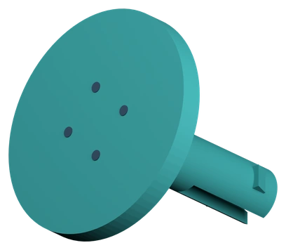 (center 140px, 460px)

  {A green round cap with four small dark holes on its face and a slotted stem behind it.}

  ---

  A hollow snap-in hub holds the folded corners together. Its centre is a bearing for the axle.
- `pw-axle` Axle
  - icon: 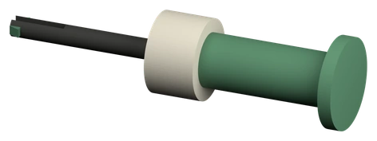 (center 470px, 460px)

  {A thin black pin extends from a cream ring and green stepped stem ending in a round cap.}

  ---

  A blunt axle with a built-in spacer and retaining tip. The hub turns around the axle; the spacer keeps the paper clear of the handle.
- `pw-handle` Handle
  - icon: 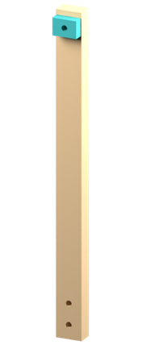 (center 690px, 820px)

  {A long narrow wooden handle with a green open hook at one end and small dark holes near each end.}

  ---

  The prepared clip snaps over the axle's rear post. Two small mounting holes remain near the foot of the handle.
- `pw-one-blade` Paper
  - icon: 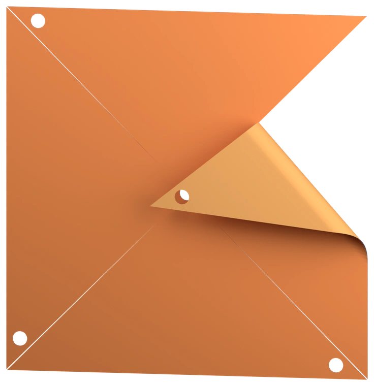

  {One red corner curls inward, leaving an open notch at the upper right and a holed tip near the centre.}
- `pw-two-blades` Paper
  - icon: 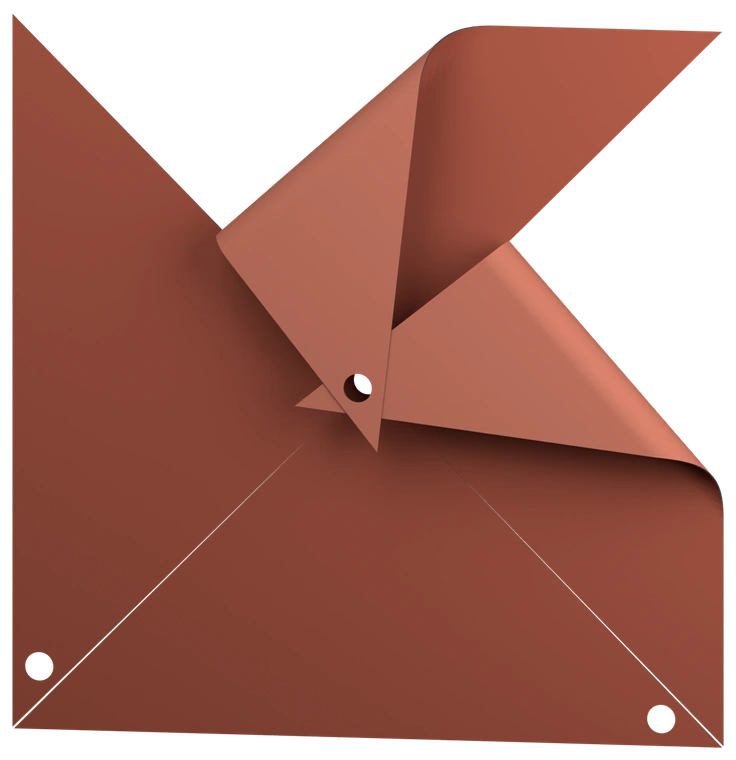

  {Two curled red folds meet near the centre. The lower half still has two flat corners.}
- `pw-three-blades` Paper
  - icon: 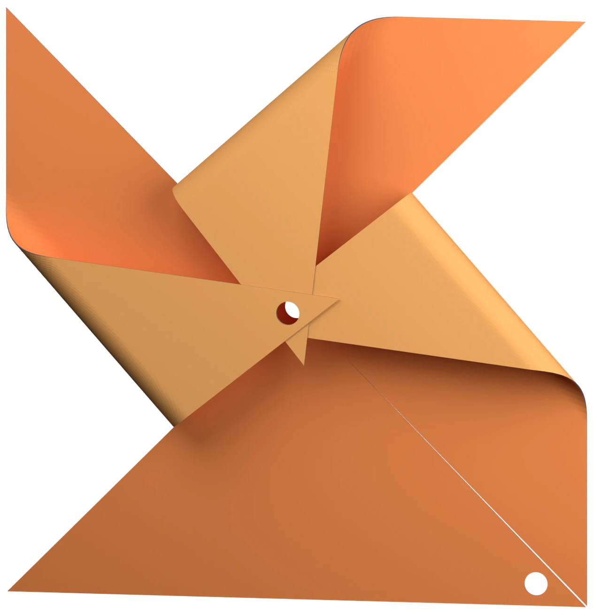

  {Three curled folds meet near the centre; one flat lower-right corner with a round hole remains.}
- `pw-loose-rotor` Blades
  - icon: 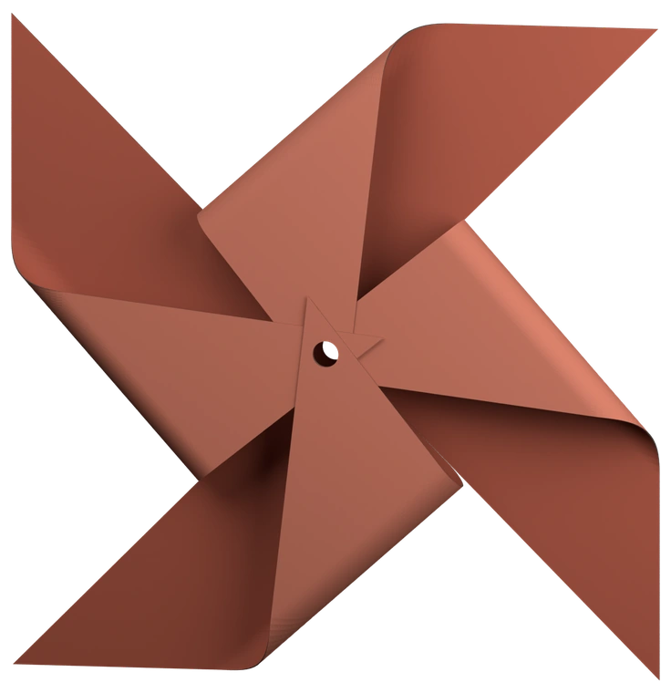

  {Four curled red blades surround a small dark hole at the centre.}
- `pw-folded-rotor` Blades
  - icon: 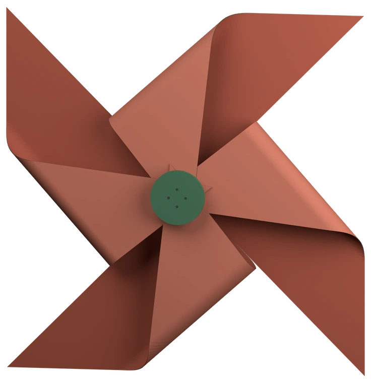

  {Four curled red blades meet beneath a small green round cap.}
- `pw-rear-rotor` Blades
  - icon: 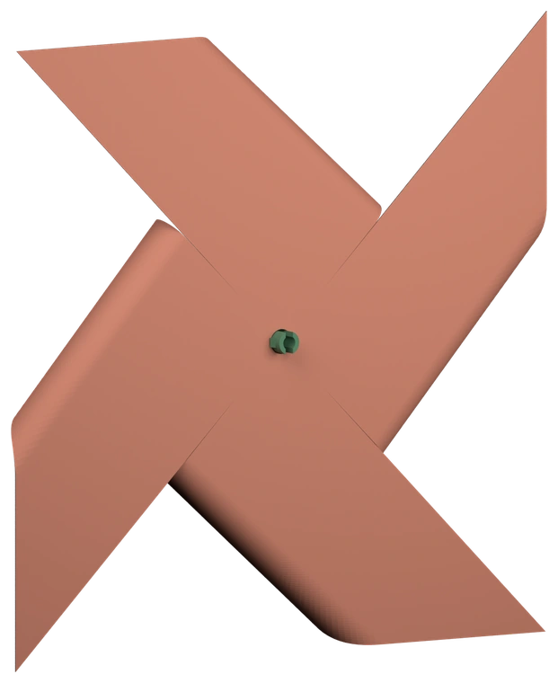

  {The pale-red back of the four blades, with a short green tip at the centre.}
- `pw-bearing-rotor` Blades
  - icon: 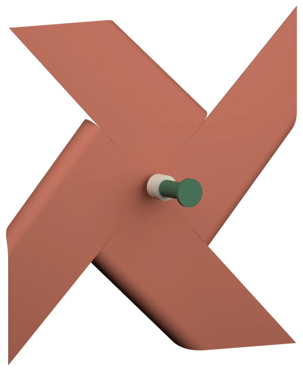

  {On the back of the red blades, a cream ring and short green stem project from the centre.}
- `pw-mounted` Pinwheel
  - icon: 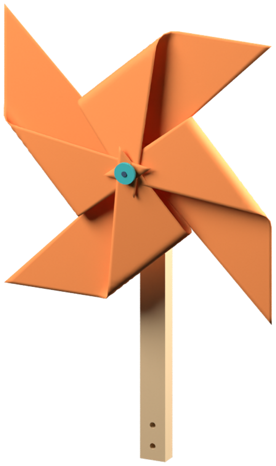

  {The wooden handle extends down from the back of the red blades, beneath the green centre fitting.}
- `pinwheel` Pinwheel
  - icon: 

  {Four curled red blades surround a green centre cap. A long wooden handle extends below.}

  ---

  Four curved paper blades catch the breeze. The paper and hub turn together around the axle while the handle stays still.

**Combinations**
- `pw-paper` [transform] @ `pw-fold` -> `pw-one-blade` (tutorial)
- `pw-one-blade` [transform] @ `pw-fold` -> `pw-two-blades`
- `pw-two-blades` [transform] @ `pw-fold` -> `pw-three-blades`
- `pw-three-blades` [transform] @ `pw-fold` -> `pw-loose-rotor`
- `pw-hub` [consume] + `pw-loose-rotor` [transform] -> `pw-folded-rotor`
- `pw-folded-rotor` [transform] @ `pw-flip` -> `pw-rear-rotor`
- `pw-axle` [consume] + `pw-rear-rotor` [transform] -> `pw-bearing-rotor`
- `pw-handle` [consume] + `pw-bearing-rotor` [transform] -> `pw-mounted`
- `pw-mounted` [transform] @ `pw-flip` -> `pinwheel`

## `c02` A sail
background: 
reference: 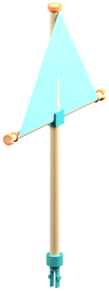

**Goals**
- Fit the connector to the mast
  - either: `wr-mast-joint`
  - or: `wr-mast-joint-foot`
  - or: `wr-frame`
  - or: `wr-ready`
  - or: `wr-frame-sail`
  - or: `wr-sail`
- next: Fit the crossbar into the connector
  - either: `wr-frame`
  - or: `wr-ready`
  - or: `wr-frame-sail`
  - or: `wr-sail`
- next: Push the foot onto the mast
  - either: `wr-mast-foot`
  - or: `wr-mast-joint-foot`
  - or: `wr-ready`
  - or: `wr-sail`
- next: Clip the sail onto the mast -- `wr-sail`

**Items**
- `wr-mast-wood` Mast
  - icon: 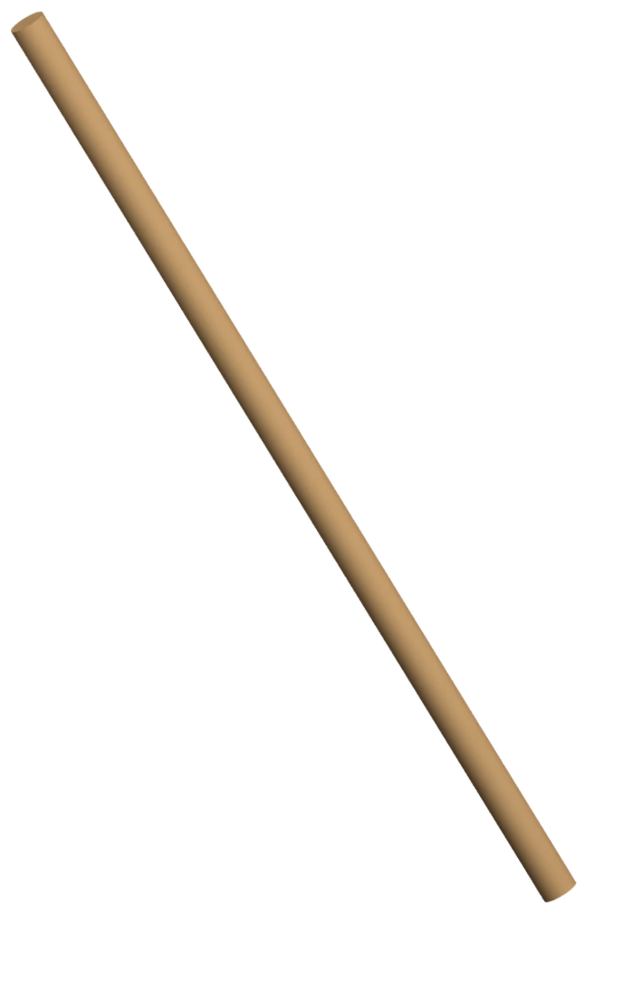

  {A long, slim tan rod lying diagonally.}
- `wr-mast-foot` Mast
  - icon: 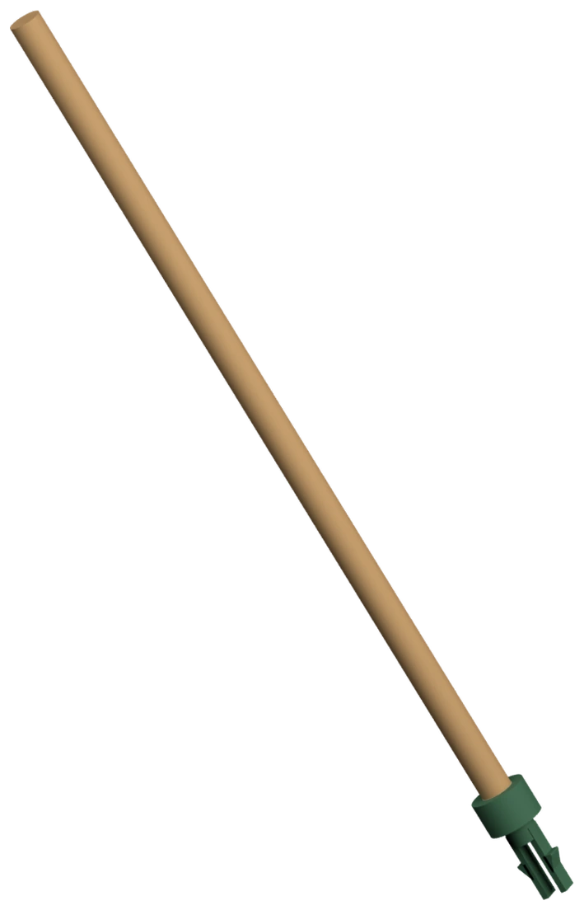

  {A long tan rod ends in a green socket with split legs.}
- `wr-mast-joint` Mast
  - icon: 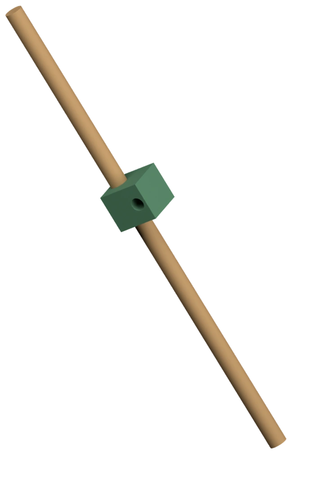

  {A long tan rod passes through a green block. A round side opening remains visible in the block.}
- `wr-mast-joint-foot` Mast
  - icon: 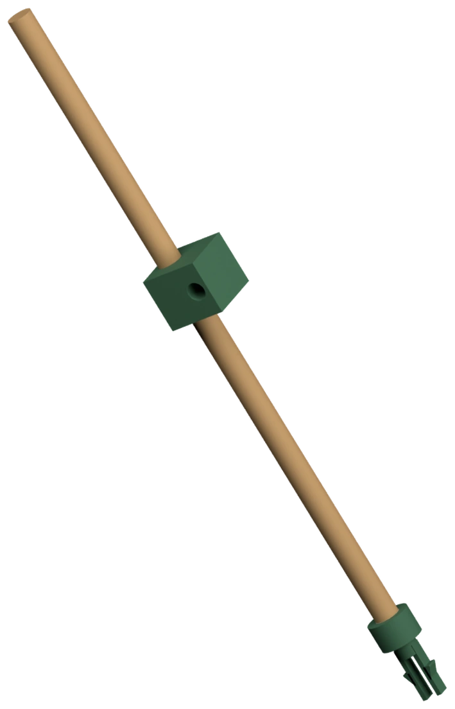

  {The long tan rod has a green block partway along it and a green split fitting at its lower end.}
- `wr-frame` Mast
  - icon: 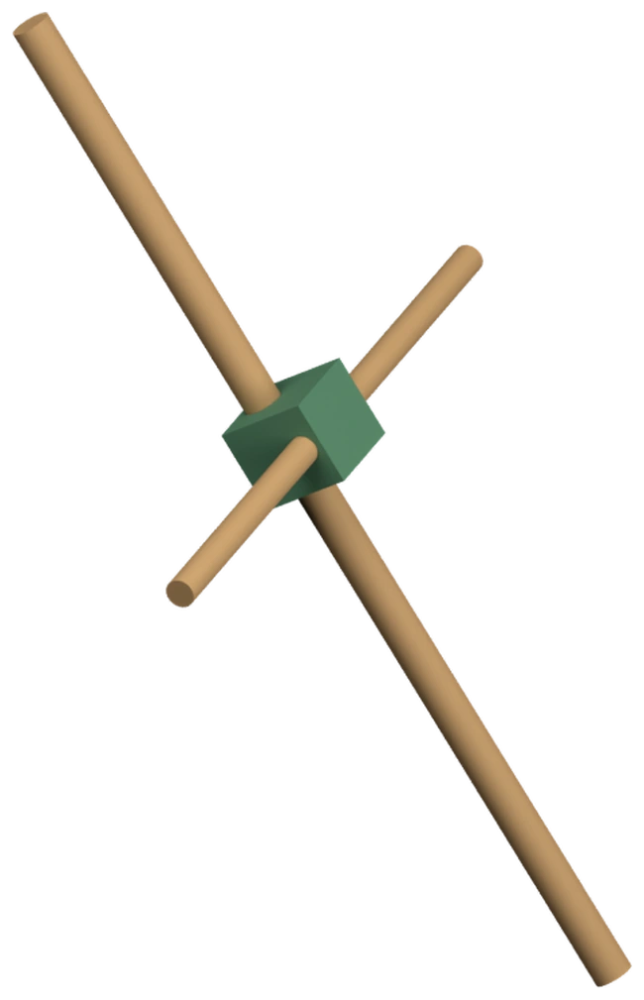

  {A long tan rod and shorter crosspiece meet at a green block.}
- `wr-ready` Mast
  - icon: 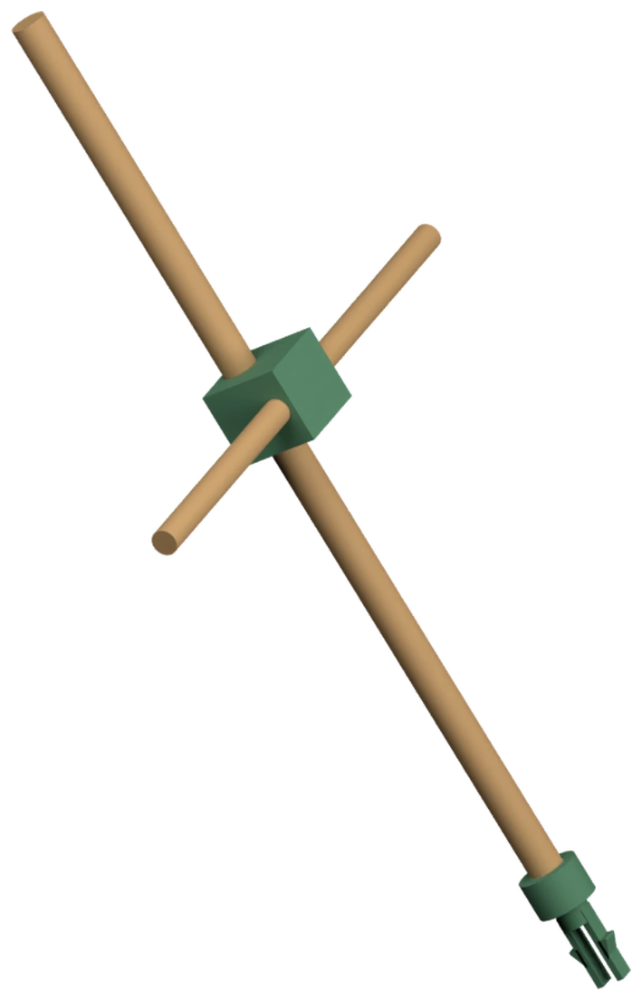

  {The crossed tan rods meet at a green block. A green split fitting sits at the end of the longer rod.}
- `wr-frame-sail` Sail
  - icon: 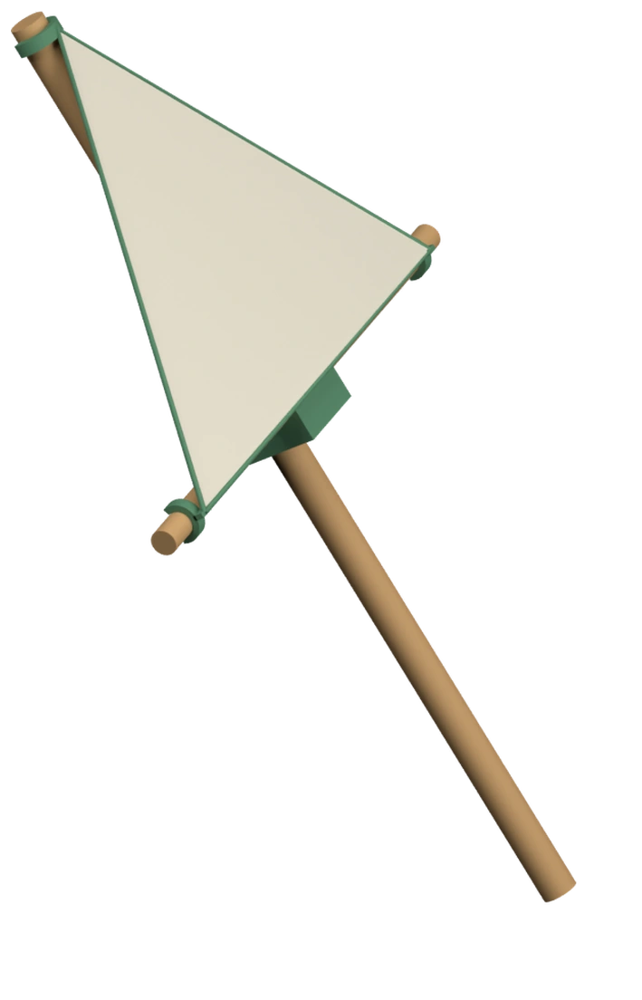

  {A cream triangular sail spans the tan frame, with a long bare rod extending below it.}
- `wr-sail` Sail
  - icon: 
  - from chapter `c-racer-body` icon: 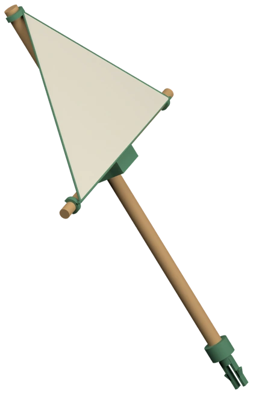

  {A cream triangular sail sits on a tan frame, above a long tan rod ending in a green split fitting.}
- `wr-connector` Connector
  - icon: 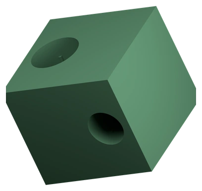

  {A green block with round openings on two different faces.}

  ---

  Two offset sockets keep the wooden rods from crossing through each other. Flexible ribs grip both rods.
- `wr-crossbar` Crossbar
  - icon: 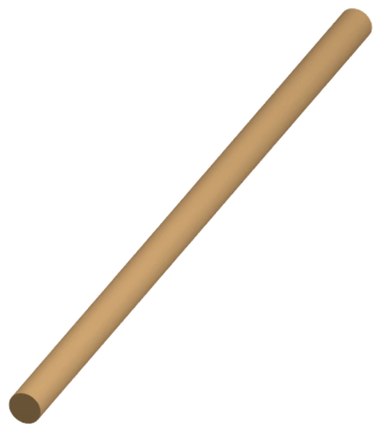

  {A short tan rod with a round end, lying diagonally.}

  ---

  A short wooden rod that supports the bottom of the sail.
- `wr-foot` Foot
  - icon: 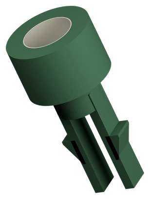

  {A green round socket with a pale inner rim and two long split legs below.}

  ---

  The mast pushes into the top socket. The split legs underneath will snap into the chassis.
- `wr-sailcloth` Sail
  - icon: 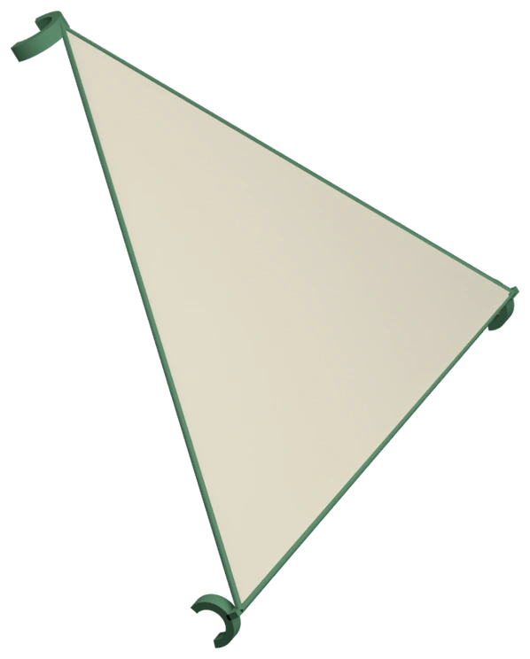

  {A cream triangular sail edged in green, with small open green clips at its corners.}

  ---

  Three small open clips are attached to the cloth. They press onto the mast and crossbar.
- `wr-crossbar-joint` Crossbar
  - icon: 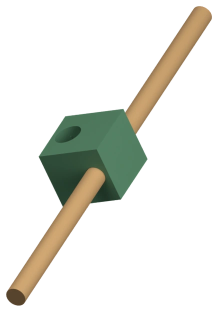

  {A short tan rod passes through a green block; a round opening faces upward.}

**Combinations**
- `wr-foot` [consume] + `wr-mast-wood` [transform] -> `wr-mast-foot`
- `wr-foot` [consume] + `wr-mast-joint` [transform] -> `wr-mast-joint-foot`
- `wr-foot` [consume] + `wr-frame` [transform] -> `wr-ready`
- `wr-foot` [consume] + `wr-frame-sail` [transform] -> `wr-sail`
- `wr-connector` [consume] + `wr-mast-wood` [transform] -> `wr-mast-joint`
- `wr-connector` [consume] + `wr-mast-foot` [transform] -> `wr-mast-joint-foot`
- `wr-crossbar` [consume] + `wr-mast-joint` [transform] -> `wr-frame`
- `wr-crossbar` [consume] + `wr-mast-joint-foot` [transform] -> `wr-ready`
- `wr-sailcloth` [consume] + `wr-frame` [transform] -> `wr-frame-sail`
- `wr-sailcloth` [consume] + `wr-ready` [transform] -> `wr-sail`
- `wr-connector` [consume] + `wr-crossbar` [transform] -> `wr-crossbar-joint`
- `wr-crossbar-joint` [consume] + `wr-mast-wood` [transform] -> `wr-frame`
- `wr-crossbar-joint` [consume] + `wr-mast-foot` [transform] -> `wr-ready`

## `c-racer-body` Wheels for the sail
background: 
reference: 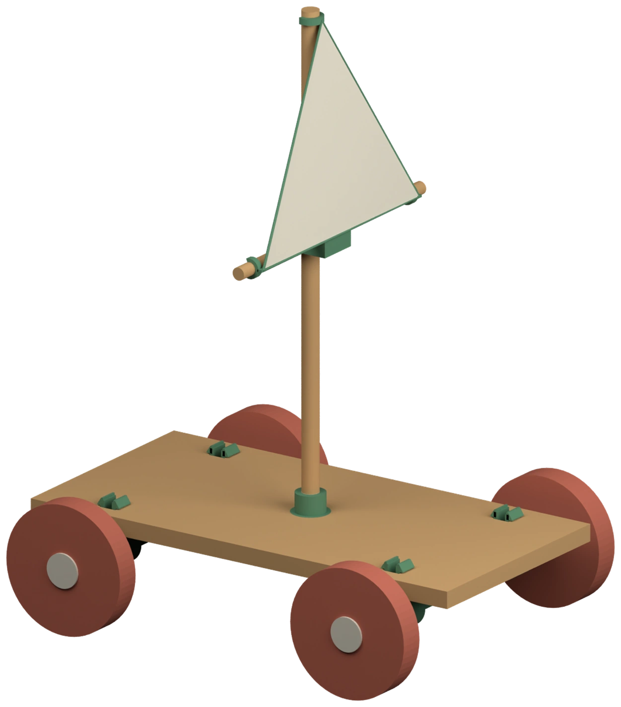

**Goals**
- Flip the chassis over -- `wr-chassis`
- next: Push a wheel onto the front straw -- `wr-front-one-wheel`
- next: Push another wheel onto the front axle -- `wr-front-wheels`
- next: Push a wheel onto the rear straw -- `wr-rear-one-wheel`
- next: Push another wheel onto the rear axle -- `wr-rear-wheels`
- next: Fit a bearing to the chassis
  - either: `wr-front-bearing-chassis`
  - or: `wr-rear-bearing-chassis`
  - or: `wr-bearing-chassis`
  - or: `wr-front-rolling-chassis`
  - or: `wr-rear-rolling-chassis`
  - or: `wr-front-wheel-chassis`
  - or: `wr-rear-wheel-chassis`
  - or: `wr-rolling-chassis`
- next: Fit the other bearing
  - either: `wr-bearing-chassis`
  - or: `wr-front-wheel-chassis`
  - or: `wr-rear-wheel-chassis`
  - or: `wr-rolling-chassis`
- next: Snap wheels into a bearing
  - either: `wr-front-rolling-chassis`
  - or: `wr-rear-rolling-chassis`
  - or: `wr-front-wheel-chassis`
  - or: `wr-rear-wheel-chassis`
  - or: `wr-rolling-chassis`
- next: Snap on the other wheels -- `wr-rolling-chassis`
- next: Flip the chassis upright -- `wr-upright`
- next: Fit the sail to the chassis -- `wind-racer`

**Hotspots**
- `wr-flip` (center 390px, 216px)
  - icon: 
  - hitbox: (center 390px, 216px) (size 236px, 248px)

**Items**
- `wr-chassis-top` Chassis
  - icon: 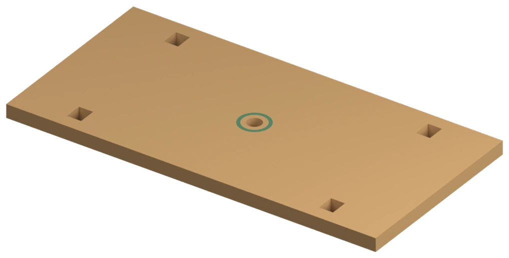

  {A flat tan rectangular board with four small rectangular holes and a green ring around its central round hole.}
- `wr-chassis` Chassis
  - icon: 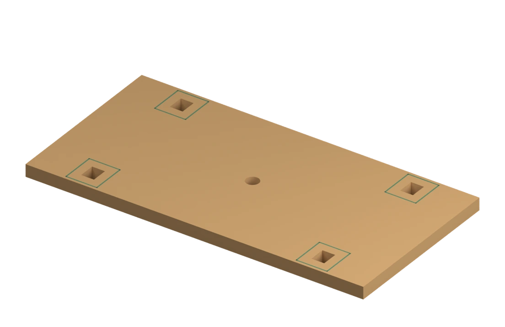

  {The other face of the tan board has green square outlines around its four rectangular holes and a plain central round hole.}
- `wr-front-bearing-chassis` Chassis
  - icon: 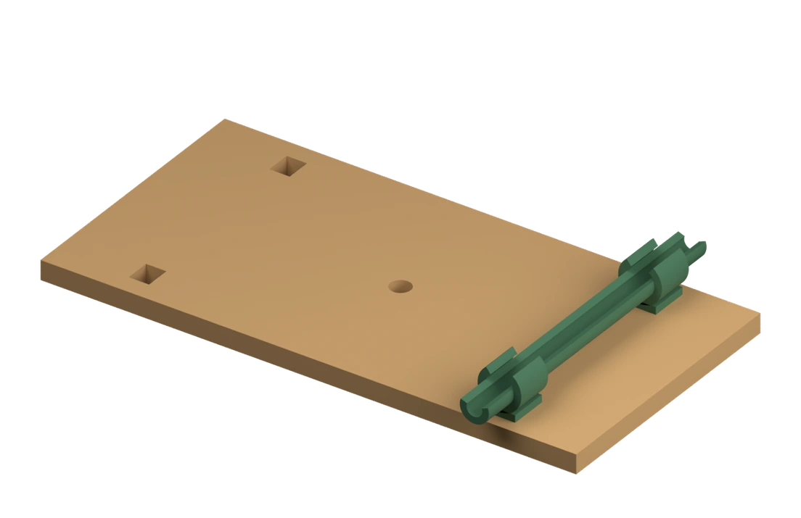

  {A green channel lies across the right-hand end of the tan board. The other end still shows two square outlines.}
- `wr-rear-bearing-chassis` Chassis
  - icon: 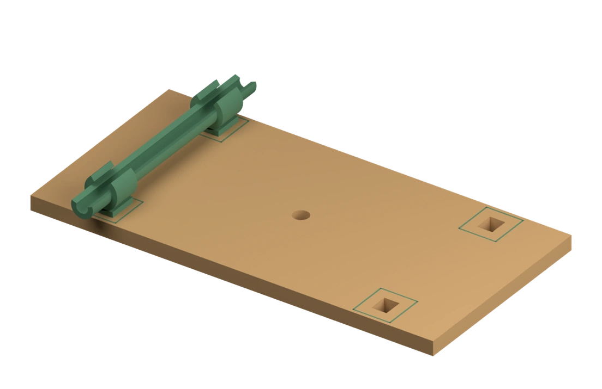

  {A green channel lies across the left-hand end of the tan board. The other end still shows two square outlines.}
- `wr-bearing-chassis` Chassis
  - icon: 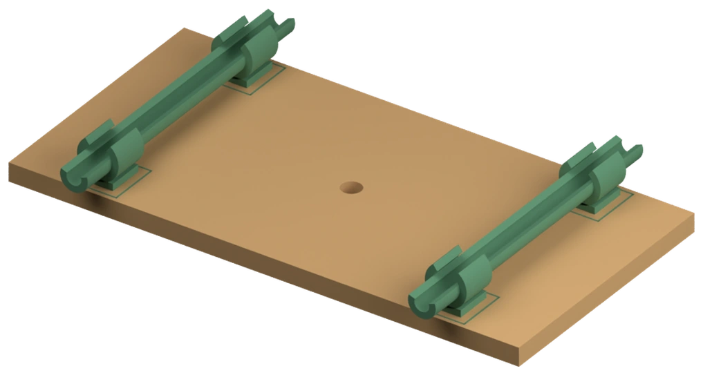

  {Two green channels lie across opposite ends of the tan board.}
- `wr-front-rolling-chassis` Chassis
  - icon: 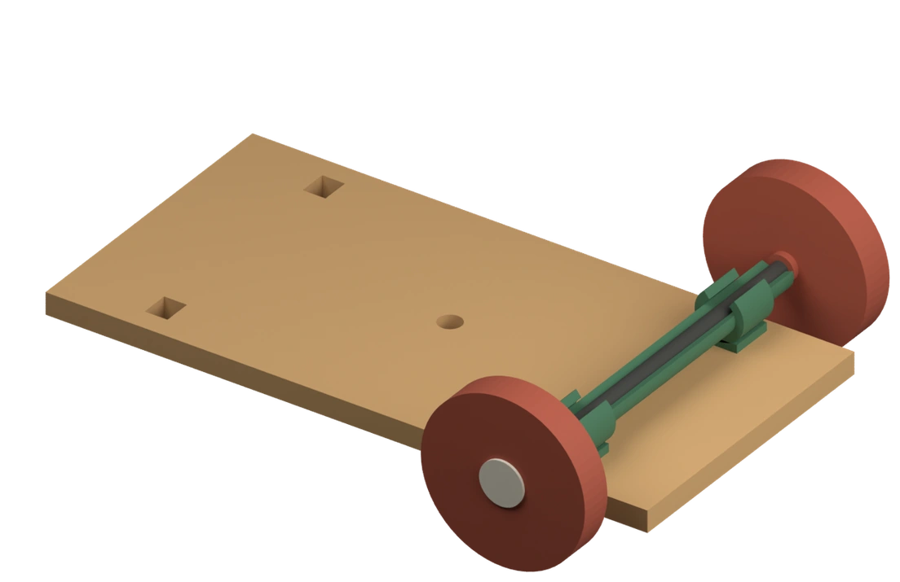

  {A pair of red wheels and a green channel cross the right-hand end of the tan board; the opposite end is bare.}
- `wr-rear-rolling-chassis` Chassis
  - icon: 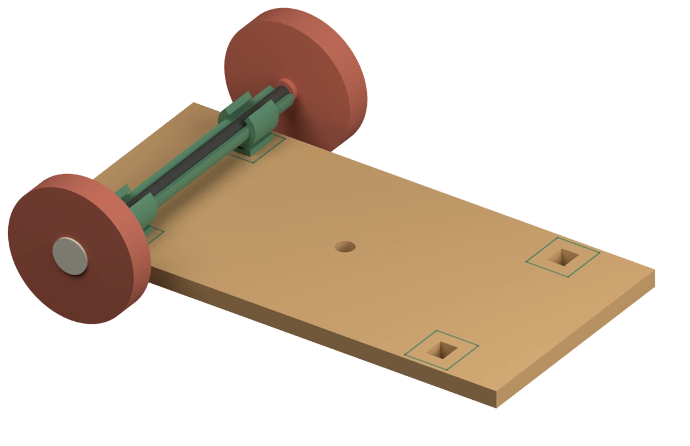

  {A pair of red wheels and a green channel cross the left-hand end of the tan board; the opposite end is bare.}
- `wr-front-wheel-chassis` Chassis
  - icon: 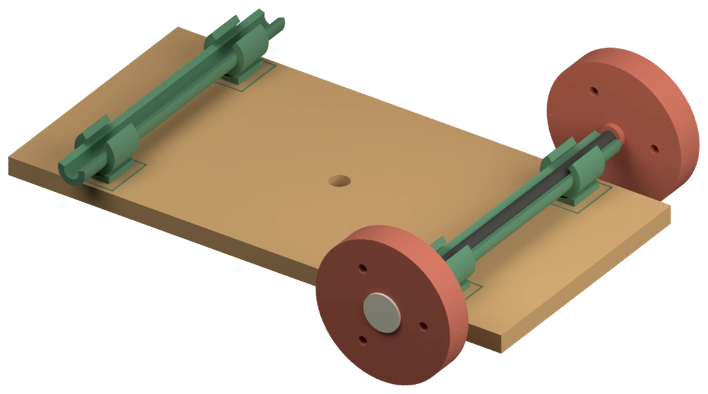

  {The tan board has two green channels; a red wheel sits at each end of the right-hand channel.}
- `wr-rear-wheel-chassis` Chassis
  - icon: 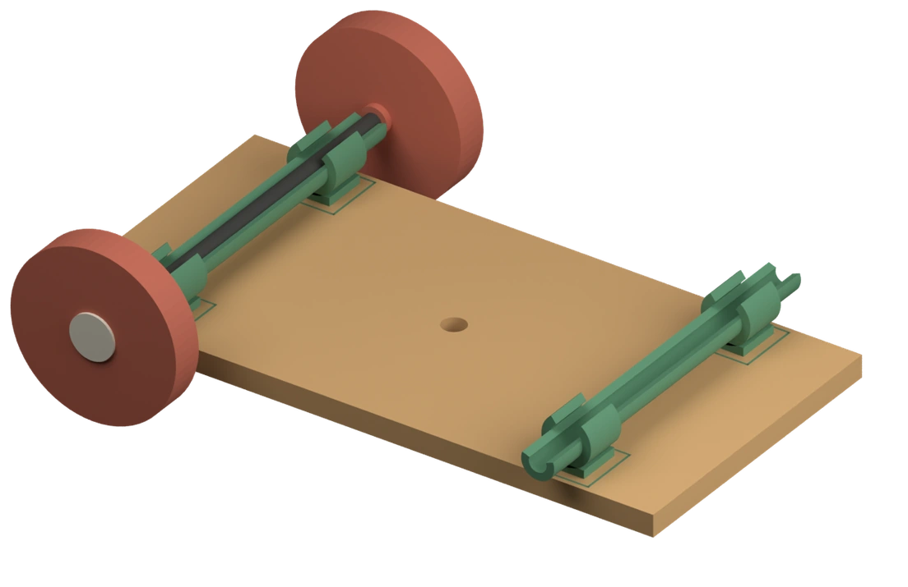

  {The tan board has two green channels; a red wheel sits at each end of the left-hand channel.}
- `wr-rolling-chassis` Chassis
  - icon: 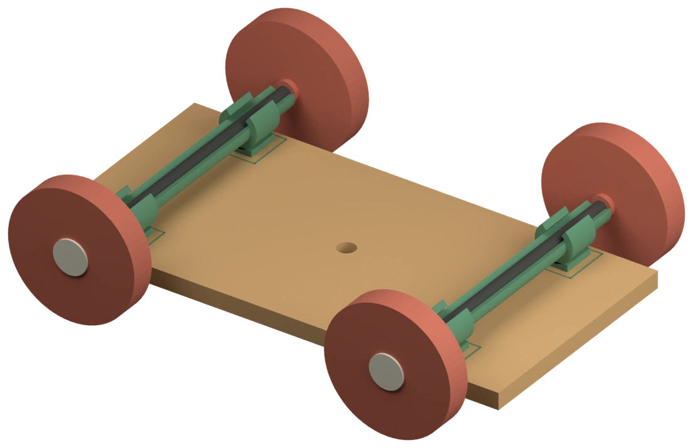

  {Four red wheels sit beside two green channels across the exposed underside of the tan board.}
- `wr-upright` Chassis
  - icon: 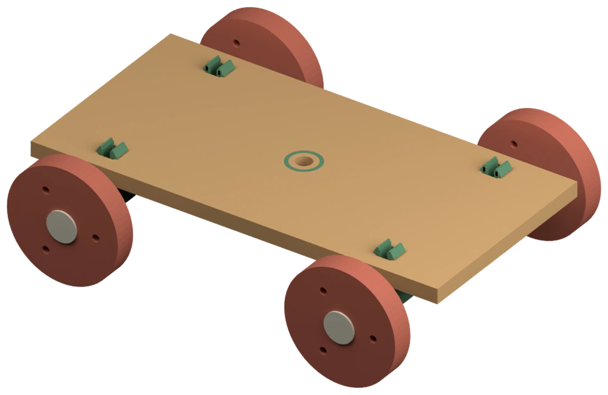

  {The tan board sits above four red wheels. Small green fittings and the green ring around the centre hole are visible on top.}
- `wind-racer` Wind racer
  - icon: 

  {A cream triangular sail rises above a tan rectangular chassis with four red wheels.}

  ---

  The wheels turn together with each straw axle inside the bearings. Outdoors, moving air can push against the sail.
- `wr-flip` Flip
- `wr-front-bearing` Bearing
  - icon: 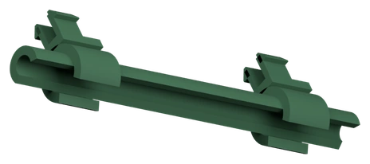

  {A long green open channel with two raised clip fittings.}

  ---

  An open bearing clips beneath the chassis. Its spring lips let the axle snap into the channel.
- `wr-front-axle` Front straw
  - icon: 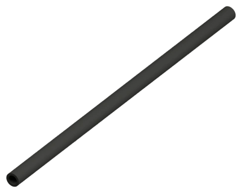

  {A thin dark tube lying diagonally, with a round opening at its nearer end.}

  ---

  A stiff hollow plastic axle. Push one wheel onto each end.
- `wr-front-one-wheel` Front axle
  - icon: 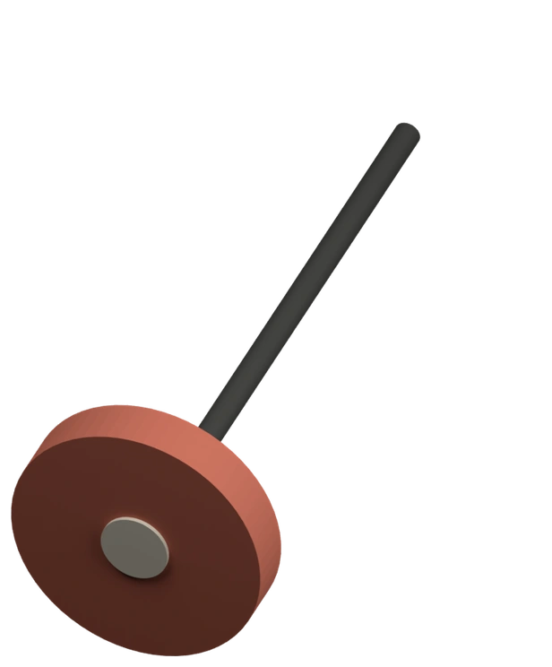

  {One red wheel sits on the end of a long dark axle; its other end is bare.}
- `wr-front-wheels` Front wheels
  - icon: 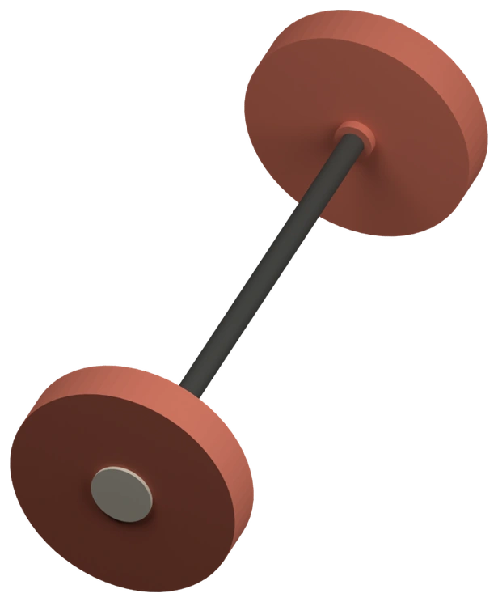

  {Two red wheels sit at opposite ends of one dark axle.}
- `wr-rear-bearing` Bearing
  - icon: 

  {A long green open channel with two raised clip fittings.}

  ---

  An open bearing clips beneath the chassis. Its spring lips let the axle snap into the channel.
- `wr-rear-axle` Rear straw
  - icon: 

  {A thin dark tube lying diagonally, with a round opening at its nearer end.}

  ---

  A stiff hollow plastic axle. Push one wheel onto each end.
- `wr-rear-one-wheel` Rear axle
  - icon: 

  {One red wheel sits on the end of a long dark axle; its other end is bare.}
- `wr-rear-wheels` Rear wheels
  - icon: 

  {Two red wheels sit at opposite ends of one dark axle.}
- `wr-wheel-1` Wheel
  - icon: 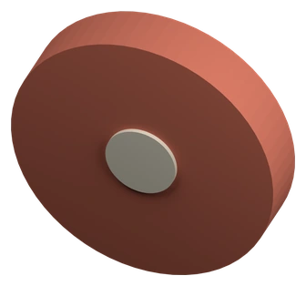

  {A thick brick-red wheel with a pale round centre.}

  ---

  The wheel has a blind centre socket and an integral spacer. Any wheel fits either straw.
- `wr-wheel-2` Wheel
  - icon: 

  {A thick brick-red wheel with a pale round centre.}

  ---

  The wheel has a blind centre socket and an integral spacer. Any wheel fits either straw.
- `wr-wheel-3` Wheel
  - icon: 

  {A thick brick-red wheel with a pale round centre.}

  ---

  The wheel has a blind centre socket and an integral spacer. Any wheel fits either straw.
- `wr-wheel-4` Wheel
  - icon: 

  {A thick brick-red wheel with a pale round centre.}

  ---

  The wheel has a blind centre socket and an integral spacer. Any wheel fits either straw.

**Combinations**
- `wr-chassis-top` [transform] @ `wr-flip` -> `wr-chassis`
- `wr-wheel-1` [consume] + `wr-front-axle` [transform] -> `wr-front-one-wheel`
- `wr-wheel-1` [consume] + `wr-front-one-wheel` [transform] -> `wr-front-wheels`
- `wr-wheel-2` [consume] + `wr-front-axle` [transform] -> `wr-front-one-wheel`
- `wr-wheel-2` [consume] + `wr-front-one-wheel` [transform] -> `wr-front-wheels`
- `wr-wheel-3` [consume] + `wr-front-axle` [transform] -> `wr-front-one-wheel`
- `wr-wheel-3` [consume] + `wr-front-one-wheel` [transform] -> `wr-front-wheels`
- `wr-wheel-4` [consume] + `wr-front-axle` [transform] -> `wr-front-one-wheel`
- `wr-wheel-4` [consume] + `wr-front-one-wheel` [transform] -> `wr-front-wheels`
- `wr-wheel-1` [consume] + `wr-rear-axle` [transform] -> `wr-rear-one-wheel`
- `wr-wheel-1` [consume] + `wr-rear-one-wheel` [transform] -> `wr-rear-wheels`
- `wr-wheel-2` [consume] + `wr-rear-axle` [transform] -> `wr-rear-one-wheel`
- `wr-wheel-2` [consume] + `wr-rear-one-wheel` [transform] -> `wr-rear-wheels`
- `wr-wheel-3` [consume] + `wr-rear-axle` [transform] -> `wr-rear-one-wheel`
- `wr-wheel-3` [consume] + `wr-rear-one-wheel` [transform] -> `wr-rear-wheels`
- `wr-wheel-4` [consume] + `wr-rear-axle` [transform] -> `wr-rear-one-wheel`
- `wr-wheel-4` [consume] + `wr-rear-one-wheel` [transform] -> `wr-rear-wheels`
- `wr-front-bearing` [consume] + `wr-chassis` [transform] -> `wr-front-bearing-chassis`
- `wr-rear-bearing` [consume] + `wr-chassis` [transform] -> `wr-rear-bearing-chassis`
- `wr-front-bearing` [consume] + `wr-rear-bearing-chassis` [transform] -> `wr-bearing-chassis`
- `wr-rear-wheels` [consume] + `wr-rear-bearing-chassis` [transform] -> `wr-rear-rolling-chassis`
- `wr-front-bearing` [consume] + `wr-rear-rolling-chassis` [transform] -> `wr-rear-wheel-chassis`
- `wr-front-wheels` [consume] + `wr-front-bearing-chassis` [transform] -> `wr-front-rolling-chassis`
- `wr-rear-bearing` [consume] + `wr-front-bearing-chassis` [transform] -> `wr-bearing-chassis`
- `wr-front-wheels` [consume] + `wr-bearing-chassis` [transform] -> `wr-front-wheel-chassis`
- `wr-rear-wheels` [consume] + `wr-bearing-chassis` [transform] -> `wr-rear-wheel-chassis`
- `wr-front-wheels` [consume] + `wr-rear-wheel-chassis` [transform] -> `wr-rolling-chassis`
- `wr-rear-bearing` [consume] + `wr-front-rolling-chassis` [transform] -> `wr-front-wheel-chassis`
- `wr-rear-wheels` [consume] + `wr-front-wheel-chassis` [transform] -> `wr-rolling-chassis`
- `wr-rolling-chassis` [transform] @ `wr-flip` -> `wr-upright`
- `wr-sail` [consume] + `wr-upright` [transform] -> `wind-racer`

## `bf-pb-rails` A marble table
background: 
reference: 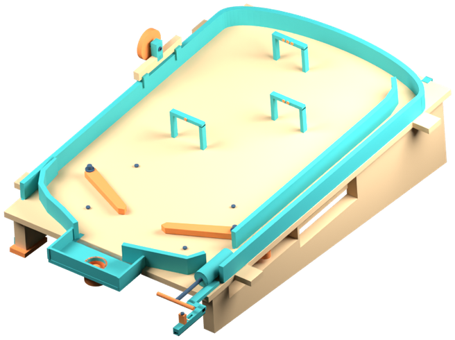

**Goals**
- Fit the Left rail -- `bf-pb-rail-1`
- next: Fit the Right rail -- `bf-pb-rail-2`
- next: Fit the Top rail -- `bf-pb-rail-3`
- next: Fit the Lane rail -- `bf-pb-rail-4`
- next: Fit the Left return -- `bf-pb-rail-5`
- next: Fit the Right return -- `bf-pb-rail-6`
- next: Fit the Marble cup -- `bf-pb-rimmed`

**Items**
- `bf-pb-tray` Tray
  - icon: 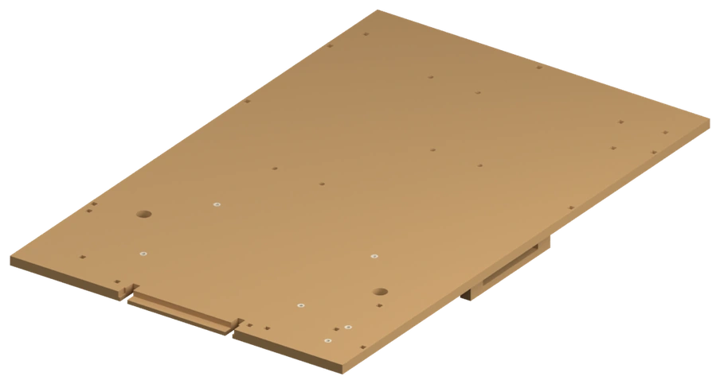

  {A long flat tan board with small holes, slots and a shallow notch across its nearer end.}

  ---

  Prepared plywood with rail slots, flipper holes and integral carrying handles.
- `bf-pb-left-rail` Left rail
  - icon: 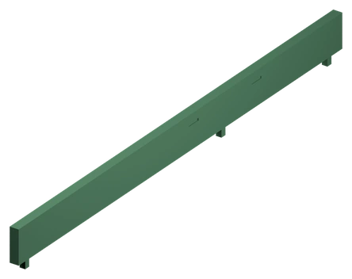

  {A long straight green rail with small projecting feet along its lower edge.}
- `bf-pb-rail-1` Table
  - icon: 

  {One straight green rail runs along the left side of the tan board.}
- `bf-pb-right-rail` Right rail
  - icon: 

  {A long straight green rail with small projecting feet along its lower edge.}
- `bf-pb-rail-2` Table
  - icon: 

  {Straight green rails run along both long sides of the tan board.}
- `bf-pb-top-rail` Top rail
  - icon: 

  {A broad curved green rail with small feet beneath it.}
- `bf-pb-rail-3` Table
  - icon: 

  {A curved green rail joins the two side rails around the far end of the tan board.}
- `bf-pb-lane` Lane rail
  - icon: 

  {A long thin green rail with a short bent tip and small feet underneath.}
- `bf-pb-rail-4` Table
  - icon: 

  {A second narrow green rail forms a long lane inside the board’s right-hand edge.}
- `bf-pb-left-lip` Left return
  - icon: 

  {A short green rail bends through a broad curve, with small feet beneath it.}
- `bf-pb-rail-5` Table
  - icon: 

  {The left rail curves inward near the front of the board.}
- `bf-pb-right-lip` Right return
  - icon: 

  {A short green rail has one angled end and small feet underneath.}
- `bf-pb-rail-6` Table
  - icon: 

  {Both front rail ends turn inward, leaving a gap between them.}
- `bf-pb-cup` Marble cup
  - icon: 

  {A green shallow tray has raised edge rails and a round recessed cup near its centre.}
- `bf-pb-rimmed` Table
  - icon: 

  {A small green tray and round cup extend from the gap at the front of the railed board.}

**Combinations**
- `bf-pb-left-rail` [consume] + `bf-pb-tray` [transform] -> `bf-pb-rail-1`
- `bf-pb-right-rail` [consume] + `bf-pb-rail-1` [transform] -> `bf-pb-rail-2`
- `bf-pb-top-rail` [consume] + `bf-pb-rail-2` [transform] -> `bf-pb-rail-3`
- `bf-pb-lane` [consume] + `bf-pb-rail-3` [transform] -> `bf-pb-rail-4`
- `bf-pb-left-lip` [consume] + `bf-pb-rail-4` [transform] -> `bf-pb-rail-5`
- `bf-pb-right-lip` [consume] + `bf-pb-rail-5` [transform] -> `bf-pb-rail-6`
- `bf-pb-cup` [consume] + `bf-pb-rail-6` [transform] -> `bf-pb-rimmed`

## `bf-pb-flippers` Two flippers
background: 
reference: 

**Goals**
- Flip the Table -- `bf-pb-under`
- next: Fit the Pivot plate -- `bf-pb-plated-under`
- next: Fit the Support -- `bf-pb-supported-under`
- next: Flip the Table upright -- `bf-pb-upright`
- next: Snap on the Left paddle -- `bf-pb-left`
- next: Snap on the Right paddle -- `bf-pb-flipped`

**Hotspots**
- `bf-pb-flip` (center 130px, 216px)
  - icon: 
  - hitbox: (center 130px, 216px) (size 236px, 248px)

**Items**
- `bf-pb-rimmed` Table
  - icon: 

  {A small green tray and round cup extend from the gap at the front of the railed board.}
- `bf-pb-flip` Flip
  - icon: 
- `bf-pb-under` Table
  - icon: 

  {The underside of the tan board faces up, showing slots, small holes and two narrow wooden strips; the green cup projects behind its far edge.}
- `bf-pb-plate` Pivot plate
  - icon: 

  {A flat green rectangular plate carries black upright pins and small red paddles at its sides.}

  ---

  A plate with retained spindles, finger buttons and return loops. The shoulders pass through the prepared tray clearances. Captive screws enter the tray’s threaded receivers from beneath.
- `bf-pb-plated-under` Table
  - icon: 

  {A green rectangular plate with black pins and red side fittings lies across the exposed underside of the board.}
- `bf-pb-support` Support
  - icon: 

  {A tan U-shaped stand has two long slotted arms and a taller connecting back.}

  ---

  One connected U-shaped support with locating tongues and retaining clips. It slopes the table towards its marble cup without tilting sideways.
- `bf-pb-supported-under` Table
  - icon: 

  {A tan U-shaped stand surrounds the underside of the board, beside the fitted green plate.}
- `bf-pb-upright` Table
  - icon: 

  {The railed table stands upright on its tan support, with two exposed dark pivot pins near the front.}
- `bf-pb-left-paddle` Left paddle
  - icon: 

  {A long flat red paddle narrows toward one end and has a socket near its broad rounded end.}

  ---

  One polymer paddle with an open keyed snap socket. Its flexible mouth clips sideways around the spindle neck between the retaining shoulders.
- `bf-pb-left` Table
  - icon: 

  {One red paddle sits on the left front pivot; the right pivot remains bare.}
- `bf-pb-right-paddle` Right paddle
  - icon: 

  {A long flat red paddle narrows toward one end and has a socket near its broad rounded end.}

  ---

  One polymer paddle with an open keyed snap socket. Its flexible mouth clips sideways around the spindle neck between the retaining shoulders.
- `bf-pb-flipped` Table
  - icon: 

  {Two red paddles angle inward near the front gap of the railed table.}

**Combinations**
- `bf-pb-rimmed` [transform] @ `bf-pb-flip` -> `bf-pb-under`
- `bf-pb-plate` [consume] + `bf-pb-under` [transform] -> `bf-pb-plated-under`
- `bf-pb-support` [consume] + `bf-pb-plated-under` [transform] -> `bf-pb-supported-under`
- `bf-pb-supported-under` [transform] @ `bf-pb-flip` -> `bf-pb-upright`
- `bf-pb-left-paddle` [consume] + `bf-pb-upright` [transform] -> `bf-pb-left`
- `bf-pb-right-paddle` [consume] + `bf-pb-left` [transform] -> `bf-pb-flipped`

## `bf-pb-launcher-build` A spring launcher
background: 
reference: 

**Goals**
- Slide the Spring onto the Plunger rod -- `bf-pb-sprung-rod`
- next: Fit the Plunger tip -- `bf-pb-tipped`
- next: Lower the Plunger into the Launcher cradle -- `bf-pb-open-launcher`
- next: Clip on the Launcher cover -- `bf-pb-launcher`
- next: Fit the Launcher to the Table -- `bf-pb-launched`

**Items**
- `bf-pb-rod` Plunger rod
  - icon: 

  {A long charcoal rod ends in a red crosspiece forming a T handle.}

  ---

  A six-millimetre plunger rod with a fitted pull handle and an open front end for threading the spring.
- `bf-pb-spring` Spring
  - icon: 

  {A thick black coil with open ends, lying diagonally.}
- `bf-pb-sprung-rod` Plunger
  - icon: 

  {A black coil surrounds the far end of the charcoal rod; its red T handle remains exposed.}
- `bf-pb-tip` Plunger tip
  - icon: 

  {A stepped red round cap with a central round hole.}

  ---

  A soft striking tip and piston with a blind gripping socket for the rod.
- `bf-pb-tipped` Plunger
  - icon: 

  {A red round cap sits beyond the coil at the far end of the charcoal rod and T handle.}
- `bf-pb-barrel` Launcher cradle
  - icon: 

  {An open grey half-tube sits at one end of a long green rail, with a red upright fitting at the other end.}

  ---

  An open-topped cradle with half-round end guides, mounting feet and a travel stop. The assembled plunger lowers through its open top.
- `bf-pb-open-launcher` Launcher
  - icon: 

  {The coil and capped rod lie inside the open grey half-tube on the green rail; the T handle extends from the front.}
- `bf-pb-cover` Launcher cover
  - icon: 

  {A grey half-cylinder has black end rims and green clips hanging from its sides.}

  ---

  A clear upper shell with matching half-guides and flexible retaining clips. Closing it captures the plunger and encloses the spring.
- `bf-pb-launcher` Launcher
  - icon: 

  {A grey cylindrical cover surrounds the coil, with green side clips; the charcoal rod and red T handle extend from its front.}
- `bf-pb-flipped` Table
  - icon: 

  {Two red paddles angle inward near the front gap of the railed table.}
- `bf-pb-launched` Table
  - icon: 

  {The covered launcher sits beside the table’s right-hand lane, with its red T handle projecting from the front.}

**Combinations**
- `bf-pb-spring` [consume] + `bf-pb-rod` [transform] -> `bf-pb-sprung-rod`
- `bf-pb-tip` [consume] + `bf-pb-sprung-rod` [transform] -> `bf-pb-tipped`
- `bf-pb-barrel` [consume] + `bf-pb-tipped` [transform] -> `bf-pb-open-launcher`
- `bf-pb-cover` [consume] + `bf-pb-open-launcher` [transform] -> `bf-pb-launcher`
- `bf-pb-launcher` [consume] + `bf-pb-flipped` [transform] -> `bf-pb-launched`

## `bf-pb-targets` One more go
background: 
reference: 

**Goals**
- Fit the Lower arch -- `bf-pb-target-1`
- next: Fit the Middle arch -- `bf-pb-target-2`
- next: Fit the Upper arch -- `bf-pb-target-3`
- next: Fit the Score wheel -- `bf-pb-scored`
- next: Put the Marble in its cup -- `pinball-table`

**Items**
- `bf-pb-launched` Table
  - icon: 

  {The covered launcher sits beside the table’s right-hand lane, with its red T handle projecting from the front.}
- `bf-pb-arch-low` Lower arch
  - icon: 

  {A green rectangular arch with one red dot on its top bar and round pegs below its two legs.}
- `bf-pb-target-1` Table
  - icon: 

  {One small green arch stands on the board above the two red paddles.}
- `bf-pb-arch-mid` Middle arch
  - icon: 

  {A green rectangular arch with two red dots on its top bar and round pegs below its two legs.}
- `bf-pb-target-2` Table
  - icon: 

  {Two small green arches stand at different positions on the board above the red paddles.}
- `bf-pb-arch-high` Upper arch
  - icon: 

  {A green rectangular arch with three red dots on its top bar and round pegs below its two legs.}
- `bf-pb-target-3` Table
  - icon: 

  {Three small green arches stand in a staggered line along the board.}
- `bf-pb-score` Score wheel
  - icon: 

  {A red wheel sits on a green support above a tan rail with green clips underneath.}
- `bf-pb-scored` Table
  - icon: 

  {A red wheel on a tan rail rises outside the table’s left edge, beside the three green arches.}
- `bf-pb-marble` Marble
  - icon: 

  {One red ball.}
- `pinball-table` Pinball table
  - icon: 

  {The railed table has two red paddles, three green arches, a side launcher and red wheel. A small red ball sits in the green cup at the front.}

**Combinations**
- `bf-pb-arch-low` [consume] + `bf-pb-launched` [transform] -> `bf-pb-target-1`
- `bf-pb-arch-mid` [consume] + `bf-pb-target-1` [transform] -> `bf-pb-target-2`
- `bf-pb-arch-high` [consume] + `bf-pb-target-2` [transform] -> `bf-pb-target-3`
- `bf-pb-score` [consume] + `bf-pb-target-3` [transform] -> `bf-pb-scored`
- `bf-pb-marble` [consume] + `bf-pb-scored` [transform] -> `pinball-table`

## `bf-cd-crank` Round and round
background: 
reference: 

**Goals**
- Slide the Cam onto the Shaft -- `bf-cd-cammed`
- next: Fit the Front bearing -- `bf-cd-bearing-1`
- next: Fit the Rear bearing -- `bf-cd-bearings`
- next: Fit the Front collar -- `bf-cd-front-retained`
- next: Flip to the back of the bearings -- `bf-cd-rear-facing`
- next: Fit the Rear collar -- `bf-cd-retained-rear`
- next: Flip back to the front -- `bf-cd-retained`
- next: Fit the Crank -- `bf-cd-cranked`
- next: Secure the Crank with its clip -- `bf-cd-clipped`
- next: Mount the bearings on the Base -- `bf-cd-frame`

**Hotspots**
- `bf-cd-flip` (center 130px, 216px)
  - icon: 
  - hitbox: (center 130px, 216px) (size 236px, 248px)

**Items**
- `bf-cd-shaft` Shaft
  - icon: 

  {A long thin charcoal rod lying diagonally.}

  ---

  A plain six-millimetre shaft, supplied without its collars. The cam and bearings slide on before the separate collars retain the shaft.
- `bf-cd-cam` Cam
  - icon: 

  {A red circular disc with a short split socket below the centre of its face.}

  ---

  The shaft hole sits off centre. Turning the round disc raises and lowers the broad follower foot.
- `bf-cd-cammed` Frame
  - icon: 

  {A charcoal shaft passes through the off-centre socket of a red disc.}
- `bf-cd-front-bearing` Front bearing
  - icon: 

  {A green rectangular frame with two legs, a round hole through its top bar and two black pins beneath its foot.}
- `bf-cd-bearing-1` Frame
  - icon: 

  {The charcoal shaft passes through one green frame in front of the red disc.}
- `bf-cd-rear-bearing` Rear bearing
  - icon: 

  {A green rectangular frame with two legs, a round hole through its top bar and two black pins beneath its foot.}
- `bf-cd-bearings` Frame
  - icon: 

  {A red disc sits on a charcoal shaft between two green frames; the near end of the shaft is bare.}
- `bf-cd-front-collar` Front collar
  - icon: 

  {A thick green ring with a split side and small holes around its rim.}
- `bf-cd-front-retained` Frame
  - icon: 

  {A green ring surrounds the shaft just outside the nearer green frame. The red disc sits between the two frames.}
- `bf-cd-flip` Flip
  - icon: 
- `bf-cd-rear-facing` Frame
  - icon: 

  {From the other side, the plain back of the red disc faces us between two green frames. A bare charcoal shaft projects from the nearer frame.}
- `bf-cd-rear-collar` Rear collar
  - icon: 

  {A thick green ring with a split side and small holes around its rim.}
- `bf-cd-retained-rear` Frame
  - icon: 

  {From the back, a green ring now surrounds the projecting shaft beside the nearer frame.}
- `bf-cd-retained` Frame
  - icon: 

  {From the front again, a red disc sits between two green frames. A green ring surrounds the exposed front shaft.}
- `bf-cd-handle` Crank
  - icon: 

  {A green cylindrical grip attached to a short red arm.}

  ---

  A D-shaped socket fits the matching shaft end. Its separate retaining clip enters the aligned cross holes after the crank is fitted.
- `bf-cd-cranked` Frame
  - icon: 

  {A green cylindrical grip and short red arm extend from the front of the two green frames and red disc.}
- `bf-cd-crank-clip` Crank clip
  - icon: 

  {One thin black wire bent into a narrow open loop with two unequal ends.}

  ---

  One spring-wire clip. Its straight leg passes through the aligned crank and shaft holes; the curved leg grips outside the socket.
- `bf-cd-clipped` Frame
  - icon: 

  {The green grip and red arm remain on the shaft; a small dark wire loop is visible beside the red socket.}
- `bf-cd-base` Base
  - icon: 

  {A flat tan rectangular board with small round holes.}
- `bf-cd-frame` Frame
  - icon: 

  {Two green frames hold a red disc and green crank above a broad tan board.}

**Combinations**
- `bf-cd-cam` [consume] + `bf-cd-shaft` [transform] -> `bf-cd-cammed`
- `bf-cd-front-bearing` [consume] + `bf-cd-cammed` [transform] -> `bf-cd-bearing-1`
- `bf-cd-rear-bearing` [consume] + `bf-cd-bearing-1` [transform] -> `bf-cd-bearings`
- `bf-cd-front-collar` [consume] + `bf-cd-bearings` [transform] -> `bf-cd-front-retained`
- `bf-cd-front-retained` [transform] @ `bf-cd-flip` -> `bf-cd-rear-facing`
- `bf-cd-rear-collar` [consume] + `bf-cd-rear-facing` [transform] -> `bf-cd-retained-rear`
- `bf-cd-retained-rear` [transform] @ `bf-cd-flip` -> `bf-cd-retained`
- `bf-cd-handle` [consume] + `bf-cd-retained` [transform] -> `bf-cd-cranked`
- `bf-cd-crank-clip` [consume] + `bf-cd-cranked` [transform] -> `bf-cd-clipped`
- `bf-cd-base` [consume] + `bf-cd-clipped` [transform] -> `bf-cd-frame`

## `bf-cd-lift` Round becomes up
background: 
reference: 

**Goals**
- Slide the Follower into the Guide -- `bf-cd-open-follower`
- next: Snap on the Cover -- `bf-cd-guided`
- next: Mount the Follower above the Cam -- `bf-cd-mounted`
- next: Hook on the Spring -- `bf-cd-lifter`

**Items**
- `bf-cd-guide` Guide
  - icon: 

  {A tall tan post on a small foot, with an open green frame at the top.}

  ---

  An open square channel with a mounting foot and spring anchor. The separate cover closes around the follower; its broad foot never has to pass through the narrow channel.
- `bf-cd-follower` Follower
  - icon: 

  {A thin red upright with a broad flat foot, a small crosspiece near its top and a black pin across its upper end.}

  ---

  A sliding rod with a broad cam foot, spring collar and retained crosshead pin for two independently pivoting links.
- `bf-cd-open-follower` Follower
  - icon: 

  {A red upright runs beside a tall tan post, through an open green frame; its broad red foot projects sideways.}
- `bf-cd-cover` Cover
  - icon: 

  {A flat green rectangular plate with short projecting tabs behind it.}
- `bf-cd-guided` Follower
  - icon: 

  {A green plate closes the front of the frame around the red upright on the tan post.}
- `bf-cd-frame` Frame
  - icon: 

  {Two green frames hold a red disc and green crank above a broad tan board.}
- `bf-cd-mounted` Lifter
  - icon: 

  {The tan post rises behind the red disc, with the broad red foot just above the disc and a cross-pin at the top.}
- `bf-cd-spring` Spring
  - icon: 

  {A black coil with an open curved hook at each end.}
- `bf-cd-lifter` Lifter
  - icon: 

  {A thin black coil runs beside the red upright between its upper crosspiece and the green guide frame.}

**Combinations**
- `bf-cd-follower` [consume] + `bf-cd-guide` [transform] -> `bf-cd-open-follower`
- `bf-cd-cover` [consume] + `bf-cd-open-follower` [transform] -> `bf-cd-guided`
- `bf-cd-guided` [consume] + `bf-cd-frame` [transform] -> `bf-cd-mounted`
- `bf-cd-spring` [consume] + `bf-cd-mounted` [transform] -> `bf-cd-lifter`

## `bf-cd-dragon` The dragon
background: 
reference: 

**Goals**
- Attach the Left wing -- `bf-cd-body-left`
- next: Attach the Right wing -- `bf-cd-winged`
- next: Attach the Tail -- `bf-cd-bodied`
- next: Mount the Dragon on the Lifter -- `bf-cd-mounted-body`
- next: Fit the Left link -- `bf-cd-linked-left`
- next: Fit the Right link -- `crank-dragon`

**Items**
- `bf-cd-body` Body
  - icon: 

  {A flat green dragon with a smiling face, red neck spikes and two long legs ending in small feet.}
- `bf-cd-left-wing` Left wing
  - icon: 

  {A pointed red wing with dark ribs and a short tan peg across its lower end.}

  ---

  One card wing with a prepared split snap pin and spacer. The two tapered tips compress through the body hole and reopen behind it.
- `bf-cd-body-left` Body
  - icon: 

  {The flat green dragon has one raised red wing; its other shoulder remains bare.}
- `bf-cd-right-wing` Right wing
  - icon: 

  {A pointed red wing with dark ribs and a short tan peg across its lower end.}

  ---

  One card wing with a prepared split snap pin and spacer. The two tapered tips compress through the body hole and reopen behind it.
- `bf-cd-winged` Body
  - icon: 

  {Two pointed red wings rise from the green dragon’s shoulders.}
- `bf-cd-tail` Tail
  - icon: 

  {A flat green tail with an upturned tip and a small round fitting at its other end.}

  ---

  The tail carries a split snap pin. Its tapered tip passes through the body hole before its flexible barbs reopen.
- `bf-cd-bodied` Dragon
  - icon: 

  {The green dragon has two raised red wings and an upturned green tail.}
- `bf-cd-lifter` Lifter
  - icon: 

  {A thin black coil runs beside the red upright between its upper crosspiece and the green guide frame.}
- `bf-cd-mounted-body` Dragon
  - icon: 

  {The green dragon stands on the tan board around the upright mechanism and red disc. Its two wings have bare lower pins.}
- `bf-cd-left-link` Left link
  - icon: 

  {A narrow green bar with an open circular eye at each end.}

  ---

  One rigid 55 mm polymer link with two open snap eyes. Fit both eyes sideways over the exposed pin necks; their heads stay in place.
- `bf-cd-linked-left` Dragon
  - icon: 

  {One green bar runs from the left wing’s lower pin to the central red upright; the right wing’s lower pin remains bare.}
- `bf-cd-right-link` Right link
  - icon: 

  {A narrow green bar with an open circular eye at each end.}

  ---

  One rigid 55 mm polymer link with two open snap eyes. It pivots independently beside the other link.
- `crank-dragon` Crank dragon
  - icon: 

  {The green dragon stands above a red disc and green crank on a tan board. Two short green bars connect its red wings to the central upright.}

**Combinations**
- `bf-cd-left-wing` [consume] + `bf-cd-body` [transform] -> `bf-cd-body-left`
- `bf-cd-right-wing` [consume] + `bf-cd-body-left` [transform] -> `bf-cd-winged`
- `bf-cd-tail` [consume] + `bf-cd-winged` [transform] -> `bf-cd-bodied`
- `bf-cd-bodied` [consume] + `bf-cd-lifter` [transform] -> `bf-cd-mounted-body`
- `bf-cd-left-link` [consume] + `bf-cd-mounted-body` [transform] -> `bf-cd-linked-left`
- `bf-cd-right-link` [consume] + `bf-cd-linked-left` [transform] -> `crank-dragon`

## `bf-pe-build` A look over the hedge
background: 
reference: 

**Goals**
- Fold the first side -- `bf-pe-fold-1`
- next: Fold the second side -- `bf-pe-fold-2`
- next: Fold and close the long seam -- `bf-pe-tube`
- next: Flip to the upper opening -- `bf-pe-rear`
- next: Fit the Upper mirror -- `bf-pe-upper-fit`
- next: Fold the top closed -- `bf-pe-top-closed`
- next: Fit the Top shade -- `bf-pe-shaded`
- next: Flip to the lower opening -- `bf-pe-front`
- next: Fit the Lower mirror -- `bf-pe-mirrored`
- next: Fold the bottom closed -- `bf-pe-closed`
- next: Fit the Eye shade -- `periscope`

**Hotspots**
- `bf-pe-flip` (center 130px, 216px)
  - icon: 
  - hitbox: (center 130px, 216px) (size 236px, 248px)
- `bf-pe-fold` (center 390px, 216px)
  - icon: 
  - hitbox: (center 390px, 216px) (size 236px, 248px)

**Items**
- `bf-pe-net` Tube net
  - icon: 

  {A flat tan sheet divided into four long panels, with square openings and longer end flaps.}

  ---

  One scored card net with dark inner faces, two end flaps, mirror ledges and prepared adhesive seam tabs. The end flaps stay open while you fit the mirrors.
- `bf-pe-fold` Fold
  - icon: 
- `bf-pe-fold-1` Tube
  - icon: 

  {One long side panel of the tan sheet folds away from the others; the lower square opening remains visible.}
- `bf-pe-fold-2` Tube
  - icon: 

  {The folded tan panels surround a dark narrow channel, with a long open side and projecting end flaps.}
- `bf-pe-tube` Tube
  - icon: 

  {A tall tan square tube with a dark lower opening and flat flaps projecting above and below.}
- `bf-pe-flip` Flip
  - icon: 
- `bf-pe-rear` Tube
  - icon: 

  {The other face of the tan tube has its dark square opening at the upper end. Its top flap still stands upright.}
- `bf-pe-upper` Upper mirror
  - icon: 

  {A silver rectangular plate held along two opposite edges by green strips.}

  ---

  An unbreakable mirror with retained edge clips. It seats on the upper forty-five-degree ledges.
- `bf-pe-upper-fit` Tube
  - icon: 

  {A pale angled edge and green side strips appear inside the upper opening; the top flap still stands upright.}
- `bf-pe-top-closed` Tube
  - icon: 

  {The top of the tan tube is now closed flat above the dark upper opening.}
- `bf-pe-top-shade` Top shade
  - icon: 

  {A thick black square frame with a stepped edge around its open centre.}

  ---

  One stepped window hood. Its narrow neck enters the opening while its prepared adhesive flange rests on the card outside.
- `bf-pe-shaded` Tube
  - icon: 

  {A thick black square rim projects around the upper opening of the tan tube.}
- `bf-pe-front` Tube
  - icon: 

  {The tan tube is turned to its lower opening again. A black rim peeks from behind the top, and the bottom flap hangs down.}
- `bf-pe-lower` Lower mirror
  - icon: 

  {A silver rectangular plate held along two opposite edges by green strips.}

  ---

  A matching mirror in retained clips. Its reflecting face remains parallel to the upper mirror, redirecting the light towards your eye.
- `bf-pe-mirrored` Tube
  - icon: 

  {A bright angled plate fills the lower opening, with a green strip along its side; the bottom flap still hangs down.}
- `bf-pe-closed` Tube
  - icon: 

  {The bottom flap is folded flat beneath the bright angled plate in the lower opening.}
- `bf-pe-eye-shade` Eye shade
  - icon: 

  {A thick black square frame with a stepped edge around its open centre.}

  ---

  A matching stepped hood for the lower window, with prepared adhesive on its outer flange.
- `periscope` Periscope
  - icon: 

  {A tall tan square tube has a black rim around its lower silver opening, with a small black edge peeking out behind its upper end.}

**Combinations**
- `bf-pe-net` [transform] @ `bf-pe-fold` -> `bf-pe-fold-1`
- `bf-pe-fold-1` [transform] @ `bf-pe-fold` -> `bf-pe-fold-2`
- `bf-pe-fold-2` [transform] @ `bf-pe-fold` -> `bf-pe-tube`
- `bf-pe-tube` [transform] @ `bf-pe-flip` -> `bf-pe-rear`
- `bf-pe-upper` [consume] + `bf-pe-rear` [transform] -> `bf-pe-upper-fit`
- `bf-pe-upper-fit` [transform] @ `bf-pe-fold` -> `bf-pe-top-closed`
- `bf-pe-top-shade` [consume] + `bf-pe-top-closed` [transform] -> `bf-pe-shaded`
- `bf-pe-shaded` [transform] @ `bf-pe-flip` -> `bf-pe-front`
- `bf-pe-lower` [consume] + `bf-pe-front` [transform] -> `bf-pe-mirrored`
- `bf-pe-mirrored` [transform] @ `bf-pe-fold` -> `bf-pe-closed`
- `bf-pe-eye-shade` [consume] + `bf-pe-closed` [transform] -> `periscope`

## `bf-ka-mirrors` Three mirrors
background: 
reference: 

**Goals**
- Fit a Mirror to the Backing
  - either: `bf-ka-mirrors-1`
  - or: `bf-ka-only-2`
  - or: `bf-ka-only-3`
- next: Fit another Mirror
  - either: `bf-ka-mirrors-2`
  - or: `bf-ka-pair-13`
  - or: `bf-ka-pair-23`
- next: Fit the last Mirror -- `bf-ka-mirrors-3`
- next: Fold the mirrors into a triangle -- `bf-ka-prism`
- next: Slide the triangle into the Viewing tube -- `bf-ka-viewer`

**Hotspots**
- `bf-ka-fold` (center 130px, 216px)
  - icon: 
  - hitbox: (center 130px, 216px) (size 236px, 248px)

**Items**
- `bf-ka-backing` Backing
  - icon: 

  {A flat tan rectangular sheet.}

  ---

  One continuous scored binding sheet. Its three adhesive panels hold the mirror backs; the flexible seams become hinges.
- `bf-ka-mirror-1` Mirror
  - icon: 

  {One long thin silver rectangular strip.}
- `bf-ka-mirrors-1` Mirrors
  - icon: 

  {One silver strip covers the left part of the tan backing; the rest is bare.}
- `bf-ka-mirror-2` Mirror
  - icon: 

  {One long thin silver rectangular strip.}
- `bf-ka-mirrors-2` Mirrors
  - icon: 

  {Two silver strips lie side by side on the tan backing, with a bare tan panel at the right.}
- `bf-ka-mirror-3` Mirror
  - icon: 

  {One long thin silver rectangular strip.}
- `bf-ka-mirrors-3` Mirrors
  - icon: 

  {Three silver strips cover the tan backing, separated by narrow tan lines.}
- `bf-ka-fold` Fold
  - icon: 
- `bf-ka-prism` Mirror triangle
  - icon: 

  {The tan sheet forms a long triangular tube with a triangular opening at its nearer end.}
- `bf-ka-tube` Viewing tube
  - icon: 

  {A tan cylindrical tube with a green rim around its open nearer end.}

  ---

  A prepared protective tube with a dark eyecap, padded mirror supports and a retained turning collar.
- `bf-ka-viewer` Viewing tube
  - icon: 

  {A triangular opening is visible inside the green-rimmed end of the tan tube.}
- `bf-ka-only-2` Mirrors
  - icon: 

  {One silver strip runs down the middle of the tan backing, with bare tan panels on both sides.}
- `bf-ka-only-3` Mirrors
  - icon: 

  {One silver strip covers the right part of the tan backing; the left two panels are bare.}
- `bf-ka-pair-13` Mirrors
  - icon: 

  {Two silver strips flank one bare tan panel in the middle of the backing.}
- `bf-ka-pair-23` Mirrors
  - icon: 

  {Two silver strips cover the middle and right panels of the backing; the left panel is bare.}

**Combinations**
- `bf-ka-mirror-1` [consume] + `bf-ka-backing` [transform] -> `bf-ka-mirrors-1`
- `bf-ka-mirror-2` [consume] + `bf-ka-mirrors-1` [transform] -> `bf-ka-mirrors-2`
- `bf-ka-mirror-3` [consume] + `bf-ka-mirrors-2` [transform] -> `bf-ka-mirrors-3`
- `bf-ka-mirrors-3` [transform] @ `bf-ka-fold` -> `bf-ka-prism`
- `bf-ka-tube` [consume] + `bf-ka-prism` [transform] -> `bf-ka-viewer`
- `bf-ka-mirror-2` [consume] + `bf-ka-backing` [transform] -> `bf-ka-only-2`
- `bf-ka-mirror-3` [consume] + `bf-ka-backing` [transform] -> `bf-ka-only-3`
- `bf-ka-mirror-3` [consume] + `bf-ka-mirrors-1` [transform] -> `bf-ka-pair-13`
- `bf-ka-mirror-1` [consume] + `bf-ka-only-2` [transform] -> `bf-ka-mirrors-2`
- `bf-ka-mirror-3` [consume] + `bf-ka-only-2` [transform] -> `bf-ka-pair-23`
- `bf-ka-mirror-1` [consume] + `bf-ka-only-3` [transform] -> `bf-ka-pair-13`
- `bf-ka-mirror-2` [consume] + `bf-ka-only-3` [transform] -> `bf-ka-pair-23`
- `bf-ka-mirror-2` [consume] + `bf-ka-pair-13` [transform] -> `bf-ka-mirrors-3`
- `bf-ka-mirror-1` [consume] + `bf-ka-pair-23` [transform] -> `bf-ka-mirrors-3`

## `bf-ka-colours` A pocket full of colours
background: 
reference: 

**Goals**
- Put the Triangle in the Colour cell -- `bf-ka-colour-1`
- next: Add the Crescent -- `bf-ka-colour-2`
- next: Add the Disc -- `bf-ka-colour-3`
- next: Snap on the Clear lid -- `bf-ka-lidded`
- next: Fit the Light cover -- `bf-ka-covered`
- next: Fit the Colour cell to the Viewing tube -- `kaleidoscope`

**Items**
- `bf-ka-cell` Colour cell
  - icon: 

  {A broad red circular rim around a dark grey bottom.}

  ---

  A connected clear-bottomed cell with a rotating collar fitting. Its separate snap lid leaves space for the coloured pieces to tumble.
- `bf-ka-triangle` Triangle
  - icon: 

  {One thick green triangle.}
- `bf-ka-colour-1` Colour cell
  - icon: 

  {One small green triangle lies inside the red-rimmed round cell.}
- `bf-ka-crescent` Crescent
  - icon: 

  {One thick yellow crescent.}
- `bf-ka-colour-2` Colour cell
  - icon: 

  {A green triangle and yellow crescent lie inside the red-rimmed round cell.}
- `bf-ka-disc` Disc
  - icon: 

  {One thick blue disc.}
- `bf-ka-colour-3` Colour cell
  - icon: 

  {A green triangle, yellow crescent and blue disc lie inside the red-rimmed round cell.}
- `bf-ka-lid` Clear lid
  - icon: 

  {A grey circular plate with three small red tabs around its edge.}
- `bf-ka-lidded` Colour cell
  - icon: 

  {The three coloured shapes appear faintly beneath a grey circular lid with three small red edge tabs.}
- `bf-ka-diffuser` Light cover
  - icon: 

  {A pale round plate with a cream edge.}
- `bf-ka-covered` Colour cell
  - icon: 

  {A pale circular cover fills the front of the red-rimmed cell.}
- `bf-ka-viewer` Viewing tube
  - icon: 

  {A triangular opening is visible inside the green-rimmed end of the tan tube.}
- `kaleidoscope` Kaleidoscope
  - icon: 

  {A long tan tube ends in green and red rings around a pale circular cover.}

**Combinations**
- `bf-ka-triangle` [consume] + `bf-ka-cell` [transform] -> `bf-ka-colour-1`
- `bf-ka-crescent` [consume] + `bf-ka-colour-1` [transform] -> `bf-ka-colour-2`
- `bf-ka-disc` [consume] + `bf-ka-colour-2` [transform] -> `bf-ka-colour-3`
- `bf-ka-lid` [consume] + `bf-ka-colour-3` [transform] -> `bf-ka-lidded`
- `bf-ka-diffuser` [consume] + `bf-ka-lidded` [transform] -> `bf-ka-covered`
- `bf-ka-covered` [consume] + `bf-ka-viewer` [transform] -> `kaleidoscope`

## `c-gantry-frame` A lifting frame
background: 
reference: 

**Goals**
- Fit a side frame -- `gh-one-side`
- next: Fit the other side frame -- `gh-two-sides`
- next: Join the frames with the beam -- `gh-frame`
- next: Fit the ratchet to the winch
  - either: `gh-ratchet-winch`
  - or: `gh-winch`
- next: Fit the crank -- `gh-winch`
- next: Mount the winch -- `gh-mounted`

**Items**
- `gh-base` Base
  - icon: 

  {A flat tan rectangular board with small round holes.}
- `gh-side-1` Side frame
  - icon: 

  {A tall triangular tan frame with a crossbar near its feet and short black pins projecting from its corners.}

  ---

  A prepared triangular frame with joined braces and captive foot pegs. Either frame fits either side of the base.

- `gh-side-2` Side frame
  - icon: 

  {A tall triangular tan frame with a crossbar near its feet and short black pins projecting from its corners.}

  ---

  A prepared triangular frame with joined braces and captive foot pegs. Either frame fits either side of the base.

- `gh-crossbeam` Beam
  - icon: 

  {A long square tan beam with small round holes along one face.}

  ---

  The beam has two end sockets and separate sockets underneath for the pulley forks.

- `gh-one-side` Frame
  - icon: 

  {One triangular tan frame stands at the left end of the rectangular base.}
- `gh-two-sides` Frame
  - icon: 

  {Two triangular tan frames stand at opposite ends of the rectangular base; their tops are unjoined.}
- `gh-frame` Frame
  - icon: 

  {A long tan beam joins the tops of the two triangular frames above the rectangular base.}
- `gh-drum` Winch
  - icon: 

  {A tan spool with red end discs sits in a green stand, with black square-ended shafts projecting from both sides.}

  ---

  The winch drum comes with its axle, two bearing cheeks, captive base fasteners and a sprung cord clamp.

- `gh-ratchet` Ratchet
  - icon: 

  {A red toothed disc with a square centre hole.}
- `gh-crank` Crank
  - icon: 

  {A straight red arm with a square hole near one end and a green cylindrical grip at the other.}
- `gh-ratchet-winch` Winch
  - icon: 

  {A red toothed disc sits outside the near green support of the tan spool.}
- `gh-crank-winch` Winch
  - icon: 

  {A tall red arm and green grip rise behind the tan spool; the nearer shaft remains bare.}
- `gh-winch` Winch
  - icon: 

  {The tan spool has a red toothed disc on its near side and a tall red crank with green grip behind it.}
- `gh-mounted` Gantry
  - icon: 

  {The red-and-green winch sits on the left side of the broad tan frame’s base.}

**Combinations**
- `gh-side-1` [consume] + `gh-base` [transform] -> `gh-one-side`
- `gh-side-2` [consume] + `gh-base` [transform] -> `gh-one-side`
- `gh-side-1` [consume] + `gh-one-side` [transform] -> `gh-two-sides`
- `gh-side-2` [consume] + `gh-one-side` [transform] -> `gh-two-sides`
- `gh-crossbeam` [consume] + `gh-two-sides` [transform] -> `gh-frame`
- `gh-ratchet` [consume] + `gh-drum` [transform] -> `gh-ratchet-winch`
- `gh-crank` [consume] + `gh-drum` [transform] -> `gh-crank-winch`
- `gh-crank` [consume] + `gh-ratchet-winch` [transform] -> `gh-winch`
- `gh-ratchet` [consume] + `gh-crank-winch` [transform] -> `gh-winch`
- `gh-winch` [consume] + `gh-frame` [transform] -> `gh-mounted`

## `c-gantry-rope` Over the beam
background: 
reference: 

**Goals**
- Fit a pulley into the side fork -- `gh-side-pulley`
- next: Fit the other pulley into its fork -- `gh-drop-pulley`
- next: Mount the side pulley
  - either: `gh-fitted-1`
  - or: `gh-fitted-3`
  - or: `gh-fitted-5`
  - or: `gh-fitted-7`
- next: Mount the drop pulley
  - either: `gh-fitted-2`
  - or: `gh-fitted-3`
  - or: `gh-fitted-6`
  - or: `gh-fitted-7`
- next: Fit the pawl
  - either: `gh-fitted-4`
  - or: `gh-fitted-5`
  - or: `gh-fitted-6`
  - or: `gh-fitted-7`
- next: Thread the rope over both pulleys -- `gh-roped`
- next: Hang the basket on the hook -- `gantry-hoist`

**Items**
- `gh-side-fork` Side fork
  - icon: 

  {A green right-angled bracket has a short horizontal green pin and a long black split pin above.}

  ---

  An open pulley bracket with a split snap axle and a barbed mounting stem. Press a pulley over the axle tip, then push the stem through the beam until its head opens above the wood.

- `gh-side-pulley` Pulley unit
  - icon: 

  {A red grooved wheel sits on the green bracket’s horizontal pin, below its long black top pin.}
- `gh-drop-fork` Drop fork
  - icon: 

  {A green right-angled bracket has a short horizontal green pin and a long black split pin above.}

  ---

  An open pulley bracket with a split snap axle and a barbed mounting stem. Press a pulley over the axle tip, then push the stem through the beam until its head opens above the wood.

- `gh-drop-pulley` Pulley unit
  - icon: 

  {A red grooved wheel sits on the green bracket’s horizontal pin, below its long black top pin.}
- `gh-pulley-1` Pulley
  - icon: 

  {A thick red wheel with a groove around its rim and a round centre hole.}

  ---

  A grooved pulley that turns on either fork axle. The split axle tip retains it.

- `gh-pulley-2` Pulley
  - icon: 

  {A thick red wheel with a groove around its rim and a round centre hole.}

  ---

  A grooved pulley that turns on either fork axle. The split axle tip retains it.

- `gh-pawl` Pawl
  - icon: 

  {A bent black lever rises from a green block and ends in a broad angled tip.}

  ---

  A spring pawl and its connected mounting foot. Its tooth rests in the ratchet so the drum cannot freely unwind.

- `gh-rope` Rope and hook
  - icon: 

  {A black cord lies in a loose spiral, with a curved hook joined at its outer end.}

  ---

  One continuous cord, already tied to its hook. Push its free end under the drum’s prepared spring clamp, wind one turn, then thread it over the two pulleys.

- `gh-basket` Basket
  - icon: 

  {A square green open box has a tan floor, dark lower band and a tall black handle.}

  ---

  A small rigid basket with a connected lifting handle. It hangs directly on the hook.

- `gh-fitted-1` Gantry
  - icon: 

  {One red pulley hangs beneath the left end of the tan top beam, above the winch.}
- `gh-fitted-2` Gantry
  - icon: 

  {One red pulley hangs near the middle of the tan top beam; the winch sits below at the left.}
- `gh-fitted-3` Gantry
  - icon: 

  {Two red pulleys hang beneath the tan top beam, one at its left end and one near the middle.}
- `gh-fitted-4` Gantry
  - icon: 

  {A small green block and dark lever stand beside the winch’s red toothed disc; the top beam is bare.}
- `gh-fitted-5` Gantry
  - icon: 

  {A dark lever stands beside the winch, and one red pulley hangs beneath the left end of the top beam.}
- `gh-fitted-6` Gantry
  - icon: 

  {A dark lever stands beside the winch, and one red pulley hangs near the middle of the top beam.}
- `gh-fitted-7` Gantry
  - icon: 

  {A dark lever stands beside the winch, below two red pulleys on the top beam.}
- `gh-roped` Hoist
  - icon: 

  {A thin black cord rises from the winch, crosses the two overhead red pulleys and hangs down to a hook.}
- `gantry-hoist` Gantry hoist
  - icon: 

  {A green basket hangs from the black hook and cord between the tan frame’s legs, beneath two red pulleys.}

  ---

  Two fixed pulleys guide the cord; they change its direction without multiplying the lifting force. Turning the crank winds the drum. The pawl holds the drum between turns.

**Combinations**
- `gh-pulley-1` [consume] + `gh-side-fork` [transform] -> `gh-side-pulley`
- `gh-pulley-2` [consume] + `gh-side-fork` [transform] -> `gh-side-pulley`
- `gh-pulley-1` [consume] + `gh-drop-fork` [transform] -> `gh-drop-pulley`
- `gh-pulley-2` [consume] + `gh-drop-fork` [transform] -> `gh-drop-pulley`
- `gh-side-pulley` [consume] + `gh-mounted` [transform] -> `gh-fitted-1`
- `gh-drop-pulley` [consume] + `gh-mounted` [transform] -> `gh-fitted-2`
- `gh-pawl` [consume] + `gh-mounted` [transform] -> `gh-fitted-4`
- `gh-drop-pulley` [consume] + `gh-fitted-1` [transform] -> `gh-fitted-3`
- `gh-pawl` [consume] + `gh-fitted-1` [transform] -> `gh-fitted-5`
- `gh-side-pulley` [consume] + `gh-fitted-2` [transform] -> `gh-fitted-3`
- `gh-pawl` [consume] + `gh-fitted-2` [transform] -> `gh-fitted-6`
- `gh-pawl` [consume] + `gh-fitted-3` [transform] -> `gh-fitted-7`
- `gh-side-pulley` [consume] + `gh-fitted-4` [transform] -> `gh-fitted-5`
- `gh-drop-pulley` [consume] + `gh-fitted-4` [transform] -> `gh-fitted-6`
- `gh-drop-pulley` [consume] + `gh-fitted-5` [transform] -> `gh-fitted-7`
- `gh-side-pulley` [consume] + `gh-fitted-6` [transform] -> `gh-fitted-7`
- `gh-rope` [consume] + `gh-fitted-7` [transform] -> `gh-roped`
- `gh-basket` [consume] + `gh-roped` [transform] -> `gantry-hoist`

## `c-carousel-drive` A turning deck
background: 
reference: 

**Goals**
- Fit the spindle
  - either: `ca-spindle-base`
  - or: `ca-drive-base`
- next: Fit the motor -- `ca-drive-base`
- next: Loop the belt around both pulleys -- `ca-belted`
- next: Set the guard over the drive
  - either: `ca-guarded`
  - or: `ca-ready`
- next: Plug in the battery -- `ca-ready`
- next: Fit the deck onto the spindle -- `ca-platform`

**Items**
- `ca-base` Base
  - icon: 

  {A thick tan circular base with a central hole, small round holes and square recesses.}

  ---

  A broad prepared base with sockets for the bearing, motor and battery. The motor and controller are matching low-voltage modules.

- `ca-spindle` Spindle
  - icon: 

  {A broad green grooved disc sits above a square green support; a short black shaft projects from its centre.}

  ---

  A vertical spindle and pulley retained inside a bearing block. The square upper end drives the deck; a shoulder supports its hub above the guard.

- `ca-motor` Motor
  - icon: 

  {A black cylindrical motor sits on a green foot, with a red pulley above and a short black lead ending in a green plug.}

  ---

  A small enclosed geared motor, its pulley, retaining strap, mounting foot and plugged lead form one supplied module.

- `ca-belt` Belt
  - icon: 

  {One thin black loop with a broad rounded end and a narrower end.}
- `ca-guard` Guard
  - icon: 

  {A dark translucent box-shaped cover has a small top hole, green corner feet and an opening at its lower edge.}

  ---

  A clear cover with a real shaft opening, cable opening and attached locating feet.

- `ca-battery` Battery and dial
  - icon: 

  {A green rectangular box has a black switch and red round knob on top.}

  ---

  The battery holder, switch and speed dial share one case. Its connected lead plugs into the motor.

- `ca-deck` Deck
  - icon: 

  {A thin tan circular disc with a central hole and three smaller holes around it.}

  ---

  A round deck with a central drive socket and three prepared pole sockets.

- `ca-spindle-base` Base
  - icon: 

  {The green pulley and square support stand in the middle of the tan circular base.}
- `ca-motor-base` Base
  - icon: 

  {The black motor with its red pulley stands near the left edge of the tan base; its lead and green plug lie beside it.}
- `ca-drive-base` Base
  - icon: 

  {The black motor and red pulley stand beside the broad green pulley on the tan base.}
- `ca-belted` Base
  - icon: 

  {A thin black belt spans the small red pulley and the large green pulley.}
- `ca-guarded` Base
  - icon: 

  {A dark translucent cover surrounds the motor and green pulley; their outlines remain visible through its sides.}
- `ca-wired` Base
  - icon: 

  {A green box with a black switch and red knob sits in front of the two pulleys and their black belt.}
- `ca-ready` Base
  - icon: 

  {The dark translucent cover encloses the pulleys, with the green control box outside at the front.}
- `ca-platform` Carousel
  - icon: 

  {A tan circular deck sits above the covered pulleys and lower round base; the green control box projects at the front.}

**Combinations**
- `ca-spindle` [consume] + `ca-base` [transform] -> `ca-spindle-base`
- `ca-motor` [consume] + `ca-base` [transform] -> `ca-motor-base`
- `ca-motor` [consume] + `ca-spindle-base` [transform] -> `ca-drive-base`
- `ca-spindle` [consume] + `ca-motor-base` [transform] -> `ca-drive-base`
- `ca-belt` [consume] + `ca-drive-base` [transform] -> `ca-belted`
- `ca-guard` [consume] + `ca-belted` [transform] -> `ca-guarded`
- `ca-battery` [consume] + `ca-belted` [transform] -> `ca-wired`
- `ca-battery` [consume] + `ca-guarded` [transform] -> `ca-ready`
- `ca-guard` [consume] + `ca-wired` [transform] -> `ca-ready`
- `ca-deck` [consume] + `ca-ready` [transform] -> `ca-platform`

## `c-carousel-horses` Three horses
background: 
reference: 

**Goals**
- Fit a pole through the red horse -- `ca-rider-1`
- next: Fit the red horse onto the deck
  - either: `ca-horses-1`
  - or: `ca-horses-3`
  - or: `ca-horses-5`
  - or: `ca-horses-7`
- next: Fit a pole through the green horse -- `ca-rider-2`
- next: Fit the green horse onto the deck
  - either: `ca-horses-2`
  - or: `ca-horses-3`
  - or: `ca-horses-6`
  - or: `ca-horses-7`
- next: Fit a pole through the cream horse -- `ca-rider-3`
- next: Fit the cream horse onto the deck
  - either: `ca-horses-4`
  - or: `ca-horses-5`
  - or: `ca-horses-6`
  - or: `ca-horses-7`
- next: Fit the roof post -- `ca-posted`
- next: Fit the canopy -- `electric-carousel`

**Items**
- `ca-horse-1` Red horse
  - icon: 

  {A small blocky red horse has a round hole in its back.}

  ---

  A single connected horse with a through socket in its back. Any of the three poles fits it.

- `ca-pole-1` Pole
  - icon: 

  {A thin black upright rod has two small green rings around its lower half.}

  ---

  A straight pole with a lower mounting peg and a shoulder that supports the horse. Any pole fits any horse.

- `ca-rider-1` Red horse
  - icon: 

  {A black pole passes through the red horse, with a green ring below it.}
- `ca-horse-2` Green horse
  - icon: 

  {A small blocky green horse has a round hole in its back.}

  ---

  A single connected horse with a through socket in its back. Any of the three poles fits it.

- `ca-pole-2` Pole
  - icon: 

  {A thin black upright rod has two small green rings around its lower half.}

  ---

  A straight pole with a lower mounting peg and a shoulder that supports the horse. Any pole fits any horse.

- `ca-rider-2` Green horse
  - icon: 

  {A black pole passes through the green horse, with a green ring below it.}
- `ca-horse-3` Cream horse
  - icon: 

  {A small blocky cream horse has a round hole in its back.}

  ---

  A single connected horse with a through socket in its back. Any of the three poles fits it.

- `ca-pole-3` Pole
  - icon: 

  {A thin black upright rod has two small green rings around its lower half.}

  ---

  A straight pole with a lower mounting peg and a shoulder that supports the horse. Any pole fits any horse.

- `ca-rider-3` Cream horse
  - icon: 

  {A black pole passes through the cream horse, with a green ring below it.}
- `ca-horses-1` Carousel
  - icon: 

  {One red horse stands on a black pole at the right side of the tan upper deck.}
- `ca-horses-2` Carousel
  - icon: 

  {One green horse stands on a black pole near the back of the tan upper deck.}
- `ca-horses-3` Carousel
  - icon: 

  {A red horse at the right and a green horse at the back stand on black poles above the deck.}
- `ca-horses-4` Carousel
  - icon: 

  {One cream horse stands on a black pole at the left front of the tan upper deck.}
- `ca-horses-5` Carousel
  - icon: 

  {Cream and red horses stand on black poles at opposite sides of the tan upper deck.}
- `ca-horses-6` Carousel
  - icon: 

  {Cream and green horses stand on black poles at the left front and back of the upper deck.}
- `ca-horses-7` Carousel
  - icon: 

  {Cream, green and red horses stand on three black poles around the tan upper deck.}
- `ca-roofpost` Roof post
  - icon: 

  {A long tan upright rod has a short green fitting around its lower end.}
- `ca-canopy` Canopy
  - icon: 

  {A shallow red circular canopy has a small green cap at its centre.}

  ---

  A small moulded canopy with a centre socket. It sits high enough to leave the horses visible.

- `ca-posted` Carousel
  - icon: 

  {A tall tan post rises from the centre of the deck between the three horses.}
- `electric-carousel` Electric carousel
  - icon: 

  {A broad red canopy on a tan central post shelters three coloured horses on black poles, above two tan circular levels and a green control box.}

  ---

  The small motor pulley drives the larger spindle pulley through the belt. All three horses turn with the deck. The roof, poles and horses keep their actual sizes throughout the build.

**Combinations**
- `ca-pole-1` [consume] + `ca-horse-1` [transform] -> `ca-rider-1`
- `ca-pole-2` [consume] + `ca-horse-1` [transform] -> `ca-rider-1`
- `ca-pole-3` [consume] + `ca-horse-1` [transform] -> `ca-rider-1`
- `ca-pole-1` [consume] + `ca-horse-2` [transform] -> `ca-rider-2`
- `ca-pole-2` [consume] + `ca-horse-2` [transform] -> `ca-rider-2`
- `ca-pole-3` [consume] + `ca-horse-2` [transform] -> `ca-rider-2`
- `ca-pole-1` [consume] + `ca-horse-3` [transform] -> `ca-rider-3`
- `ca-pole-2` [consume] + `ca-horse-3` [transform] -> `ca-rider-3`
- `ca-pole-3` [consume] + `ca-horse-3` [transform] -> `ca-rider-3`
- `ca-rider-1` [consume] + `ca-platform` [transform] -> `ca-horses-1`
- `ca-rider-2` [consume] + `ca-platform` [transform] -> `ca-horses-2`
- `ca-rider-3` [consume] + `ca-platform` [transform] -> `ca-horses-4`
- `ca-rider-2` [consume] + `ca-horses-1` [transform] -> `ca-horses-3`
- `ca-rider-3` [consume] + `ca-horses-1` [transform] -> `ca-horses-5`
- `ca-rider-1` [consume] + `ca-horses-2` [transform] -> `ca-horses-3`
- `ca-rider-3` [consume] + `ca-horses-2` [transform] -> `ca-horses-6`
- `ca-rider-3` [consume] + `ca-horses-3` [transform] -> `ca-horses-7`
- `ca-rider-1` [consume] + `ca-horses-4` [transform] -> `ca-horses-5`
- `ca-rider-2` [consume] + `ca-horses-4` [transform] -> `ca-horses-6`
- `ca-rider-2` [consume] + `ca-horses-5` [transform] -> `ca-horses-7`
- `ca-rider-1` [consume] + `ca-horses-6` [transform] -> `ca-horses-7`
- `ca-roofpost` [consume] + `ca-horses-7` [transform] -> `ca-posted`
- `ca-canopy` [consume] + `ca-posted` [transform] -> `electric-carousel`

## `c-claw-jaws` A small claw
background: 
reference: 

**Goals**
- Fit the left jaw
  - either: `cl-mech-1`
  - or: `cl-mech-3`
  - or: `cl-mech-5`
  - or: `cl-mech-7`
  - or: `cl-mech-13`
  - or: `cl-mech-15`
  - or: `cl-mech-23`
  - or: `cl-mech-31`
  - or: `cl-mech-33`
  - or: `cl-mech-35`
  - or: `cl-mech-37`
  - or: `cl-mech-39`
  - or: `cl-mech-45`
  - or: `cl-mech-47`
  - or: `cl-mech-55`
  - or: `cl-mech-63`
  - or: `cl-mech-67`
  - or: `cl-mech-71`
  - or: `cl-mech-79`
  - or: `cl-mech-87`
  - or: `cl-mech-95`
  - or: `cl-mech-99`
  - or: `cl-mech-103`
  - or: `cl-mech-111`
  - or: `cl-mech-119`
  - or: `cl-mechanical`
- next: Fit the right jaw
  - either: `cl-mech-2`
  - or: `cl-mech-3`
  - or: `cl-mech-6`
  - or: `cl-mech-7`
  - or: `cl-mech-15`
  - or: `cl-mech-22`
  - or: `cl-mech-23`
  - or: `cl-mech-31`
  - or: `cl-mech-35`
  - or: `cl-mech-39`
  - or: `cl-mech-47`
  - or: `cl-mech-55`
  - or: `cl-mech-63`
  - or: `cl-mech-66`
  - or: `cl-mech-67`
  - or: `cl-mech-70`
  - or: `cl-mech-71`
  - or: `cl-mech-79`
  - or: `cl-mech-86`
  - or: `cl-mech-87`
  - or: `cl-mech-95`
  - or: `cl-mech-99`
  - or: `cl-mech-103`
  - or: `cl-mech-111`
  - or: `cl-mech-119`
  - or: `cl-mechanical`
- next: Fit the slider
  - either: `cl-mech-4`
  - or: `cl-mech-5`
  - or: `cl-mech-6`
  - or: `cl-mech-7`
  - or: `cl-mech-13`
  - or: `cl-mech-15`
  - or: `cl-mech-22`
  - or: `cl-mech-23`
  - or: `cl-mech-31`
  - or: `cl-mech-37`
  - or: `cl-mech-39`
  - or: `cl-mech-45`
  - or: `cl-mech-47`
  - or: `cl-mech-55`
  - or: `cl-mech-63`
  - or: `cl-mech-70`
  - or: `cl-mech-71`
  - or: `cl-mech-79`
  - or: `cl-mech-86`
  - or: `cl-mech-87`
  - or: `cl-mech-95`
  - or: `cl-mech-103`
  - or: `cl-mech-111`
  - or: `cl-mech-119`
  - or: `cl-mechanical`
- next: Snap a link onto the left pins
  - either: `cl-mech-13`
  - or: `cl-mech-15`
  - or: `cl-mech-31`
  - or: `cl-mech-45`
  - or: `cl-mech-47`
  - or: `cl-mech-63`
  - or: `cl-mech-79`
  - or: `cl-mech-95`
  - or: `cl-mech-111`
  - or: `cl-mechanical`
- next: Fit the other link
  - either: `cl-mech-22`
  - or: `cl-mech-23`
  - or: `cl-mech-31`
  - or: `cl-mech-55`
  - or: `cl-mech-63`
  - or: `cl-mech-86`
  - or: `cl-mech-87`
  - or: `cl-mech-95`
  - or: `cl-mech-119`
  - or: `cl-mechanical`
- next: Fit a pad to the left jaw
  - either: `cl-mech-33`
  - or: `cl-mech-35`
  - or: `cl-mech-37`
  - or: `cl-mech-39`
  - or: `cl-mech-45`
  - or: `cl-mech-47`
  - or: `cl-mech-55`
  - or: `cl-mech-63`
  - or: `cl-mech-99`
  - or: `cl-mech-103`
  - or: `cl-mech-111`
  - or: `cl-mech-119`
  - or: `cl-mechanical`
- next: Fit the other pad
  - either: `cl-mech-66`
  - or: `cl-mech-67`
  - or: `cl-mech-70`
  - or: `cl-mech-71`
  - or: `cl-mech-79`
  - or: `cl-mech-86`
  - or: `cl-mech-87`
  - or: `cl-mech-95`
  - or: `cl-mech-99`
  - or: `cl-mech-103`
  - or: `cl-mech-111`
  - or: `cl-mech-119`
  - or: `cl-mechanical`

**Items**
- `cl-base` Palm
  - icon: 

  {A tan rectangular board has a small green fitting near one end, a raised tan strip near the other and several small holes.}

  ---

  A broad prepared palm with pivot holes and a fixed return-band hook. The jaws reach just beyond its front edge.

- `cl-jaw-1` Left jaw
  - icon: 

  {A long bent tan jaw has a hooked tip, a red-rimmed middle hole and a short green-and-black pin near its other end.}

  ---

  A single jaw with captive pivot and link pins. Its left-facing shape matches the left side of the palm.

- `cl-jaw-2` Right jaw
  - icon: 

  {A long bent tan jaw has a hooked tip, a red-rimmed middle hole and a short green-and-black pin near its other end.}

  ---

  The reflected right jaw has its own captive pins.

- `cl-slider` Slider
  - icon: 

  {A green rectangular frame surrounds a red sliding piece and supports a tall green bracket.}

  ---

  One retained sliding shoe inside its guide, including travel stops and the moving return-band hook.

- `cl-link-1` Link
  - icon: 

  {A slim red bar ends in two open circular eyes.}

  ---

  A rigid 52 mm link with split eyes that snap sideways onto the captive pins. Either link fits either side.

- `cl-link-2` Link
  - icon: 

  {A slim red bar ends in two open circular eyes.}

  ---

  A rigid 52 mm link with split eyes. Either link fits either side.

- `cl-pad-1` Pad
  - icon: 

  {A thick black rectangular block with a green top.}

  ---

  One soft pad for the inside face of a jaw. Either pad fits either jaw.

- `cl-pad-2` Pad
  - icon: 

  {A thick black rectangular block with a green top.}

  ---

  One soft pad. Either pad fits either jaw.

- `cl-mech-1` Claw
  - icon: 

  {One tan hooked jaw extends from the upper right side of the board.}
- `cl-mech-2` Claw
  - icon: 

  {One tan hooked jaw extends from the lower right side of the board.}
- `cl-mech-3` Claw
  - icon: 

  {Two tan hooked jaws spread to the right of the board.}
- `cl-mech-4` Claw
  - icon: 

  {A raised green bracket sits near the middle.}
- `cl-mech-5` Claw
  - icon: 

  {One tan hooked jaw extends from the upper right side of the board. A raised green bracket sits near the middle.}
- `cl-mech-6` Claw
  - icon: 

  {One tan hooked jaw extends from the lower right side of the board. A raised green bracket sits near the middle.}
- `cl-mech-7` Claw
  - icon: 

  {Two tan hooked jaws spread to the right of the board. A raised green bracket sits near the middle.}
- `cl-mech-13` Claw
  - icon: 

  {One tan hooked jaw extends from the upper right side of the board. One red bar joins the central green bracket to the upper jaw.}
- `cl-mech-15` Claw
  - icon: 

  {Two tan hooked jaws spread to the right of the board. One red bar joins the central green bracket to the upper jaw.}
- `cl-mech-22` Claw
  - icon: 

  {One tan hooked jaw extends from the lower right side of the board. One red bar joins the central green bracket to the lower jaw.}
- `cl-mech-23` Claw
  - icon: 

  {Two tan hooked jaws spread to the right of the board. One red bar joins the central green bracket to the lower jaw.}
- `cl-mech-31` Claw
  - icon: 

  {Two tan hooked jaws spread to the right of the board. Two red bars join the central green bracket to the jaws.}
- `cl-mech-33` Claw
  - icon: 

  {One tan hooked jaw extends from the upper right side of the board. A dark green-topped pad covers the upper jaw tip.}
- `cl-mech-35` Claw
  - icon: 

  {Two tan hooked jaws spread to the right of the board. A dark green-topped pad covers the upper jaw tip.}
- `cl-mech-37` Claw
  - icon: 

  {One tan hooked jaw extends from the upper right side of the board. A raised green bracket sits near the middle. A dark green-topped pad covers the upper jaw tip.}
- `cl-mech-39` Claw
  - icon: 

  {Two tan hooked jaws spread to the right of the board. A raised green bracket sits near the middle. A dark green-topped pad covers the upper jaw tip.}
- `cl-mech-45` Claw
  - icon: 

  {One tan hooked jaw extends from the upper right side of the board. One red bar joins the central green bracket to the upper jaw. A dark green-topped pad covers the upper jaw tip.}
- `cl-mech-47` Claw
  - icon: 

  {Two tan hooked jaws spread to the right of the board. One red bar joins the central green bracket to the upper jaw. A dark green-topped pad covers the upper jaw tip.}
- `cl-mech-55` Claw
  - icon: 

  {Two tan hooked jaws spread to the right of the board. One red bar joins the central green bracket to the lower jaw. A dark green-topped pad covers the upper jaw tip.}
- `cl-mech-63` Claw
  - icon: 

  {Two tan hooked jaws spread to the right of the board. Two red bars join the central green bracket to the jaws. A dark green-topped pad covers the upper jaw tip.}
- `cl-mech-66` Claw
  - icon: 

  {One tan hooked jaw extends from the lower right side of the board. A dark green-topped pad covers the lower jaw tip.}
- `cl-mech-67` Claw
  - icon: 

  {Two tan hooked jaws spread to the right of the board. A dark green-topped pad covers the lower jaw tip.}
- `cl-mech-70` Claw
  - icon: 

  {One tan hooked jaw extends from the lower right side of the board. A raised green bracket sits near the middle. A dark green-topped pad covers the lower jaw tip.}
- `cl-mech-71` Claw
  - icon: 

  {Two tan hooked jaws spread to the right of the board. A raised green bracket sits near the middle. A dark green-topped pad covers the lower jaw tip.}
- `cl-mech-79` Claw
  - icon: 

  {Two tan hooked jaws spread to the right of the board. One red bar joins the central green bracket to the upper jaw. A dark green-topped pad covers the lower jaw tip.}
- `cl-mech-86` Claw
  - icon: 

  {One tan hooked jaw extends from the lower right side of the board. One red bar joins the central green bracket to the lower jaw. A dark green-topped pad covers the lower jaw tip.}
- `cl-mech-87` Claw
  - icon: 

  {Two tan hooked jaws spread to the right of the board. One red bar joins the central green bracket to the lower jaw. A dark green-topped pad covers the lower jaw tip.}
- `cl-mech-95` Claw
  - icon: 

  {Two tan hooked jaws spread to the right of the board. Two red bars join the central green bracket to the jaws. A dark green-topped pad covers the lower jaw tip.}
- `cl-mech-99` Claw
  - icon: 

  {Two tan hooked jaws spread to the right of the board. Dark green-topped pads cover both jaw tips.}
- `cl-mech-103` Claw
  - icon: 

  {Two tan hooked jaws spread to the right of the board. A raised green bracket sits near the middle. Dark green-topped pads cover both jaw tips.}
- `cl-mech-111` Claw
  - icon: 

  {Two tan hooked jaws spread to the right of the board. One red bar joins the central green bracket to the upper jaw. Dark green-topped pads cover both jaw tips.}
- `cl-mech-119` Claw
  - icon: 

  {Two tan hooked jaws spread to the right of the board. One red bar joins the central green bracket to the lower jaw. Dark green-topped pads cover both jaw tips.}
- `cl-mechanical` Claw
  - icon: 

  {Two tan hooked jaws spread to the right of the board. Two red bars join the central green bracket to the jaws. Dark green-topped pads cover both jaw tips.}

**Combinations**
- `cl-jaw-1` [consume] + `cl-base` [transform] -> `cl-mech-1`
- `cl-jaw-2` [consume] + `cl-base` [transform] -> `cl-mech-2`
- `cl-slider` [consume] + `cl-base` [transform] -> `cl-mech-4`
- `cl-jaw-2` [consume] + `cl-mech-1` [transform] -> `cl-mech-3`
- `cl-slider` [consume] + `cl-mech-1` [transform] -> `cl-mech-5`
- `cl-pad-1` [consume] + `cl-mech-1` [transform] -> `cl-mech-33`
- `cl-pad-2` [consume] + `cl-mech-1` [transform] -> `cl-mech-33`
- `cl-jaw-1` [consume] + `cl-mech-2` [transform] -> `cl-mech-3`
- `cl-slider` [consume] + `cl-mech-2` [transform] -> `cl-mech-6`
- `cl-pad-1` [consume] + `cl-mech-2` [transform] -> `cl-mech-66`
- `cl-pad-2` [consume] + `cl-mech-2` [transform] -> `cl-mech-66`
- `cl-slider` [consume] + `cl-mech-3` [transform] -> `cl-mech-7`
- `cl-pad-1` [consume] + `cl-mech-3` [transform] -> `cl-mech-35`
- `cl-pad-2` [consume] + `cl-mech-3` [transform] -> `cl-mech-35`
- `cl-jaw-1` [consume] + `cl-mech-4` [transform] -> `cl-mech-5`
- `cl-jaw-2` [consume] + `cl-mech-4` [transform] -> `cl-mech-6`
- `cl-jaw-2` [consume] + `cl-mech-5` [transform] -> `cl-mech-7`
- `cl-link-1` [consume] + `cl-mech-5` [transform] -> `cl-mech-13`
- `cl-link-2` [consume] + `cl-mech-5` [transform] -> `cl-mech-13`
- `cl-pad-1` [consume] + `cl-mech-5` [transform] -> `cl-mech-37`
- `cl-pad-2` [consume] + `cl-mech-5` [transform] -> `cl-mech-37`
- `cl-jaw-1` [consume] + `cl-mech-6` [transform] -> `cl-mech-7`
- `cl-link-1` [consume] + `cl-mech-6` [transform] -> `cl-mech-22`
- `cl-link-2` [consume] + `cl-mech-6` [transform] -> `cl-mech-22`
- `cl-pad-1` [consume] + `cl-mech-6` [transform] -> `cl-mech-70`
- `cl-pad-2` [consume] + `cl-mech-6` [transform] -> `cl-mech-70`
- `cl-link-1` [consume] + `cl-mech-7` [transform] -> `cl-mech-15`
- `cl-link-2` [consume] + `cl-mech-7` [transform] -> `cl-mech-15`
- `cl-pad-1` [consume] + `cl-mech-7` [transform] -> `cl-mech-39`
- `cl-pad-2` [consume] + `cl-mech-7` [transform] -> `cl-mech-39`
- `cl-jaw-2` [consume] + `cl-mech-13` [transform] -> `cl-mech-15`
- `cl-pad-1` [consume] + `cl-mech-13` [transform] -> `cl-mech-45`
- `cl-pad-2` [consume] + `cl-mech-13` [transform] -> `cl-mech-45`
- `cl-link-1` [consume] + `cl-mech-15` [transform] -> `cl-mech-31`
- `cl-link-2` [consume] + `cl-mech-15` [transform] -> `cl-mech-31`
- `cl-pad-1` [consume] + `cl-mech-15` [transform] -> `cl-mech-47`
- `cl-pad-2` [consume] + `cl-mech-15` [transform] -> `cl-mech-47`
- `cl-jaw-1` [consume] + `cl-mech-22` [transform] -> `cl-mech-23`
- `cl-pad-1` [consume] + `cl-mech-22` [transform] -> `cl-mech-86`
- `cl-pad-2` [consume] + `cl-mech-22` [transform] -> `cl-mech-86`
- `cl-link-1` [consume] + `cl-mech-23` [transform] -> `cl-mech-31`
- `cl-link-2` [consume] + `cl-mech-23` [transform] -> `cl-mech-31`
- `cl-pad-1` [consume] + `cl-mech-23` [transform] -> `cl-mech-55`
- `cl-pad-2` [consume] + `cl-mech-23` [transform] -> `cl-mech-55`
- `cl-pad-1` [consume] + `cl-mech-31` [transform] -> `cl-mech-63`
- `cl-pad-2` [consume] + `cl-mech-31` [transform] -> `cl-mech-63`
- `cl-jaw-2` [consume] + `cl-mech-33` [transform] -> `cl-mech-35`
- `cl-slider` [consume] + `cl-mech-33` [transform] -> `cl-mech-37`
- `cl-slider` [consume] + `cl-mech-35` [transform] -> `cl-mech-39`
- `cl-pad-1` [consume] + `cl-mech-35` [transform] -> `cl-mech-99`
- `cl-pad-2` [consume] + `cl-mech-35` [transform] -> `cl-mech-99`
- `cl-jaw-2` [consume] + `cl-mech-37` [transform] -> `cl-mech-39`
- `cl-link-1` [consume] + `cl-mech-37` [transform] -> `cl-mech-45`
- `cl-link-2` [consume] + `cl-mech-37` [transform] -> `cl-mech-45`
- `cl-link-1` [consume] + `cl-mech-39` [transform] -> `cl-mech-47`
- `cl-link-2` [consume] + `cl-mech-39` [transform] -> `cl-mech-47`
- `cl-pad-1` [consume] + `cl-mech-39` [transform] -> `cl-mech-103`
- `cl-pad-2` [consume] + `cl-mech-39` [transform] -> `cl-mech-103`
- `cl-jaw-2` [consume] + `cl-mech-45` [transform] -> `cl-mech-47`
- `cl-link-1` [consume] + `cl-mech-47` [transform] -> `cl-mech-63`
- `cl-link-2` [consume] + `cl-mech-47` [transform] -> `cl-mech-63`
- `cl-pad-1` [consume] + `cl-mech-47` [transform] -> `cl-mech-111`
- `cl-pad-2` [consume] + `cl-mech-47` [transform] -> `cl-mech-111`
- `cl-link-1` [consume] + `cl-mech-55` [transform] -> `cl-mech-63`
- `cl-link-2` [consume] + `cl-mech-55` [transform] -> `cl-mech-63`
- `cl-pad-1` [consume] + `cl-mech-55` [transform] -> `cl-mech-119`
- `cl-pad-2` [consume] + `cl-mech-55` [transform] -> `cl-mech-119`
- `cl-pad-1` [consume] + `cl-mech-63` [transform] -> `cl-mechanical`
- `cl-pad-2` [consume] + `cl-mech-63` [transform] -> `cl-mechanical`
- `cl-jaw-1` [consume] + `cl-mech-66` [transform] -> `cl-mech-67`
- `cl-slider` [consume] + `cl-mech-66` [transform] -> `cl-mech-70`
- `cl-slider` [consume] + `cl-mech-67` [transform] -> `cl-mech-71`
- `cl-pad-1` [consume] + `cl-mech-67` [transform] -> `cl-mech-99`
- `cl-pad-2` [consume] + `cl-mech-67` [transform] -> `cl-mech-99`
- `cl-jaw-1` [consume] + `cl-mech-70` [transform] -> `cl-mech-71`
- `cl-link-1` [consume] + `cl-mech-70` [transform] -> `cl-mech-86`
- `cl-link-2` [consume] + `cl-mech-70` [transform] -> `cl-mech-86`
- `cl-link-1` [consume] + `cl-mech-71` [transform] -> `cl-mech-79`
- `cl-link-2` [consume] + `cl-mech-71` [transform] -> `cl-mech-79`
- `cl-pad-1` [consume] + `cl-mech-71` [transform] -> `cl-mech-103`
- `cl-pad-2` [consume] + `cl-mech-71` [transform] -> `cl-mech-103`
- `cl-link-1` [consume] + `cl-mech-79` [transform] -> `cl-mech-95`
- `cl-link-2` [consume] + `cl-mech-79` [transform] -> `cl-mech-95`
- `cl-pad-1` [consume] + `cl-mech-79` [transform] -> `cl-mech-111`
- `cl-pad-2` [consume] + `cl-mech-79` [transform] -> `cl-mech-111`
- `cl-jaw-1` [consume] + `cl-mech-86` [transform] -> `cl-mech-87`
- `cl-link-1` [consume] + `cl-mech-87` [transform] -> `cl-mech-95`
- `cl-link-2` [consume] + `cl-mech-87` [transform] -> `cl-mech-95`
- `cl-pad-1` [consume] + `cl-mech-87` [transform] -> `cl-mech-119`
- `cl-pad-2` [consume] + `cl-mech-87` [transform] -> `cl-mech-119`
- `cl-pad-1` [consume] + `cl-mech-95` [transform] -> `cl-mechanical`
- `cl-pad-2` [consume] + `cl-mech-95` [transform] -> `cl-mechanical`
- `cl-slider` [consume] + `cl-mech-99` [transform] -> `cl-mech-103`
- `cl-link-1` [consume] + `cl-mech-103` [transform] -> `cl-mech-111`
- `cl-link-2` [consume] + `cl-mech-103` [transform] -> `cl-mech-111`
- `cl-link-1` [consume] + `cl-mech-111` [transform] -> `cl-mechanical`
- `cl-link-2` [consume] + `cl-mech-111` [transform] -> `cl-mechanical`
- `cl-link-1` [consume] + `cl-mech-119` [transform] -> `cl-mechanical`
- `cl-link-2` [consume] + `cl-mech-119` [transform] -> `cl-mechanical`

## `c-claw-air` Syringes and a hose
background: 
reference: 

**Goals**
- Slide either cup to the farther seat
  - either: `cl-front-supported`
  - or: `cl-supported-output`
- next: Fit the other cup behind it -- `cl-supported-output`
- next: Fit the plunger clip
  - either: `cl-air-1`
  - or: `cl-air-3`
  - or: `cl-air-5`
  - or: `cl-air-7`
- next: Fit the syringe into the claw
  - either: `cl-air-3`
  - or: `cl-air-7`
- next: Loop the return band over its hooks
  - either: `cl-air-4`
  - or: `cl-air-5`
  - or: `cl-air-7`
- next: Push the hose onto the hand syringe -- `cl-controller`
- next: Connect the hose to the claw -- `pneumatic-claw`

**Items**
- `cl-output` Output syringe
  - icon: 

  {A transparent blue-grey syringe has a green rim, red plunger and round red thumb plate.}

  ---

  A prepared needleless syringe. Its rigid piston and stem move inside a real hollow barrel.

- `cl-rear-cup` Cup
  - icon: 

  {A green upright has a semicircular recess, red curved retaining band and two black pins below.}

  ---

  Either identical cup fits either barrel seat. Slide the first over the nozzle to the farther seat, then slide the other onto the nearer seat. Each has a soft retaining strap and captive mounting pins.

- `cl-front-cup` Cup
  - icon: 

  {A green upright has a semicircular recess, red curved retaining band and two black pins below.}

  ---

  Either identical cup fits either barrel seat. Slide the first over the nozzle to the farther seat, then slide the other onto the nearer seat. Each has a soft retaining strap and captive mounting pins.

- `cl-clip` Plunger clip
  - icon: 

  {A green clip has two open rectangular end fittings joined by a flat middle strip.}

  ---

  A connected clip that plugs into the slider and captures the syringe thumb flange.

- `cl-band` Return band
  - icon: 

  {One long narrow dark loop with rounded ends.}

  ---

  One soft elastic loop. Its two hook brackets are already attached to the palm and slider.

- `cl-input` Hand syringe
  - icon: 

  {A transparent blue-grey syringe has a red band around its barrel, a green rim and an extended red plunger.}

  ---

  A second prepared needleless syringe. It stays beside the claw, joined by the flexible hose.

- `cl-tube` Air hose
  - icon: 

  {A short blue-green tube curves into a broad U.}

  ---

  One continuous flexible hose with an open end for each syringe nozzle.

- `cl-front-supported` Syringe
  - icon: 

  {A green upright stands beside the syringe barrel, with a red band around it near the plunger end.}
- `cl-supported-output` Syringe
  - icon: 

  {Two green uprights and red bands hold opposite ends of the syringe barrel.}
- `cl-air-1` Claw
  - icon: 

  {The two-jawed mechanism has a small upright green clip on its central bracket; both jaw tips have dark pads.}
- `cl-air-3` Claw
  - icon: 

  {A syringe on two green supports lies along the right end of the board, behind the central bracket and two padded jaws.}
- `cl-air-4` Claw
  - icon: 

  {A dark loop stretches from the small right green fitting to the central bracket, beside the two padded jaws.}
- `cl-air-5` Claw
  - icon: 

  {The central bracket has an upright green clip and a dark loop extending right; two padded jaws spread to the left.}
- `cl-air-7` Claw
  - icon: 

  {A supported syringe, upright green clip and dark loop sit behind the two padded jaws on the tan board.}
- `cl-controller` Hand syringe
  - icon: 

  {A blue-green hose curves from the small end of the syringe; its red plunger extends from the other end.}
- `pneumatic-claw` Pneumatic claw
  - icon: 

  {Two padded wooden jaws and red links sit on a tan board. A supported syringe connects by a curved blue-green hose to a second syringe beside the board.}

  ---

  Pushing the hand syringe moves air through the hose into the output syringe. The output plunger moves the slider; the two rigid links turn the jaws. The elastic loop opens them as the plunger returns. The drawings show the available mechanism travel, not a measured grip force.

**Combinations**
- `cl-front-cup` [consume] + `cl-output` [transform] -> `cl-front-supported`
- `cl-rear-cup` [consume] + `cl-output` [transform] -> `cl-front-supported`
- `cl-front-cup` [consume] + `cl-front-supported` [transform] -> `cl-supported-output`
- `cl-rear-cup` [consume] + `cl-front-supported` [transform] -> `cl-supported-output`
- `cl-clip` [consume] + `cl-mechanical` [transform] -> `cl-air-1`
- `cl-band` [consume] + `cl-mechanical` [transform] -> `cl-air-4`
- `cl-supported-output` [consume] + `cl-air-1` [transform] -> `cl-air-3`
- `cl-band` [consume] + `cl-air-1` [transform] -> `cl-air-5`
- `cl-band` [consume] + `cl-air-3` [transform] -> `cl-air-7`
- `cl-clip` [consume] + `cl-air-4` [transform] -> `cl-air-5`
- `cl-supported-output` [consume] + `cl-air-5` [transform] -> `cl-air-7`
- `cl-tube` [consume] + `cl-input` [transform] -> `cl-controller`
- `cl-controller` [consume] + `cl-air-7` [transform] -> `pneumatic-claw`

## `bf-film-build` A slit drum
background: 
reference: 

**Goals**
- Cut the marked viewing slits -- `bf-film-cut`
- next: Roll the Drum wall -- `bf-film-rolled`
- next: Tape the seam -- `bf-film-seamed`

**Hotspots**
- `bf-film-cut-process` (center 130px, 216px)
  - icon: 
  - hitbox: (center 130px, 216px) (size 236px, 248px)
- `bf-film-roll-process` (center 390px, 216px)
  - icon: 
  - hitbox: (center 390px, 216px) (size 236px, 248px)

**Items**
- `bf-film-wall` Drum wall
  - icon: 

  {A long black card strip with fine pale vertical marks, a horizontal line and small tabs along its lower edge.}

  ---

  One card strip with twelve marked slots and scored floor tabs. Their tips stay straight until the floor is seated. Cut down to the stopping line; the lower band stays continuous.
- `bf-film-cut-process` Cut
  - icon: 
- `bf-film-cut` Drum wall
  - icon: 

  {The black strip has narrow open slits descending from its upper edge; its lower band remains joined.}
- `bf-film-roll-process` Roll
  - icon: 
- `bf-film-rolled` Drum
  - icon: 

  {The black strip forms an open cylinder with narrow upper slits and small tabs pointing down from its bottom.}
- `bf-film-tape` Tape
  - icon: 

  {One narrow flat green strip.}
- `bf-film-seamed` Drum
  - icon: 

  {A green strip covers the lower part of the black cylinder’s front seam.}

**Combinations**
- `bf-film-wall` [transform] @ `bf-film-cut-process` -> `bf-film-cut`
- `bf-film-cut` [transform] @ `bf-film-roll-process` -> `bf-film-rolled`
- `bf-film-tape` [consume] + `bf-film-rolled` [transform] -> `bf-film-seamed`

## `bf-film-floor-build` A turning drum
background: 
reference: 

**Goals**
- Flip the Drum over -- `bf-film-under`
- next: Fold the scored tabs inward -- `bf-film-prepared`
- next: Slide the Floor over the straight tips -- `bf-film-seated`
- next: Fold the tabs under the Floor -- `bf-film-shell`
- next: Fit the Turntable to the Base -- `bf-film-turntable`
- next: Fit the Base beneath the Drum -- `bf-film-mounted-under`
- next: Flip the Drum upright -- `bf-film-standing`

**Hotspots**
- `bf-film-flip-process` (center 130px, 216px)
  - icon: 
  - hitbox: (center 130px, 216px) (size 236px, 248px)
- `bf-film-fold-process` (center 390px, 216px)
  - icon: 
  - hitbox: (center 390px, 216px) (size 236px, 248px)

**Items**
- `bf-film-seamed` Drum
  - icon: 

  {A green strip covers the lower part of the black cylinder’s front seam.}
- `bf-film-flip-process` Flip
  - icon: 
- `bf-film-under` Drum
  - icon: 

  {The black cylinder is upside down: its small tabs point upward and the long slits reach the lower edge.}
- `bf-film-fold-process` Fold
  - icon: 
- `bf-film-prepared` Drum
  - icon: 

  {Short dark tabs project around the open upper rim of the upside-down black cylinder.}
- `bf-film-floor` Floor
  - icon: 

  {A thin tan circular disc with small slots around its edge.}

  ---

  A 178.8 mm disc, smaller than the wall opening, with twelve slots for the straight tabs. Fold the tips underneath only after inserting it.
- `bf-film-seated` Drum
  - icon: 

  {A tan circular floor fills the upper opening of the upside-down cylinder; small black tab tips project through its edge slots.}
- `bf-film-shell` Drum
  - icon: 

  {The tan circular floor has small black tabs folded flat around its rim.}
- `bf-film-base` Base
  - icon: 

  {A thick tan circular disc with a small hole at its centre.}
- `bf-film-bearing` Turntable
  - icon: 

  {A broad green disc sits above a narrow green stem, cream ring and projecting black pin.}

  ---

  One retained spindle, sleeve bearing and platform. The spindle stays fixed in the base while the platform turns.
- `bf-film-turntable` Base
  - icon: 

  {The green turntable sits on a narrow stem in the middle of the thick tan circular base.}
- `bf-film-mounted-under` Drum
  - icon: 

  {A smaller tan base sits above the upside-down drum’s floor, with three green pads and a central hole on its exposed face.}
- `bf-film-standing` Drum
  - icon: 

  {The black slit drum stands upright on a round tan base, with green tape along its front seam.}

**Combinations**
- `bf-film-seamed` [transform] @ `bf-film-flip-process` -> `bf-film-under`
- `bf-film-under` [transform] @ `bf-film-fold-process` -> `bf-film-prepared`
- `bf-film-floor` [consume] + `bf-film-prepared` [transform] -> `bf-film-seated`
- `bf-film-seated` [transform] @ `bf-film-fold-process` -> `bf-film-shell`
- `bf-film-bearing` [consume] + `bf-film-base` [transform] -> `bf-film-turntable`
- `bf-film-turntable` [consume] + `bf-film-shell` [transform] -> `bf-film-mounted-under`
- `bf-film-mounted-under` [transform] @ `bf-film-flip-process` -> `bf-film-standing`

## `bf-film-pictures` A tiny picture show
background: 
reference: 

**Goals**
- Roll the Picture strip -- `bf-film-loop`
- next: Fit the Picture ring inside the Drum -- `animation-drum`

**Hotspots**
- `bf-film-picture-roll` (center 130px, 216px)
  - icon: 
  - hitbox: (center 130px, 216px) (size 236px, 248px)

**Items**
- `bf-film-strip` Picture strip
  - icon: 

  {A long pale strip divided into panels, with small red outlined fish in different positions and a green line near one edge.}

  ---

  A printed sequence of twelve fish pictures, one per viewing slit, with a prepared adhesive overlap. The pictures face inward when rolled.
- `bf-film-picture-roll` Roll
  - icon: 
- `bf-film-loop` Picture ring
  - icon: 

  {The pale picture strip forms an open ring with red outlined fish and a green line around its inner face.}
- `bf-film-standing` Drum
  - icon: 

  {The black slit drum stands upright on a round tan base, with green tape along its front seam.}
- `animation-drum` Animation drum
  - icon: 

  {A pale ring of red outlined fish sits inside the black slit drum, above its round tan base.}

  ---

  Looking through the slits gives brief separated glimpses of successive pictures, with darkness between them.

**Combinations**
- `bf-film-strip` [transform] @ `bf-film-picture-roll` -> `bf-film-loop`
- `bf-film-loop` [consume] + `bf-film-standing` [transform] -> `animation-drum`

## `c-rover-drive` Two wheels, two motors
background: 
reference: 

**Goals**
- Flip the deck over -- `rv-under`
- next: Fit a wheel to the left motor -- `rv-drive-a`
- next: Fit a wheel to the right motor -- `rv-drive-b`
- next: Fit the left drive to the deck
  - either: `rv-deck-01`
  - or: `rv-deck-03`
  - or: `rv-deck-05`
  - or: `rv-deck-07`
  - or: `rv-deck-09`
  - or: `rv-deck-11`
  - or: `rv-deck-13`
  - or: `rv-deck-15`
  - or: `rv-deck-17`
  - or: `rv-deck-19`
  - or: `rv-deck-21`
  - or: `rv-deck-23`
  - or: `rv-deck-25`
  - or: `rv-deck-27`
  - or: `rv-deck-29`
  - or: `rv-mounted`
- next: Fit the right drive
  - either: `rv-deck-03`
  - or: `rv-deck-07`
  - or: `rv-deck-11`
  - or: `rv-deck-15`
  - or: `rv-deck-19`
  - or: `rv-deck-23`
  - or: `rv-deck-27`
  - or: `rv-mounted`
- next: Fit the caster
  - either: `rv-deck-04`
  - or: `rv-deck-05`
  - or: `rv-deck-06`
  - or: `rv-deck-07`
  - or: `rv-deck-12`
  - or: `rv-deck-13`
  - or: `rv-deck-14`
  - or: `rv-deck-15`
  - or: `rv-deck-20`
  - or: `rv-deck-21`
  - or: `rv-deck-22`
  - or: `rv-deck-23`
  - or: `rv-deck-28`
  - or: `rv-deck-29`
  - or: `rv-deck-30`
  - or: `rv-mounted`
- next: Fit the battery pack
  - either: `rv-deck-08`
  - or: `rv-deck-09`
  - or: `rv-deck-10`
  - or: `rv-deck-11`
  - or: `rv-deck-12`
  - or: `rv-deck-13`
  - or: `rv-deck-14`
  - or: `rv-deck-15`
  - or: `rv-deck-24`
  - or: `rv-deck-25`
  - or: `rv-deck-26`
  - or: `rv-deck-27`
  - or: `rv-deck-28`
  - or: `rv-deck-29`
  - or: `rv-deck-30`
  - or: `rv-mounted`
- next: Fit the receiver -- `rv-mounted`

**Hotspots**
- `rv-flip-build` (center 130px, 216px)
  - icon: 
  - hitbox: (center 130px, 216px) (size 236px, 248px)

**Items**
- `rv-deck` Deck
  - icon: 

  {A tan rectangular board has two tall dark rods, small green fittings and a short red lever near its centre.}

  ---

  The prepared deck includes two bare pen guide rods and a hand-operated lift cam. Fit the carriage, then its return spring and connected guide cap.
- `rv-motor-a` Left motor
  - icon: 

  {A green box has a flat mounting plate, two black screws, a projecting dark shaft and a red lead ending in a dark plug.}

  ---

  An enclosed slow gearmotor, mounting flange and attached lead. Its output shaft drives one wheel.
- `rv-motor-b` Right motor
  - icon: 

  {A green box has a flat mounting plate and two black screws; a short red lead and dark plug run along its side.}

  ---

  An enclosed slow gearmotor, mounting flange and attached lead. Its output shaft drives one wheel.
- `rv-wheel-a` Wheel
  - icon: 

  {A thick black wheel has eight red spokes and a green centre cap.}

  ---

  Either wheel fits either geared motor. Its retained centre fastener locks the hub to the flat-sided shaft.
- `rv-wheel-b` Wheel
  - icon: 

  {A thick black wheel has eight red spokes and a green centre cap.}

  ---

  Either wheel fits either geared motor. Its retained centre fastener locks the hub to the flat-sided shaft.
- `rv-caster` Caster
  - icon: 

  {A green rounded foot hangs below a short stem and square mounting plate with two black screws.}

  ---

  The free-turning ball supports the third corner.
- `rv-pack` Battery pack
  - icon: 

  {A flat green box has two black mounting screws and a long red lead ending in a dark plug.}

  ---

  An enclosed compatible low-voltage pack with cells already fitted.
- `rv-receiver` Receiver
  - icon: 

  {A green rectangular box has two black mounting screws and a small red mark on its top plate.}

  ---

  The supplied receiver and motor driver control the wheels independently. Its matching ready-to-use remote needs no construction here.
- `rv-under` Deck
  - icon: 

  {A bare tan rectangular board has several round holes and a narrow rectangular slot.}
- `rv-drive-a` Left drive
  - icon: 

  {A black wheel with red spokes sits on the green box’s shaft; its red lead extends from the other side.}
- `rv-drive-b` Right drive
  - icon: 

  {A black wheel stands behind a green box with two mounting screws and a red side lead.}
- `rv-deck-01` Rover
  - icon: 

  {The tan board carries one black wheel unit on a green mount at its far edge.}
- `rv-deck-02` Rover
  - icon: 

  {The tan board carries one red-spoked black wheel unit on a green mount at its near edge.}
- `rv-deck-03` Rover
  - icon: 

  {The tan board carries two black wheel units on green mounts.}
- `rv-deck-04` Rover
  - icon: 

  {The tan board carries a green round-topped foot at the right.}
- `rv-deck-05` Rover
  - icon: 

  {The tan board carries one black wheel unit on a green mount at its far edge and a green round-topped foot at the right.}
- `rv-deck-06` Rover
  - icon: 

  {The tan board carries one red-spoked black wheel unit on a green mount at its near edge and a green round-topped foot at the right.}
- `rv-deck-07` Rover
  - icon: 

  {The tan board carries two black wheel units on green mounts and a green round-topped foot at the right.}
- `rv-deck-08` Rover
  - icon: 

  {The tan board carries a dark-topped green box near the back.}
- `rv-deck-09` Rover
  - icon: 

  {The tan board carries one black wheel unit on a green mount at its far edge and a dark-topped green box near the back.}
- `rv-deck-10` Rover
  - icon: 

  {The tan board carries one red-spoked black wheel unit on a green mount at its near edge and a dark-topped green box near the back.}
- `rv-deck-11` Rover
  - icon: 

  {The tan board carries two black wheel units on green mounts and a dark-topped green box near the back.}
- `rv-deck-12` Rover
  - icon: 

  {The tan board carries a green round-topped foot at the right and a dark-topped green box near the back.}
- `rv-deck-13` Rover
  - icon: 

  {The tan board carries one black wheel unit on a green mount at its far edge, a green round-topped foot at the right and a dark-topped green box near the back.}
- `rv-deck-14` Rover
  - icon: 

  {The tan board carries one red-spoked black wheel unit on a green mount at its near edge, a green round-topped foot at the right and a dark-topped green box near the back.}
- `rv-deck-15` Rover
  - icon: 

  {The tan board carries two black wheel units on green mounts, a green round-topped foot at the right and a dark-topped green box near the back.}
- `rv-deck-16` Rover
  - icon: 

  {The tan board carries a closed green box near the front.}
- `rv-deck-17` Rover
  - icon: 

  {The tan board carries one black wheel unit on a green mount at its far edge and a closed green box near the front.}
- `rv-deck-18` Rover
  - icon: 

  {The tan board carries one red-spoked black wheel unit on a green mount at its near edge and a closed green box near the front.}
- `rv-deck-19` Rover
  - icon: 

  {The tan board carries two black wheel units on green mounts and a closed green box near the front.}
- `rv-deck-20` Rover
  - icon: 

  {The tan board carries a green round-topped foot at the right and a closed green box near the front.}
- `rv-deck-21` Rover
  - icon: 

  {The tan board carries one black wheel unit on a green mount at its far edge, a green round-topped foot at the right and a closed green box near the front.}
- `rv-deck-22` Rover
  - icon: 

  {The tan board carries one red-spoked black wheel unit on a green mount at its near edge, a green round-topped foot at the right and a closed green box near the front.}
- `rv-deck-23` Rover
  - icon: 

  {The tan board carries two black wheel units on green mounts, a green round-topped foot at the right and a closed green box near the front.}
- `rv-deck-24` Rover
  - icon: 

  {The tan board carries a dark-topped green box near the back and a closed green box near the front.}
- `rv-deck-25` Rover
  - icon: 

  {The tan board carries one black wheel unit on a green mount at its far edge, a dark-topped green box near the back and a closed green box near the front.}
- `rv-deck-26` Rover
  - icon: 

  {The tan board carries one red-spoked black wheel unit on a green mount at its near edge, a dark-topped green box near the back and a closed green box near the front.}
- `rv-deck-27` Rover
  - icon: 

  {The tan board carries two black wheel units on green mounts, a dark-topped green box near the back and a closed green box near the front.}
- `rv-deck-28` Rover
  - icon: 

  {The tan board carries a green round-topped foot at the right, a dark-topped green box near the back and a closed green box near the front.}
- `rv-deck-29` Rover
  - icon: 

  {The tan board carries one black wheel unit on a green mount at its far edge, a green round-topped foot at the right, a dark-topped green box near the back and a closed green box near the front.}
- `rv-deck-30` Rover
  - icon: 

  {The tan board carries one red-spoked black wheel unit on a green mount at its near edge, a green round-topped foot at the right, a dark-topped green box near the back and a closed green box near the front.}
- `rv-mounted` Rover
  - icon: 

  {The tan board carries two black wheel units on green mounts, a green round-topped foot at the right, a dark-topped green box near the back and a closed green box near the front.}
- `rv-flip-build` Flip

**Combinations**
- `rv-wheel-a` [consume] + `rv-motor-a` [transform] -> `rv-drive-a`
- `rv-wheel-b` [consume] + `rv-motor-a` [transform] -> `rv-drive-a`
- `rv-wheel-a` [consume] + `rv-motor-b` [transform] -> `rv-drive-b`
- `rv-wheel-b` [consume] + `rv-motor-b` [transform] -> `rv-drive-b`
- `rv-drive-a` [consume] + `rv-under` [transform] -> `rv-deck-01`
- `rv-drive-b` [consume] + `rv-under` [transform] -> `rv-deck-02`
- `rv-caster` [consume] + `rv-under` [transform] -> `rv-deck-04`
- `rv-pack` [consume] + `rv-under` [transform] -> `rv-deck-08`
- `rv-receiver` [consume] + `rv-under` [transform] -> `rv-deck-16`
- `rv-drive-b` [consume] + `rv-deck-01` [transform] -> `rv-deck-03`
- `rv-caster` [consume] + `rv-deck-01` [transform] -> `rv-deck-05`
- `rv-pack` [consume] + `rv-deck-01` [transform] -> `rv-deck-09`
- `rv-receiver` [consume] + `rv-deck-01` [transform] -> `rv-deck-17`
- `rv-drive-a` [consume] + `rv-deck-02` [transform] -> `rv-deck-03`
- `rv-caster` [consume] + `rv-deck-02` [transform] -> `rv-deck-06`
- `rv-pack` [consume] + `rv-deck-02` [transform] -> `rv-deck-10`
- `rv-receiver` [consume] + `rv-deck-02` [transform] -> `rv-deck-18`
- `rv-caster` [consume] + `rv-deck-03` [transform] -> `rv-deck-07`
- `rv-pack` [consume] + `rv-deck-03` [transform] -> `rv-deck-11`
- `rv-receiver` [consume] + `rv-deck-03` [transform] -> `rv-deck-19`
- `rv-drive-a` [consume] + `rv-deck-04` [transform] -> `rv-deck-05`
- `rv-drive-b` [consume] + `rv-deck-04` [transform] -> `rv-deck-06`
- `rv-pack` [consume] + `rv-deck-04` [transform] -> `rv-deck-12`
- `rv-receiver` [consume] + `rv-deck-04` [transform] -> `rv-deck-20`
- `rv-drive-b` [consume] + `rv-deck-05` [transform] -> `rv-deck-07`
- `rv-pack` [consume] + `rv-deck-05` [transform] -> `rv-deck-13`
- `rv-receiver` [consume] + `rv-deck-05` [transform] -> `rv-deck-21`
- `rv-drive-a` [consume] + `rv-deck-06` [transform] -> `rv-deck-07`
- `rv-pack` [consume] + `rv-deck-06` [transform] -> `rv-deck-14`
- `rv-receiver` [consume] + `rv-deck-06` [transform] -> `rv-deck-22`
- `rv-pack` [consume] + `rv-deck-07` [transform] -> `rv-deck-15`
- `rv-receiver` [consume] + `rv-deck-07` [transform] -> `rv-deck-23`
- `rv-drive-a` [consume] + `rv-deck-08` [transform] -> `rv-deck-09`
- `rv-drive-b` [consume] + `rv-deck-08` [transform] -> `rv-deck-10`
- `rv-caster` [consume] + `rv-deck-08` [transform] -> `rv-deck-12`
- `rv-receiver` [consume] + `rv-deck-08` [transform] -> `rv-deck-24`
- `rv-drive-b` [consume] + `rv-deck-09` [transform] -> `rv-deck-11`
- `rv-caster` [consume] + `rv-deck-09` [transform] -> `rv-deck-13`
- `rv-receiver` [consume] + `rv-deck-09` [transform] -> `rv-deck-25`
- `rv-drive-a` [consume] + `rv-deck-10` [transform] -> `rv-deck-11`
- `rv-caster` [consume] + `rv-deck-10` [transform] -> `rv-deck-14`
- `rv-receiver` [consume] + `rv-deck-10` [transform] -> `rv-deck-26`
- `rv-caster` [consume] + `rv-deck-11` [transform] -> `rv-deck-15`
- `rv-receiver` [consume] + `rv-deck-11` [transform] -> `rv-deck-27`
- `rv-drive-a` [consume] + `rv-deck-12` [transform] -> `rv-deck-13`
- `rv-drive-b` [consume] + `rv-deck-12` [transform] -> `rv-deck-14`
- `rv-receiver` [consume] + `rv-deck-12` [transform] -> `rv-deck-28`
- `rv-drive-b` [consume] + `rv-deck-13` [transform] -> `rv-deck-15`
- `rv-receiver` [consume] + `rv-deck-13` [transform] -> `rv-deck-29`
- `rv-drive-a` [consume] + `rv-deck-14` [transform] -> `rv-deck-15`
- `rv-receiver` [consume] + `rv-deck-14` [transform] -> `rv-deck-30`
- `rv-receiver` [consume] + `rv-deck-15` [transform] -> `rv-mounted`
- `rv-drive-a` [consume] + `rv-deck-16` [transform] -> `rv-deck-17`
- `rv-drive-b` [consume] + `rv-deck-16` [transform] -> `rv-deck-18`
- `rv-caster` [consume] + `rv-deck-16` [transform] -> `rv-deck-20`
- `rv-pack` [consume] + `rv-deck-16` [transform] -> `rv-deck-24`
- `rv-drive-b` [consume] + `rv-deck-17` [transform] -> `rv-deck-19`
- `rv-caster` [consume] + `rv-deck-17` [transform] -> `rv-deck-21`
- `rv-pack` [consume] + `rv-deck-17` [transform] -> `rv-deck-25`
- `rv-drive-a` [consume] + `rv-deck-18` [transform] -> `rv-deck-19`
- `rv-caster` [consume] + `rv-deck-18` [transform] -> `rv-deck-22`
- `rv-pack` [consume] + `rv-deck-18` [transform] -> `rv-deck-26`
- `rv-caster` [consume] + `rv-deck-19` [transform] -> `rv-deck-23`
- `rv-pack` [consume] + `rv-deck-19` [transform] -> `rv-deck-27`
- `rv-drive-a` [consume] + `rv-deck-20` [transform] -> `rv-deck-21`
- `rv-drive-b` [consume] + `rv-deck-20` [transform] -> `rv-deck-22`
- `rv-pack` [consume] + `rv-deck-20` [transform] -> `rv-deck-28`
- `rv-drive-b` [consume] + `rv-deck-21` [transform] -> `rv-deck-23`
- `rv-pack` [consume] + `rv-deck-21` [transform] -> `rv-deck-29`
- `rv-drive-a` [consume] + `rv-deck-22` [transform] -> `rv-deck-23`
- `rv-pack` [consume] + `rv-deck-22` [transform] -> `rv-deck-30`
- `rv-pack` [consume] + `rv-deck-23` [transform] -> `rv-mounted`
- `rv-drive-a` [consume] + `rv-deck-24` [transform] -> `rv-deck-25`
- `rv-drive-b` [consume] + `rv-deck-24` [transform] -> `rv-deck-26`
- `rv-caster` [consume] + `rv-deck-24` [transform] -> `rv-deck-28`
- `rv-drive-b` [consume] + `rv-deck-25` [transform] -> `rv-deck-27`
- `rv-caster` [consume] + `rv-deck-25` [transform] -> `rv-deck-29`
- `rv-drive-a` [consume] + `rv-deck-26` [transform] -> `rv-deck-27`
- `rv-caster` [consume] + `rv-deck-26` [transform] -> `rv-deck-30`
- `rv-caster` [consume] + `rv-deck-27` [transform] -> `rv-mounted`
- `rv-drive-a` [consume] + `rv-deck-28` [transform] -> `rv-deck-29`
- `rv-drive-b` [consume] + `rv-deck-28` [transform] -> `rv-deck-30`
- `rv-drive-b` [consume] + `rv-deck-29` [transform] -> `rv-mounted`
- `rv-drive-a` [consume] + `rv-deck-30` [transform] -> `rv-mounted`
- `rv-deck` [transform] @ `rv-flip-build` -> `rv-under`

## `c-rover-pen` A pen for the rover
background: 
reference: 

**Goals**
- Connect the switch harness -- `rv-wired`
- next: Fit a guard
  - either: `rv-one-guard-a`
  - or: `rv-one-guard-b`
  - or: `rv-guarded`
- next: Fit the other guard -- `rv-guarded`
- next: Flip the rover upright -- `rv-upright`
- next: Clip the pen into its carriage -- `rv-pen-carriage`
- next: Slide the carriage onto the guides -- `rv-pen-fitted`
- next: Slide on the return spring -- `rv-sprung`
- next: Press on the guide cap -- `drawing-rover`

**Hotspots**
- `rv-flip-pen` (center 130px, 216px)
  - icon: 
  - hitbox: (center 130px, 216px) (size 236px, 248px)

**Items**
- `rv-harness` Switch harness
  - icon: 

  {A small red box has two black mounting screws, a black upright switch and a bent dark lead ending in a red plug.}

  ---

  A connected fused harness and switch. Fit with the power off and connect the parked battery and motor plugs to their matching sockets.
- `rv-guard-a` Guard
  - icon: 

  {An open cream box-shaped cover has a rounded side opening, a smaller rimmed opening and two red fittings at the top.}

  ---

  One hollow snap-on guard. Its open shaft slot and split cable channel fit around the already attached wheel and lead.
- `rv-guard-b` Guard
  - icon: 

  {An open cream box-shaped cover has rounded and rectangular edge cutouts, with two red fittings at the top.}

  ---

  One hollow snap-on guard, fitted independently on the other drive.
- `rv-pen` Pen
  - icon: 

  {A long green pen has a dark cap and pointed tip.}

  ---

  A felt-tip pen with its cap removed.
- `rv-clip` Pen carriage
  - icon: 

  {A green bracket carries a split red circular clip and has a long flat arm projecting sideways.}

  ---

  One connected bridge, spring clip and follower shoe. The deck already carries the guides and lift lever.
- `rv-spring` Return spring
  - icon: 

  {A short red coil with open ends.}

  ---

  One compression spring slides down the near guide rod after the carriage. The guide cap retains its upper end.
- `rv-cap` Guide cap
  - icon: 

  {A green rectangular bar has two rounded fittings underneath.}

  ---

  One connected bridge with two soft lined sockets. Press it onto the two bare guide ends to retain the carriage and compress its return spring.
- `rv-wired` Rover
  - icon: 

  {Two wheel units, a round green caster and two green boxes sit on the tan deck, joined by thin leads and a small red switch box.}
- `rv-one-guard-a` Rover
  - icon: 

  {A cream cover surrounds the far wheel’s green box; the nearer wheel’s green box remains exposed.}
- `rv-one-guard-b` Rover
  - icon: 

  {A cream cover surrounds the nearer wheel’s green box; the far wheel’s green box remains exposed.}
- `rv-guarded` Rover
  - icon: 

  {Cream covers surround both wheel boxes; the green caster, two green boxes and red switch box remain visible between them.}
- `rv-upright` Rover
  - icon: 

  {The tan board sits above the wheels and green rounded foot. Two dark guide rods, green fittings and a short red lever rise from its top.}
- `rv-pen-carriage` Pen carriage
  - icon: 

  {A green pen passes through the red ring of a green bracket, with the bracket’s flat arm projecting sideways.}
- `rv-pen-fitted` Rover
  - icon: 

  {The green pen and its bracket stand between the dark guide rods above the wheeled tan board.}
- `rv-sprung` Rover
  - icon: 

  {A short red coil surrounds the guide rod beside the green pen.}
- `drawing-rover` Drawing rover
  - icon: 

  {A green top bar bridges the two guide rods beside the upright pen, above a tan board on two black wheels and a rounded green foot.}

  ---

  Different wheel speeds steer the rover. The hand lever lifts the pen between strokes. A slight motor mismatch makes a curve; the receiver has a trim screw. These are ordinary mechanisms, not a promise of precise handwriting.
- `rv-flip-pen` Flip

**Combinations**
- `rv-harness` [consume] + `rv-mounted` [transform] -> `rv-wired`
- `rv-guard-a` [consume] + `rv-wired` [transform] -> `rv-one-guard-a`
- `rv-guard-b` [consume] + `rv-one-guard-a` [transform] -> `rv-guarded`
- `rv-guard-b` [consume] + `rv-wired` [transform] -> `rv-one-guard-b`
- `rv-guard-a` [consume] + `rv-one-guard-b` [transform] -> `rv-guarded`
- `rv-guarded` [transform] @ `rv-flip-pen` -> `rv-upright`
- `rv-pen` [consume] + `rv-clip` [transform] -> `rv-pen-carriage`
- `rv-pen-carriage` [consume] + `rv-upright` [transform] -> `rv-pen-fitted`
- `rv-spring` [consume] + `rv-pen-fitted` [transform] -> `rv-sprung`
- `rv-cap` [consume] + `rv-sprung` [transform] -> `drawing-rover`

## `c-projector-box` A box of stars
background: 
reference: 

**Goals**
- Fit the reflector inside the box -- `pj-lined`
- next: Punch stars around the disc -- `pj-stars`
- next: Slide the disc onto the spindle -- `pj-disc-shaft`
- next: Fit the disc collar -- `pj-wheel`
- next: Lower the star wheel into the bearings -- `pj-loaded`
- next: Fit the lamp -- `pj-lamped`
- next: Connect the battery pack -- `pj-wheel-box`

**Hotspots**
- `pj-punch` (center 130px, 216px)
  - icon: 
  - hitbox: (center 130px, 216px) (size 236px, 248px)

**Items**
- `pj-box` Box
  - icon: 

  {An open tan box has a dark upright panel across its interior, several round floor holes and shaped slots in its walls.}

  ---

  An open prepared box with two upward-opening bearing cradles. Prepared loading slots let the complete star wheel lower into them; the lid closes those slots and retains the shaft.
- `pj-liner` Reflector
  - icon: 

  {A pale U-shaped liner has a flat bottom, two tall sides and a small round hole.}

  ---

  One folded U-shaped reflector joins its floor and side faces. It leaves the electrical contacts clear.
- `pj-lamp` Lamp
  - icon: 

  {A small green rectangular fitting holds a pale panel and a long thin black lead.}

  ---

  A cool-running diffused LED module, holder, current-limiting resistor and attached lead.
- `pj-battery` Battery pack
  - icon: 

  {A green-sided pack holds two dark rectangular blocks, with a small red button near one top corner.}

  ---

  An enclosed compatible switched low-voltage pack with its connected holder and fused lead. Connect with the switch off.
- `pj-card` Card disc
  - icon: 

  {A flat dark circular disc with one small centre hole.}

  ---

  The flat-sided centre hole matches the spindle.
- `pj-spindle` Spindle
  - icon: 

  {A long narrow dark shaft has small green and red fittings near one end.}

  ---

  The flat continues from the free front end to the disc seat. Slide the disc along it until it reaches the fixed rear shoulder. The two rear flanges locate the shaft in its bearing.
- `pj-collar` Disc collar
  - icon: 

  {A thick green ring has a large central opening and a smaller hole through its side.}

  ---

  Slide this flat-sided collar along the same free end, then tighten its captive screw against the shaft flat. It holds the disc against the fixed shoulder.
- `pj-lined` Projector
  - icon: 

  {A broad pale liner covers part of the open tan box’s interior, beside a dark upright panel.}
- `pj-loaded` Projector
  - icon: 

  {A long dark shaft projects from the open tan box. A dark circular disc stands across the nearer compartment.}
- `pj-lamped` Projector
  - icon: 

  {A small pale rectangle in a green fitting sits beside the disc near the edge of the open box; the long shaft projects above it.}
- `pj-stars` Star disc
  - icon: 

  {Many tiny holes circle the outer part of the dark disc, around its small central hole.}
- `pj-disc-shaft` Star wheel
  - icon: 

  {A dark shaft projects diagonally from the centre of the perforated disc.}
- `pj-wheel` Star wheel
  - icon: 

  {A small green ring surrounds the shaft where it enters the perforated disc.}
- `pj-wheel-box` Projector
  - icon: 

  {A dark block with a green edge is visible in the left-hand compartment of the open box, beside the disc and projecting shaft.}
- `pj-punch` Punch

**Combinations**
- `pj-card` [transform] @ `pj-punch` -> `pj-stars`
- `pj-stars` [consume] + `pj-spindle` [transform] -> `pj-disc-shaft`
- `pj-collar` [consume] + `pj-disc-shaft` [transform] -> `pj-wheel`
- `pj-liner` [consume] + `pj-box` [transform] -> `pj-lined`
- `pj-wheel` [consume] + `pj-lined` [transform] -> `pj-loaded`
- `pj-lamp` [consume] + `pj-loaded` [transform] -> `pj-lamped`
- `pj-battery` [consume] + `pj-lamped` [transform] -> `pj-wheel-box`

## `c-projector-lens` Bring the stars into focus
background: 
reference: 

**Goals**
- Close the box with its lid -- `pj-closed`
- next: Fit the lens into its holder -- `pj-focus`
- next: Fit the holder to the box -- `pj-focused`
- next: Fit the hood around the lens -- `pj-hooded`
- next: Fit the handle to the spindle -- `star-projector`

**Items**
- `pj-lens` Lens
  - icon: 

  {A pale blue-grey circular lens with a thin darker rim.}

  ---

  A single convex lens forms an inverted image of the lit holes.
- `pj-holder` Lens holder
  - icon: 

  {A green ring stands on a small green frame between two red blocks.}

  ---

  A connected sliding carriage retained on its rails. Move it along the rails to focus.
- `pj-hood` Hood
  - icon: 

  {A short black hollow tube has a stepped outer rim.}

  ---

  The dark tube surrounds the lens without covering its clear aperture.
- `pj-handle` Handle
  - icon: 

  {A red wheel has a centre hole, a groove around its rim and a short green grip on its face.}

  ---

  The handwheel has a real belt groove behind its grip. It can be turned by hand now and driven by a belt later.
- `pj-lid` Lid
  - icon: 

  {A flat tan lid has a narrow top slot and a shaped vertical tab hanging underneath.}

  ---

  One connected lid with locating tabs, shaft retainers and two downward tongues. The inner tongue carries the real projection window. Fit the lid before the external lens rails, which pass through its prepared openings.
- `pj-closed` Projector
  - icon: 

  {A flat tan lid closes the box; its shaped front opening and projecting shaft remain exposed.}
- `pj-focus` Lens holder
  - icon: 

  {A pale circular lens fills the green ring on the small green-and-red frame.}
- `pj-focused` Projector
  - icon: 

  {The green-and-red lens frame sits around the front opening of the closed tan box.}
- `pj-hooded` Projector
  - icon: 

  {A short black tube projects from the green lens frame on the front of the box.}
- `star-projector` Star projector
  - icon: 

  {A tan box has a black lens hood in a green-and-red frame. Below it, a long shaft ends in a red wheel with a small green grip.}

  ---

  Turning the disc brings new holes past the fixed aperture. Sliding the lens brings their projected image into focus. The optical model uses one ideal thin lens; brightness and real component tolerances are not measured.

**Combinations**
- `pj-lens` [consume] + `pj-holder` [transform] -> `pj-focus`
- `pj-lid` [consume] + `pj-wheel-box` [transform] -> `pj-closed`
- `pj-focus` [consume] + `pj-closed` [transform] -> `pj-focused`
- `pj-hood` [consume] + `pj-focused` [transform] -> `pj-hooded`
- `pj-handle` [consume] + `pj-hooded` [transform] -> `star-projector`

## `c-lift-frame` The impossible part
background: 
reference: 

Jo sets down a violet tile. “This part is invented: power makes it lift.”

**Goals**
- Fit an arch to the deck -- `fc-one-arch`
- next: Fit the second arch -- `fc-arches`
- next: Clip the cradle across the arches -- `fc-top`
- next: Seat the lift tile -- `fc-tiled`
- next: Flip the frame over -- `fc-inverted`
- next: Fit the battery underneath -- `fc-powered`
- next: Flip the frame upright -- `fc-upright`
- next: Fit the lift control -- `fc-lift-frame`

**Hotspots**
- `fc-flip-lift` (center 130px, 216px)
  - icon: 
  - hitbox: (center 130px, 216px) (size 236px, 248px)

**Items**
- `fc-deck` Deck
  - icon: 

  {A broad flat tan rectangular board with small holes and a rectangular opening near one corner.}

  ---

  A 400 × 300 mm prepared plywood deck. The mounting holes and wire passages are already cut.
- `fc-arch-a` Arch
  - icon: 

  {Two slim tan uprights joined by a tan crossbar, with green feet at their lower ends.}

  ---

  One connected rigid arch with two feet and captive bolts.
- `fc-arch-b` Arch
  - icon: 

  {Two slim tan uprights joined by a tan crossbar, with green feet at their lower ends.}

  ---

  A second identical connected arch. Either arch fits either side of the deck.
- `fc-cradle` Tile cradle
  - icon: 

  {An open green rectangular frame with projecting ends and small raised tabs.}

  ---

  One connected top cradle. Four integral saddles clip over the arches; its padded rails receive the tile.
- `fc-tile` Lift tile
  - icon: 

  {A thick flat purple square.}

  ---

  This powered lift tile is explicitly fictional. Its limited force points upward while current flows. It makes no energy and carries no person.
- `fc-battery` Battery pack
  - icon: 

  {A black rectangular box beneath a flat green top, with a thin dark lead beside it.}

  ---

  A compatible enclosed battery in its integral retained bracket. It mounts below the deck, keeping weight low.
- `fc-control` Lift control
  - icon: 

  {A green box with two red buttons and thin dark leads; one lead rises far above the box.}

  ---

  A prepared controller and latching stop button in one pod with a connected fused harness. Keep power off while fitting it.
- `fc-one-arch` Frame
  - icon: 

  {One tall tan arch stands along the far edge of a broad tan board, on two green feet.}
- `fc-arches` Frame
  - icon: 

  {Two tall tan arches stand at opposite ends of a broad tan board, on four green feet.}
- `fc-top` Frame
  - icon: 

  {A green rectangular frame spans the tops of two tan arches above a broad tan board.}
- `fc-tiled` Frame
  - icon: 

  {A purple square rests in the green frame at the top of the tan arches.}
- `fc-inverted` Frame
  - icon: 

  {The construction is upside down: the broad tan board is on top and the purple square is below the arches.}
- `fc-powered` Frame
  - icon: 

  {A black box on a green plate sits on the upward-facing tan board. The purple square is below.}
- `fc-upright` Frame
  - icon: 

  {The tan board is below the arches again, with a purple square in the green frame above.}
- `fc-lift-frame` Frame
  - icon: 

  {A green box with two red buttons sits at the right of the tan board, beneath the purple-topped frame.}
- `fc-flip-lift` Flip

**Combinations**
- `fc-arch-a` [consume] + `fc-deck` [transform] -> `fc-one-arch`
- `fc-arch-a` [consume] + `fc-one-arch` [transform] -> `fc-arches`
- `fc-arch-b` [consume] + `fc-deck` [transform] -> `fc-one-arch`
- `fc-arch-b` [consume] + `fc-one-arch` [transform] -> `fc-arches`
- `fc-cradle` [consume] + `fc-arches` [transform] -> `fc-top`
- `fc-tile` [consume] + `fc-top` [transform] -> `fc-tiled`
- `fc-tiled` [transform] @ `fc-flip-lift` -> `fc-inverted`
- `fc-battery` [consume] + `fc-inverted` [transform] -> `fc-powered`
- `fc-powered` [transform] @ `fc-flip-lift` -> `fc-upright`
- `fc-control` [consume] + `fc-upright` [transform] -> `fc-lift-frame`

## `c-lift-projector` Stars aboard
background: 
reference: 

**Goals**
- Fit the projector dock -- `fc-docked`
- next: Press your projector onto the dock -- `fc-projector-aboard`
- next: Fit the small pulley to the motor -- `fc-drive`
- next: Mount the drive motor -- `fc-motor-mounted`
- next: Loop the belt around both pulleys -- `fc-belted`
- next: Flip to the underside -- `fc-drive-under`
- next: Fit the Motor supply -- `fc-supply-under`
- next: Flip the Frame upright -- `fc-powered-show`

**Hotspots**
- `fc-flip-drive` (center 130px, 216px)
  - icon: 
  - hitbox: (center 130px, 216px) (size 236px, 248px)

**Items**
- `star-projector` Star projector
  - from chapter `c-lift-projector` icon: 
- `fc-dock` Projector dock
  - icon: 

  {An open green rectangular frame with black corner fittings and small dark pins on top.}

  ---

  One connected projector dock. Four feet bear on the deck and two recessed captive screws fasten it down. Four split snap studs pass through the original mounting holes; their flexible heads spring out above the box collars to retain the unchanged projector.
- `fc-motor` Gearmotor
  - icon: 

  {A black cylinder sits on a tall green pedestal. A dark shaft projects from its front and a thin lead extends behind.}

  ---

  An enclosed slow gearmotor with its integral pedestal and lead. The shaft is parallel to the projector spindle.
- `fc-pulley` Small pulley
  - icon: 

  {A thick red wheel with a groove around its edge and a round hole through its centre.}

  ---

  One small pulley with a captive screw that clamps onto the motor shaft flat.
- `fc-belt` Belt
  - icon: 

  {One thin black loop, long and narrow with rounded ends.}

  ---

  One continuous soft belt. Its small pulley drives the larger grooved handwheel more slowly.
- `fc-motor-pack` Motor supply
  - icon: 

  {A small black rectangular box beneath a green top, with a fine dark lead extending beside it.}

  ---

  An enclosed low-voltage motor supply with its own switch, lead and integral mounting bracket. The lamp keeps its original supply; the lift has a separate circuit.
- `fc-docked` Frame
  - icon: 

  {An open green rectangular frame sits on the tan board beside the green two-button box.}
- `fc-projector-aboard` Frame
  - icon: 

  {A tan box stands in the frame beneath the purple square. Its front has a round dark lens fitting and a projecting red wheel.}
- `fc-drive` Drive motor
  - icon: 

  {A small red grooved wheel surrounds the projecting shaft of a black cylinder on a green pedestal.}
- `fc-motor-mounted` Frame
  - icon: 

  {The black cylinder on its green pedestal stands at the front right of the tan box, with its small red wheel facing outward.}
- `fc-belted` Frame
  - icon: 

  {A thin dark belt stretches between the large red wheel on the tan box and the smaller wheel on the green pedestal.}
- `fc-drive-under` Frame
  - icon: 

  {The construction is upside down. A black box on a green plate sits on the upward-facing board; the tan box and purple square are below.}
- `fc-supply-under` Frame
  - icon: 

  {Two black boxes on green plates sit beside one another on the upward-facing board. The smaller box has a small coloured button on top.}
- `fc-powered-show` Frame
  - icon: 

  {The tan box, two red wheels and dark belt sit beneath the purple-topped frame. A fine dark lead lies beside the right-hand controls.}
- `fc-flip-drive` Flip

**Combinations**
- `fc-dock` [consume] + `fc-lift-frame` [transform] -> `fc-docked`
- `star-projector` [consume] + `fc-docked` [transform] -> `fc-projector-aboard`
- `fc-pulley` [consume] + `fc-motor` [transform] -> `fc-drive`
- `fc-drive` [consume] + `fc-projector-aboard` [transform] -> `fc-motor-mounted`
- `fc-belt` [consume] + `fc-motor-mounted` [transform] -> `fc-belted`
- `fc-belted` [transform] @ `fc-flip-drive` -> `fc-drive-under`
- `fc-motor-pack` [consume] + `fc-drive-under` [transform] -> `fc-supply-under`
- `fc-supply-under` [transform] @ `fc-flip-drive` -> `fc-powered-show`

## `c-whale-shape` A whale takes shape
background: 
reference: 

**Goals**
- Fit the Front side -- `fc-near-side`
- next: Turn to the back -- `fc-side-rear`
- next: Fit the Back side -- `fc-sided`
- next: Fit the Tail -- `fc-tailed`
- next: Fit the Back fin -- `fc-one-fin-b`
- next: Turn to the front -- `fc-fin-front`
- next: Fit the Front fin -- `fc-whale`

**Hotspots**
- `fc-flip-shell` (center 130px, 216px)
  - icon: 
  - hitbox: (center 130px, 216px) (size 236px, 248px)

**Items**
- `fc-side-a` Front side
  - icon: 

  {A long green panel with pointed ends, two keyhole-shaped openings and small fittings near its upper edge.}

  ---

  One cut whale side panel with its mounting tabs. Its top edge stays below the projector beam.
- `fc-side-b` Back side
  - icon: 

  {A long green panel with pointed ends, two keyhole-shaped openings and small projecting fittings near its upper edge.}

  ---

  A second whale side panel, fitted separately.
- `fc-tail` Tail
  - icon: 

  {A flat red forked tail joined to a green rectangular socket.}

  ---

  One continuous fixed tail with its prepared root fitting. It does not steer or provide lift.
- `fc-fin-a` Front fin
  - icon: 

  {A broad red fin with a thick upper edge and two small green round fittings behind it.}

  ---

  One fixed fin with two integral mushroom studs and a captive centre screw. The keyhole entries sit below the deck. With the screw retracted, pass the heads through the wide openings and lower the fin into the narrow slots. Tighten the screw to retain it during flips. It gives the whale its shape, not lift.
- `fc-fin-b` Back fin
  - icon: 

  {A thin red fin seen almost edge-on, with two green round fittings along one edge.}

  ---

  The other fixed fin.
- `fc-near-side` Whale
  - icon: 

  {A long green panel with two keyhole-shaped openings covers the near edge of the tan board, below the wheels and belt.}
- `fc-side-rear` Whale
  - icon: 

  {The plain tan back of the box faces us beneath the purple square. The two-button green control is at the left, and a green panel runs along the far board edge.}
- `fc-sided` Whale
  - icon: 

  {Green panels line both long edges of the tan board; the near panel has two keyhole-shaped openings.}
- `fc-tailed` Whale
  - icon: 

  {From the back, a red forked tail projects to the left of the green-sided construction. The plain tan box face is visible beneath the purple square.}
- `fc-one-fin-b` Whale
  - icon: 

  {A red fin projects from the nearer green panel, below the plain back of the tan box. The red forked tail extends to the left.}
- `fc-fin-front` Whale
  - icon: 

  {The tan box’s lens fitting, red wheels and belt face us. The near green panel has two pale openings; a red forked tail extends to the right.}
- `fc-whale` Whale
  - icon: 

  {A red fin projects from the near green side panel, below the wheels and belt. A red forked tail extends from the right end.}
- `fc-flip-shell` Flip

**Combinations**
- `fc-side-a` [consume] + `fc-powered-show` [transform] -> `fc-near-side`
- `fc-near-side` [transform] @ `fc-flip-shell` -> `fc-side-rear`
- `fc-side-b` [consume] + `fc-side-rear` [transform] -> `fc-sided`
- `fc-tail` [consume] + `fc-sided` [transform] -> `fc-tailed`
- `fc-fin-b` [consume] + `fc-tailed` [transform] -> `fc-one-fin-b`
- `fc-one-fin-b` [transform] @ `fc-flip-shell` -> `fc-fin-front`
- `fc-fin-a` [consume] + `fc-fin-front` [transform] -> `fc-whale`

## `c-whale-finish` Ready for the fair
background: 
reference: 

**Goals**
- Flip the whale over -- `fc-whale-under`
- next: Fit a landing skid
  - either: `fc-one-skid-a`
  - or: `fc-one-skid-b`
  - or: `fc-skids`
- next: Fit the other skid -- `fc-skids`
- next: Fit the weight rail -- `fc-railed`
- next: Fit the weight through the wide slot -- `fc-weighted`
- next: Flip the whale upright -- `fc-standing`
- next: Fit the clear drive guard -- `flying-whale`

**Hotspots**
- `fc-flip-feet` (center 130px, 216px)
  - icon: 
  - hitbox: (center 130px, 216px) (size 236px, 248px)

**Items**
- `fc-skid-a` Landing skid
  - icon: 

  {A long tan bar joined to two short green uprights with flat green ends.}

  ---

  One connected landing skid with two upright legs and captive deck bolts.
- `fc-skid-b` Landing skid
  - icon: 

  {A long tan bar joined to two short green uprights with flat green ends.}

  ---

  A second landing skid. Their feet reach below the batteries and trim weight.
- `fc-rail` Weight rail
  - icon: 

  {A long green channel with an upright fitting at each end and a small red end piece.}

  ---

  One slotted rail with integral mounting ears, closed travel ends and a wide keyhole entry near the right end. The weight shoe enters through that opening from below.
- `fc-weight` Counterweight
  - icon: 

  {A black rectangular block with a cream top and a raised green fitting.}

  ---

  A single sliding weight with a captive shoe, vertical clamp screw and washer. Raise the shoe through the wide rail entry, slide into the narrow track, then tighten the screw to clamp the rail between shoe and pad.
- `fc-guard` Guard
  - icon: 

  {A long grey translucent cover with an open lower edge and green feet at its ends.}

  ---

  One hollow clear hood, open underneath and at the rear. Lower it over the drive, then tighten the captive screws on its exposed side feet. It encloses the belt and hand grip without covering the lens.
- `fc-whale-under` Whale
  - icon: 

  {The whale-shaped construction is upside down. Black boxes and thin leads are visible on the upward-facing tan board; the purple square is below.}
- `fc-one-skid-a` Whale
  - icon: 

  {On the upside-down construction, a long tan bar stands on two short green supports along the far side of the board.}
- `fc-one-skid-b` Whale
  - icon: 

  {On the upside-down construction, a long tan bar stands on two short green supports along the near side of the board.}
- `fc-skids` Whale
  - icon: 

  {Two long tan bars stand on green supports along opposite sides of the upward-facing board.}
- `fc-railed` Whale
  - icon: 

  {A long green channel crosses the upward-facing board between the two raised tan bars.}
- `fc-weighted` Whale
  - icon: 

  {A small dark block with a red round fitting sits on the green channel between the raised tan bars.}
- `fc-standing` Whale
  - icon: 

  {The whale-shaped construction stands upright on two tan bars. The purple square is above the tan box, wheels and belt.}
- `flying-whale` Whale
  - icon: 

  {A grey translucent cover encloses the front wheels and belt. The green-sided machine has a red fin and forked tail, tan skids and a purple square above.}

  ---

  The real projector, motor, belt, batteries, arches and counterweight retain their ordinary jobs. Only the violet lift tile is fictional. The exposed rail lets the weight move opposite a heavier end while the machine is supported and disconnected. This is a dimensioned story model, not a manufactured flying toy.
- `fc-flip-feet` Flip

**Combinations**
- `fc-whale` [transform] @ `fc-flip-feet` -> `fc-whale-under`
- `fc-skid-a` [consume] + `fc-whale-under` [transform] -> `fc-one-skid-a`
- `fc-skid-b` [consume] + `fc-one-skid-a` [transform] -> `fc-skids`
- `fc-skid-b` [consume] + `fc-whale-under` [transform] -> `fc-one-skid-b`
- `fc-skid-a` [consume] + `fc-one-skid-b` [transform] -> `fc-skids`
- `fc-rail` [consume] + `fc-skids` [transform] -> `fc-railed`
- `fc-weight` [consume] + `fc-railed` [transform] -> `fc-weighted`
- `fc-weighted` [transform] @ `fc-flip-feet` -> `fc-standing`
- `fc-guard` [consume] + `fc-standing` [transform] -> `flying-whale`

## `c-end` The End
background: 

“Can I have a go?”
