#  Settlement

You are a settler at the dawn of history. Found your land's first settlement.

> NOTE: Adapted from `elements-basket-continuity-v10`, exported from the current campaign at source commit `1c95988a4e3771abcf2be28183ce009d38645d2c`. This is storybook alchemy, not chemistry, engineering, manufacturing or survival instructions. A recipe represents a recognisable craft relationship, not a complete bill of materials.

> NOTE: Only Earth, Water, Air and Fire are primitive supplies. Other Items entries identify useful craftable work or carry existing work; they do not grant finished objects. Recipes are global. Later workshop visits are later chapters, not a reopening of an earlier board.

> NOTE: Rustic coloured-woodcut edition. The player begins on the NEAR bank. The orchard, cooking clearing, lean-to and later cottage all stand on that SAME near bank, connected by a dry path. Crossing the brook later leads away from home toward the mill and village. Never put home or orchard on the far bank. Where water is visible it flows from RIGHT to LEFT; never mirror a reference. Forked willow on the left, twin poplars across the water, two low hills toward the right horizon. Scene backgrounds show the state before this chapter’s construction. Icons are separate movable objects; fixed location art is centred as documented below. The four primitive icons begin in the opening landscape: Water in the river, Air in the sky, Fire in front of the lean-to, and Earth in the open clearing. Their icon declarations give image-relative centres; subsequent movement is free.

## Stone and brick

background: 

> NOTE: Scene continuity: Opening river clearing. Orchard trees hug the near RIGHT edge; a rudimentary stick-and-thatch lean-to stands above the clearing on this same bank. Far bank has only fields and twin poplars. No house or bridge.

We have chosen a place beside the river. We'll need solid building materials for a settlement here.

**Goals**
- Make Stone -- Stone
- Make Brick -- Brick

**Items**
- Stone
  - icon: 
- Brick
  - icon: 
- Clay
  - icon: 

- Earth
  - icon:  (center 218.4px, 894.64px)
- Water
  - icon:  (center 421.2px, 405.12px)
- Air
  - icon:  (center 429px, 118.16px)
- Fire
  - icon:  (center 585px, 607.68px)

**Combinations**
- Water + Earth -> Clay (tutorial)
- Earth + Fire -> Stone
- Clay [transform] + Fire -> Brick

## The first supper

background: 

> NOTE: Scene continuity: A little closer to the near-bank orchard cooking clearing, same viewpoint and right-to-left river visible above it. Apple trees at the far right margin, same rough lean-to upper right, forked willow left. Empty broad earth clearing. No house, bridge or built oven.

We need a meal before we can get back to work. We will grow plants, fruit and grain.

**Goals**
- Grow plants -- Plant
- next: Make Flatbread -- Flatbread
- Make Fruit juice -- Fruit juice

**Items**
- Flatbread
  - icon: 
- Fruit juice
  - icon: 

  ---

  Crushing breaks the fruit's flesh and releases its juice. Pressing then separates much of the liquid from the remaining pulp.
- Rain
  - icon: 
- Flour
  - icon: 
- Dough
  - icon: 
- Fruit
  - icon: 

- Plant
  - icon: 

  *Plants*. Grasses carry seed heads that shake in the breeze. Fruit bushes need watering, and trees take root in the earth and grow woody trunks. Some softer stems contain can be crushed to get useful fibers.

- Grain
  - icon: 

  After harvesting and threshing, the breeze blows the lighter chaff aside while the heavier grain falls. This is winnowing: separating the grain before milling or cooking it.

  ---

  Threshing loosens grain from the stalks or seed heads. Winnowing is a separate operation: moving air carries away lighter chaff while the heavier kernels fall. Hand winnowing uses a breeze; a machine can supply the same air movement with a fan. Different cereals need different harvesting and processing methods. [FAO: Processing of cereals](https://www.fao.org/4/x0039e/x0039e06.htm).

**Combinations**
- Air + Water -> Rain
- Earth + Rain -> Plant
- Plant + Air -> Grain
- Grain [transform] + Stone -> Flour
- Flour [transform] + Water -> Dough
- Dough [transform] + Fire -> Flatbread
- Plant + Water -> Fruit
- Fruit [transform] + Water -> Fruit juice
- Fruit [transform] + Stone -> Fruit juice

> NOTE: Grain: Plant + Air compresses harvesting, threshing and winnowing; it does not mean grain grows from air. Fruit juice similarly compresses crushing, pressing and collection.

## Building a house

background: 

> NOTE: Scene continuity: Home construction site on our near bank, a few steps from the orchard. The same crude lean-to occupies the upper right margin. Bare level earth where the cottage will be made; a few timber posts at the extreme edge. River still beyond our home site, orchard on our side. NO finished house or bridge yet.

Here by the river would be a good place to build a house.

**Goals**
- Grow wood in the earth -- Wood
- next: Build a house -- House
- next: Make a sleeping mat -- Sleeping mat
- next: Fit window and sleeping mat -- House[Window, Sleeping mat]

**Items**
- Window
  - icon: 
- Sleeping mat
  - icon: 
- Sand
  - icon: 
- Glass
  - icon: 

  ---

  Ordinary soda-lime glass is made from more than sand. Silica supplies the main glass-forming material; soda ash lowers the melting temperature, and limestone helps the glass resist weathering. The mixture is melted and shaped while hot. [Corning Museum of Glass: glassmaking questions](https://info.cmog.org/frequently-asked-questions).
- Wood
  - icon: 
- Plant fiber
  - icon: 
- Thread
  - icon: 
- Cloth
  - icon: 
- Rope
  - icon: 

- House (compound)
  - icon: 
  - unnamed slot: accepts Window, icon: 
  - unnamed slot: accepts Sleeping mat, icon: 
  - unnamed slot: accepts Hearth, icon: 

  [Window]

  ---

  A glazed window lets daylight into a room while keeping the opening closed against wind and rain.

- House

  [Sleeping mat]

  ---

  A sleeping mat puts a layer of woven fibres between the sleeper and the floor.

- House

  [Hearth]

  ---

  A hearth provides a place for a warming fire inside the house.

- Hearth
  - icon: 

  ---

  A hearth is the place where a fire is kept. Its stone or brick surface separates the fire from the surrounding floor.

**Combinations**
- Earth + Air -> Sand
- Sand [transform] + Fire -> Glass
- Plant + Earth -> Wood
- Glass [consume] + Wood [consume] -> Window
- Plant + Stone -> Plant fiber
- Plant fiber [transform] + Wood -> Thread
- Thread [transform] + Wood -> Cloth
- Plant fiber [consume] + Thread [consume] -> Rope
- Plant fiber [consume] + Cloth [transform] -> Sleeping mat
- Brick [consume] + Wood [consume] -> House
- Stone [consume] + Fire -> Hearth

> NOTE: Glass: Sand + Fire is a storybook simplification; flux, stabilizer and controlled glassworking are not separate game steps.

## Across the brook

background: 

> NOTE: Scene continuity: Approaching the unbridged brook from our home bank. The cottage we just built stands upper RIGHT on our NEAR bank: cream plaster, rough dark timber, ochre thatch, square window on left and doorway on right. Orchard beside it on same bank. Water crosses upper third from right to left. A path on the opposite bank leads to a distant red-roof mill barn. No bridge yet; broad open earth on our bank.

A river blocks the path. Build a footbridge to cross it, and a handcart to move supplies.

**Goals**
- Build a footbridge -- Footbridge
- Shape planks into a wheel with stone -- Wheel
- next: Make Handcart -- Handcart

**Items**
- Footbridge
  - icon: 
- Handcart
  - icon: 
- Axe
  - icon: 
- Planks
  - icon: 
- Wheelset
  - icon: 

- Wheel
  - icon: 

  A wheel can carry a load by rolling or transfer turning motion in a machine. Its shape makes new kinds of transport and work possible.

  ---

  A cart's wheels let its load roll instead of dragging across the ground. Wheels also transmit motion: a wheel fixed to an axle turns the shaft with it, and teeth around its rim let it drive another wheel. A cart shows another useful distinction. On a bend, the outside wheel travels farther than the inside one. If both are locked to the same axle, one must skid; allowing them to turn independently makes steering easier. [LEGO Education: wheels and axles](https://education.lego.com/en-us/lessons/advancing-with-spm/wheel-and-axle/).

**Combinations**
- Wood [consume] + Stone [consume] -> Axe
- Axe + Wood [transform] -> Planks
- Planks [consume] + Rope [consume] -> Footbridge
- Planks [transform] + Stone -> Wheel
- Wheel [consume] + Wood [consume] -> Wheelset
- Planks [consume] + Wheelset [consume] -> Handcart

## The mill bend

background: 

> NOTE: Scene continuity: Mill bend after crossing the brook. A low timber barn with rusty red pitched roof stands upper right beside the race. Empty wheel bearing, no finished waterwheel or grain mill machinery yet. A little bakehouse adjacent. River flows right to left across upper third; large pale empty mill yard foreground. No cottage on this bank.

The moving stream can power a mill. Grind grain for the village and press the garden's oil-bearing seeds for lamp fuel.

**Goals**
- (three goals are a lot but okay here because building the mill, obtaining flour, and discovering seed oil are related but distinct uses of the bend; the review found coherent machinery and an oil-press surprise without an established benefit from staging)
- Make Grain mill -- Grain mill
- Make Flour sack -- Flour sack
- Press seed oil -- Seed oil

**Items**
- Flour sack
  - icon: 
- Seed oil
  - icon: 

  ---

  Seeds hold oil within their tissues. Breaking or grinding suitable seeds prepares them for pressing; pressure then squeezes out oil, which must have a path to drain away. The best preparation and press depend on the seed being used. [FAO: Principles of oil extraction](https://www.fao.org/4/X5043E/x5043E03.htm).

- Waterwheel
  - icon: 

  ---

  Moving water pushes against a waterwheel's paddles or fills its buckets, turning the wheel and its shaft. A supported axle carries that motion to the machinery being driven.
- Millstone
  - icon: 
- Wooden gear
  - icon: 
- Mill gearing
  - icon: 
- Sack
  - icon: 
- Oil-bearing seeds
  - icon: 

  ---

  Oil-bearing crops are grown for the oil stored in their seeds or fruit. Harvesting separates this material from the rest of the plant before further preparation and extraction. Some seeds need their outer coverings removed; others can be processed with them. [FAO: Principles of oil extraction](https://www.fao.org/4/X5043E/x5043E03.htm).

- Grain mill
  - icon: 

  The waterwheel, gears and grinding stone are connected. Flowing water can now do the repeated work of grinding grain for the village.

  ---

  In a water-powered grain mill, gears carry motion from the waterwheel to the millstones and can make the stones turn faster than the wheel. Grain enters through a hole in the upper stone and passes between its turning face and a fixed stone below. Grooves cut into the stone faces help cut and grind the grain. At Mount Vernon's reconstructed gristmill, the miller controls the water supply and the gap between the stones to regulate the grinding. [Mount Vernon: how the gristmill works](https://www.mountvernon.org/the-estate-gardens/gristmill/ten-facts-about-the-gristmill).

- Weighted seed press
  - icon: 

  The planks form a lever and a draining bed; the millstone supplies the weight. Prepared seeds can be squeezed here, and the oil drains into the collecting bed.

  ---

  A weighted press uses a lever and a heavy load to squeeze prepared oil-bearing material. The press bed supports the material while letting oil drain into a collecting vessel. Traditional presses have used stones, wedges, levers and twisted ropes to produce this pressure. Crushing seeds and pressing oil are related but distinct jobs. [FAO: Principles of oil extraction](https://www.fao.org/4/X5043E/x5043E03.htm).

**Combinations**
- Planks [transform] + Water -> Waterwheel
- Stone [consume] + Wheel [consume] -> Millstone
- Wheel [transform] + Axe -> Wooden gear
- Waterwheel [consume] + Wooden gear [consume] -> Mill gearing
- Mill gearing [consume] + Millstone [consume] -> Grain mill
- Cloth [transform] + Thread [consume] -> Sack
- Sack [transform] + Flour [consume] -> Flour sack
- Plant + Fruit [transform] -> Oil-bearing seeds
- Oil-bearing seeds [transform] + Weighted seed press [preserve] -> Seed oil
- Water + Wheel [transform] -> Waterwheel
- Millstone [consume] + Planks [consume] -> Weighted seed press

> NOTE: Mill machinery: Waterwheel recipes include paddles and mounting. The weighted seed press includes joinery and a draining press bed; the loose millstone does not act alone. Selecting suitable seeds, preparing them and saving planting stock are implicit.

## Baking bread

background: 

> NOTE: Scene continuity: Mill bakehouse yard, rusty red roof upper left, rough bread oven built into the wall at far upper left. The mill now has a wooden working waterwheel visible in the upper background. Water runs right to left. Pale open yard, earth bank at far right with a stone-framed cellar doorway cut into it. The cellar is painted into the bank; its transparent hit area follows the doorway.

The mill now supplies flour for regular baking. Bread will feed the settlement.

**Goals**
- Bake bread -- Bread
- next: Pack a picnic basket -- Picnic basket

> NOTE: Hotspot **Warm cellar** is centred at (86%, 34.5%) from the background’s top-left: (671, 582) pixels in the 780×1688 asset. The background itself depicts the stone cellar entrance cut into the existing right-hand earth bank. Its separate 352×376 icon is 100% transparent and defines only the 88×94 hit area on the 390px board. Hover, focus and compatible drags reveal its name and outline; no separate miniature is drawn over the scenery.

**Hotspots**
- Warm cellar (center 670.8px, 582.36px)
  - icon: 

**Items**
- Warm cellar
- Bread
  - icon: 
- Picnic basket
  - icon: 
- Risen dough
  - icon: 
- Basket
  - icon: 

  ---

  Interwoven plant fibres form a basket's sides and base. A bound rim helps hold the weave together, while a handle carries the load.

- Wild starter
  - icon: 

  Moistened flour, tended over time, has become a living culture of yeasts and bacteria from the flour and its surroundings. The bubbling starter can help bread dough rise.

  ---

  A sourdough starter is a living culture of yeasts and bacteria in flour and water. Wild yeasts are already present on flour; they do not have to be deliberately caught from the air. Regular additions of flour and water sustain the culture, and fermentation produces the gas that helps dough rise. Developing and maintaining a starter takes time and care. [Colorado State University Extension: Sourdough Starter Best Practices](https://extension.colostate.edu/resource/sourdough-starter-best-practices/).

**Combinations**
- Flour [transform] + Air -> Wild starter
- Wild starter + Dough [transform] @ Warm cellar -> Risen dough
- Risen dough [transform] + Fire -> Bread
- Plant fiber [transform] + Rope [consume] -> Basket
- Bread [consume] + Basket [transform] -> Picnic basket

> NOTE: Wild starter: Flour + Air includes moistening and tending. Air stands for the surroundings; it does not imply dry-flour fermentation or microbes arriving only on a breeze. Reusing the starter for cider is a story simplification, not a claim that one culture suits every fermentation.

## The potter's yard

background: 

> NOTE: Scene continuity: An earnest rural potter’s yard. Rough timber shed and clay-red brick wall across top third, stacked unfired pots only at extreme upper left. Bare broad ochre courtyard. A full-sized brick firing kiln stands beside the shed against the right-hand wall, painted into the scene.

Cooking and storing food call for sturdy vessels. Firing clay in the potter's kiln will give us bowls and jars for everyday use.

**Goals**
- Fire and glaze a bowl and jars
  - both: Fired glazed bowl
  - and: Fired glazed jar
- Make Tiled table -- Tiled table

> NOTE: Hotspot **Kiln yard** is centred at (83%, 26%) from the background’s top-left: (647, 439) pixels in the 780×1688 asset. The background itself depicts the full-sized brick kiln standing beside the pottery shed against its right-hand wall. Its separate 448×400 icon is 100% transparent and defines only the 112×100 hit area on the 390px board. Hover, focus and compatible drags reveal its name and outline; no separate miniature is drawn over the scenery.

**Hotspots**
- Kiln yard (center 647.4px, 438.88px)
  - icon: 

**Items**
- Kiln yard
- Fired glazed bowl
  - icon: 

  ---

  Firing changes a shaped clay bowl into hard pottery. A suitable glaze melts during firing and forms a glassy surface as it cools. Some potters fire the clay first and glaze it for a second firing; others glaze unfired clay and fire both together. [V&A: Lucie Rie's ceramics and single firing](https://www.vam.ac.uk/articles/lucy-rie-british-studio-potter/).
- Tiled table
  - icon: 
- Tile
  - icon: 

  The board shapes a flat clay slab. Drying and firing make it hard enough to set into the tabletop.

- Table
  - icon: 

- Formed clay bowl
  - icon: 

  On the potter's wheel, the clay turns beneath your hands. Steady pressure shapes an even, round bowl. It is still soft enough to build up the rim with more clay.

  ---

  A potter's wheel keeps the clay turning while the potter's hands shape it. The formed vessel must still dry and be fired; shaping alone does not turn wet clay into durable pottery. Richard Batterham used a foot-powered kick-wheel, keeping it turning by pushing a disc below the working surface. [V&A: Richard Batterham's methods of making](https://www.vam.ac.uk/articles/richard-batterham-methods-of-making).

- Clay jar
  - icon: 

  More clay builds up the bowl's sides. The opening is narrowed and the joins smoothed before the jar dries.

  ---

  Coiling builds a pot from rolls of clay laid one above another and pressed together. The joined coils become the vessel's wall; smoothing them can leave little trace of the separate rolls. The shaped jar is still unfired clay. [Smithsonian National Museum of Asian Art: coiling](https://asia.si.edu/glossary/coiling-method/).

- Glaze mixture
  - icon: 

  ---

  A glaze must suit both the clay body and the firing conditions. Some mineral-rich clays can themselves supply a glaze: Albany slip, for example, was used for dark stoneware glazes. Its composition includes silica, alumina, iron and other minerals. This does not make an arbitrary mixture of sand and clay a usable glaze. [Museum of Fine Arts, Boston: Albany slip clay](https://cameo.mfa.org/wiki/Albany_slip_clay).

- Fired glazed jar
  - icon: 

  The clay jar has been coated, fired and left to cool. The glaze has melted into a glassy surface.

  ---

  A glazed jar has a fired clay body covered by a thin glassy layer. The coating melts in the kiln and sets during cooling; the body beneath it remains pottery. Applying glaze without firing does not produce that surface. Lucie Rie glazed unfired pots and fired the clay and glaze together, rather than using a separate initial firing. [V&A: Lucie Rie's ceramics](https://www.vam.ac.uk/articles/lucy-rie-british-studio-potter/).

**Combinations**
- Clay jar [transform] + Glaze mixture [consume] @ Kiln yard -> Fired glazed jar
- Sand [consume] + Clay [consume] -> Glaze mixture
- Clay [consume] + Formed clay bowl [transform] -> Clay jar
- Clay [transform] + Wheel -> Formed clay bowl
- Clay [transform] + Planks -> Tile
- Formed clay bowl [transform] + Glaze mixture [consume] @ Kiln yard -> Fired glazed bowl
- Planks [consume] + Wood [consume] -> Table
- Table [transform] + Tile [consume] -> Tiled table

> NOTE: Pottery: Wheel stands for the turning pottery tool, not a complete cart-wheel conversion procedure. The formed bowl becomes part of the coiled jar; it is not a reusable mould. Drying, suitable glaze selection, coating, firing and cooling are compressed into the relevant craft actions. The fictional glaze has no implied food-contact or heat-resistance certification.

## Preserving fruit

background: 

> NOTE: Scene continuity: Back in our starting-bank orchard for preserving fruit. Apple trees and low stone wall frame upper third, completed cream-and-timber thatched cottage upper right. Large empty earth courtyard foreground, no greenhouse, trellis or irrigation yet. Small glimpse of river beyond, flowing right to left.

The orchard has more fruit than we can eat fresh. Preserves and cider will let us keep some of the harvest for later.

**Goals**
- Make a wooden jar lid -- Jar lid
- next: Make Covered preserves -- Covered preserves
- Pack cider to carry
  - either: Cider jar
  - or: Cider bottle

**Items**
- Covered preserves
  - icon: 

  The wooden lid fits the jar. It keeps dirt out without sealing the preserves airtight.

  ---

  A loose wooden lid keeps dirt out of a jar but is not a canning seal. Covered storage and shelf-stable preservation are different things: a lid alone does not make cooked fruit safe to keep indefinitely. [National Center for Home Food Preservation: canning methods and their limits](https://nchfp.uga.edu/how/can/general-information/equipment-and-methods-not-recommended).

- Cider jar
  - icon: 

  ---

  A glazed pottery jar holds liquid behind a glassy coating on its clay body. Its closure helps prevent spills and keep dirt out; closing a container is not itself a preservation treatment.

- Cider bottle
  - icon: 

  ---

  A bottle contains liquid within a glass body and a narrow neck. A fitted closure makes it easier to carry without spilling, but bottling alone does not make its contents safe for indefinite storage.
- Jam
  - icon: 
- Jar lid
  - icon: 

  The jar's rim gives the size. The plank is cut and shaped into a wooden lid.

  ---

- Preserve jar
  - icon: 
- Cider
  - icon: 
- Glass bottle
  - icon: 

  ---

  Glassblowing introduces a bubble into hot, softened glass on the end of a blowpipe. The glassworker enlarges and shapes that hollow form into a vessel. Controlled cooling then limits the strain caused by uneven cooling. [Corning Museum of Glass: glassmaking questions](https://info.cmog.org/frequently-asked-questions).

**Combinations**
- Fruit [transform] + Fire -> Jam
- Planks [transform] + Fired glazed jar -> Jar lid
- Jam [consume] + Fired glazed jar [transform] -> Preserve jar
- Preserve jar [transform] + Jar lid [consume] -> Covered preserves
- Wild starter + Fruit juice [transform] -> Cider
- Cider [consume] + Fired glazed jar [transform] -> Cider jar
- Glass [transform] + Air -> Glass bottle
- Cider [consume] + Glass bottle [transform] -> Cider bottle

> NOTE: Containers: Filling the cider vessels includes fitting their ordinary closures. The glass-bottle action includes heating, blowpipe work, shaping and controlled cooling. These combinations do not supply preservation procedures.

## Iron tools

background: 

> NOTE: Scene continuity: Small quarry workshop. Russet and grey broken rock face across top and right edge, rough open timber shelter upper left. No completed forge, kiln or tool chest yet. Broad pale sandy working floor; the hotspot follows the iron-red seam in the actual right-hand quarry face.

There's iron ore here in the ground. We'll smelt it in a charcoal-fired furnace and make tools.

**Goals**
- Build a kiln -- Kiln
- next: Make charcoal for the furnace -- Charcoal
- Make cloth bellows -- Bellows
- next: Get it hotter -- Forge
- next: Make a pickaxe for breaking hard ground -- Pickaxe
- next: Shape hot iron into nails at the forge -- Nails
- next: Build a wooden tool chest -- Wooden chest

> NOTE: Hotspot **Iron quarry** is centred at (86%, 22%) from the background’s top-left: (671, 371) pixels in the 780×1688 asset. The background itself depicts the rust-red iron seam in the actual quarry face, in the same position on both visits. Its separate 352×512 icon is 100% transparent and defines only the 88×128 hit area on the 390px board. Hover, focus and compatible drags reveal its name and outline; no separate miniature is drawn over the scenery.

**Hotspots**
- Iron quarry (center 670.8px, 371.36px)
  - icon: 

**Items**
- Iron quarry
- Pickaxe
  - icon: 
- Wooden chest
  - icon: 
- Kiln
  - icon: 

  Brick walls contain the fire and help hold its heat.

  ---

  A kiln encloses heat within an insulated chamber. Its lining must withstand repeated firing, while openings control the air supply. Heating changes clay into hard ceramic; the rate of heating and time at temperature matter as well as the highest temperature reached. [Aalto University: kilns and firing](https://openlearning.aalto.fi/course/view.php?id=110&section=15).

  The air inside also affects the result. Some glaze colours change depending on how much oxygen is available during firing: the same copper-containing pigment can produce very different colours under different conditions. [V&A: oxidation and ceramic firing](https://www.vam.ac.uk/articles/a-z-of-ceramics).

- Iron ore
  - icon: 

  ---

  Ore is rock containing material from which a metal can be extracted. Stone hammers were used in prehistoric mining to break mineral-bearing rock. Archaeologists studying Bronze Age copper mines in Britain have found both hand-held and hafted cobbles, with wear showing how they were used. [Timberlake and Craddock: prehistoric metal mining tools](https://www.scielo.cl/scielo.php?script=sci_arttext&pid=S0717-73562013000100002).
- Bellows
  - icon: 

  The cloth forms flexible sides between wooden boards. Pulling the boards apart draws air in through a valve; squeezing them together forces it through a nozzle into the fire. *Bellows*

  ---

  Bellows move air through a fire to make it burn more intensely. Opening the boards draws air through a one-way valve; closing them pushes it out through a nozzle. The flexible sides and joints must hold air. A surviving blacksmith's bellows at Brora Heritage Centre uses leather and wood, and was worked by a hand lever or foot treadle. [Museum of the Highlands: Blacksmith's Bellows](https://museumofthehighlands.org/project/blacksmiths-bellows).
- Unfuelled forge
  - icon: 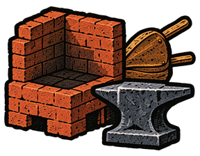

  The bellows are fitted. The furnace needs charcoal before it can smelt the ore.

  ---

- Forge
  - icon: 

  Charcoal fuels the fire, and the bellows supply air to make it burn hotter.

  ---

  Smelting extracts iron from ore; smithing shapes iron that has already been extracted. A smelting furnace controls the fuel, air supply and separation of metal from unwanted material. At Saugus Iron Works, charcoal fuel, bellows and a mineral flux worked together in the blast furnace. An ordinary open smithing hearth is not the same apparatus. [National Park Service: Iron Making—Smelting](https://home.nps.gov/articles/000/iron-making-smelting.htm).

- Charcoal
  - icon: 

  With little air entering the kiln, the heated wood becomes charcoal instead of burning away to ash.

  ---

  Heating wood with very little oxygen breaks down its material while preventing much of the carbon from burning away. Gases escape, leaving a carbon-rich solid: charcoal. This process is called pyrolysis. The result depends on the wood, temperature, time and air supply. Charcoal still contains fuel that can burn when air is admitted; it is not the mineral ash left after that fuel has been consumed. [Virginia Cooperative Extension: how charcoal is made](https://ext.vt.edu/natural-resources/charcoal/charcoalmaking.html).

- Nails
  - icon: 

  The forge heats the iron for hammering into pointed shafts with flat heads. The nails will fasten the chest's planks together.

  ---

  Hand-forged nails begin as iron rod heated in a forge. Hammering draws the end into a point; a heading tool supports the shaft while the head is formed. The smith may reheat the metal during the work. Auckland Museum's account of Roman nails describes this process and the square shafts it produced. [Auckland Museum: For the Want of a Nail](https://www.aucklandmuseum.com/discover/stories/blog/2025/roman-nails).

- Hinge
  - icon: 

  ---

  A hinge joins two parts so that one can swing relative to the other. In a pinned metal hinge, the leaves turn around a shared pin while remaining connected.

- Iron
  - icon: 

  Iron can be shaped into strong cutting edges, fasteners and fittings. It adds new possibilities for tools and construction.

  ---

  Iron's composition affects what a smith can make from it. Wrought iron contains very little carbon and can be forged and bent into fittings such as nails and hinges. Cast iron contains more carbon: molten metal fills a mould, but the cooled casting is generally too brittle to hammer into shape. Steel combines iron with a controlled amount of carbon and may be heat-treated to change its hardness and toughness. A cutting edge and a flexible fastener therefore call for different material properties. [National Park Service: iron and iron alloys](https://www.nps.gov/orgs/1739/upload/book-metals-in-america-part-4.pdf).

- Stone hammer
  - icon: 

  You choose a river-worn cobble as a hand-held hammer. The river has rounded its edges over time.

  ---

  River transport knocks and rubs stones against one another, gradually wearing down sharp edges. A suitably shaped cobble can also serve as a hammerstone, held in the hand to strike another stone. Impact marks on museum examples show where blows landed. Rounding takes repeated abrasion; contact with water does not instantly reshape a stone. [Domokos and colleagues: How River Rocks Round](https://journals.plos.org/plosone/article?id=10.1371%2Fjournal.pone.0088657), [Hackney Museum: Hammerstone](https://museum-collection.hackney.gov.uk/object-1991-637).

- Chisel
  - icon: 

  A hardened cutting edge lets this workshop chisel cut softer metal as well as shape wood.

  ---

  Chisels are made for different materials and jobs. A cold chisel has a metal-cutting edge, unlike a tool intended only for wood. London Museum's iron cold chisel has a tapered, ground edge and was used by tradespeople working metal; shipwrights also used such tools to cut sockets in capstans. [London Museum: iron cold chisel](https://www.londonmuseum.org.uk/collections/v/object-281229/chisel-iron-cold-chisel/).

**Combinations**
- Brick [transform] + Fire -> Kiln
- Stone + Water -> Stone hammer
- Stone hammer @ Iron quarry -> Iron ore
- Cloth [transform] + Air -> Bellows
- Wood [transform] + Kiln -> Charcoal
- Kiln [consume] + Bellows [consume] -> Unfuelled forge
- Charcoal [consume] + Unfuelled forge [transform] -> Forge
- Iron ore [transform] + Forge -> Iron
- Iron [consume] + Wood [consume] -> Pickaxe
- Iron [transform] + Stone -> Chisel
- Iron [transform] + Forge -> Nails
- Iron [consume] + Nails [consume] -> Hinge
- Planks [consume] + Nails [consume] -> Wooden chest
- Stone @ Iron quarry -> Iron ore

> NOTE: Ironworking abstractions: Stone + Water selects a river-worn hammer; quarry actions chip an exposed seam. Iron + Stone includes shaping, hardening and grinding a metal-capable chisel. Saw and nail manufacture include the smith's tools and finishing work. Forge represents the equipped ironworking workshop across smelting and smithing; construction, flux, separation and refining are not separate game steps.

> NOTE: Bellows: Cloth stands for suitably airtight flexible material. Preparing it, fitting boards, valve and nozzle, and sealing joins are implicit. Keep this intentional simplification without adding animals or leather.

## The walled garden

background: 

> NOTE: Scene continuity: Walled garden on our home bank. Same apple trees, low stone wall and cream plaster ochre-thatch cottage at upper right. Bare beds along far upper edge; no supported trellis, greenhouse or irrigation system yet. Wide open earth courtyard.

Our climbing plants need support, and young seedlings need shelter from the weather. We'll make them a greenhouse.

**Goals**
- Make Supported garden -- Supported garden
- Make Greenhouse -- Greenhouse

**Items**
- Supported garden
  - icon: 
- Greenhouse
  - icon: 
- Seedlings
  - icon: 
- Trellis
  - icon: 

**Combinations**
- Oil-bearing seeds [transform] + Water -> Seedlings
- Seedlings + Rope [transform] -> Trellis
- Seedlings [consume] + Trellis [transform] -> Supported garden
- Window [transform] + Seedlings [consume] -> Greenhouse

## Irrigating the garden

background: 

> NOTE: Scene continuity: Garden water bank after the trellis and greenhouse were built. Same home-bank orchard and cottage upper right, low stone wall. Modest wooden trellis and small glass greenhouse now visible along top edge. River runs right to left at upper left. No jar wheel, aqueduct channel or reservoir yet. Large clear ochre earth foreground.

The stream is below the growing beds. Use the current to lift water into a raised basin, then bring it to the garden without carrying every bucket uphill.

**Goals**
- Make a chisel for shaping tools -- Chisel
- next: Cut saw teeth in an iron blade -- Saw
- next: Lift stream water into a reservoir -- Filled reservoir
- next: Carry water to the garden -- Irrigated garden

**Items**
- Irrigated garden
  - icon: 
- Saw
  - icon: 

  The chisel cuts notches along a prepared iron blade. The teeth are sharpened and set slightly outward so the blade can pass through the cut.

  ---

  A saw's teeth cut a groove slightly wider than its blade. Setting the teeth outward gives the blade room to move without binding; sharpening renews their cutting edges. [US War Department: Maintenance and Care of Hand Tools](https://www.govinfo.gov/content/pkg/GOVPUB-W-3ceba03bcf8294abb336ca2b2f1a1385/html/GOVPUB-W-3ceba03bcf8294abb336ca2b2f1a1385.htm).

  Some saw-making machines form teeth by forcing a chisel into the edge of a metal blank. [US patent classification for saw-making machines, subclass 28](https://www.uspto.gov/web/patents/classification/uspc076/defs076.pdf).

- Water pipe
  - icon: 

  The saw cuts the log to length. Boring out its centre makes a wide wooden pipe for carrying water.

  ---

  Wooden water pipes were made by boring a passage through logs and joining the sections. The Agricultural Museum of New Brunswick preserves wooden pipes and couplers from a farm near Belleisle Bay, along with an auger used to bore such pipes. Sawing cuts a log to length; the auger makes the passage through its centre. [Agricultural Museum of New Brunswick: Wooden Water Pipes](https://www.agrmuseumofnb.ca/post/wooden-water-pipes-artifact-986186).

- Reservoir
  - icon: 
- Waterwheel with jars
  - icon: 

  ---

  A water-powered noria carries containers around its rim. The current turns the wheel, dipping each container into the stream and lifting it to empty into a raised trough. Pots, buckets and sections of bamboo have all served as the containers. The wheel lifts the water; gravity carries it onward. [FAO: Water lifting devices, section 3.4.1](https://www.fao.org/4/ah810e/AH810E05.htm).

- Filled reservoir
  - icon: 

  ---

  A raised reservoir stores water above the ground it supplies. Water lifted into the basin can then flow downhill through channels to the growing beds. Lifting and carrying it are separate jobs: the wheel provides the lift, and the height of the water supplies the onward flow. [FAO: Water lifting devices](https://www.fao.org/4/ah810e/AH810E05.htm).
- Water channel
  - icon: 

  The pipe feeds a trough built from planks. Wooden supports hold the trough high enough for water to flow towards the growing beds.

- Irrigation channel
  - icon: 

**Combinations**
- Iron [transform] + Chisel -> Saw
- Saw [preserve] + Wood [transform] -> Water pipe
- Clay [consume] + Brick [consume] -> Reservoir
- Reservoir [transform] + Waterwheel with jars [preserve] -> Filled reservoir
- Water pipe [consume] + Planks [consume] -> Water channel
- Water channel [transform] + Filled reservoir [preserve] -> Irrigation channel
- Irrigation channel [consume] + Supported garden [transform] -> Irrigated garden
- Waterwheel [transform] + Fired glazed jar [consume] -> Waterwheel with jars

> NOTE: Waterwheel with jars: The existing pottery supply represents multiple fired vessels. Attachment and positioning are compressed; no lift height or flow rate is specified.

> NOTE: Saw and Water pipe: Tool-stock preparation, hardening, grinding, fitting a handle, boring and finishing use the established workshop capabilities. The saw cuts the pipe's length; it does not drill its bore. The chisel-tooth source documents machine tooling, not routine early hand manufacture.

## Water and sanitation

background: 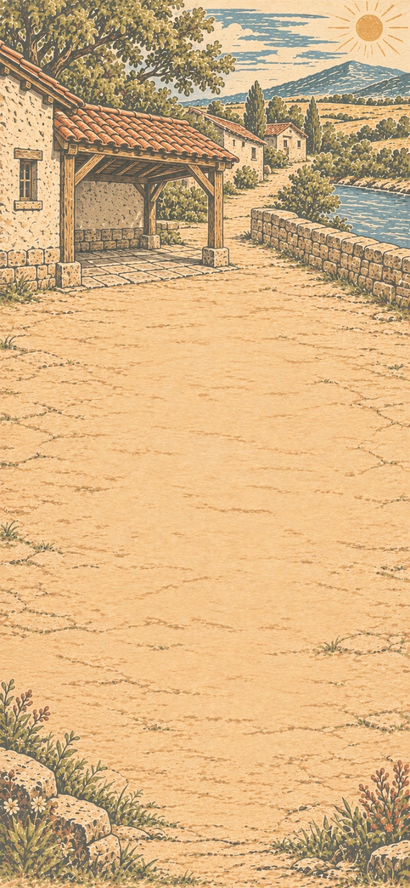

> NOTE: Shared waterworks site before the player constructs drinking-water storage, washstand and drainage.

Riverwater carries dirt with it. Soap and clean water help us stay healthy. We'll make a washing place.

**Goals**
- Prepare covered drinking water -- Covered water jar
- Plumb the washstand -- Washstand
- next: Supply soap for handwashing -- Wash station

**Items**
- Unplumbed washstand
  - icon: 
- Covered water jar
  - icon: 

  The boiled water has cooled. The lid keeps dirt out of the jar.

  ---

  Boiling kills disease-causing microbes, and clean, covered storage helps prevent contamination afterward. Boiling does not remove harmful chemicals. [CDC: household water treatment](https://www.cdc.gov/global-water-sanitation-hygiene/about/about-household-water-treatment.html).

- Filter bed
  - icon: 
- Water filter
  - icon: 

  The water pipe holds the sand and charcoal in layers. Water enters at the top and drips out below.

- Filtered water
  - icon: 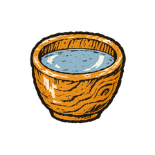

  The water is clearer after filtering. Harmful microbes may remain.

  ---

  A filter can remove suspended dirt without removing all disease-causing microbes. Clear-looking water is not necessarily safe to drink; different filters remove different contaminants. [CDC: choosing water filters](https://www.cdc.gov/drinking-water/prevention/about-choosing-home-water-filters.html).

- Boiled water
  - icon: 

  ---

  Boiling kills disease-causing microbes, but it does not remove harmful chemicals. Treated water can also become contaminated again during handling or storage. [CDC: household water treatment](https://www.cdc.gov/global-water-sanitation-hygiene/about/about-household-water-treatment.html).

- Drinking-water bowl
  - icon: 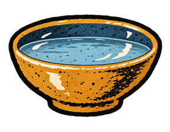

  ---

  The vessel matters as well as the water: pouring treated water into an unclean container can contaminate it again. [CDC: household water treatment](https://www.cdc.gov/global-water-sanitation-hygiene/about/about-household-water-treatment.html).

- Covered clay jar
  - icon: 
- Filled water jar
  - icon: 

  ---

  Clean, covered containers help protect treated water from contamination during storage. Preparing the water and keeping it clean afterward are separate tasks. [CDC: household water treatment](https://www.cdc.gov/global-water-sanitation-hygiene/about/about-household-water-treatment.html).

- Washstand
  - icon: 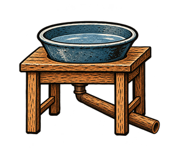

  The pipe carries used wash water away from the stand to a separate disposal area. The covered drinking-water jars stand apart from the washing place.

  ---

  A washstand drain carries used washing water away from the basin. Drainage moves wastewater; it does not treat it. Protecting drinking water also requires safe collection, disposal and treatment of waste beyond the washing place. [WHO: Sanitation](https://www.who.int/news-room/fact-sheets/detail/sanitation).

- Wash station
  - icon: 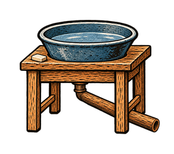

  Soap and water are ready for handwashing.

  ---

- Ash
  - icon: 

  The charcoal burns away, leaving mineral ash.

  ---

  Burning wood releases much of its material as gases, but calcium, potassium, magnesium and other mineral elements remain in the ash. These came from the plant material itself. Ash contains alkaline compounds, including carbonates and oxides, so it changes the chemistry of water or soil that it enters. Its composition varies with the material burned. [Oregon State University Extension: what remains in wood ash](https://extension.oregonstate.edu/news/sweep-wood-ash-fireplace-garden).

- Lye
  - icon: 

  Water draws soluble alkalis from the ash. These react with oil in soap-making. *Lye*

  ---

  Historical soap-makers extracted an alkaline liquid from wood ash with water. At Fort Scott, an ash hopper collected this liquid for soap-making. Lye reacts with fats or oils to form soap; the lye itself is caustic. [National Park Service: Laundress—Making Soap](https://www.nps.gov/fosc/learn/education/laundress7.htm).

- Soap
  - icon: 

  Soap loosens grease and dirt so water can carry them away. The same washing also removes germs that hands can pass to food and to other people.

  ---

  Washing with soap and clean water removes dirt and germs from hands. Rinsing carries away what the washing has loosened. [CDC: hand hygiene](https://www.cdc.gov/clean-hands/faq/).

  Soap is made when fats or oils react with an alkali such as lye. The resulting fatty-acid salts provide its cleaning action. [CPSC: Soap](https://www.cpsc.gov/Business--Manufacturing/Business-Education/Business-Guidance/Soap).

**Combinations**
- Water pipe [consume] + Unplumbed washstand [transform] -> Washstand
- Sand [consume] + Charcoal [consume] -> Filter bed
- Filter bed [consume] + Water pipe [transform] -> Water filter
- Water + Water filter [preserve] -> Filtered water
- Filtered water [transform] + Fire -> Boiled water
- Boiled water [consume] + Fired glazed bowl [consume] -> Drinking-water bowl
- Fired glazed jar [transform] + Jar lid [consume] -> Covered clay jar
- Drinking-water bowl + Covered clay jar [transform] -> Covered water jar
- Fired glazed bowl [consume] + Table [transform] -> Unplumbed washstand
- Boiled water [consume] + Fired glazed jar [transform] -> Filled water jar
- Drinking-water bowl + Fired glazed jar [transform] -> Filled water jar
- Filled water jar [transform] + Jar lid [consume] -> Covered water jar
- Boiled water [consume] + Covered clay jar [transform] -> Covered water jar

> NOTE: Unplumbed washstand: The basin sits on its wooden stand, but the used-water outlet has not yet been fitted.

> NOTE: Water storage and drainage: The bowl remains available after pouring; filling a covered jar includes lifting and replacing its lid. Fitting the drain includes a supported, sloped outlet separated from the drinking supply. No siting or construction specification is supplied.
- Charcoal [transform] + Fire -> Ash
- Ash [transform] + Water -> Lye
- Lye [consume] + Seed oil [consume] -> Soap
- Soap [preserve] + Washstand [transform] -> Wash station

> NOTE: Lye and Soap: Ash leaching, separation and soap-making are compressed material relationships. Do not turn these combinations into a manufacturing procedure.

## Cooking a shared meal

background: 

> NOTE: Scene continuity: Inside the communal kitchen, with the hearth built into the right-hand wall. The wall hearth is background scenery only; cooking uses the movable Stove and its fitted pot.

People working in the fields and workshops need a meal.

**Goals**
- Build a stove and fit a cooking pot -- Cooking stove
- next: Cook porridge and fruit compote
  - both: Porridge
  - and: Fruit compote
- next: Lay a feast table -- Feast table

**Items**
- Porridge
  - icon: 

  ---

  Porridge is grain cooked in water or another liquid until it softens and thickens. A pot holds both the grain and its cooking liquid over the heat.

- Fruit compote
  - icon: 

  ---

  A compote is fruit cooked until it softens in its juices or a syrup. The fruit remains part of the dish rather than being strained away as in a clear juice.

- Feast table
  - icon: 
- Stove
  - icon: 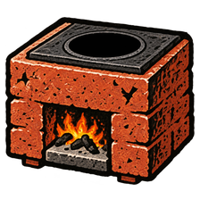
- Cooking stove
  - icon: 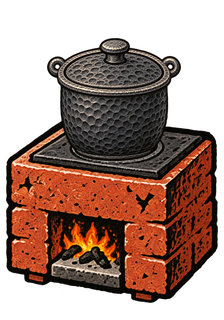

  The pot sits over the fire. Its flat bottom rests on the stove top, keeping it steady while the food cooks.

  ---

- Cooking pot
  - icon: 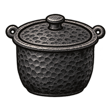

  The iron is heated and worked into a pot with a fitted bottom and handle. It is ready to sit over the stove's fire.

  ---

  Making a pot from worked iron involves shaping the body, fitting a bottom and attaching a handle. The joins must hold liquid as well as support the vessel. Heating helps the metalworker shape the iron; shaping and joining still require tools and skilled work.

- Feast
  - icon: 

**Combinations**
- Brick [consume] + Iron [consume] -> Stove
- Iron [transform] + Stove -> Cooking pot
- Stove [transform] + Cooking pot [consume] -> Cooking stove
- Grain [transform] + Cooking stove -> Porridge
- Fruit [transform] + Cooking stove -> Fruit compote
- Bread [consume] + Fruit [consume] -> Feast
- Feast [consume] + Tiled table [transform] -> Feast table
- Porridge [consume] + Fruit compote [consume] -> Feast

> NOTE: Cooking pot: The stove supplies workshop heat. Use a worked-iron vessel with a fitted bottom and handle, not a cast pot or a transformed glazed bowl.

> NOTE: Feast: Bowls of warm porridge and fruit compote make a meal to share. The bread-and-fruit feast is still welcome, too.

## A dock and sailboat

background: 

> NOTE: Scene continuity: First visit to the wider river landing. Unbuilt bare sandy bank, broad water upper third flowing right to left toward sea. Crooked willow left, low opposite reed bank, no dock or boat yet. Empty broad ochre shore foreground, small sheltered inlet at far right.

This river is good for fishing and trade. A dock and sailboat will let us bring catches and goods ashore.

**Goals**
- Build a dock -- Dock
- Make Sailboat -- Sailboat

**Items**
- Dock
  - icon: 
- Raft
  - icon: 
- Sail
  - icon: 
- Pier post
  - icon: 

- Sailboat
  - icon: 

  The boat can use wind in its sail to move across the water. It carries people, fishing gear and goods along the river.

  ---

  A sailboat does not need the wind directly behind it. The sail's angle changes how the moving air acts on it, allowing the boat to travel across the wind as well as downwind. There is a limit: pointing too close to the wind makes the sail flap instead of drive the boat. Boats capable of working windward reach that direction by alternating between angled courses, called tacks. The useful angles depend on the boat and its rig. [Royal Yachting Association: points of sail](https://www.rya.org.uk/training/do-you-know-your-points-of-sail/).

**Combinations**
- Wood [consume] + Rope [consume] -> Raft
- Cloth [consume] + Rope [consume] -> Sail
- Raft [transform] + Sail [consume] -> Sailboat
- Planks [transform] + Stone hammer -> Pier post
- Pier post [consume] + Planks [consume] -> Dock

## The lighthouse

background: 

> NOTE: Scene continuity: Bare harbour headland before a lighthouse is made. Rocky cape upper right and slate blue sea across upper third, distant curved harbour coast on left. NO tower, lighthouse or mooring buoy. Broad open pale grassy-earth foreground. The hotspot covers the actual grassy cape and cliff at upper right, continuous with the shore.

At the river mouth, boats need to find the harbour after dark. A light above the headland will guide fishing crews and trading vessels towards a sheltered mooring.

**Goals**
- Make an oil lamp for the tower -- Oil lamp
- next: Protect the flame with glass -- Lantern
- next: Light the harbour entrance -- Lighthouse
- Make a buoy for mooring boats -- Mooring buoy

> NOTE: Hotspot **Harbour headland** is centred at (678.6, 350) pixels in the 780×1688 asset. The background itself depicts the actual grassy cape and rock face projecting into the sea at upper right; still without a lighthouse. Its separate 352×480 icon is 100% transparent and defines only the 88×120 hit area on the 390px board. Hover, focus and compatible drags reveal its name and outline; no separate miniature is drawn over the scenery.

**Hotspots**
- Harbour headland (center 678.6px, 350px)
  - icon: 
  - place: Tower (center 702px, 253px)
  - place: Lighthouse (center 702px, 245px)

**Items**
- Harbour headland
- Lighthouse
  - icon: 

  ---

  A lighthouse raises a light above the shore so boats can locate a harbour or recognise a headland after dark. An oil-lit lantern room shelters its flame while allowing air in and hot gases out. The lamp also needs access for refilling and cleaning.

- Mooring buoy
  - icon: 
- Oil-soaked fiber wick
  - icon: 
- Oil lamp
  - icon: 

  The wick draws oil from the bowl to feed the flame.

  ---

  An oil lamp's wick carries liquid through the narrow spaces between its fibres. This capillary action brings oil from the bowl to the flame without a pump. Heat turns oil near the wick's tip into vapour, which burns after mixing with air. The bowl holds the supply; the wick delivers a small amount at a time to the place where it can burn. [Cornell University: the chemical history of a candle and oil lamp](https://labs.plantbio.cornell.edu/wayne/Light%20and%20Life%202016/3515%20Lecture%20Chemical%20History%20of%20a%20candle.pdf).

- Lantern
  - icon: 

  A glass enclosure shelters the oil flame. Openings let air reach the wick and hot gases escape.

- Tower
  - icon: 
- Float
  - icon: 

  ---

  A sealed, empty jar contains air as well as ceramic. It can displace enough water to support its weight, even though a solid lump of the same clay would sink. The seal keeps the water out; a wooden support holds the vessel in place.

**Combinations**
- Oil-soaked fiber wick [consume] + Fired glazed bowl [consume] -> Oil lamp
- Oil lamp [transform] + Glass [consume] -> Lantern
- Brick [consume] + Window [consume] -> Tower
- Tower [transform] + Lantern [consume] @ Harbour headland -> Lighthouse
- Wood [consume] + Fired glazed jar [consume] -> Float
- Float [transform] + Rope [consume] -> Mooring buoy
- Plant fiber [consume] + Seed oil [consume] -> Oil-soaked fiber wick

> NOTE: Lighthouse: The lamp made in this chapter supplies the tower's light; installation includes mounting it inside the tower.

> NOTE: Float: A suitable seal and wooden support are included in the craft action.

## Smoking fish

background: 

> NOTE: Scene continuity: Fishing waters below our harbour. Slate blue sea across top third, distant same pale lighthouse at upper right and harbour curve to left. Low rocks at outer margins, broad empty warm sandy foreground. The hotspot lies out over open water, beyond the beach. No caught fish, salt piles or preserves.

It's time to prepare food for winter. Smoking our fish will help them keep longer.

[If skipped] Smoked fish is ready for storage.

**Goals**
- Make Smoked fish -- Smoked fish

> NOTE: Hotspot **Fishing waters** is centred at (546, 278) pixels in the 780×1688 asset. The receiver lies over open sea beyond the shore. Its separate 496×344 icon is 100% transparent and defines only the 124×86 hit area on the 390px board. Hover, focus and compatible drags reveal its name and outline; no separate miniature is drawn over the scenery.

**Hotspots**
- Fishing waters (center 546px, 278px)
  - icon: 

**Items**
- Fishing waters
- Smoked fish
  - icon: 
- Net
  - icon: 
- Fish
  - icon: 
- Brine
  - icon: 
- Smoke
  - icon: 

- Salt
  - icon: 

**Combinations**
- Thread [consume] + Rope [consume] -> Net
- Net @ Fishing waters -> Fish
- Fired glazed bowl @ Fishing waters -> Brine
- Brine [transform] + Fire -> Salt
- Wood [transform] + Fire -> Smoke
- Smoke [preserve] + Fish [transform] -> Smoked fish

## Storing food for winter

background: 

> NOTE: Scene continuity: Communal dry store: rough plaster and timber rafters, empty wooden shelves against upper wall, earthen ochre floor wide and clear. Small blue daylight window upper left. No finished grain bin or preserve crock yet; furnishings remain at edges.

Fresh fruit won't keep all winter, and grain must be stored dry. We need reserves that will last until the next harvest.

**Goals**
- Build an empty grain bin -- Empty grain bin
- next: Store the grain -- Grain bin
- Dry fruit and store it in a jar -- Fruit crock
- next: Make a jar of pickles -- Pickle jar

**Items**
- Empty grain bin
  - icon: 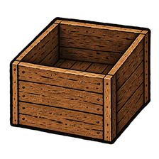
- Grain bin
  - icon: 

  Dry grain fills the bin, ready to take out for milling and cooking.

  ---

- Pickle jar
  - icon: 

  Pickled fruit fills the glazed clay jar. Its lid keeps the contents covered.

  ---

- Vinegar
  - icon: 
- Pickles
  - icon: 

- Fruit crock
  - icon: 
- Drying rack
  - icon: 
- Dried fruit
  - icon: 

**Combinations**
- Planks [consume] + Wooden chest [transform] -> Empty grain bin
- Grain [consume] + Empty grain bin [transform] -> Grain bin
- Planks [consume] + Net [consume] -> Drying rack
- Fruit [transform] + Drying rack [preserve] -> Dried fruit
- Dried fruit [consume] + Covered clay jar [transform] -> Fruit crock
- Cider [transform] + Air -> Vinegar
- Vinegar [consume] + Fruit [consume] -> Pickles
- Pickles [consume] + Fired glazed jar [transform] -> Pickle jar

> NOTE: Pickle jar: Reuse the matching covered ceramic-vessel artwork. The opaque glazed jar does not become transparent glass when filled; lid fitting uses the established vessel closures.

## Dyeing and weaving

background: 

> NOTE: Scene continuity: Village square in autumn. Crooked elm upper left, low communal hall with red tiled roof upper centre, stone wall and empty washing corner at far right. Worn pale ochre paving is open across foreground. No canopy, banner, bandstand or puppet theatre yet.

It's time to celebrate at Harvest Festival! Let's decorate the square with colourful cloths.

**Goals**
- Make Cloth banner -- Cloth banner
- Make Canopy -- Canopy

**Items**
- Cloth banner
  - icon: 
- Canopy
  - icon: 
- Flowers
  - icon: 
- Dye
  - icon: 
- Dyed cloth
  - icon: 
- Loom
  - icon: 
- Dyed thread
  - icon: 

  ---

  Thread can be dyed before weaving, allowing the weaver to choose where each colour appears. In tapestry, coloured weft threads run through a stretched warp to build up areas of colour. [V&A: What is tapestry?](https://www.vam.ac.uk/articles/what-is-tapestry).

- Patterned cloth
  - icon: 

  ---

  A loom holds the lengthwise warp threads under tension while weft threads cross between them. In tapestry weaving, coloured weft threads can turn back partway across the warp, forming separate blocks of colour that make a pattern or picture. [V&A: What is tapestry?](https://www.vam.ac.uk/articles/what-is-tapestry).

- Awning
  - icon: 

**Combinations**
- Plant + Rain -> Flowers
- Flowers [transform] + Water -> Dye
- Cloth [transform] + Dye [consume] -> Dyed cloth
- Dyed cloth [transform] + Wood [consume] -> Cloth banner
- Thread [consume] + Planks [consume] -> Loom
- Loom [preserve] + Dyed thread [transform] -> Patterned cloth
- Patterned cloth [transform] + Wood [consume] -> Cloth banner
- Cloth [consume] + Planks [consume] -> Awning
- Awning [transform] + Rope [consume] -> Canopy
- Thread [transform] + Dye [consume] -> Dyed thread

## Making musical instruments

background: 

> NOTE: Scene continuity: Same village square: crooked elm left, red-tile communal hall upper centre, washing corner right. A rustic cloth canopy and simple coloured bunting now span only the upper edge. No stage or bandstand, no instruments yet. Broad empty pale paving.

There'll be music and dancing at the festival. Make some instruments.

**Goals**
- (three goals are a lot but okay here because flute, drum, and bandstand form one legible music-making scene; the reviewed construction stayed clear and supported optional curiosity with all three goals visible)
- Make Flute -- Flute
- Make Drum -- Drum
- Make Bandstand -- Bandstand

**Items**
- Flute
  - icon: 
- Drum
  - icon: 

  The cloth is stretched tightly across the mouth of the jar to make a drumhead.

  ---

  A struck drumhead bends inward, then its tension pulls it back. The repeated movement sets the surrounding air vibrating. Tightening the same head generally raises its pitch; its size and mass also matter. Several vibration patterns sound together, so a drum need not have one clear musical note. Striking near the centre or near the edge excites those patterns differently, while the drum's body and enclosed air also affect the sound. [Neville Fletcher: the physics of musical instruments, section 12](https://newt.phys.unsw.edu.au/music/people/publications/Fletcher1999a.pdf).

- Bandstand
  - icon: 
- Wooden tube
  - icon: 

  The chisel shapes the wood; boring and smoothing leave a narrow passage through it. This slender tube is suitable for an instrument or a small housing.

- Platform
  - icon: 

**Combinations**
- Wood [transform] + Chisel -> Wooden tube
- Wooden tube [transform] + Air -> Flute
- Cloth [consume] + Clay jar [transform] -> Drum
- Planks [consume] + Brick [consume] -> Platform
- Platform [transform] + Canopy [consume] -> Bandstand

## A puppet theatre

background: 

> NOTE: Scene continuity: Same village square and canopy. A low simple timber bandstand now sits along the upper left edge beneath crooked elm. Communal hall red roof upper centre. No puppet booth or exhibition yet. Clear pale paving foreground.

For the children at the festival, a puppet theatre.

**Goals**
- Make Puppet theatre -- Puppet theatre

**Items**
- Puppet theatre
  - icon: 

  The curtain hides the puppeteers while they move the figures across the stage.

- Puppet
  - icon: 
- Curtain
  - icon: 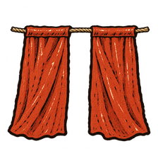

  The rope runs through a folded hem along the top of the dyed cloth. The curtain can slide along it.

- Stage
  - icon: 

**Combinations**
- Wood [consume] + Cloth [consume] -> Puppet
- Dyed cloth [transform] + Rope [consume] -> Curtain
- Curtain [consume] + Platform [transform] -> Stage
- Stage [transform] + Puppet [consume] -> Puppet theatre

## The art studio

background: 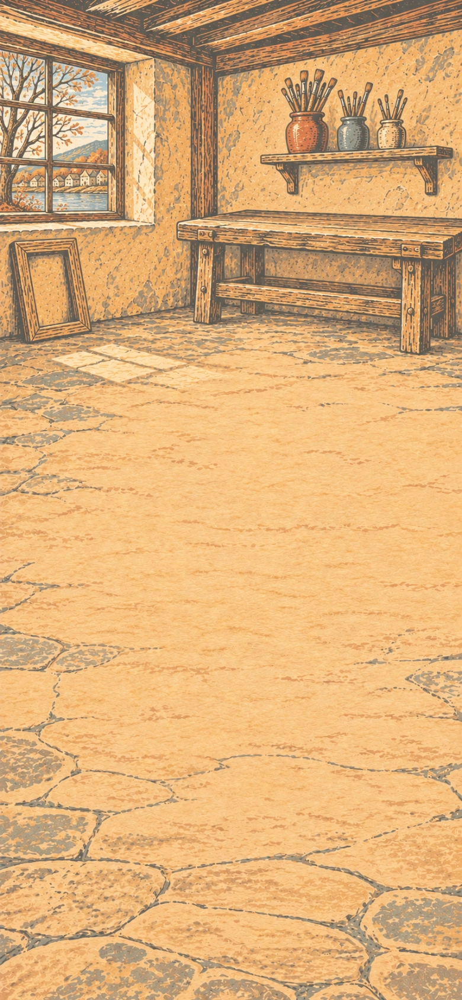

After the festival, some of us turn to art and craft.

**Goals**
- Paint a picture -- Picture
- Make a mosaic -- Mosaic

**Items**
- Paper pulp
  - icon: 
- Paper
  - icon: 
- Paint
  - icon: 
- Picture
  - icon: 
- Brush
  - icon: 
- Mosaic
  - icon: 

  Coloured glass pieces are set into clay to make a picture.

  ---

  A mosaic makes an image from separate pieces of stone, ceramic or glass, called tesserae. Their colours form the shading, while their size and arrangement determine how finely an outline can be drawn. Roman mosaicists used very small pieces for painterly detail and glass for colours difficult to obtain from stone. Pieces set in mortar became part of a floor or wall; the supporting bed held the many small parts together. [Getty Museum: Roman mosaic materials and techniques](https://www.getty.edu/publications/romanmosaics/introduction/).

- Mosaic pieces
  - icon: 

**Combinations**
- Plant fiber [transform] + Water -> Paper pulp
- Paper pulp [transform] + Cloth -> Paper
- Dye [transform] + Fired glazed bowl -> Paint
- Plant fiber [consume] + Wooden tube [consume] -> Brush
- Paint [consume] + Paper [consume] -> Picture
- Glass [transform] + Stone -> Mosaic pieces
- Mosaic pieces [consume] + Clay [consume] -> Mosaic

## The mechanical workshop

background: 

A press can make copies of our pictures. Gears and a pendulum give us another project: a clock.

**Goals**
- Build a printing press -- Printing press
- next: Print a page -- Printed pages
- Make a clock -- Clock

**Items**
- Ink
  - icon: 
- Printing block
  - icon: 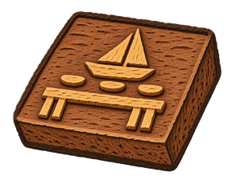
- Printing press
  - icon: 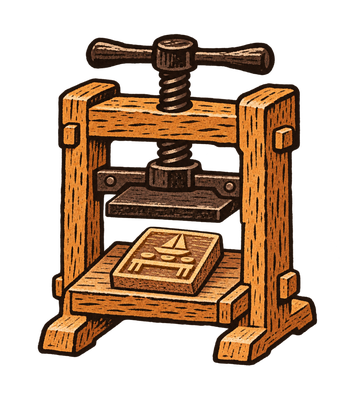

  The carved block sits in a timber frame beneath an iron screw. Turning the screw lowers a flat plate, pressing paper against the inked block; lifting it makes room for another sheet.

  ---

  A wooden screw press holds the printing surface and paper between flat plates. Turning a heavy iron screw supplies the pressure needed to transfer the ink. The frame, bed and guides keep the parts aligned. [Chetham's Library's wooden press](https://library.chethams.com/collections/101-treasures-of-chethams/wooden-printing-press/) shows this construction.

  A carved relief block prints from the areas left standing above the cut-away background. The whole image remains on one block; movable type instead uses separate pieces that can be rearranged.

- Uninked press (exclusive with Inked press)
  - icon: 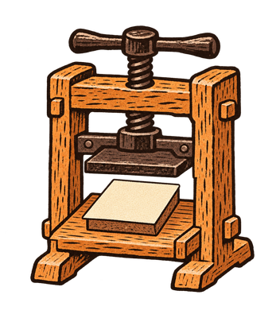

  Paper is ready in the press, but the carved block still needs ink. Lift the sheet while inking the block, then lower it for printing.

  ---

- Inked press (exclusive with Uninked press)
  - icon: 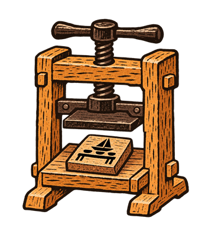

  Ink coats the raised surface of the carved block. The press is ready for a sheet of paper.

  ---

- Printed pages
  - icon: 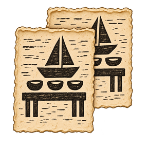

  The same illustration appears on each sheet. Leave the prints flat to dry before hanging them up.

  ---

  Printing transfers ink from a prepared surface onto paper. Each copy needs fresh inking, careful placement of the sheet, pressure and removal of the finished print. The page must dry before it can be handled freely.

  At the [Museum Plantin-Moretus printing workshop](https://museumplantinmoretus.be/en/seeing-doing/museum/printing-workshop), printers inked assembled type and fastened prepared paper in place before pressing it. A carved image and a page of type use different printing surfaces, but both need this control of ink, paper and pressure.

- Pendulum
  - icon: 
- Clockwork
  - icon: 

  ---

  A mechanical clock needs a source of power, gears to transmit motion, and an escapement to release that motion a little at a time. In a pendulum clock, the escapement also gives the pendulum small pushes to keep it swinging. The pendulum regulates the mechanism; it does not supply its power.

  The [Science Museum's model of Galileo's clock design](https://collection.sciencemuseumgroup.org.uk/objects/co8593065/model-of-a-pendulum-clock-based-on-galileos-design) illustrates the difficulty: the clock must keep the pendulum moving without disturbing the regular swing that it uses to measure time.

- Clock
  - icon: 

  The clock's gears count the pendulum's swings and move the hands around the dial.

  ---

  A pendulum clock measures time by counting repeated swings. Gears turn that count into the movement of hands around a dial. Adjusting the pendulum changes its rate, so the clock can be checked against a reference and corrected. [NIST: how clocks work](https://www.nist.gov/pml/time-and-frequency-division/timekeeping-and-clocks-faqs).

- Hourglass
  - icon: 

  ---

  An hourglass has two glass bulbs joined by a narrow neck. Dry grains pass from the upper bulb to the lower one. The amount of material and the rate of flow determine the interval; the finished glass must be timed before it can serve as a reliable measure.

**Combinations**
- Charcoal [transform] + Water -> Ink
- Chisel + Planks [transform] -> Printing block
- Printing block [transform] + Iron [consume] -> Printing press
- Printing press [transform] + Paper [consume] -> Uninked press
- Printing press [transform] + Ink [consume] -> Inked press
- Uninked press [transform] + Ink [consume] -> Printed pages
- Inked press [transform] + Paper [consume] -> Printed pages

> NOTE: Printing press: The frame draws on the established plank supply; thread cutting, jointing and finishing use the existing woodworking and forge capabilities. The carved block remains a relief surface, not movable type. These omitted craft steps do not need additional inventory items.

> NOTE: Partial press states: Uninked press means paper prepared without ink; Inked press means ink prepared without paper. They are alternative first preparations of the same machine, not competing inventions. Both routes end in the same printing operation and printed output. The completed press retires from the working inventory after the operation; it is not a material turned into paper. Inking, paper handling, pressure and lifting the printed sheet remain compressed into the final combination.

- Sand [consume] + Glass bottle [transform] -> Hourglass
- Stone [consume] + Rope [consume] -> Pendulum
- Pendulum [consume] + Wooden gear [consume] -> Clockwork
- Clockwork [transform] + Planks [consume] -> Clock

> NOTE: Hourglass: Reshaping, joining, sealing and timing the glass bulbs remain one craft action. Preserve the glass input; an opaque ceramic jar is not an hourglass.

> NOTE: Clockwork: Power, gearing and escapement remain one craft abstraction. The finished clock is a land-based pendulum clock, not a marine chronometer.

## Identifying plants

background: 

> NOTE: Scene continuity: Botanical visit to our home-bank orchard. Same cottage, stone wall, apple trees, supported trellis and small greenhouse persist across top. A simple wooden irrigation trough and jar-lifting wheel now work at upper left by right-to-left river. Open earth clearing foreground; no botanical books pre-placed.

Some of us turn to studying the world around us. We're fascinated by the plants. *Botany*.

**Goals**
- Press a plant specimen -- Pressed plant specimen
- Draw the leaf -- Botanical drawing

**Items**
- Pressed plant specimen
  - icon: 

  ---

  Pressing and drying a plant preserves material that can be examined after its growing season. Mounted specimens keep leaves, stems and sometimes flowers together for comparison. Loose sheets can be rearranged as a collection grows. [Kew's history of plants in books](https://www.kew.org/read-and-watch/a-brief-history-of-plants-in-books) describes the move from bound plant albums to the separate sheets used in herbaria today.
- Leaf study
  - icon: 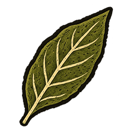
- Botanical drawing
  - icon: 

  ---

  A botanical drawing records the features used to compare plants: leaf outline, veins, stem and flower structure. Drawing a detail larger than life can make it easier to examine. A drawing and a pressed specimen preserve different evidence: one records what the observer selected to show, while the other retains the plant material itself.

**Combinations**
- Plant + Paper [transform] -> Pressed plant specimen
- Lens + Plant -> Leaf study
- Leaf study [consume] + Paper [transform] -> Botanical drawing

> NOTE: Botanical records remain separate until binding. Pressing, drying and mounting are included in the specimen operation; drawing uses the workshop's existing ink without another preparation step.

## Examining pond water

background: 

> NOTE: Scene continuity: Quiet close view of the mill pond. The SAME rust-red timber mill and now working wooden waterwheel stand far upper left, pond water across upper third runs right to left, rushes at far right. Wide pale dry earth foreground. The hotspot follows real pond water beside the right-hand rushes; no microscope or study instruments.

We want to look closer at our world. *Microscopes*.

**Goals**
- Examine pond slide -- Pond life study

> NOTE: Hotspot **Mill pond** is centred at (74%, 28%) from the background’s top-left: (577, 473) pixels in the 780×1688 asset. The background itself depicts the mill pond water between the working wheel and the right-hand rushes. Its separate 416×320 icon is 100% transparent and defines only the 104×80 hit area on the 390px board. Hover, focus and compatible drags reveal its name and outline; no separate miniature is drawn over the scenery.

**Hotspots**
- Mill pond (center 577.2px, 472.64px)
  - icon: 

**Items**
- Mill pond
- Lens
  - icon: 

  The sand acts as grinding grit. The glass is worked against a curved tool, then polished with finer abrasives until the lens is clear.

  ---

  A lens maker grinds a glass blank against a tool with a chosen curve. Abrasive grains remove glass between the two surfaces; much finer powders then polish away the grinding marks. The curve and the clear surface both matter to the image. [Museo Galileo: lens-making](https://catalogue.museogalileo.it/multimedia/LensmakingBis.html) describes this work with damp emery and curved metal tools.

- Magnifier
  - icon: 
- Telescope
  - icon: 
- Pond water
  - icon: 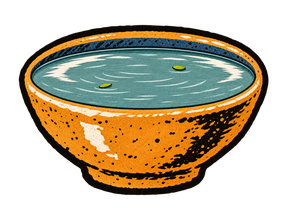
- Pond slide
  - icon: 

  ---

  A microscope slide supports a thin layer of material on clear glass. A small drop of pond water spreads the sample out so that light can pass through it and individual details can be brought into focus.

- Microscope
  - icon: 

  The microscope reveals details too small for unaided sight. A prepared pond-water sample can now be examined for tiny living things.

  ---

  A compound microscope enlarges an image in two stages. The objective lens near the specimen forms a magnified image; the eyepiece enlarges that image for the observer. Focusing adjusts the distance between specimen and objective until the detail becomes sharp, and illumination supplies the light from which the image is made. A larger image is not necessarily a more detailed one: beyond the lenses' resolving ability, extra magnification only enlarges the blur. [University of Maryland: principles of light microscopy](https://www.science.umd.edu/CBMG/faculty/wolniak/wolniakmicro.html), [Nikon: useful magnification](https://www.microscopyu.com/microscopy-basics/useful-magnification-range).

- Pond life study
  - icon: 

  You bring the drop into focus. Green specks drift past; a transparent swimmer turns, then slips out of view. You sketch the shapes and movements on a loose sheet.

  ---

  Notes and sketches can record a microscopic organism's outline, internal features and movement. These observations can guide a comparison with identified specimens, but a quick look at a few shapes is not enough to establish a species. Examining pond life also does not establish whether the water is safe to drink.

**Combinations**
- Glass [transform] + Sand -> Lens
- Lens [consume] + Wood [consume] -> Magnifier
- Lens [consume] + Wooden tube [consume] -> Telescope
- Magnifier [consume] + Telescope [consume] -> Microscope
- Fired glazed bowl @ Mill pond -> Pond water
- Pond slide [preserve] + Microscope [preserve] -> Pond life study
- Pond water [consume] + Glass [transform] -> Pond slide

> NOTE: Lens: Sand stands for selected grinding grit; the shaped tool, finer abrasives and polishing remain part of this single craft operation.

> NOTE: Pond life study: Keep the observation illustrative and fictional; the depicted swimmer does not claim a species identification.

> NOTE: Pond slide: Accept the player's direct sample-on-glass action; cutting and finishing the support are included in preparing the sample.

> NOTE: Pond life study is the illustrated observation sheet itself. Sketching with the studio’s paper and ink is included in the observation, avoiding a second paper record of the same study.

## Watching the weather

background: 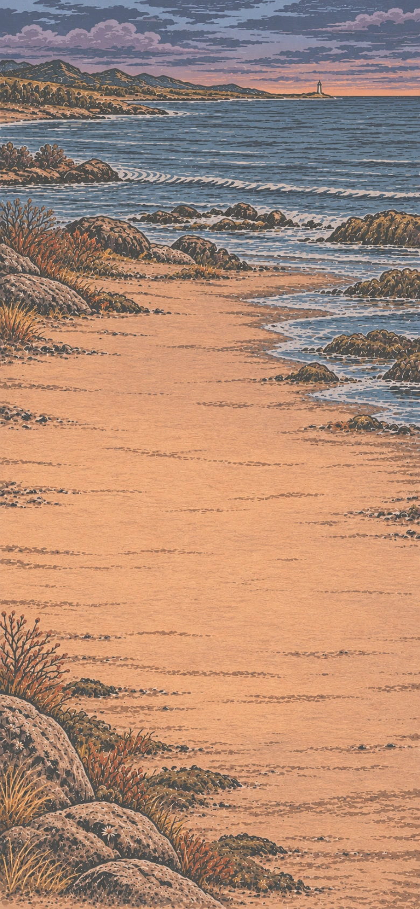

We want to learn about the seasons and weather. *Meteorology*.

**Goals**
- Record the rainfall -- Rain record
- Record the wind -- Wind record

**Items**
- Collected rain level
  - icon: 
- Windsock
  - icon: 
- Rain record
  - icon: 

  ---

  A rain record becomes useful when the observations can be compared. Keeping the same collector in the same place and reading it after equal intervals makes the entries more consistent. The vessel is emptied after each reading so the next entry covers a fresh interval. The [Met Office's rain-gauge guide](https://weather.metoffice.gov.uk/learn-about/met-office-for-schools/other-content/other-resources/weather-station/rain-gauge) recommends checking at the same time each day and writing down the result.
- Wind record
  - icon: 

  ---

  A wind record notes the windsock's direction and how far it lifts at each observation. Recording the time makes it possible to compare these changes with rain collected during the same period.

- Clear collector with level marks
  - icon: 

  Rainfall can now be recorded and compared from one observation to the next. Water levels from equal collection periods in the same vessel reveal wetter and drier spells, helping people build a record of changing weather.

  ---

  A clear rain collector lets the observer read the water level against marks fixed beside it. Repeated readings in the same vessel can show wetter and drier periods. An arbitrary bottle scale does not, by itself, measure rainfall depth: the collector's shape and opening must be accounted for. The [Met Office's simple rain gauge](https://weather.metoffice.gov.uk/learn-about/met-office-for-schools/other-content/other-resources/weather-station/rain-gauge) uses a prepared base and measured scale rather than uncalibrated marks.

- Rainfall station
  - icon: 

  The marked collector stands beside the clock. The vessel is checked and emptied after each equal collection period.

  ---

**Combinations**
- Clear collector with level marks [transform] + Clock [preserve] -> Rainfall station
- Glass bottle [transform] + Paper [consume] -> Clear collector with level marks
- Rainfall station [transform] + Rain -> Collected rain level
- Cloth [consume] + Wooden tube [consume] -> Windsock
- Paper [transform] + Collected rain level [preserve] -> Rain record
- Windsock [preserve] + Paper [transform] -> Wind record

> NOTE: Weather observations: The collector measures relative fill levels, not calibrated rainfall depth. Checking and emptying after each interval are included in observation; the clock is set up before collection. Keep the marked strip beside the clear bottle so the water level remains visible.

## Charting the stars

background: 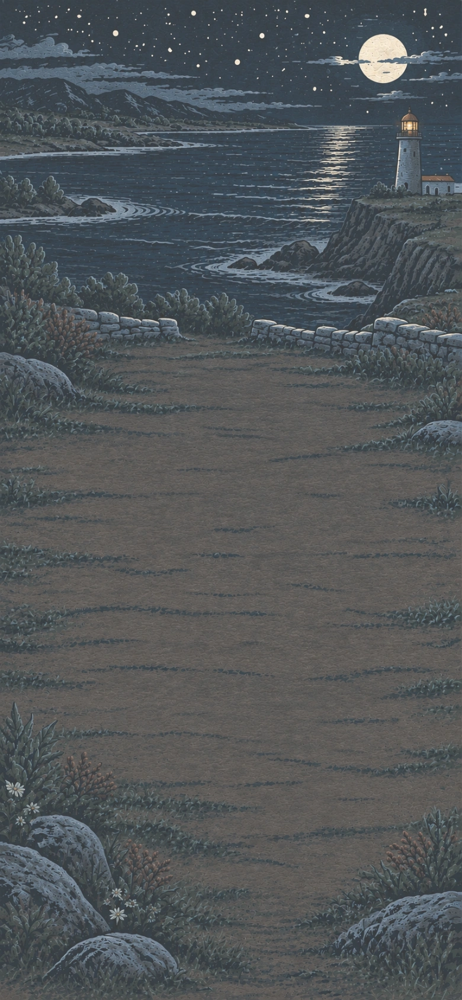

> NOTE: Scene continuity: Same lighthouse headland under a starry sky. Familiar pale stone lighthouse with ochre roof at upper right, harbour curve left. Rich slate-indigo sky with many simple star cuts across top third, no constellations drawn. Broad pale moonlit ochre forecourt remains spacious and readable. No telescope or tripod yet.

Out here under the night sky, we are drawn to study the stars. *Astronomy*.

**Goals**
- Make Mounted telescope -- Mounted telescope
- next: Chart the stars -- Star chart

**Items**
- Mounted telescope
  - icon: 
- Star chart
  - icon: 

  The chart records the positions of the stars seen through the telescope.

  ---

  A star chart maps stars relative to one another, letting an observer match a familiar pattern and locate less obvious objects nearby. The same chart is not a picture of every night's horizon: Earth turns during the night, and its orbit changes which direction the night side faces through the year. Location also matters. A rotating star map, or planisphere, selects the visible part for a date, time and latitude. [NASA: constellations and the changing sky](https://spaceplace.nasa.gov/constellations/en/), [Astronomical Society of Southern Africa: planispheres](https://assa.saao.ac.za/how-to-observe/getting-started/planisphere/).

- Tripod
  - icon: 

**Combinations**
- Planks [consume] + Hinge [consume] -> Tripod
- Telescope [transform] + Tripod [consume] -> Mounted telescope
- Mounted telescope [preserve] + Paper [transform] -> Star chart

## An encyclopedia

background: 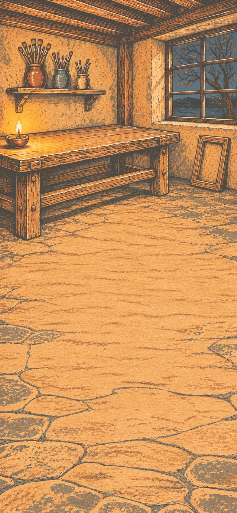

We'll compile all that we've learned into an encyclopedia.

**Goals**
- Gather the artwork and studies -- Binding boards[Printed pages, Pressed plant specimen, Botanical drawing, Pond life study, Rain record, Wind record, Star chart]
- next: Bind the encyclopedia -- Encyclopedia

**Hotspots**
- Binding table (center 330px, 465px)
  - icon: 
  - hitbox: (center 330px, 430px) (size 320px, 213px)
- Binding boards (center 330px, 430px)
- Encyclopedia (center 330px, 430px)

**Items**
- Binding table
- Binding boards (compound)
  - icon: 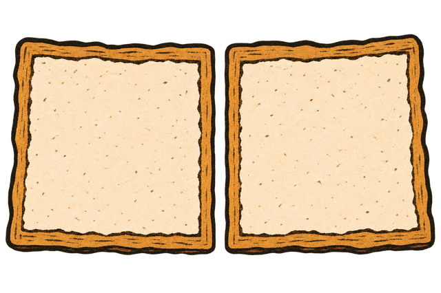
  - slot: Art, accepts Printed pages, icon: 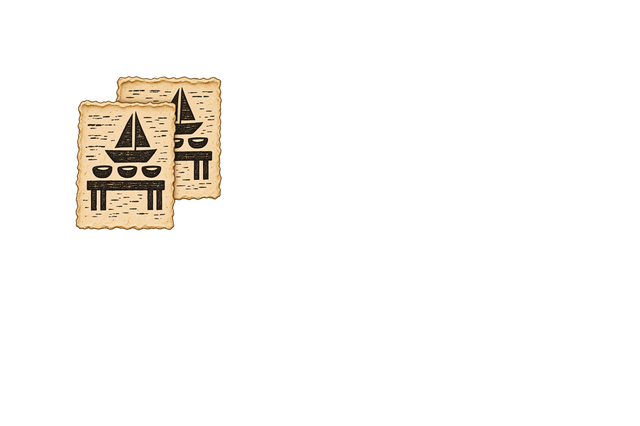
  - slot: Specimen, accepts Pressed plant specimen, icon: 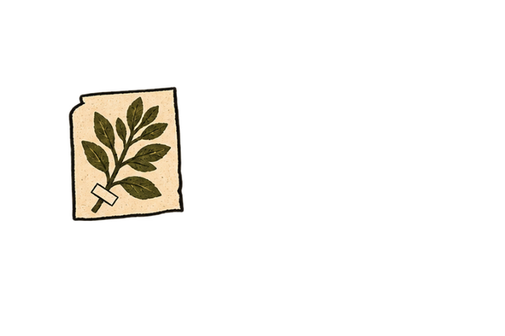
  - slot: Drawing, accepts Botanical drawing, icon: 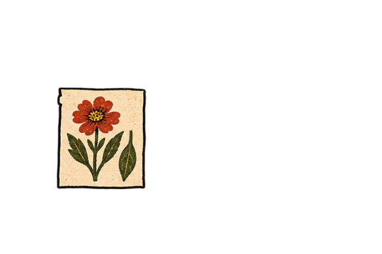
  - slot: Pond life, accepts Pond life study, icon: 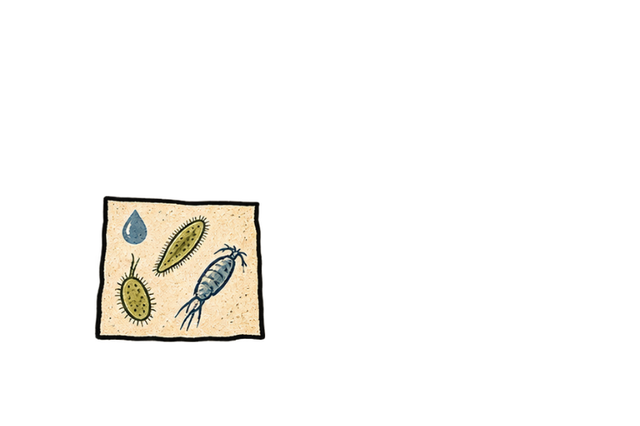
  - slot: Rain, accepts Rain record, icon: 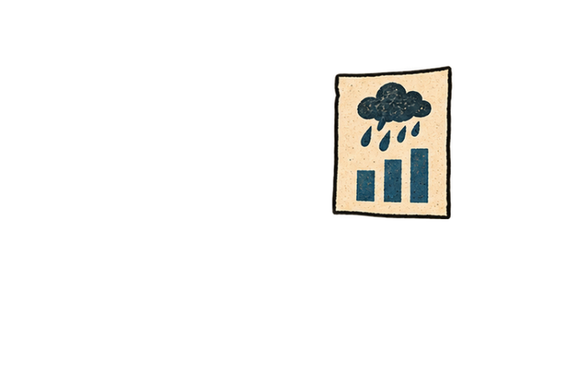
  - slot: Wind, accepts Wind record, icon: 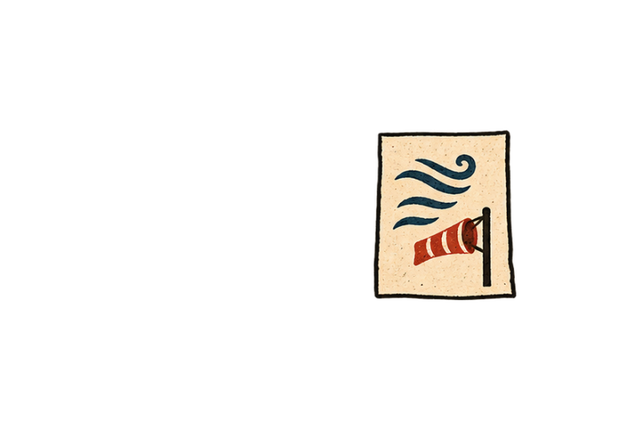
  - slot: Stars, accepts Star chart, icon: 

  The lined wooden boards are ready to hold the loose sheets.

  ---

  Wooden boards were used as stiff book covers before lighter paper boards became common. Paper leaves at the front and back helped attach and protect the text block; a leaf pasted to the inside of a cover is called a pastedown. [Conservation Center for Art & Historic Artifacts: book structure](https://ccaha.org/sites/default/files/attachments/2018-05/Illustrated%20Guide%20to%20Book%20Terminology%20Part%20One.pdf).

- Encyclopedia
  - icon: 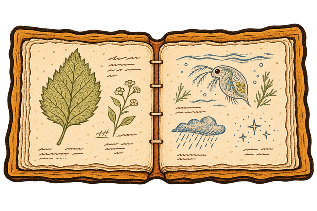

  Here in this book is all we have learned.

  ---

  An encyclopedia divides knowledge into named entries that readers can look up separately. An index gathers references to a subject even when it appears under several headings; cross-references connect related entries. Diderot and d'Alembert's Encyclopédie used these connections extensively, though some pointed to articles that were never written. Checking the references is part of making the collection usable. [University of Chicago: editing the Encyclopédie](https://encyclopedie.uchicago.edu/editors-introduction).

  Binding gives those arranged pages a durable form. Folded sheets are gathered into sections and sewn through their folds; sewing supports can attach the text block to wooden covers while allowing it to open. [Conservation Center for Art & Historic Artifacts: book structure](https://ccaha.org/sites/default/files/attachments/2018-05/Illustrated%20Guide%20to%20Book%20Terminology%20Part%20One.pdf).

**Combinations**
- Paper [consume] + Planks [transform] @ Binding table -> Binding boards
- Binding boards[Printed pages, Pressed plant specimen, Botanical drawing, Pond life study, Rain record, Wind record, Star chart] [transform] + Thread [consume] -> Encyclopedia

> NOTE: Encyclopedia: Seven separate contributions fit directly in any order. No botanical or weather bundle is made earlier. The printed artwork supplies arts and culture without inserting a new record-making errand into the festival. Binding returns to the studio from a different angle at night, with an oil lamp; the table is a workspace gate preventing early binding during the investigations. Cutting, folding, attaching boards and sewing remain one craft action. The first volume represents the settlement's accumulated work, not exhaustive human knowledge.

## The End

background: 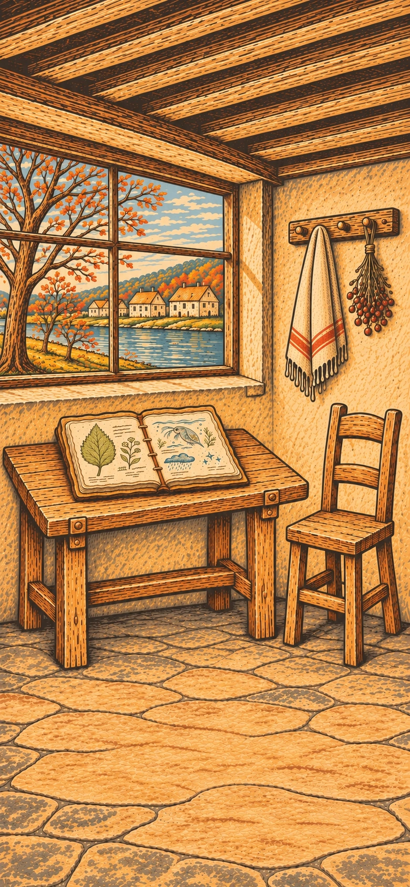

We have founded a settlement. We leave this record for our descendants.
